# Phase 10 — Infrastructure, Component Wiring, and Routing Evolution

This document explains how the Phase 10 workflow components are loaded, connected, routed, stored, and exposed inside the CloudDesk application. It begins with the Phase 9 baseline and follows P10-1 through P10-6.

## What exists in Phase 10

Phase 10 adds workflow orchestration and observability to the existing FastAPI application. It does not add Docker images or Compose containers. CloudDesk is still running as a Python application process with an optional frontend process outside the current container implementation.

| Component              | Infrastructure role at the end of Phase 10                                     |
| ---------------------- | ------------------------------------------------------------------------------ |
| FastAPI                | Receives HTTP requests and starts or reads workflow runs                       |
| Ticket API routes      | Provides run, status, and events endpoints                                     |
| `WorkflowService`      | Creates runs, starts graphs in background tasks, saves state, and reads status |
| LangGraph `StateGraph` | Coordinates named workflow nodes and conditional routing                       |
| `SupportState`         | Carries the ticket and specialist findings through the graph                   |
| Checkpointer           | Preserves resumable workflow state in memory or SQLite                         |
| SQLAlchemy             | Persists workflow runs and events                                              |
| SQLite or PostgreSQL   | Stores the workflow database and event history                                 |
| `WorkflowTracer`       | Writes safe node, tool, model, error, and completion events                    |
| BackgroundTasks        | Starts workflow execution after the API returns 202                            |
| Docker / Compose       | Not implemented yet; no container network is active in Phase 10                |

## Subtask evolution

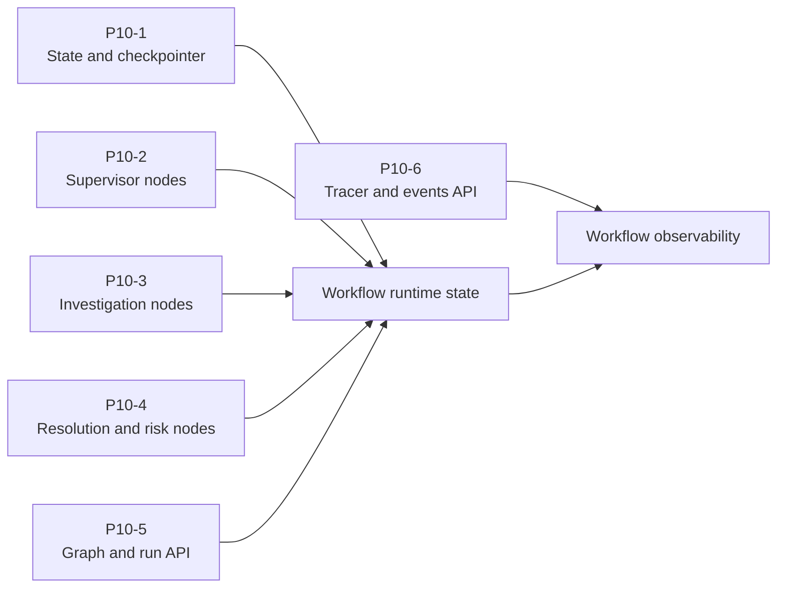

## Starting point — Phase 9 application process

At the start of Phase 10, CloudDesk has specialist Python classes but no complete workflow path. The application already has FastAPI routing, SQLAlchemy session management, tickets, repositories, tools, guardrails, memory facades, knowledge retrieval, and mock integrations.

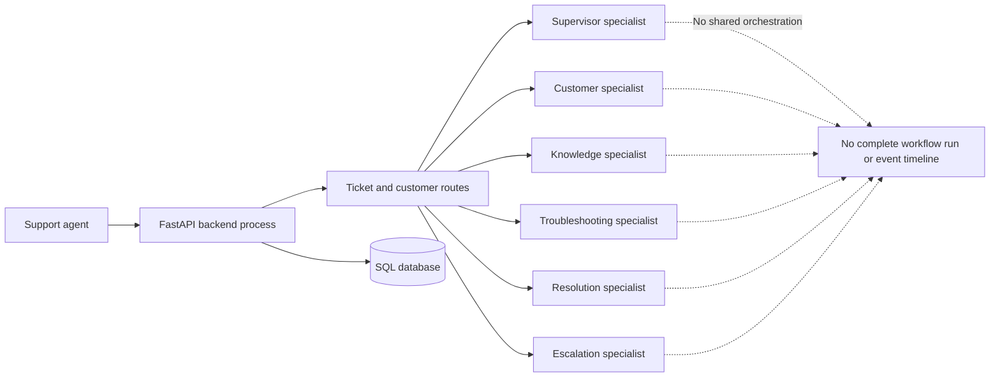

### Starting limitations

- A caller would need to decide when to execute each specialist.
- Specialist outputs are not carried by one complete named workflow state.
- A paused or interrupted workflow has no public graph lifecycle through P10-5.
- Workflow runs and node events are not yet the center of routing.
- Operators cannot inspect one chronological workflow timeline.

Phase 10 introduces LangGraph as the in-process coordinator and HTTP routes as the external control boundary.

## Component map at the end of Phase 10

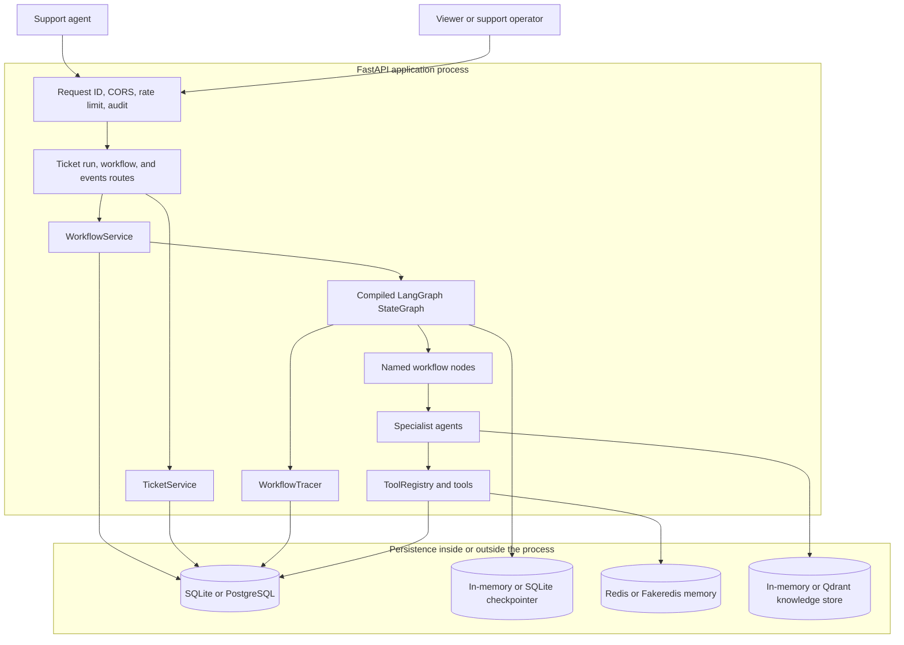

### Networking boundary

At this stage, CloudDesk is not deployed as a Docker network. The main process boundary is:

```text
Browser or API client
  → FastAPI process on the configured port
  → in-process LangGraph graph
  → SQLAlchemy database session
  → optional Redis, knowledge store, checkpointer, and mock integrations
```

This is a process-level architecture. Docker service names and container ports belong to a later Compose or deployment design.

## P10-1 — State and checkpointer wiring

P10-1 introduces `SupportState` and `create_checkpointer()`.

### Component wiring

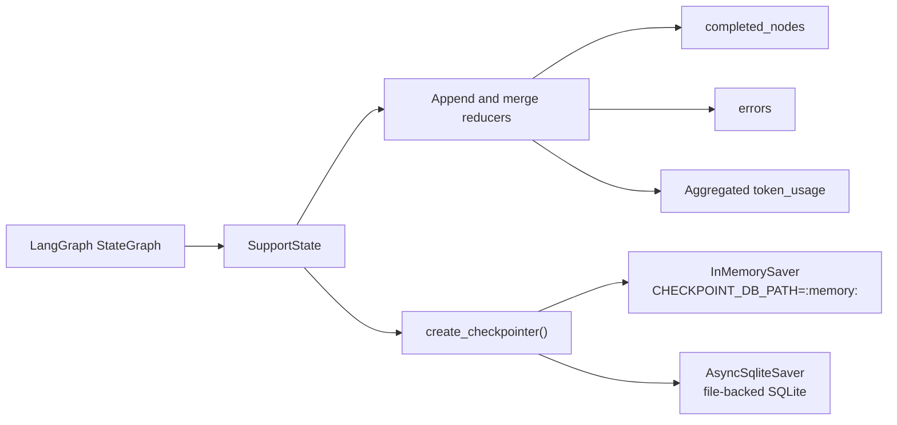

The state is the shared working memory for the graph. The checkpointer is the resumable execution memory for the graph.

### State persistence versus checkpoint persistence

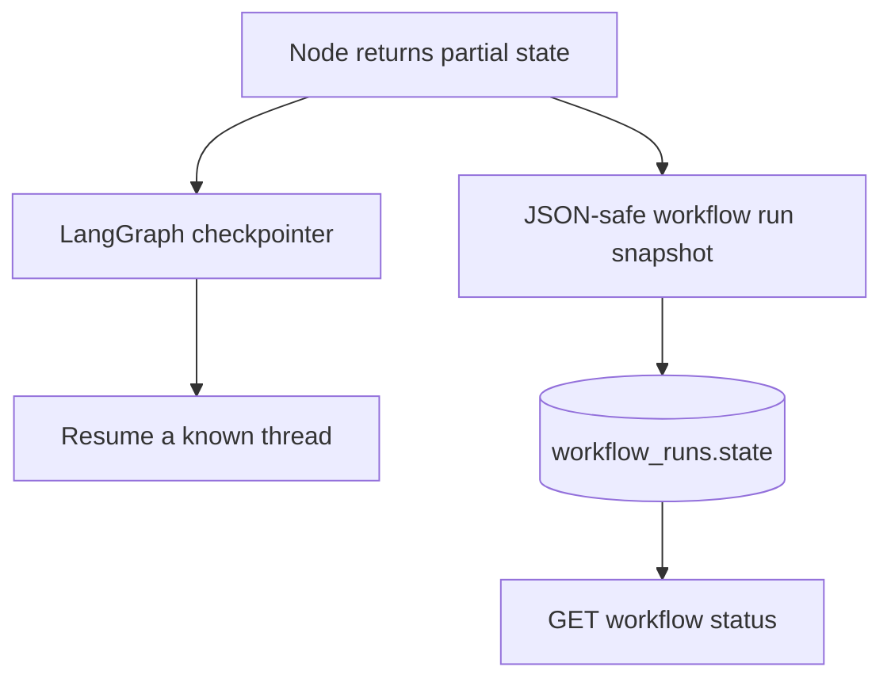

Runtime objects such as `ToolRegistry`, AI providers, and memory service objects are not copied into these persisted structures. They are execution dependencies that are kept outside the database snapshot.

### Infrastructure choice

- Tests and local one-off runs can use `:memory:` checkpointer storage.
- A file-backed SQLite checkpointer preserves state across process restarts.
- The application database may use SQLite or PostgreSQL independently of checkpoint storage.

## P10-2 — Supervisor node wiring

P10-2 adds the first graph stages:

```text
understand_ticket
  → classify_severity
  → ticket_summary
```

### Process routing

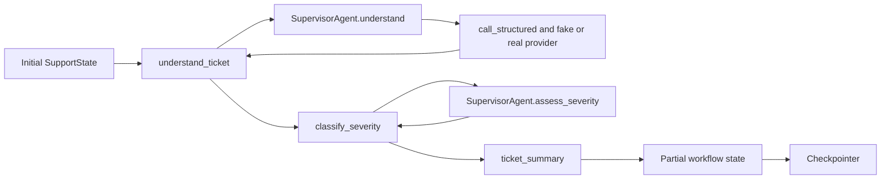

The nodes run inside the LangGraph graph, not as separate network services. They share Python memory and call existing specialist components.

### Subtask routing boundary

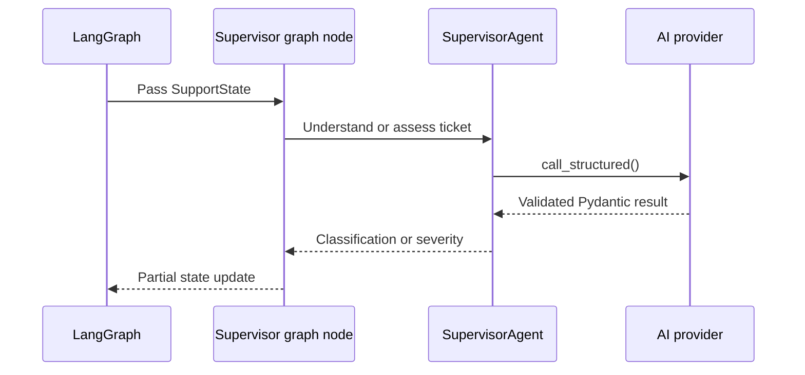

No additional HTTP calls or containers are required for this stage.

## P10-3 — Investigation node wiring

P10-3 adds three graph stages:

```text
customer_context
  → knowledge_retrieval
  → troubleshooting
```

### Component wiring

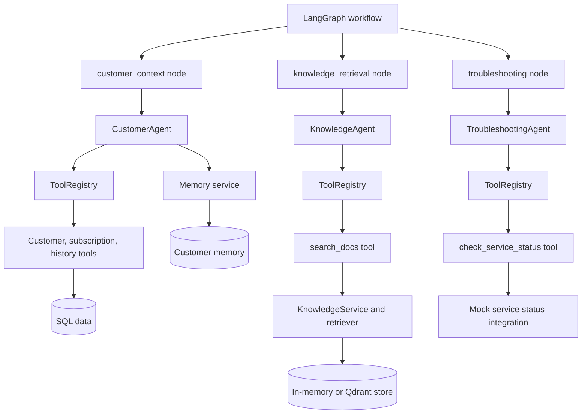

### Routing sequence

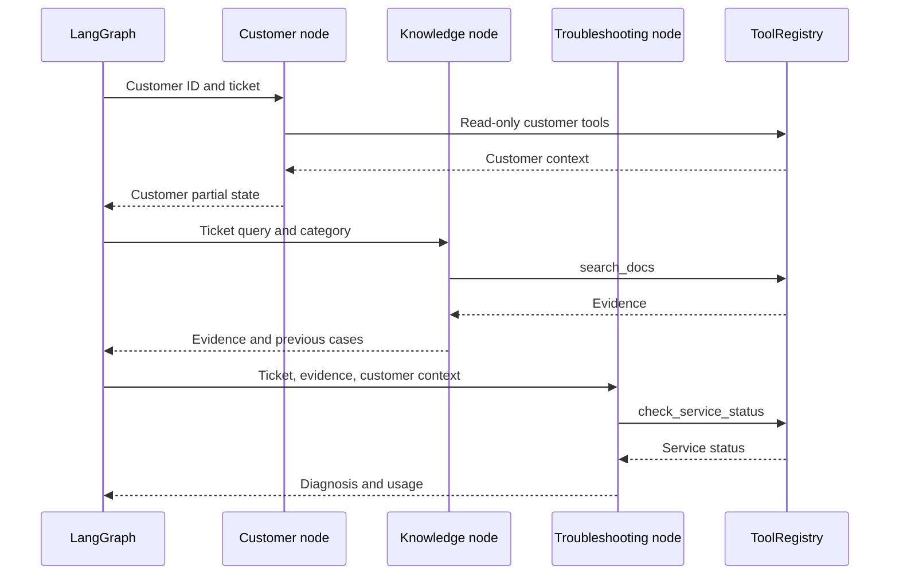

If a tool fails or is unavailable, the node returns partial state and an error record. The graph can continue to later stages instead of losing the entire workflow.

## P10-4 — Resolution and risk node wiring

P10-4 adds:

```text
resolution_planning
  → risk_check
```

### Resolution component route

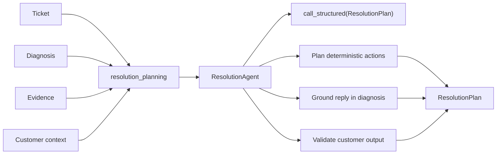

### Risk routing

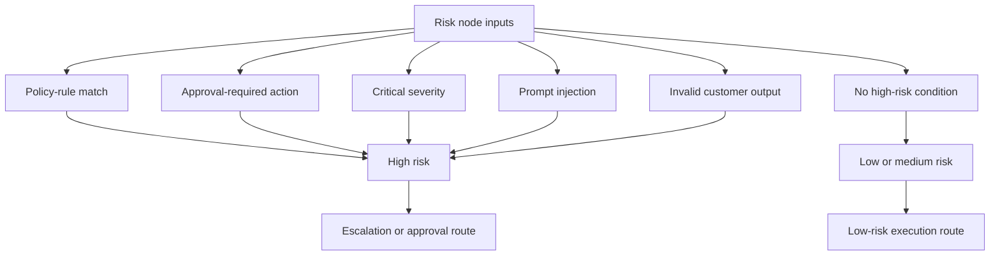

There is no real money or account action in P10-4. The resolution node creates an approval-required action proposal. Actual execution belongs to the later shared tool phase.

## P10-5 — Graph wiring and run API

P10-5 is the main infrastructure step in Phase 10.

### Final process route

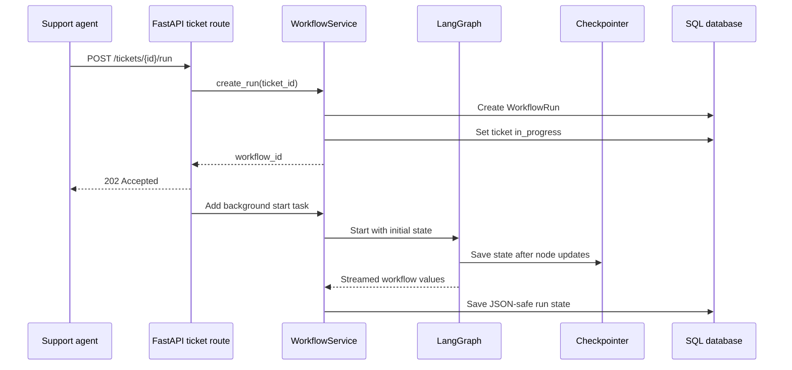

### Graph route

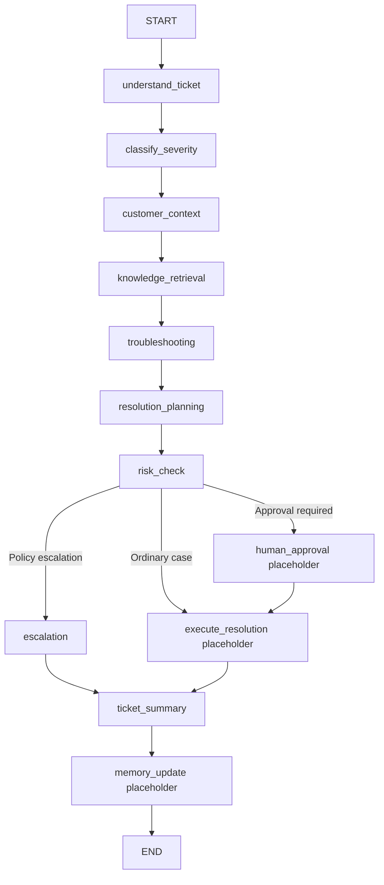

### Status routing

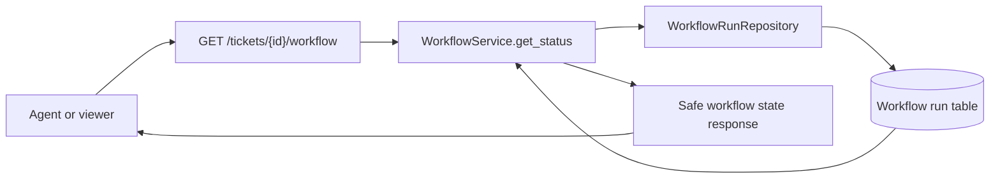

Starting a second run while a workflow is paused is blocked with HTTP 409. The same conflict rule protects approval and resume behavior from duplicate starts.

### Background execution

The API has two responsibilities:

1. create the workflow record immediately;
2. schedule graph execution in FastAPI `BackgroundTasks`.

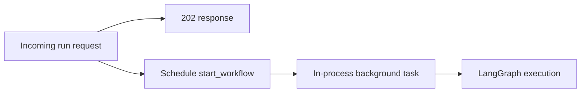

In Phase 10, background work is still in-process. There is no separate worker service or message queue.

## P10-6 — Workflow tracer and events API

P10-6 adds `WorkflowTracer` and `GET /tickets/{ticket_id}/events`.

### Wiring

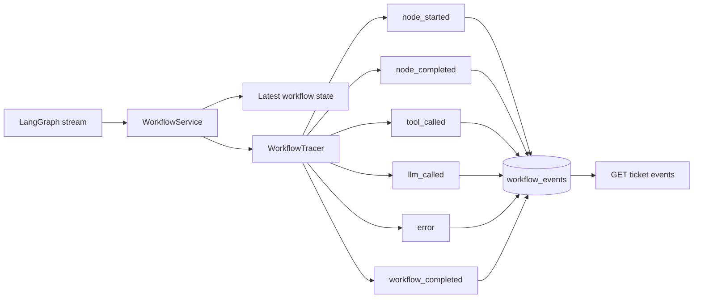

### Event sequence

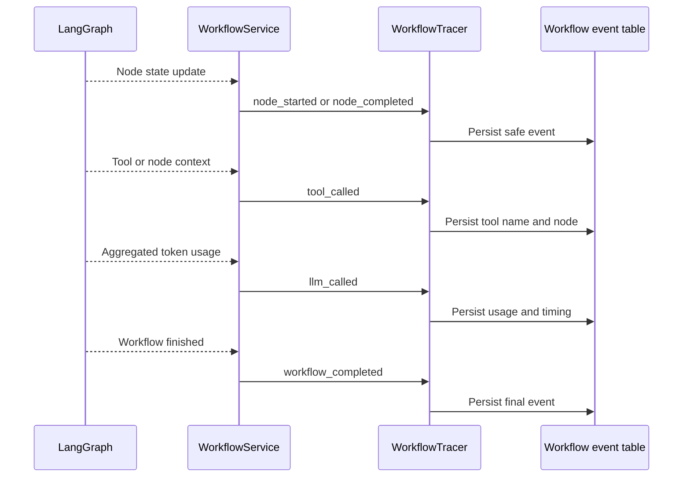

The tracer is intentionally fail-safe. If telemetry cannot be written, it does not stop the main graph workflow.

### Events API routing

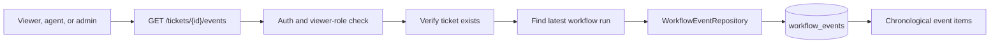

The events response is reader-safe:

- event type;
- node name;
- payload;
- duration;
- token usage;
- timestamp.

It does not expose raw prompts or hidden chain-of-thought.

## Complete Phase 10 infrastructure flow

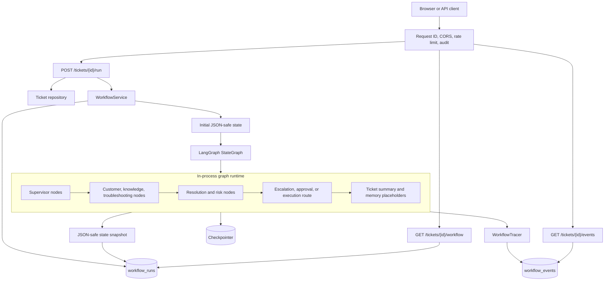

## Docker and container-network status

Docker networking is not yet active in the repository at this phase.

Phase 10 components still run in the local or test Python process:

- FastAPI routes;
- LangGraph nodes;
- specialist agents;
- tool registry;
- workflow service;
- tracer;
- in-process background task.

Persistence may point to:

- local SQLite;
- PostgreSQL;
- Redis or Fakeredis;
- in-memory or Qdrant vector storage.

The future container design will need service DNS names and port wiring, for example:

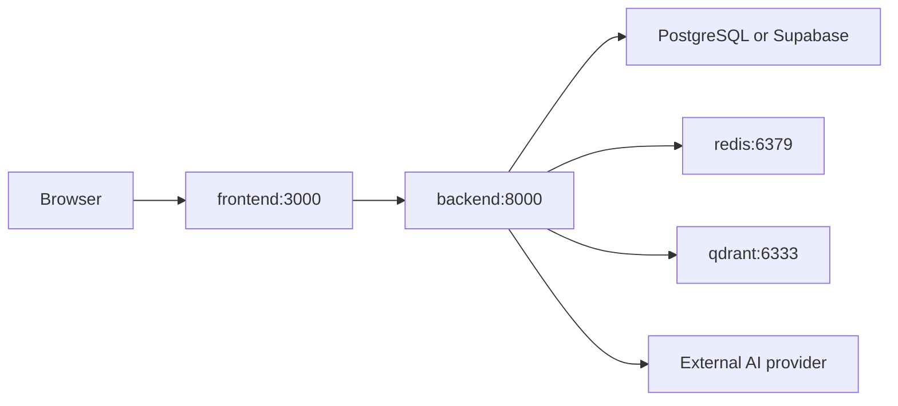

That is a planned end-state network only. It is not a claim that Compose containers or Dockerfiles are already implemented in Phase 10.

## Request and routing summary

| Request or operation | Entry point                                  | Internal routing                                           | Storage                        |
| -------------------- | -------------------------------------------- | ---------------------------------------------------------- | ------------------------------ |
| Start workflow       | `POST /tickets/{id}/run`                     | `WorkflowService.create_run` → background `start_workflow` | `workflow_runs`, ticket status |
| Execute graph        | In-process background task                   | LangGraph nodes and conditional routing                    | Checkpointer and run state     |
| Read progress        | `GET /tickets/{id}/workflow`                 | Workflow repository lookup                                 | `workflow_runs.state`          |
| Read events          | `GET /tickets/{id}/events`                   | Workflow and event repositories                            | `workflow_events`              |
| Resume workflow      | Service method in later approval integration | LangGraph `Command(resume=...)`                            | Checkpointer and run status    |
| Store telemetry      | Stream and node updates                      | `WorkflowTracer`                                           | `workflow_events`              |

## Honest limitations after Phase 10

- No Docker network, container DNS, or Compose dependency wiring is implemented in Phase 10.
- Workflow background tasks run inside the FastAPI process.
- `human_approval`, `execute_resolution`, and `memory_update` placeholders are not complete P11 behavior.
- P10-6 traces workflow stream state and node context. It does not yet guarantee a complete argument/result trace for every low-level registry call.
- External Redis and Qdrant are supported as application choices, but no container topology is required for the offline demo.
- Live AI API calls require provider configuration, credentials, and later deployment settings.

## Interview summary

Phase 10 turns the CloudDesk backend into an orchestrated workflow application.

FastAPI receives a request and creates a workflow run. `WorkflowService` starts a LangGraph graph as an in-process background task. The graph moves named nodes through understanding, investigation, resolution planning, and risk routing. A checkpointer preserves resumable graph state, while SQL tables persist run snapshots and event history.

The service is the infrastructure bridge between HTTP, LangGraph, database repositories, and observability. At the end of Phase 10, the system can start a workflow, report status, and return a safe event timeline. Docker networking and the completed approval/action lifecycle are intentionally left to later work.
