# Phase 11 — Infrastructure, Component Wiring, and Routing Evolution

This document explains how memory components are loaded, connected, routed, and stored in CloudDesk during Phase 11. It begins with the Phase 10 application process and follows the memory design from short-term storage through durable customer memory.

It describes the infrastructure that exists now. It does **not** describe Docker containers or Compose networks as implemented infrastructure, because no Dockerfiles or Compose manifest exist in this repository phase.

## Phase 11 infrastructure goal

Phase 11 adds two memory lifetimes to the existing FastAPI and LangGraph application:

- temporary memory in Redis or fakeredis;
- durable customer memory in SQLite or PostgreSQL.

The system also introduces an application facade that coordinates:

- recent ticket conversations;
- temporary workflow state;
- knowledge retrieval cache entries;
- durable customer support notes;
- secret scrubbing and duplicate checks;
- customer-scoped database reads and writes.

The subtask evolution is:

```mermaid
flowchart LR
    P10["Phase 10 workflow process"]

    P111["1. Short-term memory"]
    P112["2. CustomerMemory model"]
    P113["3. Recall routing"]
    P114["4. Resolution recording"]
    P115["5. Scrubbing and ownership"]
    P116["6. Duplicate prevention"]
    P117["7. MemoryService facade"]
    P118["8. Customer-agent wiring"]
    P119["9. Graph memory position"]

    P10 --> P111
    P111 --> P112
    P112 --> P113
    P113 --> P114
    P114 --> P115
    P115 --> P116
    P116 --> P117
    P117 --> P118
    P118 --> P119
```

---

## Infrastructure status at the end of Phase 11

| Component                  | Infrastructure role                                        |
| -------------------------- | ---------------------------------------------------------- |
| FastAPI process            | Receives HTTP requests and starts or reads workflows       |
| LangGraph process          | Executes support-workflow nodes inside the backend process |
| `MemoryService`            | Coordinates temporary and durable memory operations        |
| `ShortTermMemory`          | Stores Redis-compatible temporary values                   |
| Redis                      | Real shared temporary cache in deployment mode             |
| Fakeredis                  | In-process fake Redis for demo and tests                   |
| `LongTermMemory`           | Applies memory type, customer, ticket, and scrubbing rules |
| `CustomerMemoryRepository` | Reads and writes customer memory rows                      |
| SQLAlchemy session         | Runs database operations in one transaction                |
| SQLite                     | Local demo and test database                               |
| PostgreSQL                 | Cloud or production customer-memory database               |
| Customer context node      | Attempts to load customer memory before troubleshooting    |
| `memory_update` graph node | Reserved final memory position, currently placeholder      |
| Docker / Compose           | **Not implemented in this phase**                          |

No memory microservice has been created. All memory components run in the backend Python process or connect to process-external Redis and SQL services.

---

## Starting point — Phase 10 infrastructure

At the end of Phase 10, CloudDesk has:

- FastAPI middleware and API routes;
- a SQLAlchemy database session per HTTP request;
- LangGraph workflow execution;
- in-memory or SQLite workflow checkpoints;
- SQL workflow runs and workflow events;
- Redis/fakeredis support in the application;
- a knowledge-store option of memory or Qdrant;
- a `memory_update` graph position, but no real memory write.

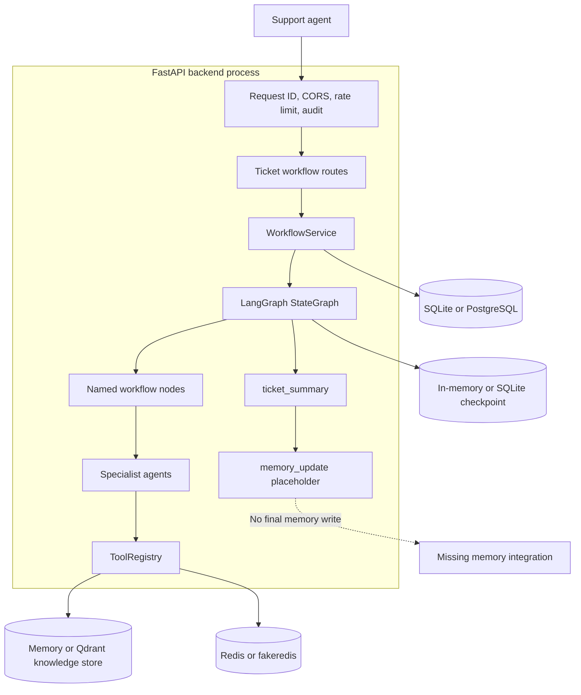

### Phase 10 routing boundary

The existing HTTP route starts a workflow in a background task:

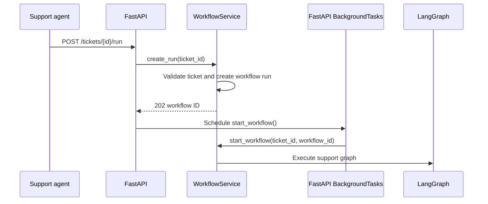

The memory components introduced in Phase 11 attach to this existing process and state flow.

---

## Component view at the end of Phase 11

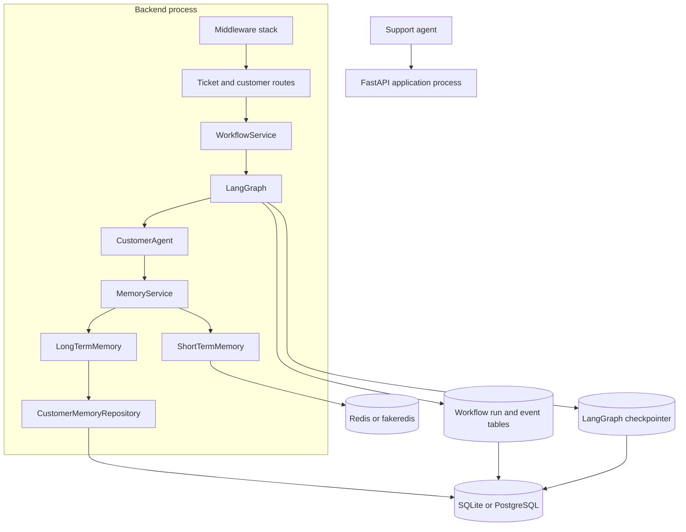

This is still one backend application process. Redis and the SQL database are external protocol targets only when real Redis or PostgreSQL is configured.

### Networking boundary

The Phase 11 data flow is:

```text
Browser or API client
  → FastAPI middleware
  → FastAPI route
  → service or graph
  → MemoryService
      → Redis/fakeredis for temporary values
      → SQLAlchemy repository for durable customer memory
  → SQLite or PostgreSQL
```

There are no Docker service DNS names such as `backend`, `redis`, or `qdrant` in the implemented Phase 11 network.

---

## P11-1 — Short-term memory wiring

P11-1 adds `ShortTermMemory` and Redis key helpers.

### Component routing

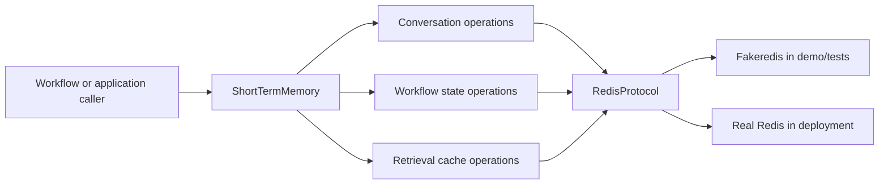

`ShortTermMemory` uses JSON encoding and decoding. It does not expose Python objects directly to Redis.

### Process wiring

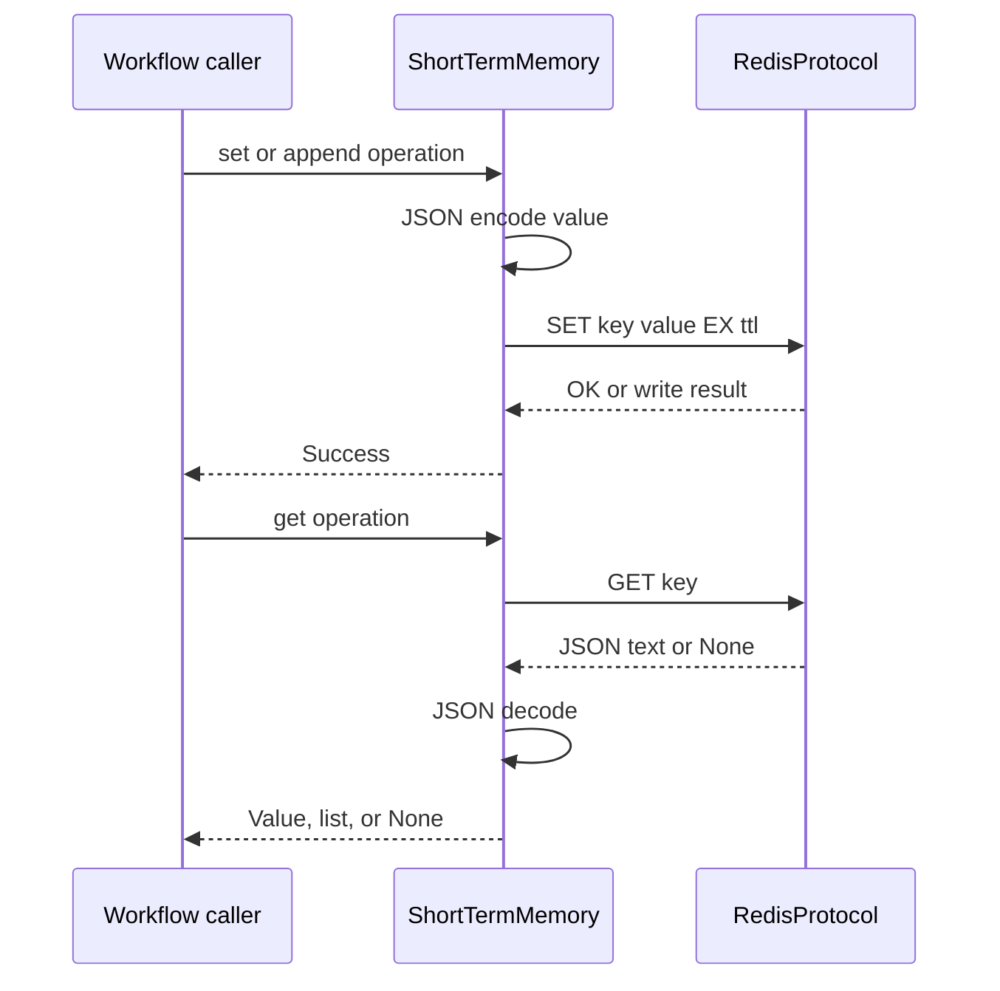

### Redis key routing

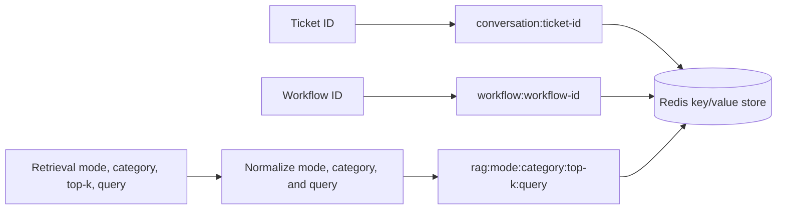

### TTL routing

| Key              |       TTL |
| ---------------- | --------: |
| `conversation:*` |  24 hours |
| `workflow:*`     |  24 hours |
| `rag:*`          | 5 minutes |

The real Redis client is created lazily through `create_redis_client()`. If no Redis URL is configured or fake Redis is enabled, the application uses a shared fakeredis instance.

**P11-1 infrastructure result:** temporary memory is a Redis Protocol abstraction rather than direct Redis calls scattered through the graph.

---

## P11-2 — Durable customer-memory wiring

P11-2 adds the `CustomerMemory` entity and `CustomerMemoryRepository`.

### SQL wiring

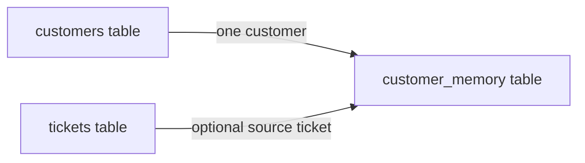

The database record contains:

```text
id
customer_id
type
content
source_ticket_id
created_at
updated_at
```

The SQL model and PostgreSQL schema keep the allowed types in the same data boundary:

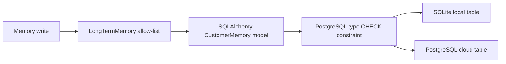

The SQL repository is customer-scoped:

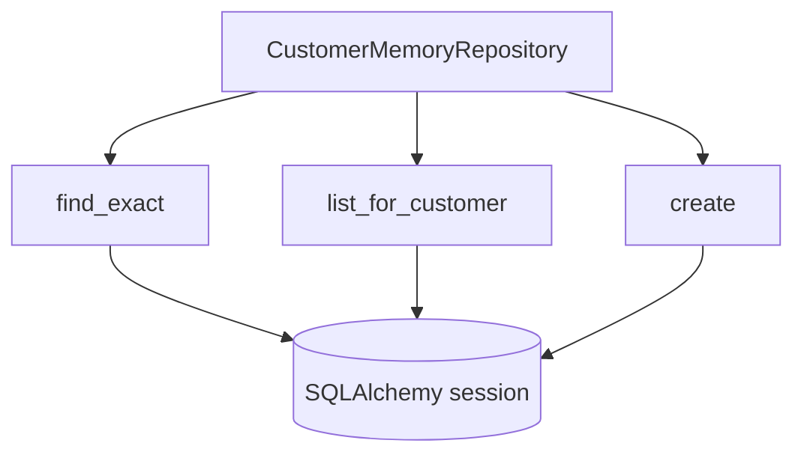

**P11-2 infrastructure result:** durable memory has one customer owner and an optional source ticket in the same SQL database as the rest of CloudDesk records.

---

## P11-3 — Recall routing

P11-3 allows the customer agent to recall up to ten long-term notes.

### Read path

```mermaid
flowchart LR
    Graph[Customer-context workflow node]
    Graph --> CustomerAgent[CustomerAgent]
    CustomerAgent --> MemoryService[MemoryService.recall_customer]
    MemoryService --> LongMemory[LongTermMemory.recall]
    LongMemory --> Repo[CustomerMemoryRepository]
    Repo --> SQL[(customer_memory table)]

    SQL --> Records[Newest records]
    Records --> Limit[Maximum 10]
    Limit --> Scrub[Scrub customer-facing memory text]
    Scrub --> Context[CustomerContext.memory_notes]
```

### Recall sequence

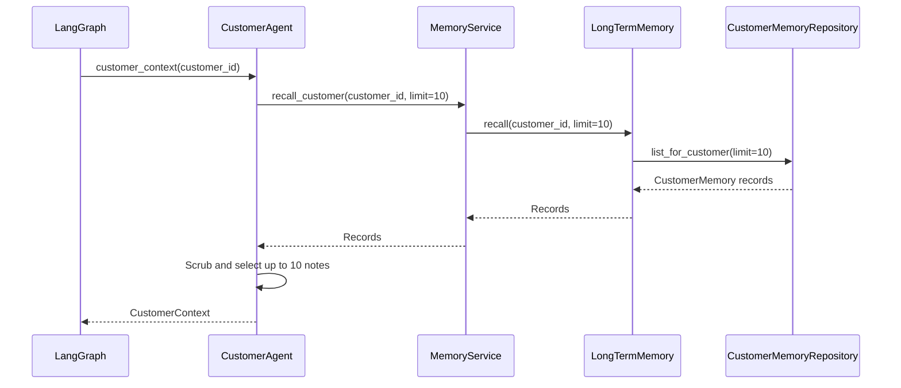

The call is fail-soft. If no memory service is configured or recall fails, the customer agent continues with customer, subscription, workspace, and ticket data instead of stopping the workflow.

**P11-3 infrastructure result:** memory recall is an optional read dependency of the customer-context stage.

---

## P11-4 — Resolution recording routing

P11-4 adds `MemoryService.record_resolution()` and `LongTermMemory.record()`.

### Write path

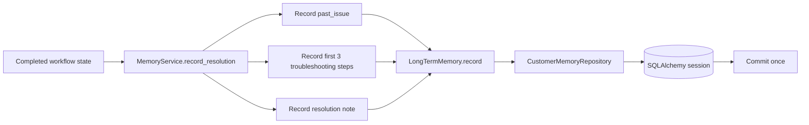

### Transaction boundary

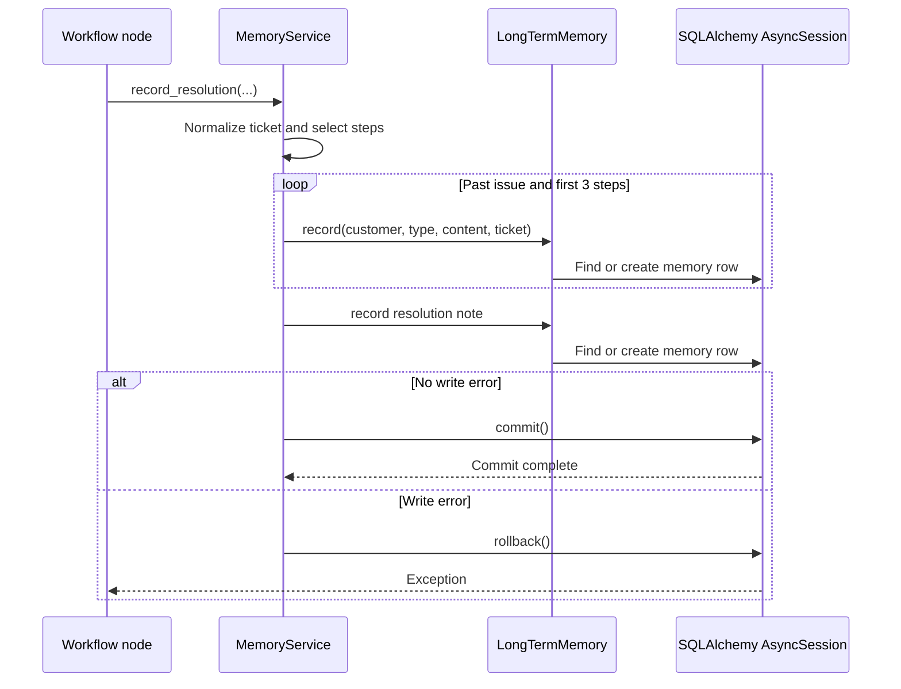

The service writes no more than three troubleshooting steps. It returns each record together with a created-or-existing result.

**P11-4 infrastructure result:** resolution memory is a small transaction at the boundary of workflow and SQL persistence.

---

## P11-5 — Scrubbing and ownership routing

P11-5 adds guardrails around memory infrastructure.

### Memory write gate

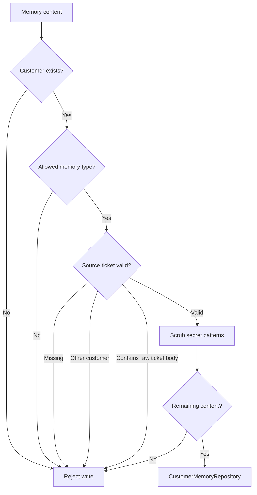

### Infrastructure boundary of guardrails

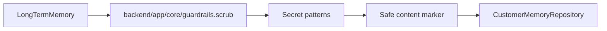

The guardrail module is inside the backend process. It is not a separate HTTP microservice.

It validates:

- card numbers;
- password assignments;
- API-key assignments;
- tokens and authorization values;
- JWT and bearer tokens;
- private keys and AWS keys;
- credentials embedded in URLs or queries.

The source-ticket check verifies:

- the ticket exists;
- the ticket belongs to the customer;
- the memory text does not equal or contain the raw ticket body.

**P11-5 infrastructure result:** memory write routing can reach the SQL repository only after customer, type, ticket, and secret checks pass.

---

## P11-6 — Duplicate-routing design

P11-6 uses one exact database lookup before creating a memory record.

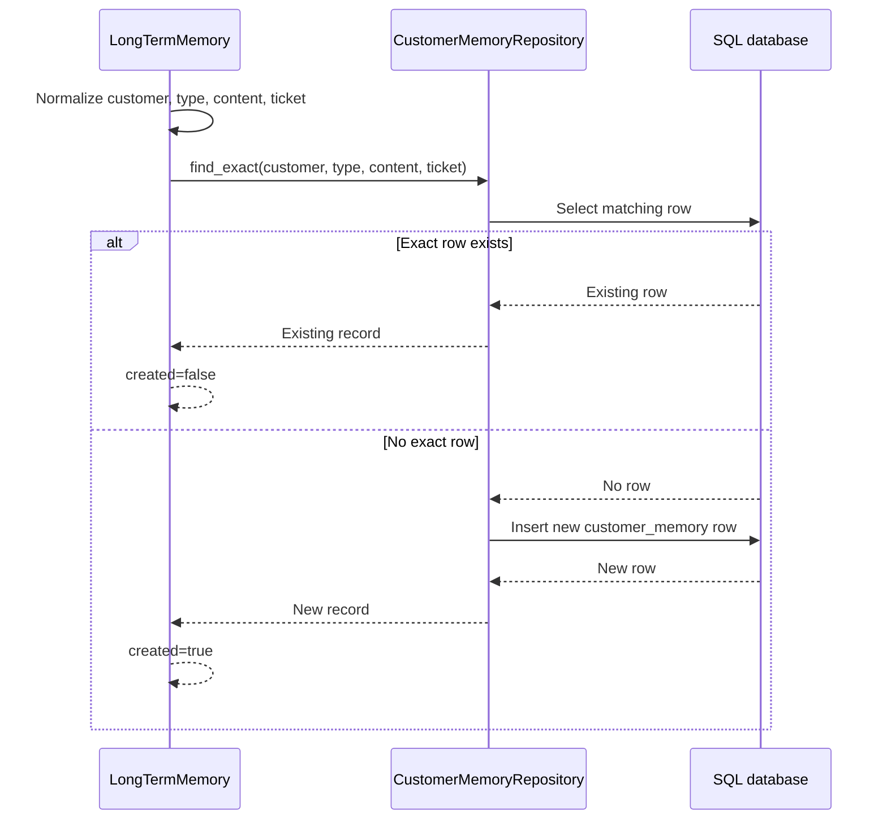

The routing key is therefore deterministic:

```text
customer_id + memory_type + scrubbed_content + source_ticket_id
```

This is not AI similarity matching. It is an exact SQL lookup.

**P11-6 infrastructure result:** repeated resolution writes do not create repeated rows for exactly matching values.

---

## P11-7 — Memory coordinator routing

P11-7 introduces `MemoryService`.

### Facade wiring

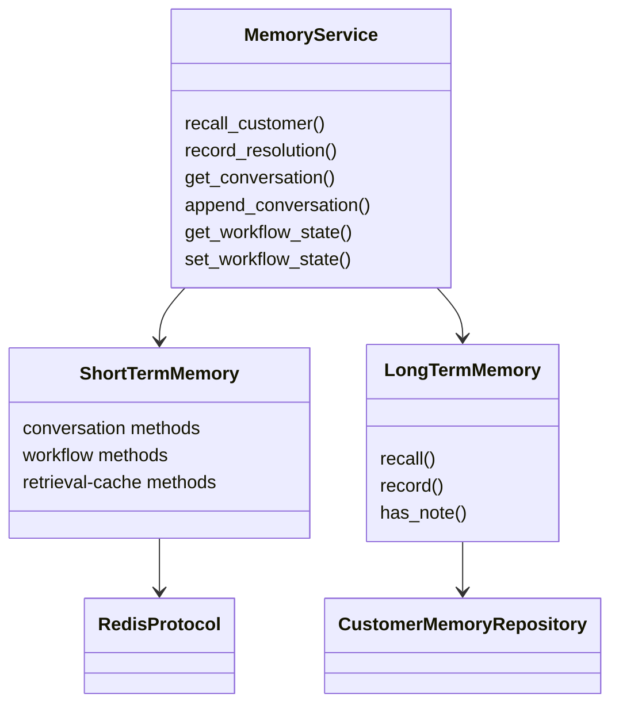

The facade keeps storage details behind two branches:

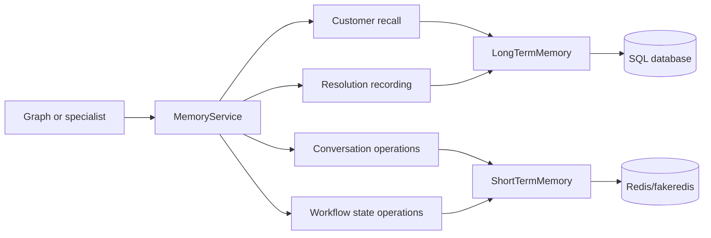

**P11-7 infrastructure result:** graph components do not need separate SQL, Redis, scrubbing, and repository logic.

---

## P11-8 — Customer-agent wiring

P11-8 connects the memory recall interface to customer-context loading.

### Current process route

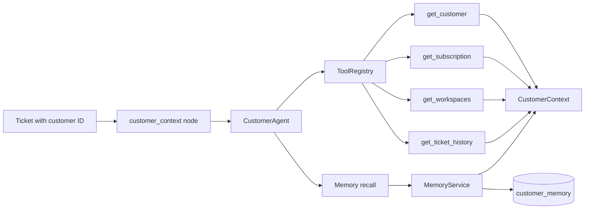

The memory service is looked up from the workflow state using the `memory_service` or `memory` key. The code can continue if no memory service is present.

A memory lookup failure is fail-soft:

```mermaid
sequenceDiagram
    participant Investigation as customer_context node
    participant Agent as CustomerAgent
    participant Tools as ToolRegistry
    participant Memory as MemoryService

    Investigation->>Agent: Load context
    Agent->>Tools: Read profile and account tools

    Agent->>Memory: Recall customer notes
    alt Memory service available
        Memory-->>Agent: Scrubbed records
        Agent->>Agent: Limit to 10 notes
    else Memory unavailable or recall fails
        Agent->>Agent: Continue without memory notes
    end

    Agent-->>Investigation: CustomerContext
```

### Important current wiring state

The workflow API currently creates `WorkflowService(session).create_run(...)` without a `memory_service` argument, and `_initial_state()` does not add a memory service.

Therefore, in the normal API route:

- the customer-context node may have no memory service;
- it returns customer context without long-term memory notes;
- the MemoryService implementation exists but is not consistently injected into the live graph.

This is an infrastructure wiring gap, not a missing storage component.

**P11-8 infrastructure result:** recall code exists, but live graph injection is incomplete.

---

## P11-9 — Final graph memory position

P11-9 reserves `memory_update` as the final workflow stage.

### Intended route

```mermaid
flowchart LR
    Graph[LangGraph workflow]
    Graph --> ResolutionOrEscalation[Resolution or escalation branch]
    ResolutionOrEscalation --> Summary[ticket_summary]
    Summary --> MemoryUpdate[memory_update]
    MemoryUpdate --> MemoryService[MemoryService.record_resolution]
    MemoryService --> SQL[(customer_memory)]
    MemoryUpdate --> End[END]
```

### Current implementation route

```mermaid
flowchart LR
    Graph[LangGraph workflow]
    Graph --> Summary[ticket_summary]
    Summary --> Placeholder[memory_update placeholder]
    Placeholder --> Completed[Add completed_nodes entry]
    Completed --> End[END]

    Placeholder -. "No database call" .-> Missing[Missing live memory write]
```

The current `memory_update()` function:

- deletes the provided state;
- marks `memory_update` as completed;
- sets `current_node` to `memory_update`;
- does not call Redis or SQL memory.

This is a graph integration gap rather than a missing memory subsystem.

**P11-9 infrastructure result:** the route and node name exist, but a real MemoryService call and session injection are still required for automatic end-of-run writes.

---

## Final Phase 11 network path

The implemented infrastructure is:

```mermaid
flowchart TD
    Browser[Browser or API client]

    Browser -->|HTTP| Middleware[FastAPI middleware]
    Middleware -->|X-Request-ID| Routes[API routes]

    Routes --> TicketService[Ticket or workflow service]
    TicketService --> Session[SQLAlchemy AsyncSession]
    TicketService --> Graph[LangGraph workflow]

    Graph --> State[SupportState]
    Graph --> Checkpoint[Checkpointer]
    Graph --> CustomerContext[Customer context node]

    CustomerContext --> MemoryFacade[MemoryService if injected]
    MemoryFacade --> Short[ShortTermMemory]
    MemoryFacade --> Long[LongTermMemory]

    Short --> Redis[(Redis or fakeredis)]
    Long --> Repository[CustomerMemoryRepository]
    Repository --> SQL[(SQLite or PostgreSQL)]

    Checkpoint --> SQL
    Graph --> WorkflowTables[(Workflow run and event tables)]
    WorkflowTables --> SQL
```

The intended memory route after final graph integration is:

```mermaid
sequenceDiagram
    participant Graph as LangGraph
    participant Summary as ticket_summary
    participant Update as memory_update
    participant Service as MemoryService
    participant Short as ShortTermMemory
    participant Long as LongTermMemory
    participant SQL as SQL database

    Graph->>Summary: Create final ticket summary
    Summary-->>Graph: Summary state
    Graph->>Update: Run final memory node
    Update->>Short: Read or update temporary state if required
    Update->>Service: record_resolution(...)
    Service->>Long: Store issue, steps, and note
    Long->>SQL: Validate and deduplicate
    SQL-->>Long: Existing or created records
    Long-->>Service: Memory write result
    Service-->>Update: Safe memory result
    Update-->>Graph: completed_nodes=[memory_update]
    Graph-->>Graph: END
```

---

## Docker and container status

There is no active Docker network in Phase 11.

This means the following are not currently implemented:

- backend Docker image;
- frontend Docker image;
- Docker Compose network;
- Redis container;
- Qdrant container;
- PostgreSQL container;
- container health checks;
- container service DNS routing;
- reverse-proxy routing.

The architecture is ready for a later container shape:

```mermaid
flowchart LR
    Browser[Browser] --> Frontend[Frontend container]
    Frontend -->|HTTP /api/v1| Backend[Backend container]

    Backend --> Redis[(Redis container)]
    Backend --> SQL[(PostgreSQL container)]
    Backend --> Qdrant[(Qdrant container)]

    Backend --> LangGraph[LangGraph in backend process]
    LangGraph --> Memory[MemoryService]
```

That diagram is a planned delivery shape, not the infrastructure used by the current Phase 11 implementation.

The planned routing remains consistent with the application design:

- browser traffic enters the frontend container;
- frontend calls the backend over HTTP;
- backend owns workflow and memory orchestration;
- Redis carries short-term temporary values;
- PostgreSQL carries durable application and memory records;
- Qdrant carries vector knowledge;
- LangGraph remains in the backend process unless a later worker architecture is introduced.

---

## Component responsibility map

| Component                  | Responsibility                            | Infrastructure dependency                |
| -------------------------- | ----------------------------------------- | ---------------------------------------- |
| FastAPI                    | HTTP routing and middleware               | Backend process                          |
| `WorkflowService`          | Create, run, status, and resume workflows | SQLAlchemy session                       |
| LangGraph                  | Execute named workflow nodes and routing  | Backend process, checkpointer            |
| `ShortTermMemory`          | Temporary memory operations               | Redis or fakeredis                       |
| Redis/fakeredis            | Key/value TTL storage                     | Process-external or in-process           |
| `CustomerMemoryRepository` | SQL read/write operations                 | SQLAlchemy session                       |
| `LongTermMemory`           | Validate and scrub durable memory         | Repository and guardrails                |
| `MemoryService`            | Coordinate both memory lifetimes          | Both short-term and long-term components |
| Customer agent             | Read memory into customer context         | MemoryService when injected              |
| `memory_update`            | Final memory graph position               | Intended MemoryService integration       |
| SQLite/PostgreSQL          | Durable records                           | SQLAlchemy                               |

---

## Honest Phase 11 status

The memory infrastructure is locally implemented, with this remaining integration status:

```text
Implemented:
- Redis/fakeredis short-term memory
- Redis key formats and TTL constants
- Durable customer_memory entity and repository
- MemoryService coordination
- Customer recall and resolution recording logic
- Scrubbing and ownership guards
- Exact duplicate lookup
- SQLite/fakeredis offline tests

Not yet complete:
- Live MemoryService injection into WorkflowService graph state
- Automatic call to record_resolution in memory_update
- End-to-end demonstration of recall on a later workflow run
- Docker Compose networking and container deployment
```

Phase 11 therefore extends the application with real memory components, but only as local process-level and database/Redis components. It does not yet provide a complete automatic end-of-workflow memory write or container network.

---

## Interview-ready infrastructure summary

### 30-second summary

> “Phase 11 adds memory infrastructure around the existing FastAPI and LangGraph process. Temporary memory uses Redis or fakeredis with 24-hour conversation and workflow TTLs and a five-minute retrieval cache. Durable memory uses SQLAlchemy in the `customer_memory` table. `MemoryService` separates short-term and long-term operations, while `LongTermMemory` validates, scrubs, and deduplicates records. Docker networking is not implemented yet. The remaining infrastructure gap is injecting and calling MemoryService in the live workflow's final memory node.”

### 60-second summary

> “At this stage, all components are in-process or connected to local backing services. FastAPI receives the request, `WorkflowService` creates the workflow, and LangGraph executes the support nodes. The customer-context node can use a memory facade to recall the customer's latest notes, while `ShortTermMemory` uses Redis or fakeredis for temporary data and `LongTermMemory` uses SQLAlchemy for durable data. Memory writes pass through ownership, secret, allowed-type, and duplicate checks before reaching SQLite or PostgreSQL. The architecture currently has no Docker network. It does not yet have a live, injected MemoryService in every workflow API run, and the final `memory_update` graph node is still a placeholder. So the storage components are real and tested, but automatic graph-wide memory persistence is the remaining infrastructure integration.”
