# Phase 12 — Infrastructure, Component Wiring, and Routing Evolution

This document explains how the Phase 12 frontend components are loaded, wired, routed, and connected to the CloudDesk backend. It follows P12-1 through P12-4 and distinguishes implemented process and HTTP routing from Docker or Compose infrastructure that is not yet implemented.

## Phase 12 infrastructure goal

Phase 12 adds the browser-facing layer to an application that already contains FastAPI, authentication, SQLAlchemy repositories, Redis/fakeredis support, knowledge storage, and the LangGraph workflow.

It adds:

- a Next.js frontend process;
- the App Router route structure;
- a root layout, app shell, login gate, and authentication provider;
- one typed HTTP API client;
- role-aware browser navigation;
- read-only dashboard and detail-page routing;
- browser polling and network error handling;
- typed frontend responses and local environment configuration.

The subtask evolution is:

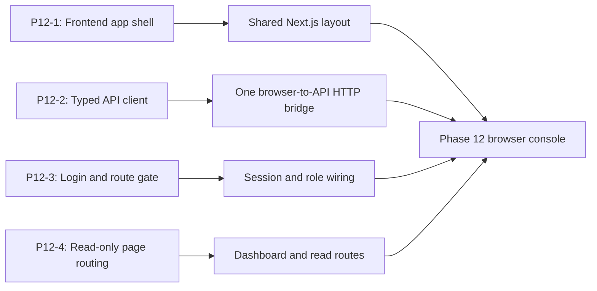

## Infrastructure status at the end of Phase 12

| Component             | Implemented infrastructure role                                   |
| --------------------- | ----------------------------------------------------------------- |
| Next.js process       | Serves browser pages and routes on the frontend development port  |
| App Router            | Maps browser URLs to React pages and layouts                      |
| Root layout           | Provides authentication context, login gating, and app shell      |
| App shell             | Displays navigation, identity, sign-out, header, and page content |
| Role-aware navigation | Filters menu items from the browser session role                  |
| AuthProvider          | Restores or creates the browser session                           |
| LoginGate             | Prevents protected page rendering while signed out                |
| ApiClient             | Sends HTTP requests to FastAPI with headers and typed responses   |
| Browser local storage | Stores the JWT access token                                       |
| usePolling            | Refreshes read pages through API calls                            |
| FastAPI               | Receives `/api/v1/*` and `/health` HTTP traffic                   |
| JWT/RBAC              | Performs the real backend authorization check                     |
| SQLAlchemy            | Reads application records through repositories                    |
| Redis/fakeredis       | Supports backend memory and rate-limit behavior                   |
| Memory/vector stores  | Support customer context and knowledge retrieval                  |
| Docker / Compose      | **Not implemented for this phase**                                |

No frontend container, backend container, Redis container, PostgreSQL container, Qdrant container, or reverse proxy is required by the current implementation.

---

## Starting point — backend process plus placeholder frontend

Before P12-1, FastAPI exists as a backend process and the frontend folder has only types and placeholder route structure.

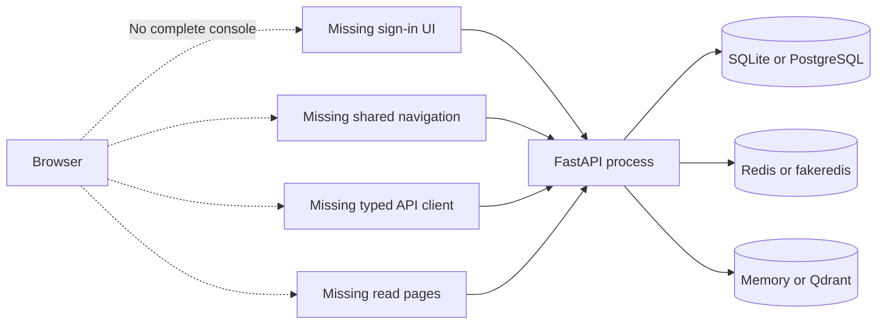

The backend does not need a frontend container to expose APIs. HTTP routing already exists independently.

Phase 12 adds browser component wiring around the following process routes:

```text
Next.js browser process
  → Next.js App Router
  → React client components
  → ApiClient
  → FastAPI /api/v1 routes
  → backend repositories and services
  → SQL, Redis, knowledge, and workflow stores
```

---

## P12-1 — App-shell and navigation wiring

P12-1 adds the first complete Next.js application boundary.

### Component hierarchy

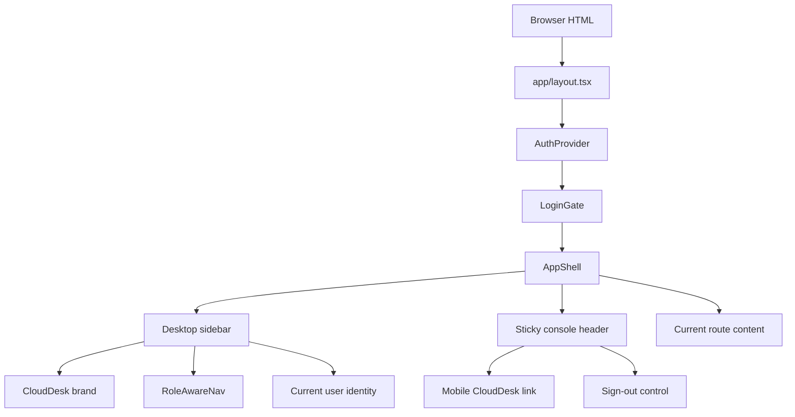

The App Router route is resolved before React content is rendered.

```mermaid
flowchart LR
    URL[/browser URL] --> Router[Next.js App Router]

    Router --> Login[/login]
    Router --> Dashboard[/dashboard]
    Router --> Tickets[/tickets]
    Router --> Ticket[/tickets/:id]
    Router --> Customers[/customers]
    Router --> Customer[/customers/:id]
    Router --> Knowledge[/knowledge]
    Router --> Article[/knowledge/:id]
    Router --> Escalations[/escalations]
    Router --> Agents[/agents]
    Router --> Audit[/audit]
    Router --> Settings[/settings]
    Router --> Health[/api/health]
```

### Navigation wiring

Navigation is declared once in `components/layout/nav.ts`.

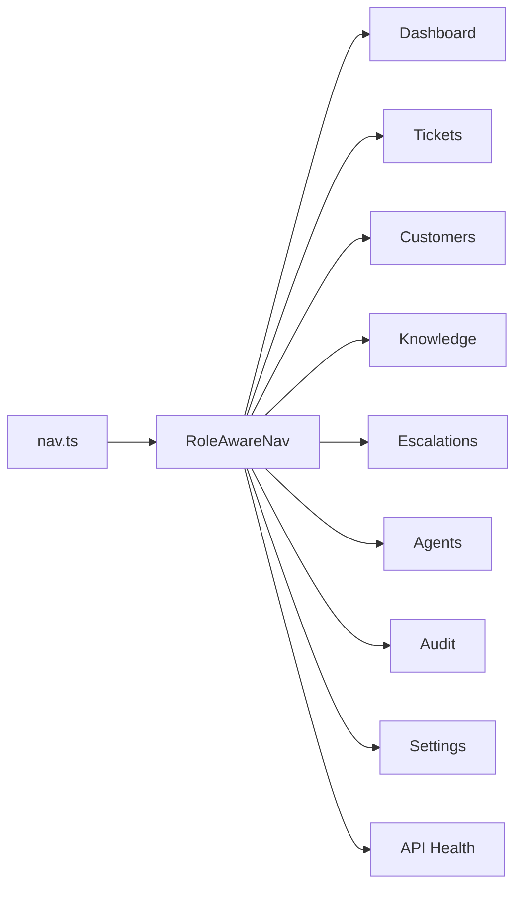

P12-1 also configures Next.js as a standalone frontend output:

```text
next.config.ts
  output: "standalone"
```

This prepares a later container image but does not create or start the container now.

**P12-1 infrastructure result:** Next.js is a complete process-level application shell with a single navigation configuration and an App Router route map.

---

## P12-2 — Typed API-client wiring

P12-2 creates the only backend communication path used by frontend pages.

### Browser-to-API route

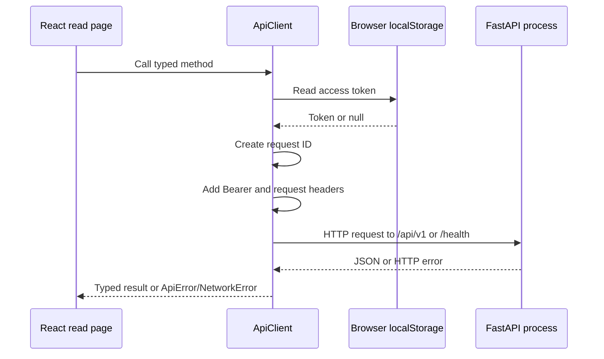

The default API address is:

```text
NEXT_PUBLIC_API_BASE_URL
  default: http://localhost:8000
```

This default is suitable for local browser development, where the browser connects to FastAPI on port 8000.

```mermaid
flowchart LR
    Browser[Support-agent browser] -->|NEXT_PUBLIC_API_BASE_URL| Backend[FastAPI :8000]
    Backend --> Middleware[Request ID, CORS, rate limit, audit]
    Middleware --> Routes[/api/v1 routes]
```

### Request headers

Every API request sends:

- `Accept: application/json`;
- `X-Request-ID: <UUID-or-fallback-ID>`;
- `Authorization: Bearer <token>` for protected requests;
- `Content-Type: application/json` when a JSON body is present.

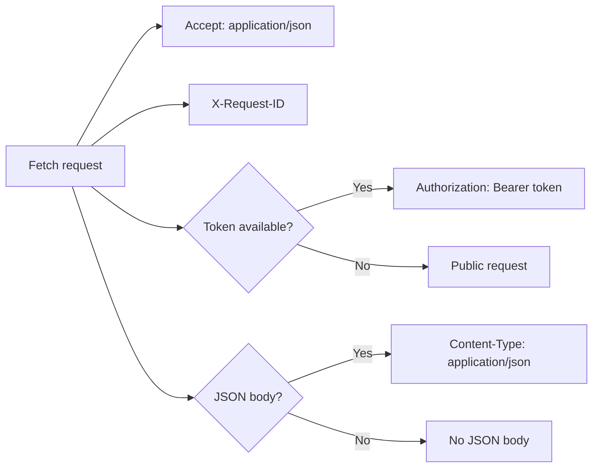

### Session response routing

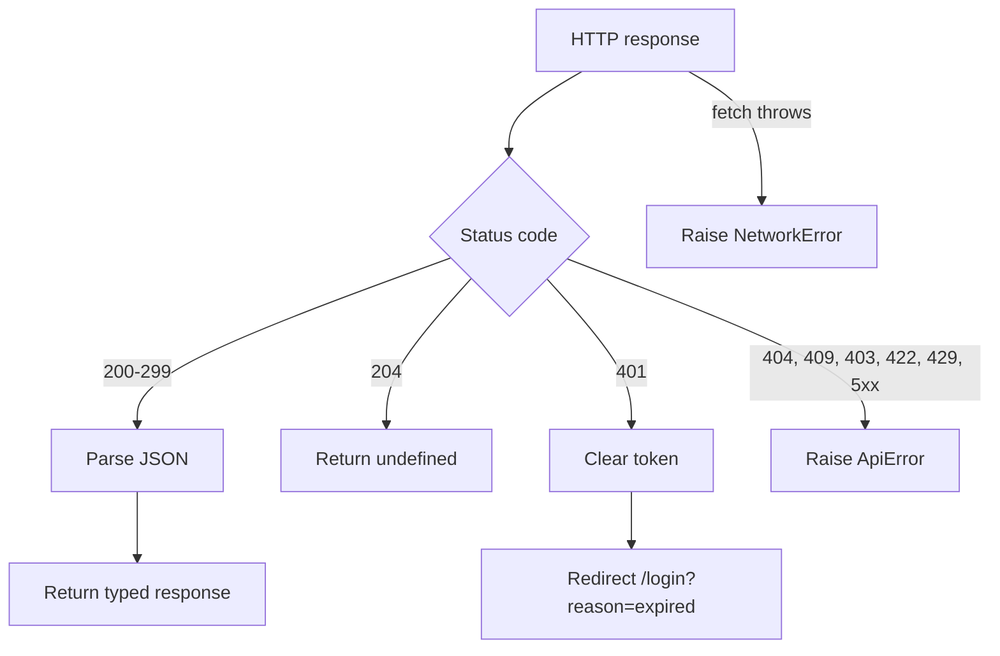

### P12-2 method routing

The typed client routes methods into backend API groups:

```mermaid
flowchart LR
    Client[ApiClient]

    Client --> Auth[/auth demo-token and me]
    Client --> Tickets[/tickets routes]
    Client --> Customers[/customers routes]
    Client --> Knowledge[/knowledge routes]
    Client --> Approvals[/approvals routes]
    Client --> Escalations[/escalations routes]
    Client --> Health[/health routes]
```

The frontend has no direct database, Redis, Qdrant, or vector-store connection. These remain backend dependencies.

**P12-2 infrastructure result:** all frontend-backend communication is HTTP through `ApiClient`; no browser page accesses infrastructure stores directly.

---

## P12-3 — Authentication and login-route wiring

P12-3 adds session and role routing across the Next.js layout.

### Session provider wiring

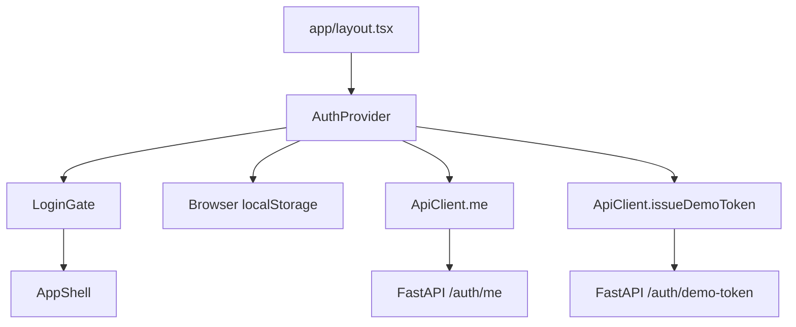

### Session restoration route

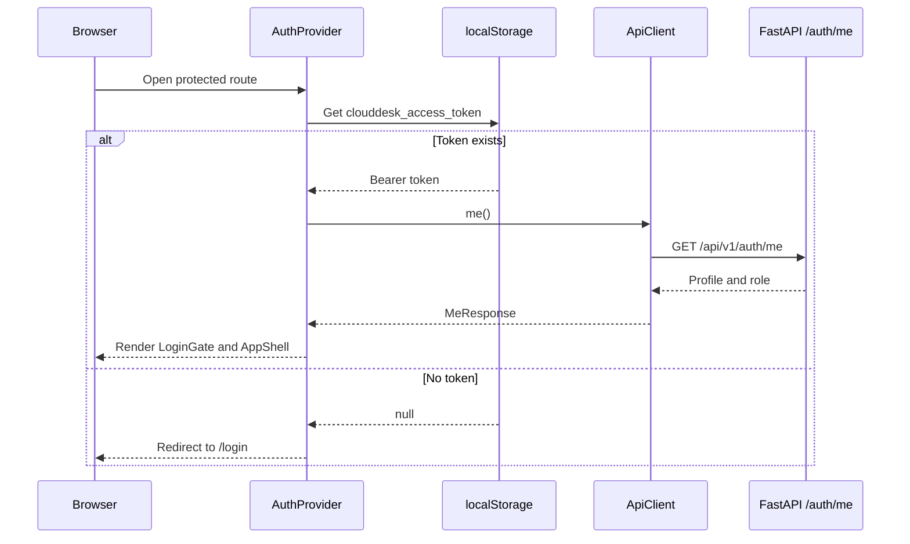

If `/auth/me` fails, the provider clears the token and redirects to login.

### Login route wiring

```mermaid
flowchart LR
    LoginURL[/login] --> LoginPage[Login page]
    LoginPage --> Suspense[Suspense boundary]
    Suspense --> LoginForm[LoginForm]

    LoginForm --> SignIn[AuthProvider.signIn]
    SignIn --> DemoToken[POST /auth/demo-token]
    DemoToken --> Storage[Save bearer token]
    Storage --> Profile[GET /auth/me]
    Profile --> Dashboard[/dashboard]
```

The login page uses `useSearchParams()` inside a Suspense boundary so Next.js can statically render the rest of the application safely.

### Login-gate route wiring

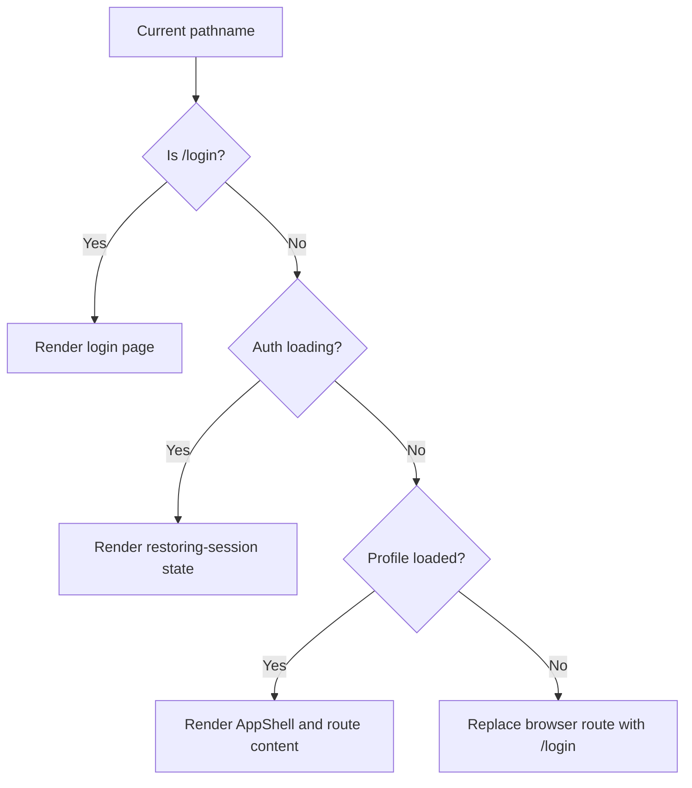

### Role-aware navigation wiring

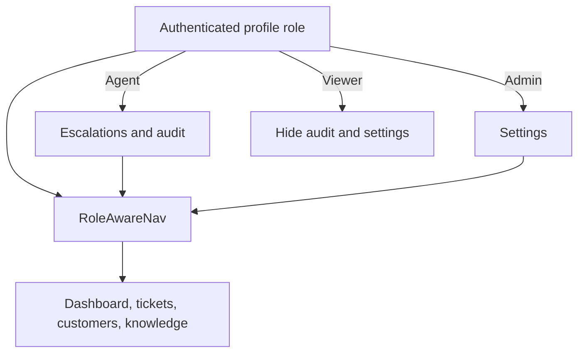

The frontend filters navigation, but it does not create authorization security. FastAPI applies the real role check at the protected route.

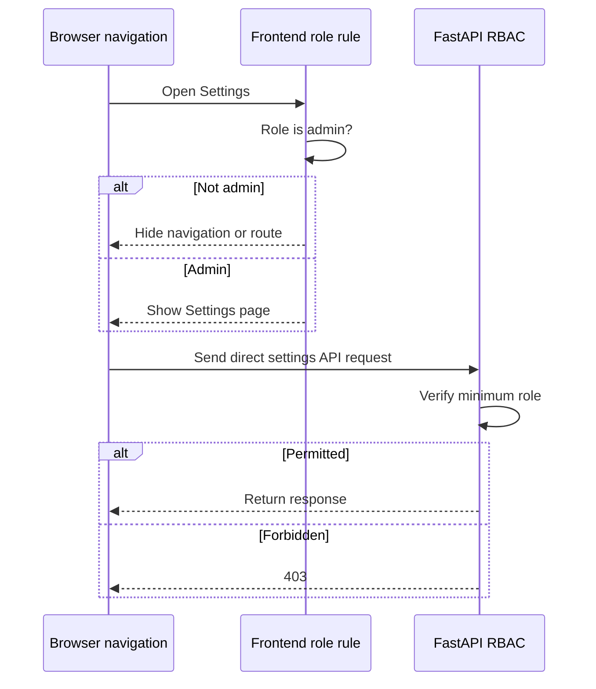

**P12-3 infrastructure result:** the Next.js process owns the session presentation layer, while HTTP authentication and authorization remain in FastAPI.

---

## P12-4 — Read-page routing and polling

P12-4 connects browser routes to read-side backend endpoints.

### Page-to-route wiring

```mermaid
flowchart LR
    Dashboard[/dashboard] --> DashboardPage[Dashboard page]
    Tickets[/tickets] --> TicketsPage[Tickets page]
    Ticket[/tickets/:id] --> TicketPage[Ticket detail page]
    Customers[/customers] --> CustomersPage[Customers page]
    Customer[/customers/:id] --> CustomerPage[Customer detail page]
    Knowledge[/knowledge] --> KnowledgePage[Knowledge page]
    Article[/knowledge/:id] --> ArticlePage[Knowledge detail page]
    Escalations[/escalations] --> EscalationsPage[Escalations page]
```

### Dashboard route wiring

```mermaid
flowchart LR
    DashboardPage[Dashboard] --> TicketsAPI[listTickets]
    DashboardPage --> CustomersAPI[listCustomers]
    DashboardPage --> EscalationsAPI[listEscalations]

    TicketsAPI --> Backend[/api/v1/tickets]
    CustomersAPI --> BackendCustomers[/api/v1/customers]
    EscalationsAPI --> BackendEscalations[/api/v1/escalations]

    Backend --> DashboardCards[Ticket, customer, escalation counts]
    BackendCustomers --> DashboardCards
    BackendEscalations --> DashboardCards
```

The dashboard performs three read calls rather than using a dedicated dashboard backend route.

### Ticket route wiring

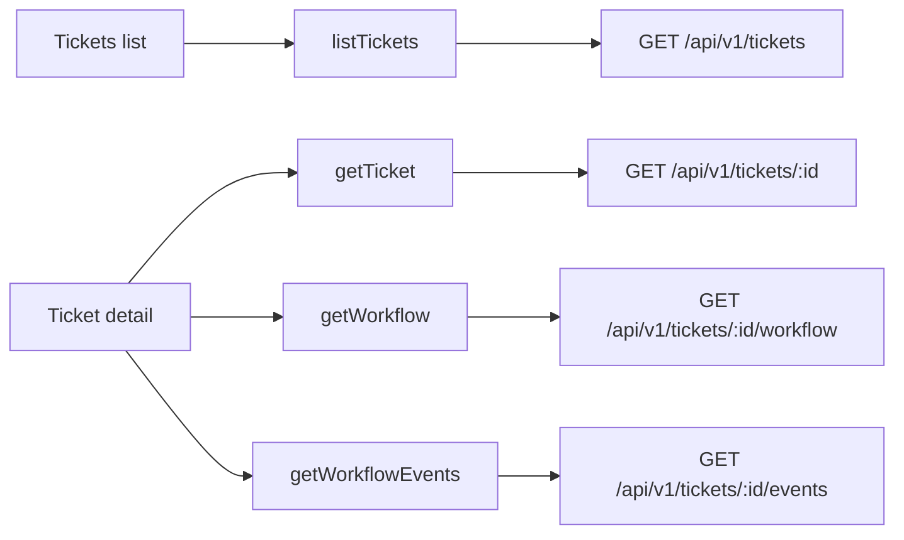

The ticket detail route adds polling on every 2 seconds. The ticket list page polls every 10 seconds.

### Customer route wiring

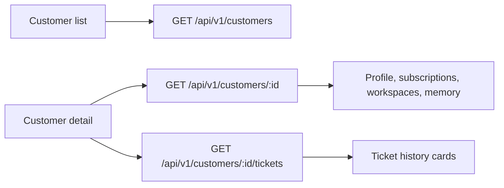

Customer detail polls every 10 seconds. The history link can route to the existing ticket detail page.

### Knowledge route wiring

```mermaid
flowchart LR
    KnowledgeList[Knowledge list] --> ListArticles[GET /api/v1/knowledge]
    ArticleDetail[Article detail] --> GetArticle[GET /api/v1/knowledge/:id]

    ListArticles --> SummaryCards[Article summaries]
    GetArticle --> ArticleReader[Title, tags, and Markdown content]
```

Knowledge list and article detail use a 30-second polling interval.

### Escalation route wiring

```mermaid
flowchart LR
    EscalationPage[Escalations list] --> GetEscalations[GET /api/v1/escalations]
    GetEscalations --> EscalationCards[Team, reason, status, ticket link]
    EscalationCards --> TicketRoute[/tickets/:ticket_id]
```

Escalation polling is every 10 seconds.

### Read-page state routing

```mermaid
stateDiagram-v2
    [*] --> Loading
    Loading --> Data: API returns records
    Loading --> Empty: API returns no records
    Loading --> Error: Network or API error
    Error --> Loading: Retry button
    Data --> Loading: Poll refresh begins
    Empty --> Loading: Poll refresh begins
    Loading --> Loading: Subsequent poll
```

The polling hook:

1. loads data immediately;
2. stores data or error state;
3. starts an interval;
4. reloads the page data;
5. clears the interval when the component is removed.

```mermaid
sequenceDiagram
    participant Page as Read page
    participant Hook as usePolling
    participant Client as ApiClient
    participant FastAPI as FastAPI

    Page->>Hook: Register loader and interval
    Hook->>Client: Immediate load
    Client->>FastAPI: Protected GET request
    FastAPI-->>Client: JSON response
    Client-->>Hook: Typed data or error
    Hook-->>Page: Loading false and update state

    loop Refresh interval
        Hook->>Client: Reload
        Client->>FastAPI: Protected GET request
        FastAPI-->>Client: New JSON response
        Client-->>Hook: New data or error
        Hook-->>Page: Refresh display
    end

    Page->>Hook: Page unmount
    Hook->>Hook: Clear interval
```

**P12-4 infrastructure result:** browser routes now call read endpoints through typed methods and keep visible data current with bounded polling.

---

## Complete Phase 12 infrastructure wiring

The implemented local process topology is:

```mermaid
flowchart TB
    User[Support agent browser]

    subgraph Frontend[Next.js frontend process :3000]
        Router[App Router]
        AuthProvider[AuthProvider]
        LoginGate[LoginGate]
        AppShell[AppShell]
        RoleNav[RoleAwareNav]
        Pages[Read-only pages]
        Polling[usePolling]
        ApiClient[Typed ApiClient]

        Router --> AuthProvider
        AuthProvider --> LoginGate
        LoginGate --> AppShell
        AppShell --> RoleNav
        AppShell --> Pages
        Pages --> Polling
        Polling --> ApiClient
    end

    subgraph Backend[FastAPI backend process :8000]
        Middleware[Request ID, CORS, rate limit, audit]
        Auth[Auth routes]
        Ticket[Ticket and workflow routes]
        Customer[Customer routes]
        Knowledge[Knowledge routes]
        Escalation[Escalation routes]
        RBAC[JWT and role checks]
        Services[Application services]

        Middleware --> RBAC
        RBAC --> Auth
        RBAC --> Ticket
        RBAC --> Customer
        RBAC --> Knowledge
        RBAC --> Escalation
        Auth --> Services
        Ticket --> Services
        Customer --> Services
        Knowledge --> Services
        Escalation --> Services
    end

    subgraph Stores[Backend stores]
        SQL[(SQLite or PostgreSQL)]
        Redis[(Redis or fakeredis)]
        Vector[(Memory or Qdrant)]
    end

    User -->|HTTP browser navigation| Router
    ApiClient -->|HTTP /api/v1| Middleware
    ApiClient -->|Health requests| Middleware

    Services --> SQL
    Services --> Redis
    Services --> Vector
```

This topology is not container networking. Port 3000 and port 8000 are process ports on the local development system.

### Complete browser request flow

```mermaid
sequenceDiagram
    participant Browser as Browser
    participant Next as Next.js process
    participant Auth as AuthProvider
    participant Client as ApiClient
    participant FastAPI as FastAPI process
    participant Backend as Backend services

    Browser->>Next: GET /dashboard
    Next->>Auth: Restore session
    Auth->>Client: GET /api/v1/auth/me
    Client->>FastAPI: Bearer token
    FastAPI->>Backend: Validate role and profile
    Backend-->>Client: MeResponse
    Client-->>Next: Current user and role
    Next-->>Browser: Dashboard route shell

    Browser->>Client: Dashboard loads tickets, customers, escalations
    Client->>FastAPI: Three protected GET requests
    FastAPI->>Backend: Viewer-or-higher RBAC
    Backend-->>Client: Three typed JSON responses
    Client-->>Browser: Summary cards

    Browser->>Next: Navigate to /tickets/:id
    Next->>Client: Ticket, workflow, event methods
    Client->>FastAPI: Three protected GET requests
    FastAPI-->>Client: Typed ticket and event data
    Client-->>Browser: Read-only detail view

    loop Poll interval
        Browser->>Client: Reload current read page
        Client->>FastAPI: Protected GET request
        FastAPI-->>Client: Updated response
        Client-->>Browser: Refresh visible state
    end
```

---

## Network boundaries

The Phase 12 network boundaries are:

```text
Browser → Next.js process
  Route and React rendering

Browser → FastAPI process
  Authentication and API calls

FastAPI → SQL database
  Tickets, customers, events, approvals, memory

FastAPI → Redis/fakeredis
  Cache and temporary application state

FastAPI → memory or Qdrant
  Knowledge retrieval

FastAPI → AI provider
  Workflow model calls in demo or production mode
```

There is no direct browser connection to:

- SQLite or PostgreSQL;
- Redis;
- Qdrant;
- workflow runtime state;
- service-role database credentials;
- AI provider secrets.

The browser receives only the public API base URL and the user access token.

```mermaid
flowchart LR
    Browser[Browser]

    Browser --> Next[Next.js :3000]
    Browser --> API[FastAPI :8000]

    API --> SQL[(SQL database)]
    API --> Redis[(Redis/fakeredis)]
    API --> Vector[(Knowledge vector store)]

    Browser -. "No direct connection" .-> SQL
    Browser -. "No direct connection" .-> Redis
    Browser -. "No direct connection" .-> Vector
```

---

## Docker and container status

Phase 12 does **not** implement Docker networking.

No Dockerfiles or Compose manifests exist in the repository for the frontend or backend at this phase.

The current infrastructure is local process wiring:

```text
Terminal 1: FastAPI on :8000
Terminal 2: Next.js on :3000
Browser: HTTP calls to :3000 and :8000
```

The standalone Next.js setting is container-ready configuration, but that does not create a Docker image or container network.

### Future planned container topology

The later delivery design could be:

```mermaid
flowchart TB
    Internet[Browser or network load balancer]

    subgraph Compose[Docker Compose network]
        Frontend[frontend container:3000]
        Backend[backend container:8000]
        RedisContainer[Redis container:6379]
        QdrantContainer[Qdrant container:6333]
        Database[PostgreSQL container or external service]
    end

    Internet --> Frontend
    Frontend -->|HTTP /api/v1| Backend
    Backend --> RedisContainer
    Backend --> QdrantContainer
    Backend --> Database
```

In that future topology:

- service names would replace localhost hostnames;
- Next.js would call the backend through the Compose network or public route;
- Redis and Qdrant would use container DNS names;
- PostgreSQL could be a container or external managed database;
- environment variables would be supplied by Compose;
- health checks and dependencies would define startup order;
- secrets would come from deployment secret stores, not browser variables.

This is a planned delivery shape, not current Phase 12 infrastructure.

---

## Routing summary

| Route            | Frontend behavior              | Backend dependency                            |
| ---------------- | ------------------------------ | --------------------------------------------- |
| `/login`         | Demo sign-in form              | `/api/v1/auth/demo-token` and `/auth/me`      |
| `/dashboard`     | Summary cards                  | Tickets, customers, and escalations read APIs |
| `/tickets`       | Ticket table                   | `GET /api/v1/tickets`                         |
| `/tickets/:id`   | Ticket detail and event view   | Ticket, workflow, and events read APIs        |
| `/customers`     | Customer cards                 | `GET /api/v1/customers`                       |
| `/customers/:id` | Customer context and history   | Customer detail and history APIs              |
| `/knowledge`     | Article list                   | `GET /api/v1/knowledge`                       |
| `/knowledge/:id` | Article reader                 | `GET /api/v1/knowledge/:id`                   |
| `/escalations`   | Named-team escalation cards    | `GET /api/v1/escalations`                     |
| `/agents`        | Planned workflow metadata view | Future `/api/v1/agents` route                 |
| `/audit`         | Planned audit view             | Future audit API                              |
| `/settings`      | Planned admin-only view        | Future settings API                           |
| `/api/health`    | Frontend health route          | Backend `/health` checks                      |

The `/agents`, `/audit`, `/settings`, and `/api/health` pages in the shell are not fully implemented as backend read data where that route has not been added to the backend yet.

---

## Component responsibility map

| Component          | Responsibility                                    | Must not handle                    |
| ------------------ | ------------------------------------------------- | ---------------------------------- |
| Next.js App Router | Browser URL routing                               | Backend role decisions             |
| Root layout        | Authentication provider and app shell composition | Database access                    |
| AuthProvider       | Session restoration and browser user state        | JWT signing or service-role access |
| LoginGate          | Browser route protection presentation             | Final security validation          |
| AppShell           | Layout, navigation, identity, sign-out            | Ticket and account writes          |
| RoleAwareNav       | Role-based menu filtering                         | Backend RBAC                       |
| ApiClient          | HTTP headers, JSON, auth, and API methods         | SQL or Redis access                |
| usePolling         | Browser refresh behavior                          | Workflow execution                 |
| Read pages         | Display typed API data                            | Approval or reply action execution |
| FastAPI            | Public API, authorization, validation, services   | Browser layout rendering           |

---

## Honest Phase 12 status

```text
Implemented:
- Next.js frontend process and App Router
- Shared app shell and navigation
- Typed browser-to-FastAPI API client
- Bearer token and request-ID wiring
- Demo login and session restoration
- Login gate and role-aware navigation
- Read-only API-backed pages and polling
- Frontend unit tests and production build

Not implemented:
- Dockerfiles or Compose stack
- Container DNS networking
- Reverse-proxy routing
- Container health dependency wiring
- Frontend-to-backend Docker service discovery
- Final ticket action routes in the UI
- Live cloud frontend deployment
```

The browser and backend run as separate local processes in Phase 12. The browser calls FastAPI through configured HTTP URLs, and FastAPI calls SQL, Redis/fakeredis, knowledge, and workflow components independently.

---

## Interview-ready infrastructure summary

### 30-second summary

> “Phase 12 adds a Next.js frontend process in front of the existing FastAPI backend. Next.js owns App Router pages and the app shell, while `ApiClient` owns every frontend HTTP call. Browser requests add a bearer token and request ID and reach FastAPI on port 8000. FastAPI remains responsible for JWT role checks, services, and data stores. There is no Docker network in Phase 12; frontend and backend run as separate local processes. Phase 12 also adds polling for read-only data. Docker Compose and container DNS routing belong to a later delivery phase.”

### 60-second summary

> “The infrastructure change is the addition of a browser presentation process rather than a new backend service. Next.js 15 renders the App Router pages and the common shell. `AuthProvider` restores or creates the user session, `LoginGate` controls protected rendering, and `RoleAwareNav` filters menu items. `ApiClient` is the only frontend HTTP bridge. It reads the local bearer token, sends `X-Request-ID`, handles 401 and network/API errors, and calls FastAPI routes for auth, tickets, customers, knowledge, approvals, and escalations. Read pages use polling for updated data and do not connect to SQL or Redis directly. FastAPI on port 8000 validates roles and reads or writes the backend stores. In the current implementation, Next.js on port 3000 and FastAPI on port 8000 are separate local processes. Docker images, service DNS, Compose networking, reverse proxies, and container health checks are not implemented yet.”
