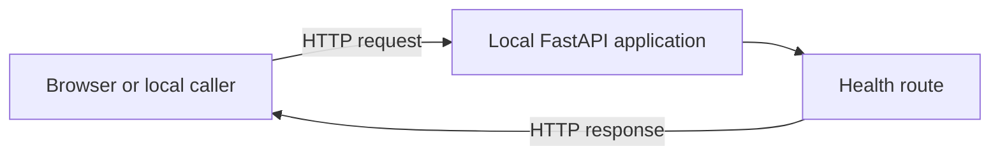
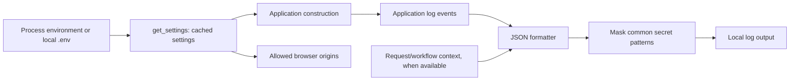
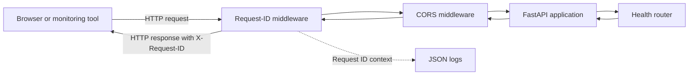
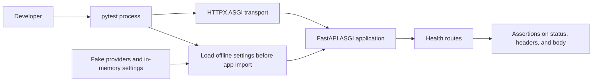
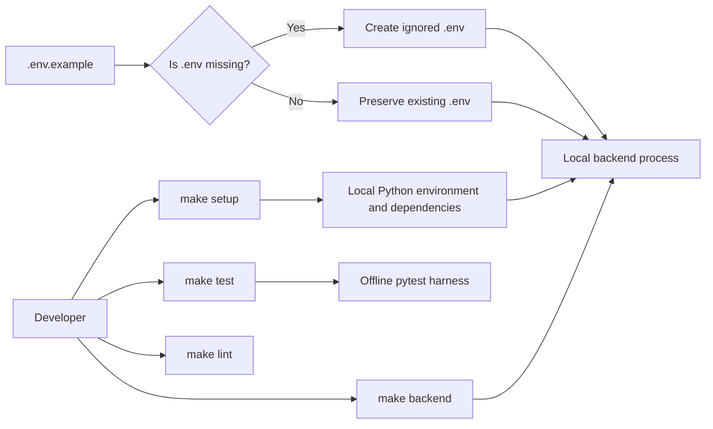
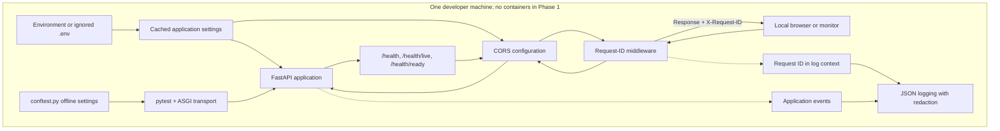
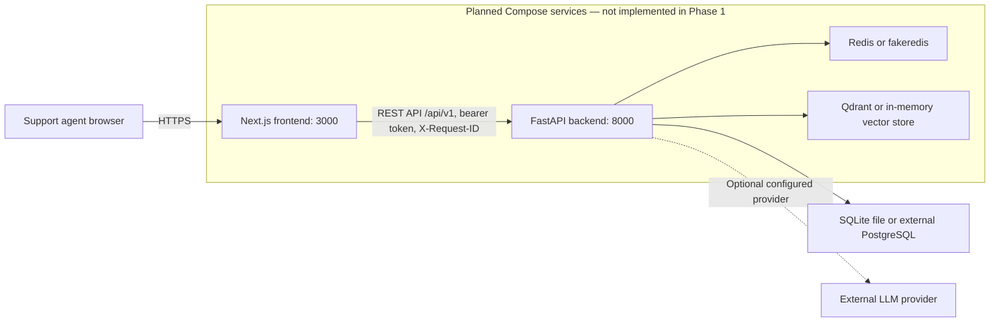

# Phase 1 — Infrastructure Design Evolution

This file documents **Phase 1 only**. It explains how the application components
are wired and how requests are routed today, then shows the planned Docker shape as
a future design. Each project phase should have its own file in this folder.

## Important status: Phase 1 is not a Docker deployment

There is currently no Dockerfile or Docker Compose manifest in the repository.
Phase 1 runs as a local Python application, not as a group of containers. The
Docker diagram at the end of this document is the planned architecture from the
project specification; it is **not implemented or deployed**.

## Starting point — one local web process

The simplest Phase 1 design is one client talking to one web application. There are
no container networks or service-to-service connections yet.

In the local development command, Uvicorn starts the application on
`127.0.0.1:8000`. The `127.0.0.1` address means the service is bound to the same
computer by default. This is useful for development; it is not a public production
endpoint.

## P1-1 — Wire application settings and logging

The application reads configuration once through the cached settings helper. The
settings include options for the database, Redis, vector store, model provider,
CORS origins, and other features that will be used by later phases. In Phase 1,
having a setting for a service does not mean that the service is already connected.

The application also installs a JSON log formatter. Later, request middleware can
place a request ID into the logging context so related records can be found together.

**Infrastructure effect:** configuration is supplied to the local process rather
than hard-coded into a network service. Secrets are not intended to be committed;
the real `.env` file is Git-ignored.

## P1-2 — Wire the HTTP middleware and routes

The order of the wrappers matters. `RequestIdMiddleware` is the outer layer, CORS is
inside it, and the FastAPI application is inside both. A request passes through them
in that order. The response travels back through the wrappers, allowing the outer
layer to add `X-Request-ID` even when the response comes from CORS or an error path.

CORS is a browser permission check: it tells a browser which configured website
origins may read responses. It is **not** a proxy, a firewall, or a route to another
service.

The Phase 1 routes are:

| Route | Current behavior | Dependency traffic |
|---|---|---|
| `GET /health` | Returns a basic `ok` response | None |
| `GET /health/live` | Returns a liveness response | None |
| `GET /health/ready` | Checks whether dependency settings look configured | No live dependency connections |

`/health/ready` is a configuration check, not proof that a database or other
dependency is reachable. The `/api/v1` business routes are not part of this phase.

## P1-3 — Wire tests without a network or containers

Pytest loads `tests/conftest.py` before importing the application. That setup forces
offline-friendly settings, such as a fake model provider, in-memory vector storage,
fake-Redis mode, and in-memory database/checkpoint settings.

The existing API tests use an in-process ASGI transport. They pass requests directly
to the application object instead of opening a TCP port. So, even though the tests
exercise HTTP behavior, they do not need a running server, Docker, or cloud services.

**Infrastructure effect:** test traffic stays inside the test process. No test
network or container topology is needed for the current runtime checks.

## P1-4 — Wire local developer commands and configuration files

The Makefile provides local entry points for setting up dependencies, running tests,
checking style, and starting the backend. `make setup` is designed to copy
`.env.example` to `.env` only when a local `.env` does not already exist. That keeps
an existing developer configuration from being overwritten.

**Infrastructure effect:** local setup and test operations are repeatable, but the
Makefile does not provision Docker networks or cloud services.

## End-of-Phase 1 — Integrated component wiring

At the end of this phase, the runtime is still one local web process. Its internal
request path is now explicitly layered and observable:

1. The process reads its settings during application construction.
2. HTTP requests enter through request-ID middleware.
3. CORS applies the configured browser-origin policy.
4. FastAPI dispatches to the health route.
5. The response returns through the wrappers with the same request ID.
6. Logs carry the request ID where available and apply secret masking.
7. Tests exercise this wiring locally with offline settings.

## Planned later: Docker Compose service network

The target architecture specifies a frontend, backend, Redis, and Qdrant in a
container stack. The frontend calls the backend over the API; the backend uses its
configured data and provider services. The user's browser should not connect
directly to backend data stores.

This is a target design, not a Phase 1 network diagram. In particular, no Docker
service names, Compose network, container health checks, or published production
ports are currently defined in the repository. SQLite would be a file used by the
backend; PostgreSQL may be separately managed. Those details should be updated in
this folder when the container phase implements them.

## Component reference

| Responsibility | Implementation |
|---|---|
| Application and middleware assembly | [main.py](../../backend/app/main.py) |
| Request-ID boundary | [request_id.py](../../backend/app/middleware/request_id.py) |
| CORS and configured settings | [config.py](../../backend/app/core/config.py) |
| Health routing | [health.py](../../backend/app/api/health.py) |
| Request/workflow log context | [logging.py](../../backend/app/core/logging.py) |
| Offline test wiring | [conftest.py](../../tests/conftest.py) |
| Local development entry points | [Makefile](../../Makefile) |
| Planned whole-system architecture | [ARCHITECTURE.md](../../docs/ARCHITECTURE.md) |
