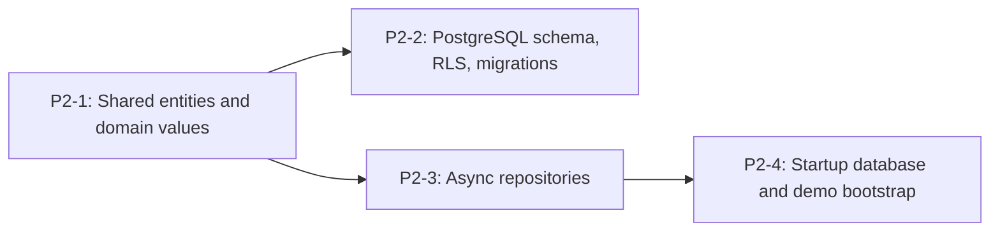
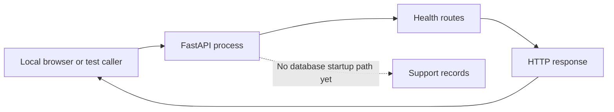
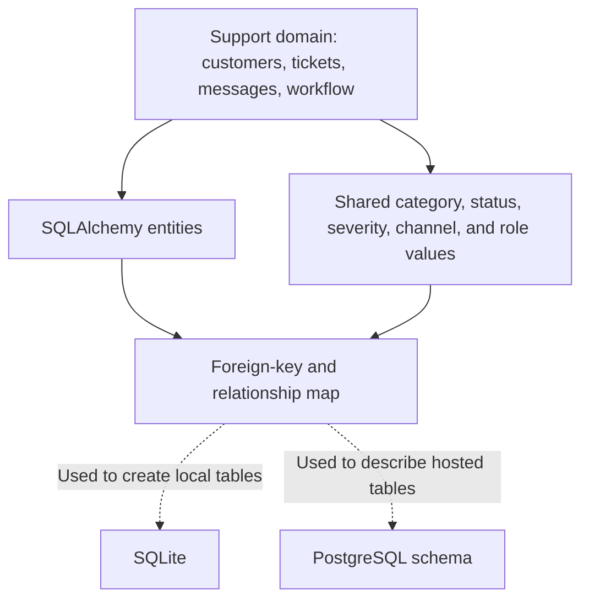
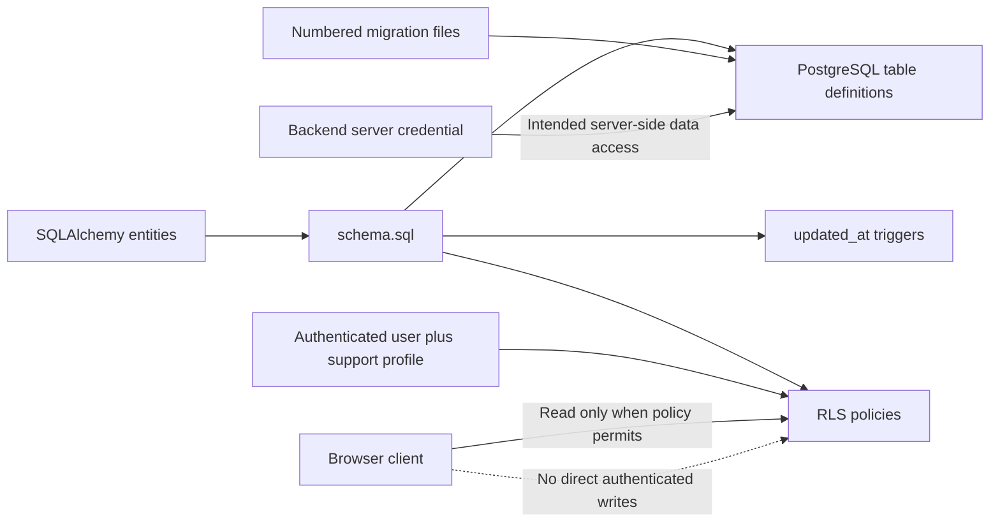
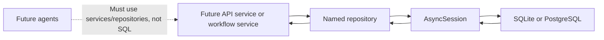
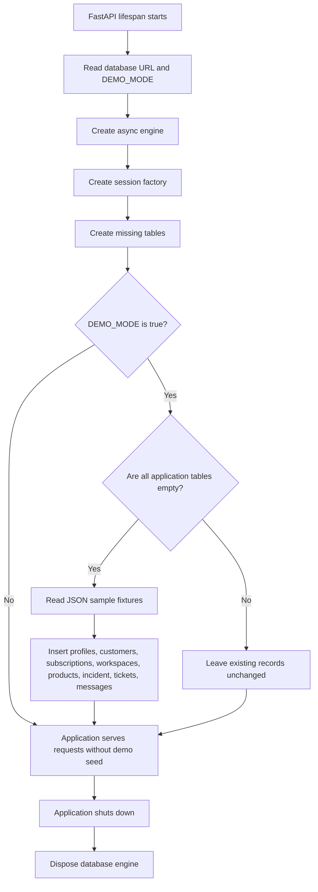
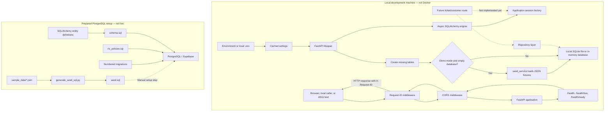
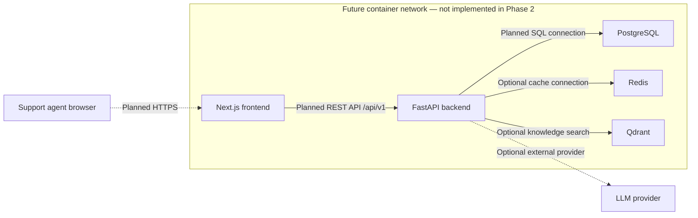

# Phase 2 — Infrastructure and Component-Wiring Evolution

This document explains how the Phase 2 data components connect to the running
application, how requests are currently routed, and what is prepared for
PostgreSQL. It distinguishes the implemented local setup from future Docker
networking.

## Status at the end of Phase 2

Phase 2 adds database setup and data-access wiring to the local FastAPI service.
It does **not** add Dockerfiles, a Compose file, a container network, or a live
PostgreSQL deployment. Docker networking remains a future delivery task.

The Phase 2 subtasks connect in this order:

P2-2 and P2-3 are parallel work after the shared entities exist. P2-4 adds startup
wiring and fixtures after the persistence foundation.

## Starting point — local HTTP service only

Before Phase 2, the application ran as a local Python web service. A caller could
reach health routes, but there was no connected customer/ticket database path.

This is the conceptual starting point for the phase. It is not a Docker topology:
the application was a local process, not a group of containers.

## Component wiring by subtask

### P2-1 — Define the data shapes

The entity classes describe the records and their relationships—for example, a
ticket refers to a customer, a workspace can have tickets, and a ticket can have
messages and workflow records. Shared categories and statuses give those records
consistent values.

At this step, models describe the data but are not a request router and do not
automatically connect to a database.

### P2-2 — Describe the hosted database and its access boundary

The PostgreSQL setup is kept as SQL files separate from the Python models:

- `database/schema.sql` creates the tables and update-time triggers.
- `database/rls_policies.sql` enables row-level security and grants authenticated
  support roles read access. Direct authenticated writes are withheld.
- `database/migrations/` records the setup as numbered SQL changes.

The intended backend connection uses a server-only `service_role` credential.
That credential must not be sent to a browser. These policies are prepared code;
they have not been applied to a live PostgreSQL database.

The user identity and full API role enforcement arrive in the later identity phase.
RLS is a database-side boundary; it is not a replacement for API authentication or
business approval checks.

### P2-3 — Put database queries behind repositories

Repositories receive an asynchronous database session and use SQLAlchemy to read
or change records. The caller owns the larger transaction and decides when to
commit. Repositories do not handle HTTP requests, make policy decisions, or call
AI models.

Repositories exist for the mapped entities, but the ticket and customer routes
that will use them have not been implemented. `get_session` provides a request
dependency for later routes to obtain a session from the application session
factory.

### P2-4 — Wire database startup and optional demo loading

The FastAPI lifespan is the application start-and-stop sequence. On startup it
reads the configured database URL, creates an async engine and session factory,
creates missing tables, and—only when demo mode is enabled—checks whether all
application tables are empty. If so, it loads the JSON fixtures in a single
transaction. When the application shuts down, it disposes of the engine.

The fixture set has three support profiles, eight customers and related records,
and thirteen ticket scenarios. The bootstrapped local database uses SQLite. A
separate generator creates PostgreSQL `seed.sql` from the same JSON files; it must
be run manually as part of the clean hosted-database setup.

## End-of-Phase 2 — Current component and request routing

The application still runs as **one local FastAPI process**. Its startup path now
sets up persistence, while its current HTTP request path still serves health
routes. The ticket API is future work.

### Current HTTP request path

1. A local caller sends an HTTP request to the FastAPI process.
2. The outer request-ID middleware validates or creates `X-Request-ID`.
3. CORS applies the configured browser-origin policy inside that boundary.
4. FastAPI dispatches the request to its current health routes.
5. The response returns through the middleware and includes the request ID.

The `/health` and `/health/live` routes do not query the database. `/health/ready`
checks whether connection settings look configured; it does not prove that the
database is reachable. Database initialization happens during application startup,
not on every health request.

### Current database path

1. The lifespan reads settings and creates the engine and session factory.
2. SQLAlchemy creates missing tables from the entity metadata.
3. If demo mode is enabled, the bootstrap checks all mapped tables.
4. If the database is empty, the bootstrap inserts fixtures in relationship order.
5. Future routes can request a session and use repositories rather than writing
   database queries inside the route.

The SQLite file is local to the backend process. The PostgreSQL schema and RLS
scripts are not automatically applied by the local startup code.

## Docker networking: planned, not implemented

There are no Dockerfiles or Compose files in the repository at the end of Phase 2.
Therefore, there is no Docker bridge network, container DNS name, published
container port, or container-to-container route to describe as current behavior.

The planned later deployment shape is shown below only to explain the intended
direction. In a future Compose setup, the browser would reach the frontend, the
frontend would call the backend API, and the backend would connect to its data
services. The browser would not connect directly to the database.

When container files are implemented, this document should be updated with the
actual service names, internal ports, published ports, health checks, and network
boundaries. Until then, those details are design intent, not deployed
infrastructure.

## Component reference

| Responsibility | Implementation |
|---|---|
| Application lifecycle and middleware assembly | [main.py](../../backend/app/main.py) |
| Request-ID middleware | [request_id.py](../../backend/app/middleware/request_id.py) |
| Health routes | [health.py](../../backend/app/api/health.py) |
| Engine, session factory, and table creation | [database.py](../../backend/app/core/database.py) |
| Conditional fixture loading | [seed_service.py](../../backend/app/services/seed_service.py) |
| Entity definitions | [entities.py](../../backend/app/models/entities.py) |
| Async repository layer | [repositories/](../../backend/app/repositories/) |
| PostgreSQL setup and migrations | [database/](../../database/) |
| Offline fixtures | [sample_data/](../../sample_data/) |
| Target full-system architecture | [ARCHITECTURE.md](../../docs/ARCHITECTURE.md) |
