# Phase 3 — Infrastructure and Component-Wiring Evolution

This document explains how the Phase 3 authentication, role, rate-limit, request
tracking, and audit components are wired into the running application. It
documents only what is implemented in the repository and clearly separates that
from future Docker and production networking.

## Status at the end of Phase 3

Phase 3 does not add Docker containers or a Compose network. The application is
still a local FastAPI process. It does add runtime HTTP wrapping, in-process
authentication dependencies, and connections to Redis or fake Redis and the
application database.

| Component | Current location | Current infrastructure |
|---|---|---|
| FastAPI process | Local Uvicorn process | `127.0.0.1:8000` in development |
| Database | SQLite or prepared PostgreSQL | SQLite file or in-memory test database |
| Redis | Real Redis or fake Redis | In-process fake Redis in demo/test mode |
| Browser routing | CORS rules | No frontend container or reverse proxy yet |
| Audit storage | `audit_logs` table | Same database session factory as the application |
| Containers | Not implemented | Docker networking remains a later delivery phase |

The subtask wiring sequence is:

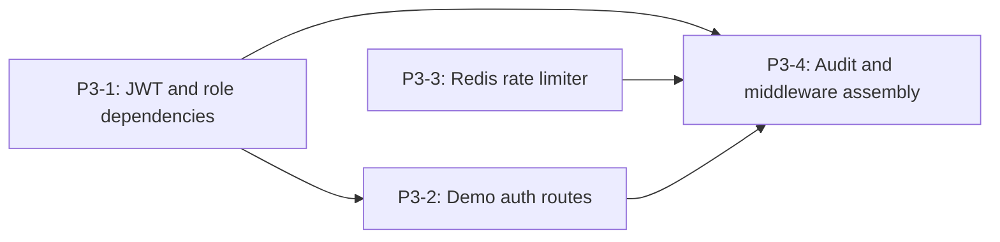

P3-1 and P3-3 can be built independently. P3-2 depends on P3-1 for its JWT
format and role values. P3-4 is last because it connects the complete HTTP
middleware chain.

## Starting point — local HTTP process before request guards

At the start of Phase 3, the application has the data foundation and request-ID
boundary from earlier phases. An incoming HTTP request reaches FastAPI, CORS, and
the route. The route does not have a shared JWT verifier or role dependency.

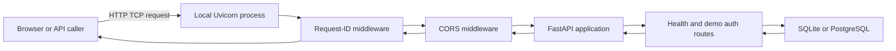

The diagram represents local process wiring, not Docker network routing. The
database has one application connection, but an authenticated request has not yet
passed through a common role decision.

## P3-1 — Wire JWT verification and route authorization

P3-1 adds two in-process security components:

1. `get_current_user` extracts the bearer token and verifies its JWT claims.
2. `require_role` turns a minimum role into a FastAPI dependency.

These components do not open a separate network service. They run inside the
FastAPI worker process. The effective JWT secret comes from cached application
settings:

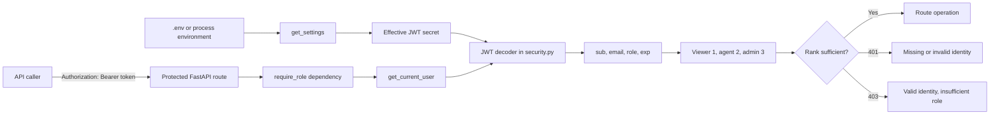

The secret is selected by the application settings. Supabase JWT secret takes
priority over the local JWT secret. In demo mode, when neither is configured,
the application supplies the demo-only local secret. A production process should
not rely on that fallback.

The actual network flow has no extra authentication server. FastAPI receives the
token and verifies it locally:

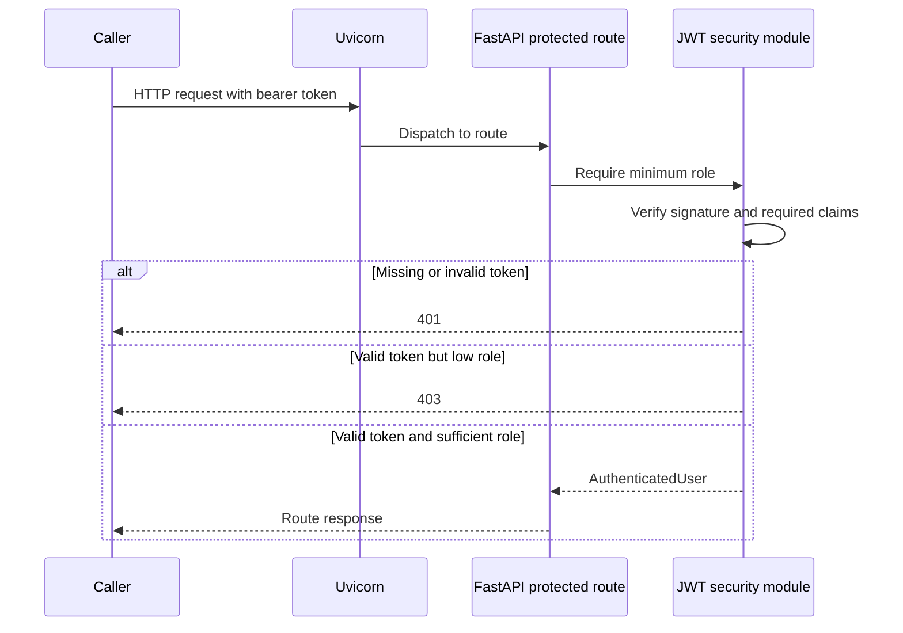

**Infrastructure effect:** authentication is a CPU and configuration operation
inside the FastAPI process. It does not require a network call to an identity
service.

## P3-2 — Wire demo token issuance and `/me`

P3-2 exposes the demo authentication routes under `/api/v1/auth`. The API route
uses the same database session factory that application startup creates for
SQLite or PostgreSQL.

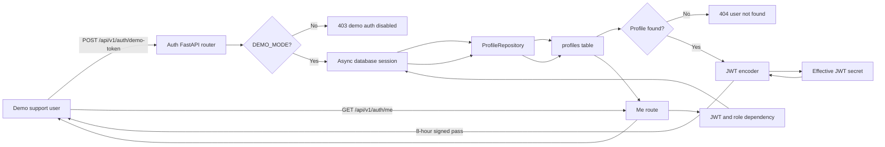

The route does not call a separate identity provider. The network components are:

- HTTP: the browser or client to Uvicorn/FastAPI;
- database: FastAPI to SQLite or the configured hosted PostgreSQL service;
- JWT: local signing and verification inside FastAPI;
- browser storage: the caller retains the pass and sends it as a bearer header.

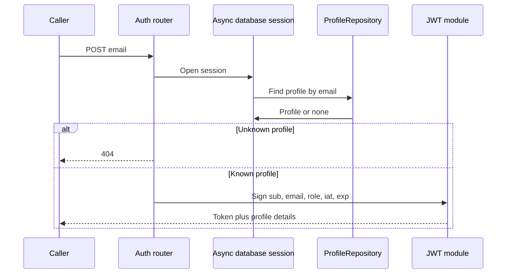

**Infrastructure effect:** demo login depends on the application database and
process settings. It does not create an additional container or network service.

## P3-3 — Wire Redis and fake Redis rate limiting

P3-3 adds a middleware component that counts one-minute request windows. The
component chooses one of two cache clients from the Redis factory.

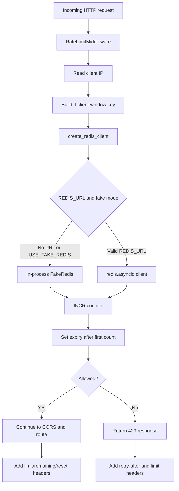

In the current local setup, `USE_FAKE_REDIS=true` and `REDIS_URL` is empty, so
FakeRedis runs as an in-memory Python object inside the FastAPI process. It does
not create a Redis container or a network socket.

In the future Docker or cloud setup, the backend can receive a Redis URL and
connect to a managed or container Redis service:

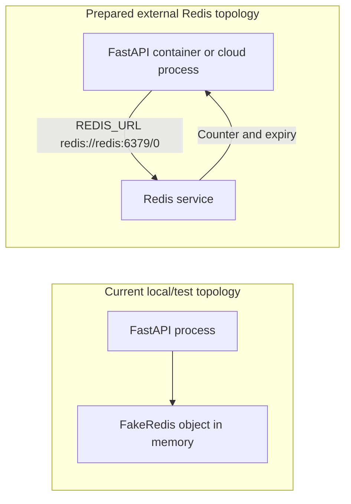

The limiter also isolates cache failures. If `INCR`, `EXPIRE`, or connection
operations raise a Redis or network error, the middleware fails open and permits
the request. It does not route traffic to the database for the rate-limit
decision.

**Infrastructure effect:** the Redis client is an optional external dependency,
while fake Redis keeps the demo and offline test stack local.

## P3-4 — Wire audit, tracing, and middleware order

P3-4 is the shared HTTP assembly point. The application is wrapped in:

```text
RequestIdMiddleware
  -> AuditMiddleware
     -> RateLimitMiddleware
        -> CORSMiddleware
           -> FastAPI
```

This order is implemented in `create_app()`:

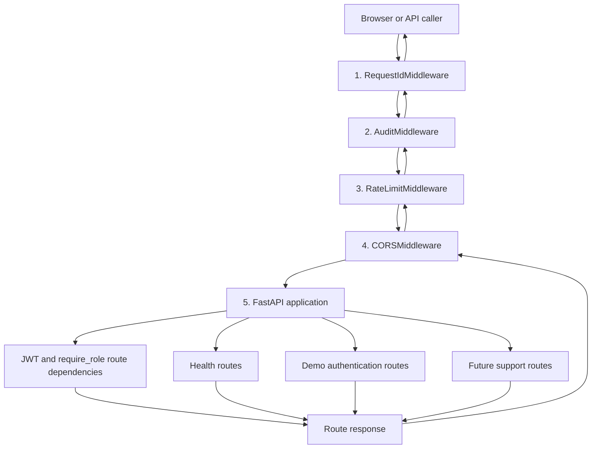

On the way in, request ID processing surrounds every later result. This means a
request rejected by rate limiting or CORS can still receive the trace header.
On state-changing requests, audit middleware records the actor and response:

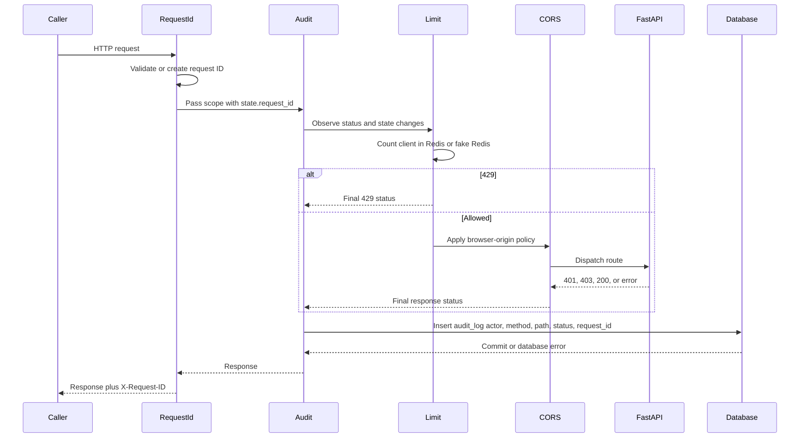

Audit middleware uses the application session factory. It is not a separate
microservice or container. It opens an asynchronous SQLAlchemy session to the
configured SQLite or PostgreSQL database, adds an `AuditLog`, and commits.

Read-only `GET` requests are bypassed. State-changing methods are watched,
including requests that can end in 401, 403, 429, or 500. `HEAD` and `OPTIONS`
are also excluded from the audit row.

**Infrastructure effect:** the audit database path is coupled to the application
database availability. Audit failures are isolated so the HTTP response can
continue.

## End-of-Phase 3 component wiring

The complete local component map is:

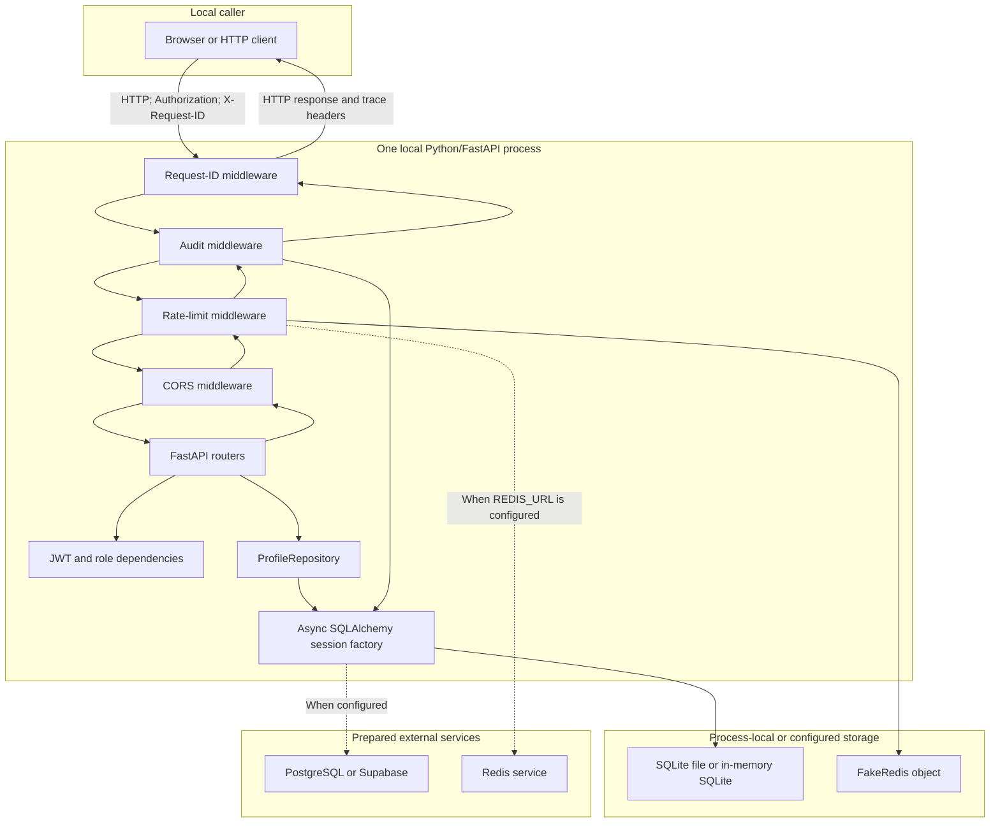

The route can follow one of these current infrastructure paths:

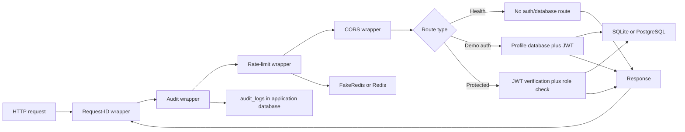

## Prepared Docker network: not implemented in Phase 3

The target Phase 14 architecture may place the frontend, backend, Redis, and
vector store in containers. Phase 3 does not yet create that network.

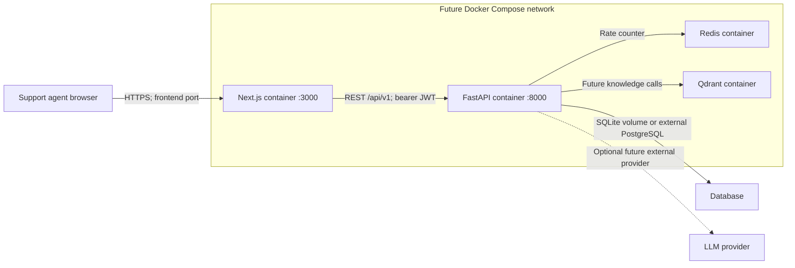

This is a target design. The repository currently has no Dockerfile or Compose
file for Phase 3, and no live Redis or PostgreSQL container is started by the
current application.

## Component-to-infrastructure reference

| Component | Infrastructure responsibility |
|---|---|
| Uvicorn and FastAPI | Host HTTP routes and middleware in one process |
| `create_app()` | Assemble middleware wrappers and CORS policy |
| `RequestIdMiddleware` | Attach a trace ID to the HTTP scope and response |
| `AuditMiddleware` | Open an application database session and write audit records |
| `FixedWindowRateLimiter` | Count requests through Redis or fake Redis |
| `create_redis_client()` | Select process-local or external cache infrastructure |
| JWT settings and security module | Supply and verify local signing configuration |
| Demo auth router | Query the application database and sign a local pass |
| `get_session()` | Supply route-scoped database sessions |
| SQLite demo database | Store profiles and audit rows in the local process setup |
| PostgreSQL/Supabase | Prepared database infrastructure, not live in Phase 3 |

## Routing and network boundaries

1. The caller reaches FastAPI through a local host port or future load balancer.
2. Request-ID middleware validates or creates the HTTP trace ID.
3. Audit middleware watches state-changing HTTP requests.
4. Rate-limit middleware uses the client IP and cache counter.
5. CORS middleware applies browser-origin policy.
6. FastAPI routes dispatch into auth or future business dependencies.
7. Demo auth and audit operations use the database session factory.
8. Redis operations use fake Redis locally or Redis externally when configured.
9. The response returns through CORS, limit, audit, and request-ID wrappers.
10. The caller receives the HTTP status, JSON body, and trace/rate-limit headers.

## Honest validation status

Phase 3 infrastructure is implemented and validated locally with:

- in-process ASGI HTTP tests;
- in-memory SQLite sessions;
- fake Redis counters;
- no Docker containers;
- no live Redis service;
- no live PostgreSQL or Supabase account;
- no reverse proxy or frontend network;
- no published cloud endpoint.

The middleware order and request routing are implemented. Docker networking,
container health checks, service discovery, TLS termination, load balancing,
and hosted database deployment are future delivery work.
