# Phase 4 — Infrastructure and Component-Wiring Evolution

This document explains how the Phase 4 Support API components are wired into the
running application. It covers routing, middleware, database sessions, services,
repositories, and response paths. It also separates implemented process wiring
from the Docker and container networking that are planned for a later phase.

## Current infrastructure status

At the end of Phase 4, CloudDesk still runs as a local Python/FastAPI process.
The Phase 4 subtasks add API routers, Pydantic validation models, and service
components. They do not add Docker containers, a Compose file, a reverse proxy,
or a frontend deployment.

| Component | Phase 4 infrastructure state |
|---|---|
| FastAPI application | One local Uvicorn/ASGI process |
| Ticket API | Mounted in-process under `/api/v1/tickets` |
| Customer API | Mounted in-process under `/api/v1/customers` |
| Authentication | JWT verification inside the FastAPI process |
| Role checks | FastAPI dependencies inside each protected route |
| Database sessions | Async SQLAlchemy sessions created from the application factory |
| Redis | Real Redis or in-process FakeRedis |
| Frontend | Not implemented as a running container or server |
| Docker | No Dockerfile or Compose network is present yet |

The subtask wiring sequence is:

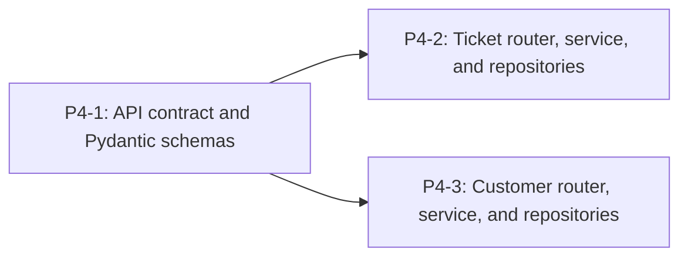

P4-1 defines the route and JSON contract. P4-2 and P4-3 then add separate HTTP
routers that consume that contract.

## Starting point — protected local API without support routes

Before Phase 4, FastAPI has authentication, request-ID, audit, rate-limit, CORS,
health, and demo-auth components. It also has an application database session
factory and repositories. However, it has no mounted ticket or customer API.

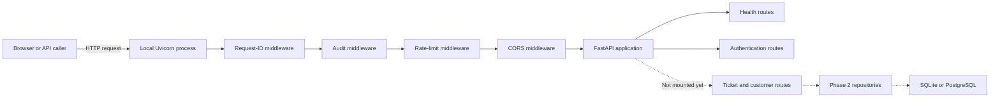

The database session factory already exists, so Phase 4 does not create a second
server process or database connection system. It mounts new routers and has those
routers request sessions from the existing application state.

## P4-1 — Wire the API contract into backend and frontend types

P4-1 is primarily a contract wiring change. It gives the application named domain
and response structures before P4-2 and P4-3 add routes.

The contract has two technical copies:

1. `docs/API_CONTRACT.md` is the written route and payload contract.
2. Pydantic classes in `backend/app/schemas/` validate backend requests and shape
   backend responses.

The future frontend should mirror the contract in `frontend/lib/types.ts`. This
does not create a network call or container connection. It prevents the browser
and backend from treating the same values differently.

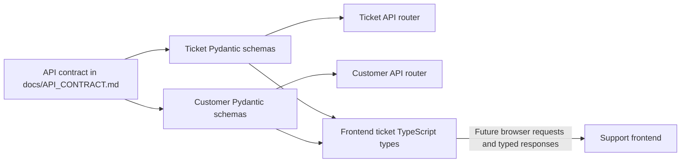

Pydantic acts at the HTTP boundary:

- request JSON is converted into typed values;
- invalid channels, statuses, or required fields are rejected;
- ticket creation requires exactly one customer source;
- database entities are converted into response models.

**Infrastructure effect:** P4-1 adds no runtime network hop. It adds a validation
and transformation boundary that runs inside the FastAPI process.

## P4-2 — Wire ticket routes, ticket service, and repositories

P4-2 mounts a ticket router on the main FastAPI application:

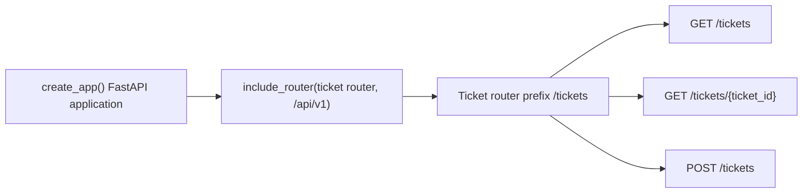

The HTTP flow for the ticket API is:

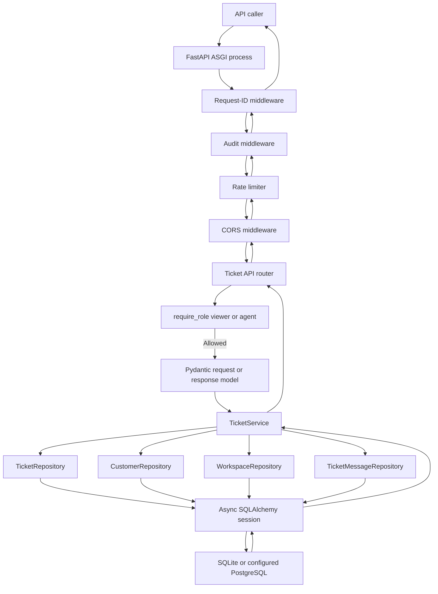

### Ticket list route

`GET /api/v1/tickets` is routed to the ticket router. The viewer-or-higher role
dependency is evaluated before the service is called.

The query parameters for status, category, severity, limit, and offset are
Pydantic/FastAPI values. `TicketService` validates pagination limits, and
`TicketRepository` creates the SQLAlchemy filtered query.

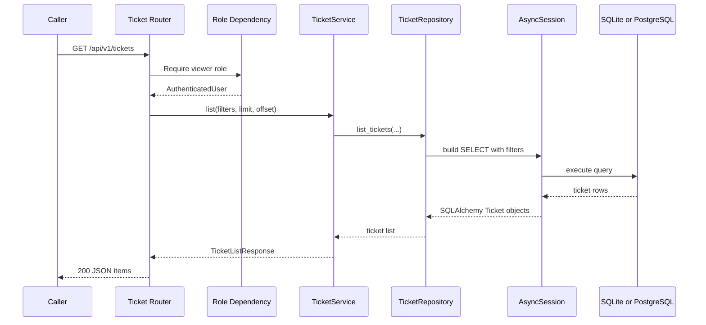

### Ticket detail route

`GET /api/v1/tickets/{ticket_id}` asks `TicketService` for a complete ticket.
`TicketRepository.get_detail()` uses eager-loading to gather the customer,
workspace, and messages with one repository result path.

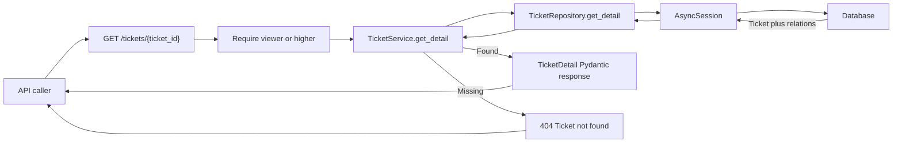

### Ticket creation route

`POST /api/v1/tickets` is the more complex P4-2 request path. The route requires
an agent or admin, validates the Pydantic request, and gives it to
`TicketService`.

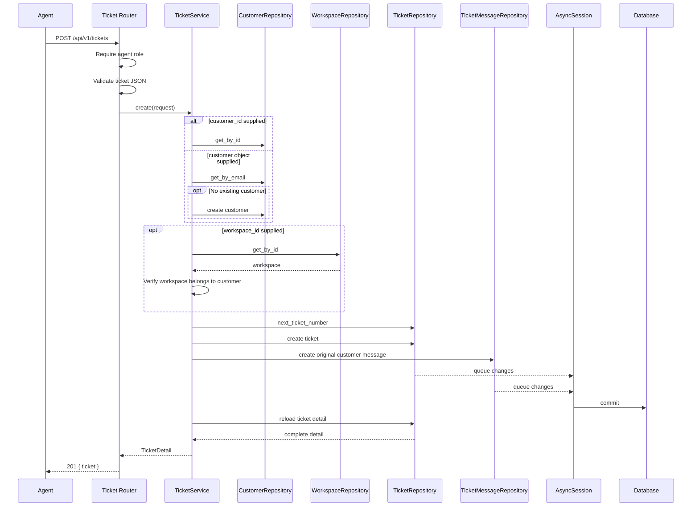

All repositories use the same request-scoped `AsyncSession`. The ticket, customer
link, workspace link, and original message are committed together. This is one
database transaction rather than independent network calls.

**Infrastructure effect:** P4-2 adds local in-process routing and repository
coordination. It does not open a separate ticket microservice or message queue.

## P4-3 — Wire customer routes, customer service, and redaction

P4-3 mounts a second in-process router on the main FastAPI application:

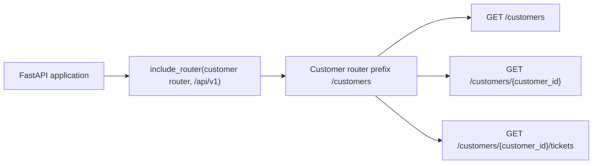

The customer API follows the same middleware and session path as the ticket API:

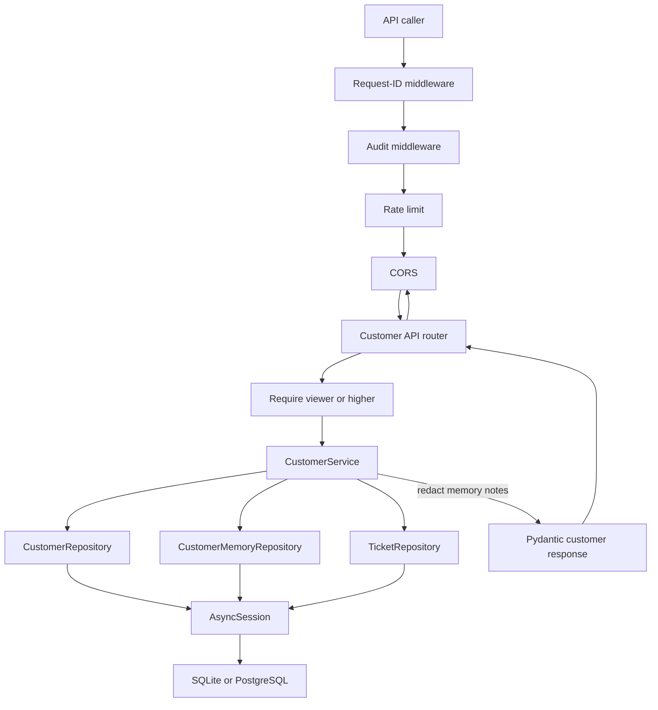

### Customer list route

The list route uses `CustomerRepository.list()` and a Pydantic
`CustomerListResponse`. It returns summary fields rather than subscriptions,
workspaces, or memory.

### Customer detail route

The detail route has the largest P4-3 component assembly:

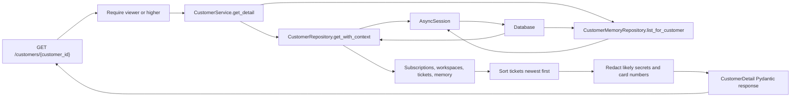

The redaction step runs inside `CustomerService`, not in the database or the HTTP
router. It masks likely password, API-key, token, secret, and card patterns before
the Pydantic memory objects leave the application.

### Customer ticket-history route

The history route verifies that the customer exists, then calls
`TicketRepository.list_for_customer()` with the requested customer ID and pagination
values.

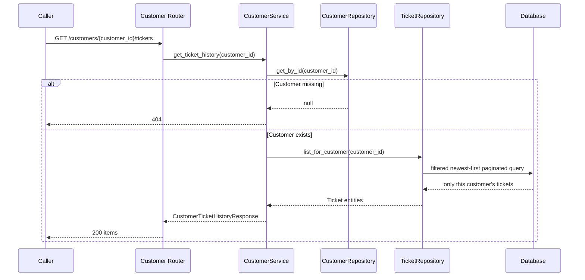

**Infrastructure effect:** P4-3 adds no external customer service. It combines
database relationships and an in-process redaction function inside the backend
process.

## Complete Phase 4 request and response routing

The final in-process topology has one FastAPI application, one application database
session factory, and two Support API routers. Middleware wraps every HTTP request.

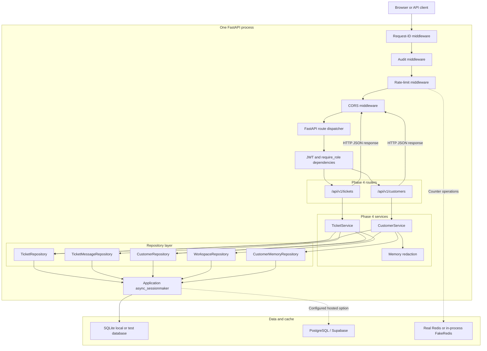

## Database and session routing

FastAPI creates the database engine and session factory during its lifespan. A
ticket or customer route does not create a new engine for every request.

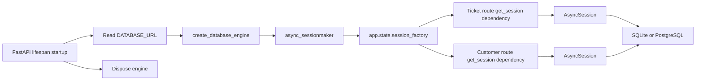

The database URL determines the target:

- local demo and tests normally use SQLite;
- PostgreSQL and Supabase use an external database connection;
- no browser or frontend component receives the database credential.

The service-role credential belongs to the backend server process. It is not
placed in the Next.js browser bundle or in Pydantic response fields.

## Audit and error routing in Phase 4

Phase 4 makes the existing audit infrastructure more useful because there are
now real state-changing API operations. A `POST /api/v1/tickets` request passes
through the audit middleware as a non-GET method.

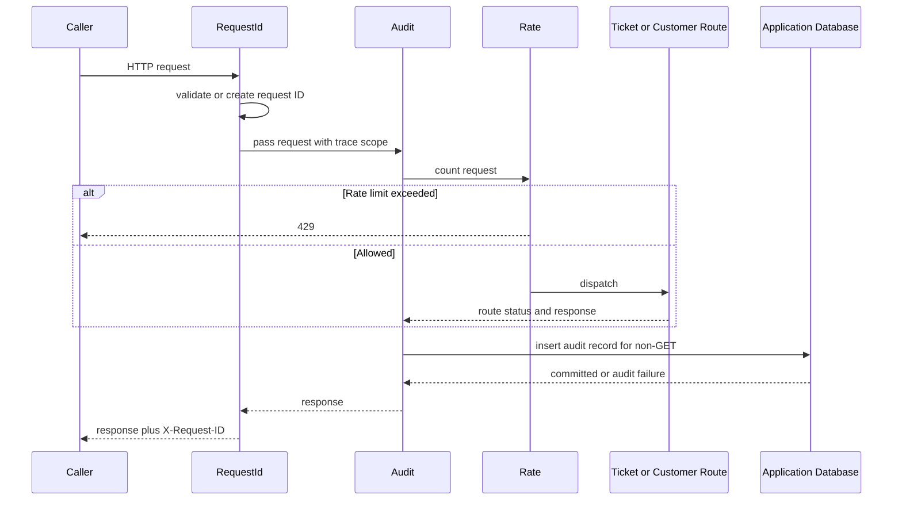

Audit failures are not allowed to change the route's intended HTTP result. The
audit record is separate telemetry. This protects ticket and customer responses
from a telemetry-write failure.

## CORS and browser routing

There is no frontend application or reverse proxy in Phase 4. CORS is configured
inside the FastAPI process so a future browser frontend can call the API.

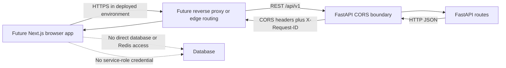

The current CORS configuration allows configured origins, all methods and headers,
and exposes `X-Request-ID`. CORS is browser access control, not a network proxy
and not a replacement for JWT or role checks.

## Planned Docker component topology

The Docker topology is future work. It is not a description of the currently
running Phase 4 process. The project specification anticipates:

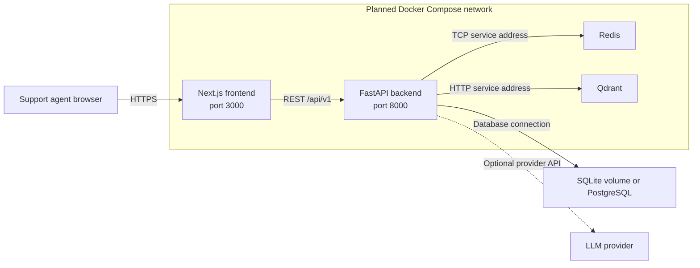

In the target deployment:

- only the frontend and backend would publish browser-facing or routing ports;
- internal containers would communicate over a Docker network;
- Redis and Qdrant would use service names or DNS names;
- PostgreSQL could be containerized or externally managed;
- the frontend must not receive database or Redis credentials;
- a future reverse proxy or platform router would handle public TLS and route
  `/api/v1` to FastAPI.

These container connections are planned and should not be presented as completed
in Phase 4.

## Component reference

| Infrastructure responsibility | Implementation |
|---|---|
| FastAPI assembly and router mounting | [main.py](../../backend/app/main.py) |
| Database engine and session routing | [database.py](../../backend/app/core/database.py) |
| Ticket HTTP routes | [api/tickets.py](../../backend/app/api/tickets.py) |
| Customer HTTP routes | [api/customers.py](../../backend/app/api/customers.py) |
| Ticket coordination | [ticket_service.py](../../backend/app/services/ticket_service.py) |
| Customer coordination and memory redaction | [customer_service.py](../../backend/app/services/customer_service.py) |
| Ticket and message repositories | [tickets.py](../../backend/app/repositories/tickets.py) |
| Customer and memory repositories | [customers.py](../../backend/app/repositories/customers.py) |
| Request-ID wiring | [request_id.py](../../backend/app/middleware/request_id.py) |
| Audit routing | [audit.py](../../backend/app/middleware/audit.py) |
| Rate-limit routing | [rate_limit.py](../../backend/app/middleware/rate_limit.py) |
| Redis and FakeRedis selection | [redis.py](../../backend/app/core/redis.py) |
| API contract | [API_CONTRACT.md](../../docs/API_CONTRACT.md) |

## Validation and boundaries

Phase 4 component wiring is implemented and covered by focused API tests:

- ticket list, detail, creation, role, and validation routes;
- customer list, detail, history, role, and pagination routes;
- missing-ticket and missing-customer 404 behavior;
- customer/workspace mismatch rejection;
- memory-note redaction;
- middleware and JWT behavior inherited from earlier phases.

No Docker image, Compose network, frontend server, live PostgreSQL instance, or
live Redis service is implemented or required to run the Phase 4 focused tests.
