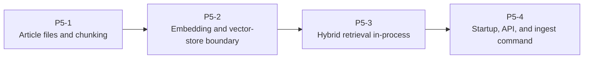
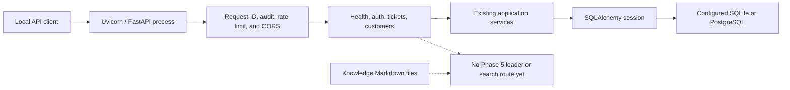
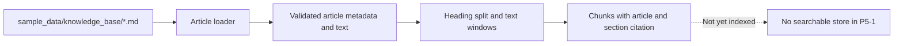
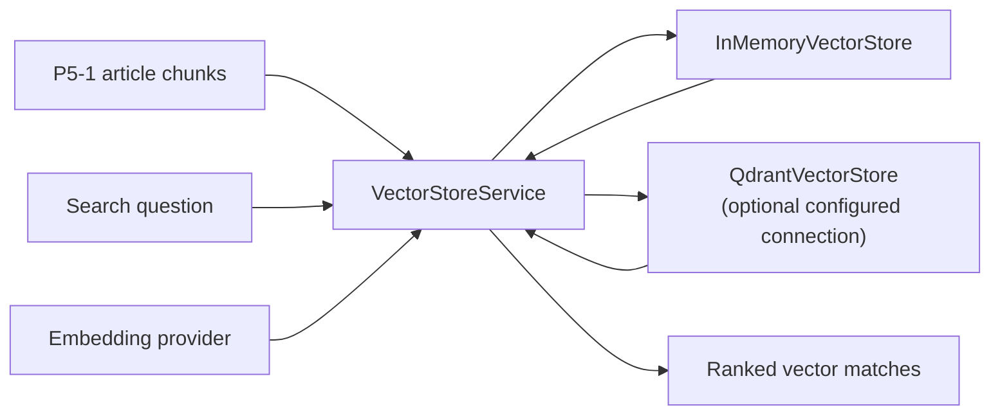
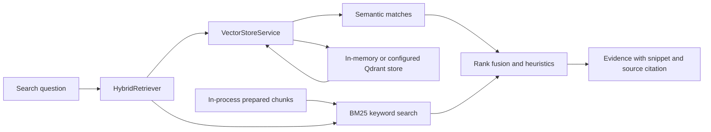
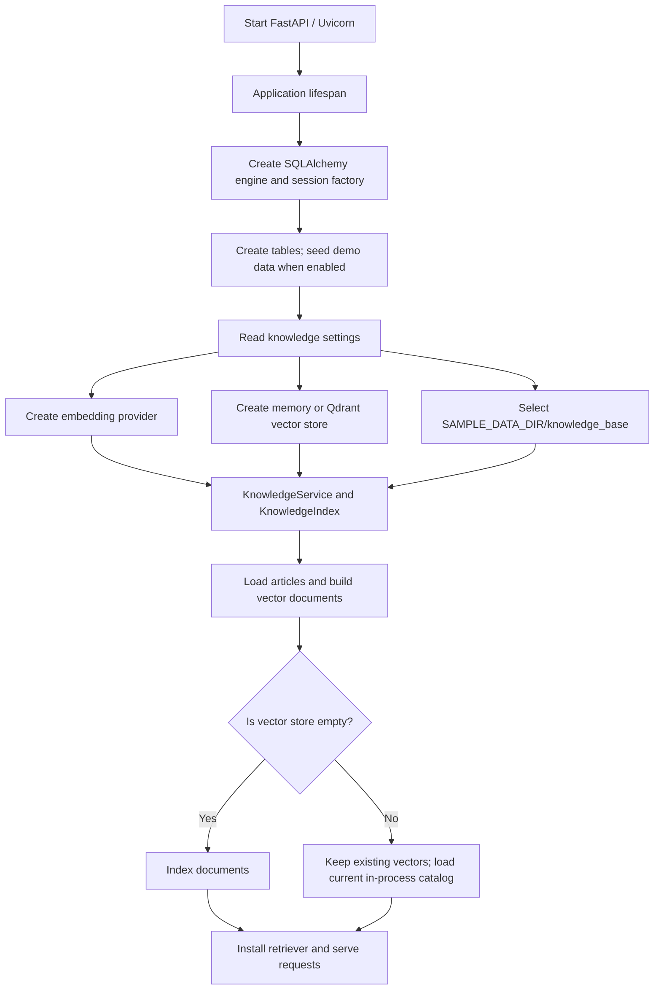
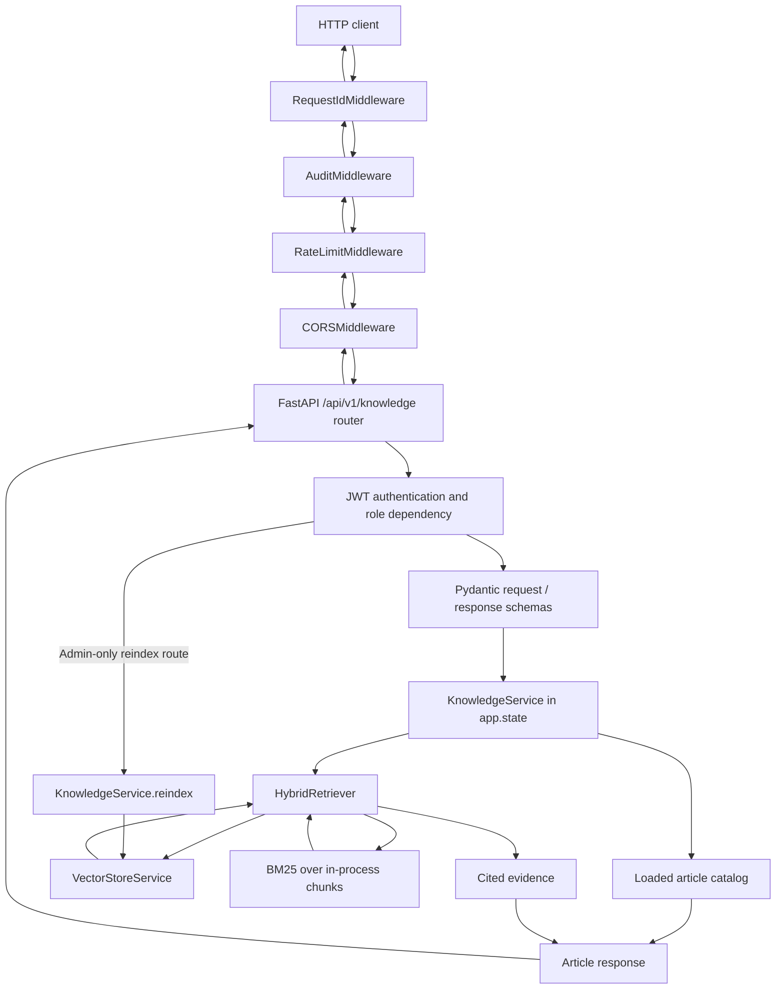
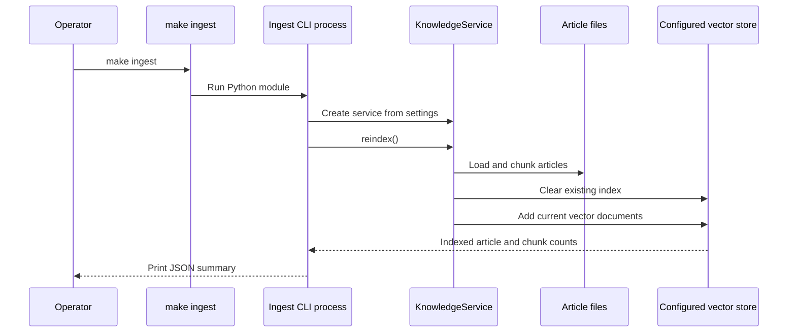
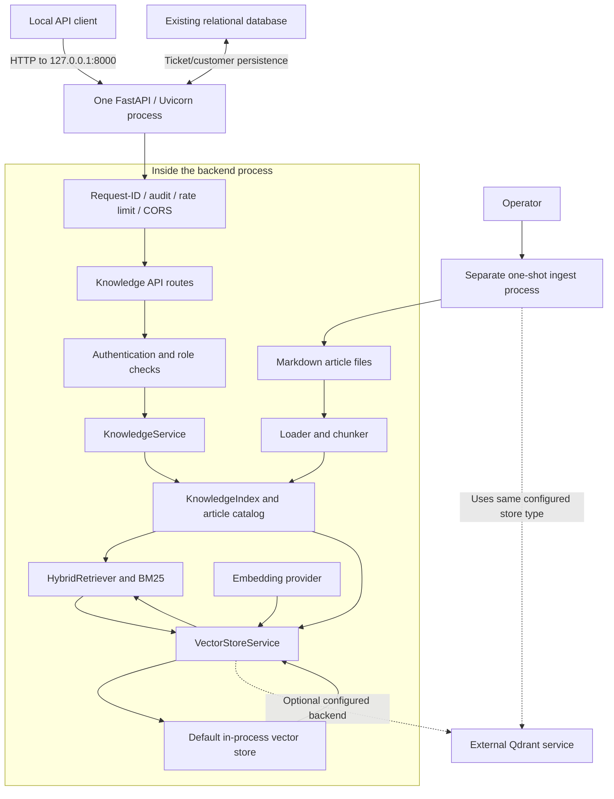
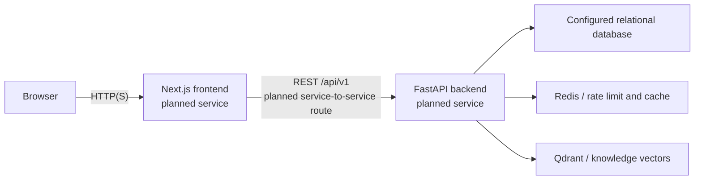

# Phase 5 — Infrastructure, Component Wiring, and Routing Evolution

This document explains how Phase 5's knowledge-search components connect to
each other and to the running CloudDesk application. It describes the
implemented local process wiring and the optional Qdrant connection. It also
distinguishes these from Docker networking, which is not configured in the
Phase 5 repository.

## Infrastructure status at the end of Phase 5

The Phase 5 knowledge pipeline runs inside the existing FastAPI application.
The backend is started locally by the Makefile; it is not split into a
knowledge microservice. The repository has no Dockerfile or Compose
configuration, so there is no implemented container network, service DNS, port
mapping, or volume mount to document as an existing feature.

| Component | Implemented Phase 5 connection |
|---|---|
| FastAPI backend | One local Uvicorn process; `make backend` binds `127.0.0.1:8000` |
| Knowledge API | In-process router mounted under `/api/v1/knowledge` |
| Article source | Markdown files read from `SAMPLE_DATA_DIR/knowledge_base` |
| Embeddings | Created in the backend process; default provider is deterministic fake embeddings |
| Vector storage | Default is process-local memory; optional Qdrant adapter connects to configured `QDRANT_URL` |
| Keyword search | BM25 uses the article chunks held by the backend process |
| Relational database | Configured through `DATABASE_URL`; separate from the knowledge vector store |
| Frontend | Phase 5 adds API contract types, not a running frontend or knowledge-search page |
| Docker / Compose | Not present in the repository at this phase |

The defaults in [.env.example](../../.env.example) select fake embeddings and
`VECTOR_STORE=memory`; `QDRANT_URL` is blank. The local backend command is
defined in [Makefile](../../Makefile). These defaults let the search pipeline
run without a separately hosted vector database.

## Wiring progression

Each task adds a component boundary or a caller. The first three tasks do not
add a new server or network hop; P5-4 wires the components into the existing
backend and adds a one-shot operator command.

## Starting point — after Phase 4

Before Phase 5, the backend already has one ASGI application, middleware,
authentication, database access, and ticket/customer routes. Knowledge article
files are not yet connected to an application route or search service.

At this point there is no knowledge-specific startup step, vector-store
connection, or HTTP route. Adding the knowledge search does not replace the
ticket/customer database path.

## P5-1 — Article files and chunk preparation

P5-1 adds a filesystem input to the data flow. The loader reads Markdown files,
validates their metadata, and the chunker divides content into heading-based,
overlapping windows. This work happens in the Python process when invoked; it
does not add an HTTP listener or an external dependency.

### Connection and routing implications

- Article files are local filesystem inputs, not requests to a remote service.
- The Phase 5.1 parser and chunker are library components, not standalone
  processes.
- Ticket and customer routes continue to use their existing database services.

## P5-2 — Embeddings and a storage adapter

P5-2 adds a `VectorStoreService` boundary. The embedding provider turns article
chunks and search questions into vectors. The adapter stores and searches them.
In the default configuration, both the fake embedding work and in-memory
storage happen in the backend process.

### Two storage modes

**Default local mode:** `VECTOR_STORE=memory` keeps vectors in the Python
process. It requires no network connection, but the contents are lost when that
process exits.

**Optional Qdrant mode:** `VECTOR_STORE=qdrant` creates the Qdrant adapter using
`QDRANT_URL`, the configured collection, and the optional API key. The backend
then connects to that configured Qdrant endpoint. This is an implemented
adapter, not evidence that a Qdrant server is running in this repository.

The relational database and vector store serve different roles: ticket and
customer data use SQLAlchemy and `DATABASE_URL`; knowledge chunks use the
vector-store interface.

## P5-3 — Hybrid search inside the application

P5-3 wires semantic matching and keyword matching together in
`HybridRetriever`. BM25 uses the prepared article chunks held in memory;
semantic matches come through the vector-store interface. The retriever fuses
the ranked results, applies local ranking heuristics, and returns cited
evidence.

This is still an in-process component flow, not a separate search service.
P5-3 by itself does not expose a URL; it supplies the retrieval operation that
P5-4 connects to the FastAPI route.

## P5-4 — Startup, API routes, and operator ingest

### Application startup wiring

The FastAPI lifespan creates the existing database engine and session factory,
creates tables, and optionally loads demo data. It then builds the
`KnowledgeService` from settings and initializes its index before the
application begins serving requests.

If the vector store is already populated, startup does not automatically clear
and rebuild it. The current article catalog is still loaded into the process;
an explicit reindex is the operation that rebuilds stored vectors.

### HTTP request routing

The application mounts the knowledge router under `/api/v1`. The relevant
knowledge endpoints are:

| Route | Authorization | Purpose |
|---|---|---|
| `GET /api/v1/knowledge` | Viewer or higher | List article summaries |
| `GET /api/v1/knowledge/{article_id}` | Viewer or higher | Return article detail |
| `POST /api/v1/knowledge/search` | Viewer or higher | Run retrieval and return evidence |
| `POST /api/v1/knowledge/reindex` | Admin | Clear and rebuild the configured index |

The request passes through middleware before reaching the router. For inbound
requests, the wrapping order is Request-ID, audit, rate limit, CORS, then the
FastAPI route. The response travels back through those wrappers in reverse.

The route layer checks the caller's role and validates request/response data.
`KnowledgeService` coordinates the catalog and retrieval; the retriever does
not access the ticket/customer SQL repositories. CORS exposes `X-Request-ID` to
browser clients. The existing frontend contract types do not, on their own,
create a network request or a deployed frontend.

### Reindex command routing

The `make ingest` target runs
`python -m backend.app.cli.ingest_knowledge` as a separate one-shot Python
process. It creates its own service from the same environment settings and
calls `reindex()`.

There is an important process boundary here: with the default in-memory
vector store, the CLI's indexed data disappears when the CLI exits. The API
process builds its own in-memory index during startup. To share vectors across
the CLI and API process lifetimes, configure a persistent external vector store
such as Qdrant; the live Qdrant connection has not been validated in this
environment.

An API reindex is different: it runs inside the already-running API process and
rebuilds that process's configured store and index.

## End-of-Phase 5 component and network view

This diagram summarizes the implementation that exists now. Solid connections
are current application wiring. The optional Qdrant link is used only when
selected in configuration.

The dashed Qdrant links are optional configuration paths, not a local service
discovered in this repository. In default memory mode, both the API and CLI
have separate process-local stores.

## Docker networking — planned, not implemented in Phase 5

No Dockerfile, Compose file, reverse proxy, or container network was found in
the repository. Therefore there are no implemented Docker service names,
container ports, health dependencies, network aliases, or data volumes to
describe for Phase 5.

The project architecture describes a later container setup in which the
browser uses the Next.js frontend and that frontend calls the FastAPI service.
The following is a **planned topology only**, not a Phase 5 deployment:

In a future Compose deployment, the frontend should call the backend using the
backend's service name on the Compose network, not `127.0.0.1` (which would
refer to the frontend container itself). The backend would connect to Qdrant
using its service name if Qdrant is part of that same network, or a configured
external URL if hosted elsewhere. Actual service names, ports, networks, health
checks, secrets, and volumes must be documented from the Compose configuration
when that configuration is added.

## Implementation references

| Responsibility | Source |
|---|---|
| API app, lifespan, middleware order, and router mounting | [main.py](../../backend/app/main.py) |
| Knowledge routes and role restrictions | [api/knowledge.py](../../backend/app/api/knowledge.py) |
| Settings-based service composition | [services/knowledge_service.py](../../backend/app/services/knowledge_service.py) |
| Index initialization and reindex lifecycle | [rag/ingest.py](../../rag/ingest.py) |
| Semantic and keyword retrieval | [rag/retriever.py](../../rag/retriever.py) |
| Embedding and vector-store adapters | [rag/embeddings.py](../../rag/embeddings.py), [rag/vector_store.py](../../rag/vector_store.py) |
| Offline ingest command | [cli/ingest_knowledge.py](../../backend/app/cli/ingest_knowledge.py) |
| Local run and ingest commands | [Makefile](../../Makefile) |
| Default local settings | [.env.example](../../.env.example) |
| Knowledge API contract | [API_CONTRACT.md](../../docs/API_CONTRACT.md) |
| Phase 5 system design evolution | [Phase5_Project_System_Design_Evolution.md](../design_evolution/Phase5_Project_System_Design_Evolution.md) |
