# Phase 6 — Infrastructure, Component Wiring, and Routing Evolution

This document explains how the Phase 6 tool, policy, repository, and integration
components connect to the running application. It describes implemented Python
process wiring and distinguishes that wiring from Docker networking, which is not
yet configured in this repository.

## Infrastructure status at the end of Phase 6

Phase 6 runs inside the Python/FastAPI process model. Tools are async Python
objects, the registry is an in-process coordinator, repositories use SQLAlchemy,
and mock integrations hold local in-memory state.

There is currently no HTTP route that constructs or executes the tool registry,
and `backend/app/main.py` does not yet store a tool registry in `app.state`.
The tool components are implemented and tested as library-level pieces.
Later workflow or approval phases will provide the application composition and
HTTP entry point.

| Component | Implemented Phase 6 connection |
|---|---|
| FastAPI backend | One local Uvicorn/ASGI process |
| ToolRegistry | In-process async coordinator; created directly in tests or future workflow composition |
| ToolPolicy | In-process policy, using settings and requested tool arguments |
| Read-only tools | In-process async tools connected to repositories or knowledge/integration services |
| Write tools | In-process async tools connected to repositories or mock integrations |
| Relational database | SQLAlchemy async sessions created from `DATABASE_URL` |
| Knowledge service | Existing Phase 5 service passed into read-only tool construction |
| Mock integrations | In-memory objects created by `create_integrations()` |
| Approval storage | Not implemented as a Phase 6 HTTP route or persisted approval service |
| Docker / Compose | No Dockerfile or Compose network is present |

The timeout and refund settings come from `Settings`:

- `APPROVAL_REQUIRED_FOR_REFUNDS`
- `MAX_REFUND_WITHOUT_APPROVAL`
- `TOOL_TIMEOUT_SECONDS`

The default in-memory integration objects are isolated by each factory call.
Mock state is process memory and is not shared across independent Python
processes.

## Wiring progression

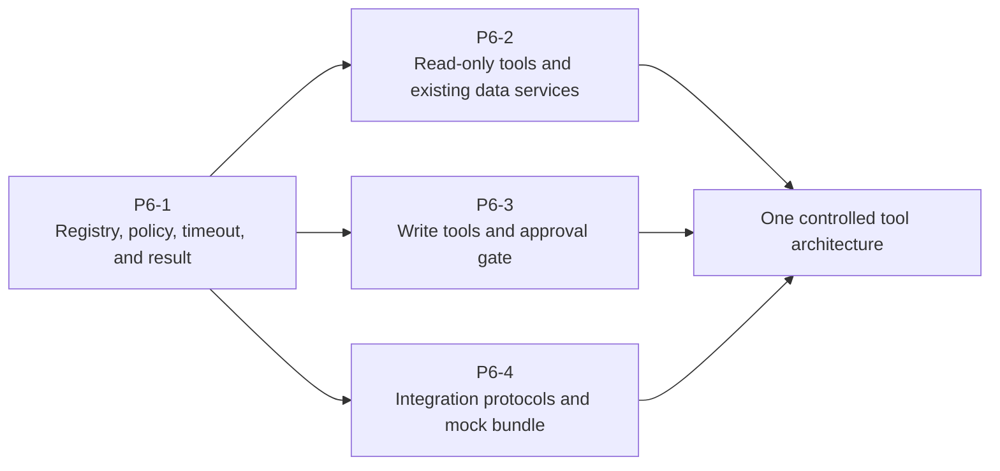

P6-1 supplies execution and policy behavior. P6-2 and P6-3 register tools behind
that behavior. P6-4 supplies replaceable integration implementations.

## Starting point — application components without a tool boundary

At the start of Phase 6, the FastAPI process already has middleware, routes,
repositories, the database session factory, and the Phase 5 knowledge service.
No central registry is mounted into startup.

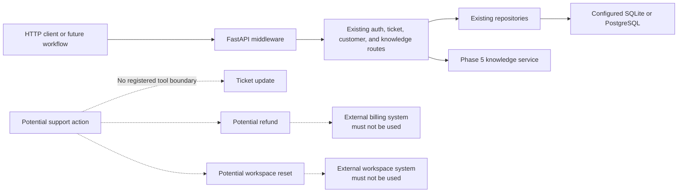

At this stage, the components exist, but the application has no common rule for:

- registering available actions;
- rejecting unknown actions;
- checking consequential-action approval;
- applying one timeout;
- returning one result type;
- replacing external integrations with offline adapters.

## P6-1 — Registry, policy, timeout, and result routing

P6-1 introduces a Python object graph rather than a new network service.

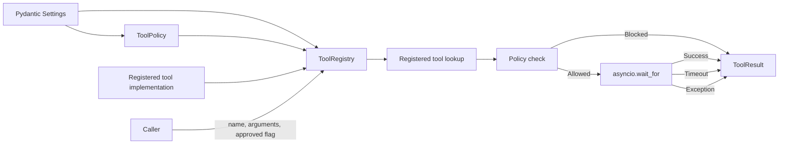

### Component roles

**ToolRegistry**

The registry owns the table of registered tools. Registration validates that
the tool has a name, an async `ainvoke()` method, and no duplicate name.
Execution is centralized in `ToolRegistry.execute()`.

**ToolPolicy**

The policy uses settings plus the tool name and arguments. It returns whether
approval is required. It does not execute tools or change databases.

**Async timeout**

The registry wraps `ainvoke()` with `asyncio.wait_for()`. The timeout comes from
`TOOL_TIMEOUT_SECONDS`, with a default of 30 seconds.

**ToolResult**

Every result follows the same object shape:

- success or failure;
- tool name;
- output or error code;
- optional approval-required state.

The registry catches `TimeoutError` and general exceptions. It does not let
tool exceptions propagate into the caller as an unexpected crash.

**Connection flow**

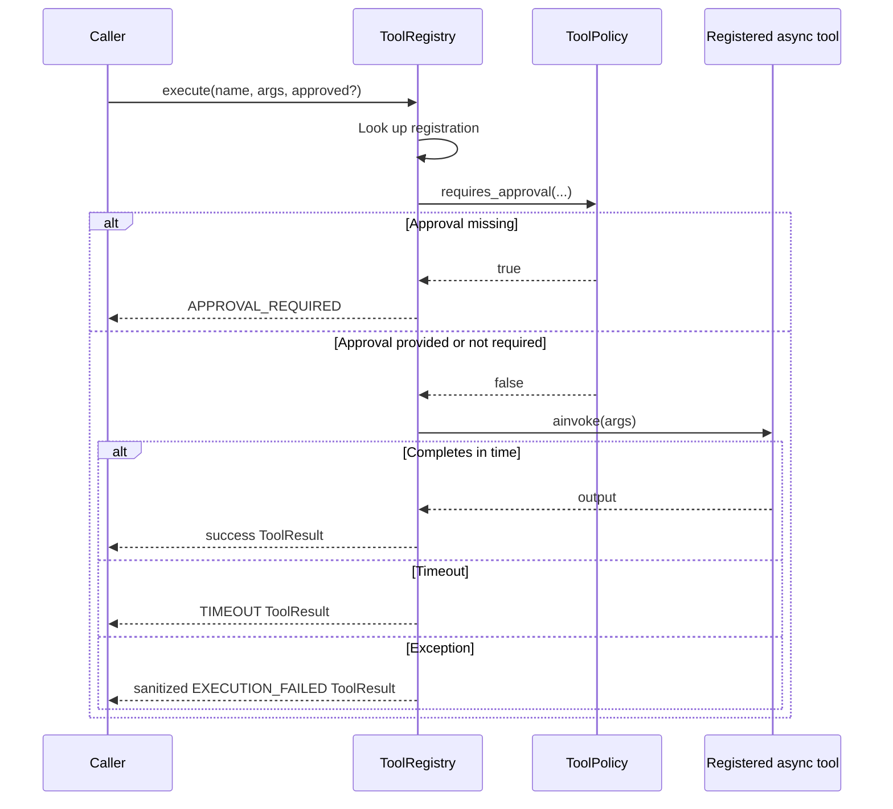

P6-1 adds no HTTP listener or network connection. It is an internal Python
coordination boundary.

## P6-2 — Read-only tool component wiring

P6-2 defines five tools and registers them with a supplied registry.

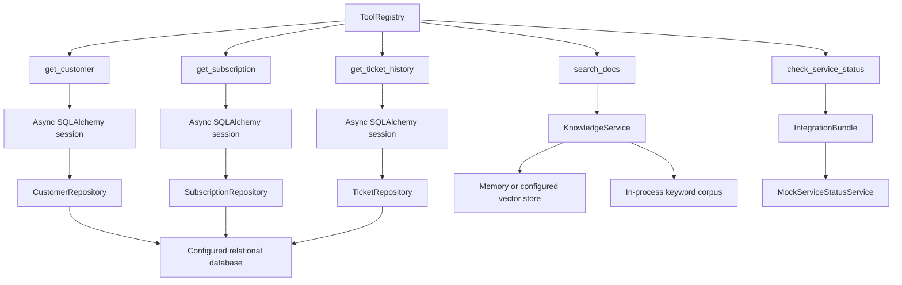

The read-only registration function receives:

- the existing async session factory;
- the already initialized knowledge service;
- the integration bundle.

These dependencies are passed as constructor-style parameters rather than
discovered through HTTP calls.

### Read-only database routing

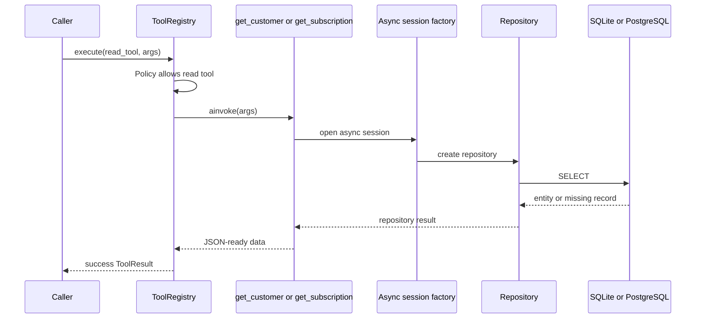

Each tool opens a short-lived session and commits no changes. `get_ticket_history`
can exclude a ticket and applies limit/offset values. It does not return raw
ticket message bodies.

### Knowledge routing

`search_docs` calls `KnowledgeService.search()` with the requested question,
category, mode, and result count. The existing service uses the configured
vector store and its in-process or loaded keyword corpus.

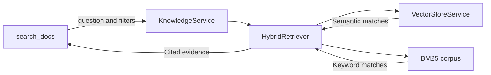

This P6-2 route is not a separate network call. It stays inside the Python
process unless a future knowledge service implementation adds a remote
connection.

## P6-3 — Write-tool routing and approval boundary

P6-3 adds write tools to the same registry boundary.

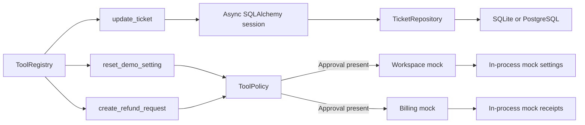

### Ticket update route

`update_ticket` validates enum values and at least one field before opening a
database session. It uses `TicketRepository.update()` to change supported
ticket fields and commits the session.

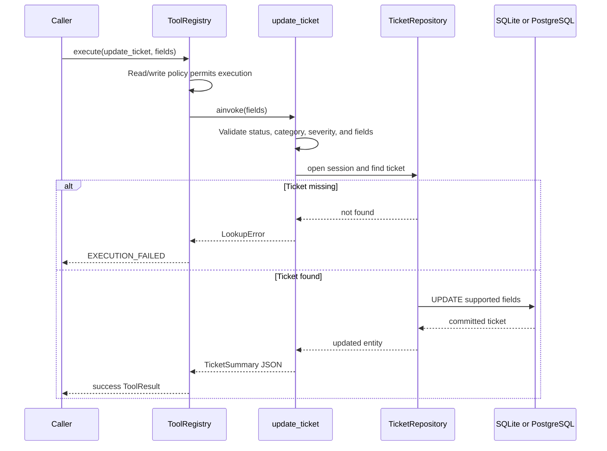

### Approval-gated reset route

`reset_demo_setting` is registered as an approval-required tool. The registry
checks policy before invoking the mock workspace adapter.

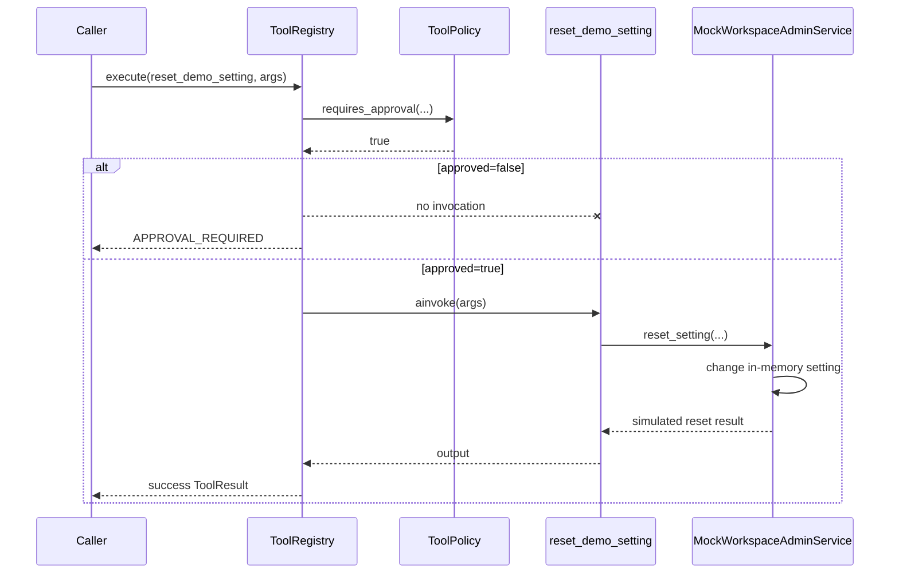

### Refund approval route

The refund policy uses settings and the amount argument. The default demo
requires approval for every refund. When approval is enabled in the request,
the write tool converts the amount to `Decimal`, validates it, and calls the
mock billing service.

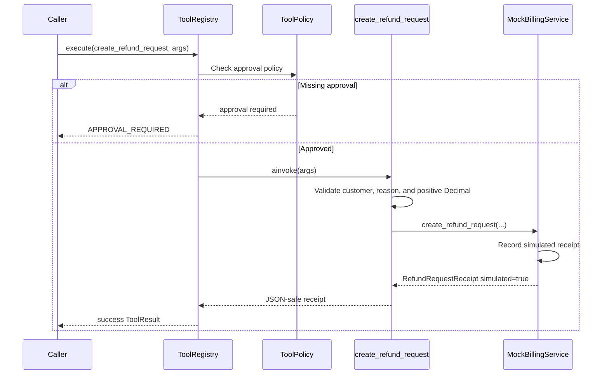

P6-3 does not persist an approval record or run a human approval route. Approval
is an execution flag on the registry call, and future approval infrastructure
must supply that flag only after a real decision is recorded.

## P6-4 — Integration protocols and mock routing

P6-4 creates a composition layer that is independent of concrete external
vendors.

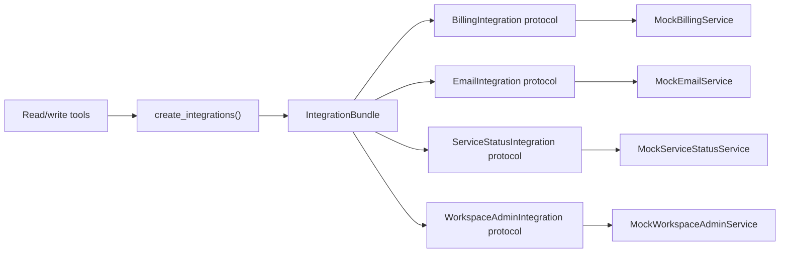

The protocols define method signatures and result types. The factory currently
returns mock implementations. A future real provider can implement the same
interface without changing the tool's registry or policy.

### Mock process and state boundaries

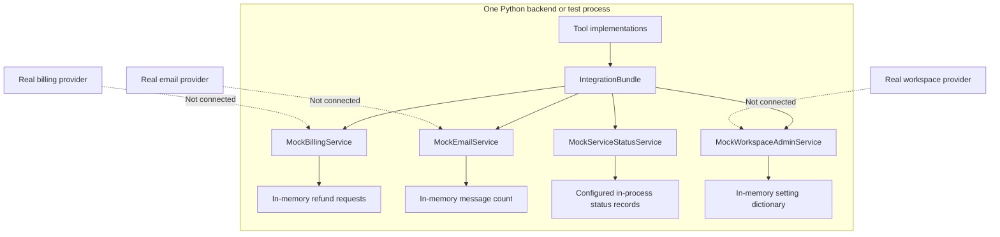

Mock state is not persisted to SQLite or Redis. Restarting the process clears
refund receipts, message counts, and setting resets. This behavior is suitable
for local tests and demos, not production records.

## Test-time wiring

The unit tests construct an isolated process-like environment:

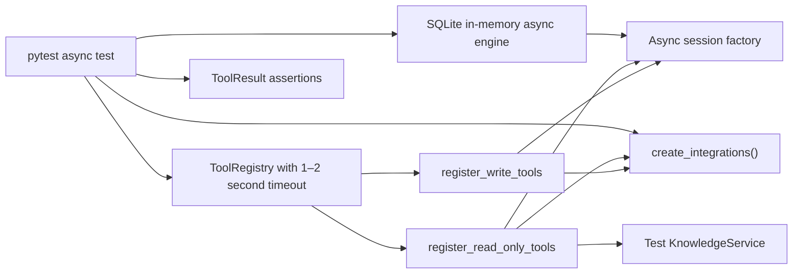

The test environment has no network route and no Docker container. It uses
SQLite memory and mock integrations to verify:

- approved and blocked action routing;
- database updates;
- mock side effects;
- unknown tools;
- timeout behavior;
- exception handling.

## HTTP routing status

Phase 6 has no dedicated tool HTTP API. The existing `create_app()` middleware
and route assembly remains unchanged:

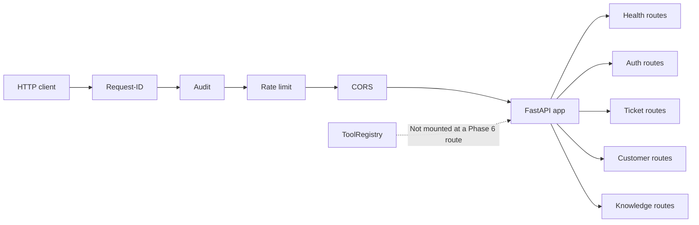

The future graph/workflow or approval API can compose the registry at application
startup and expose the registry to workflow nodes through application state or
dependency injection. A Phase 6 HTTP route would not itself be an approval
boundary; approval must be persisted and authorized outside the mock registry
call.

## End-of-Phase 6 component and network view

This is the complete implemented Phase 6 process wiring. Solid lines are
current in-process or database connections. Dashed lines are future or
configured external boundaries.

```mermaid
flowchart TB
    subgraph LocalHost["Local Python process or test process"]
        Caller["Caller or future workflow"]

        subgraph Core["Tool execution core"]
            Registry["ToolRegistry"]
            Policy["ToolPolicy"]
            Timeout["asyncio.wait_for timeout"]
            Result["ToolResult"]
            Registry --> Policy
            Registry --> Timeout
            Timeout --> Result
        end

        subgraph ReadTools["Read-only tools"]
            Customer["get_customer"]
            Subscription["get_subscription"]
            History["get_ticket_history"]
            Search["search_docs"]
            Status["check_service_status"]
        end

        subgraph WriteTools["Write tools"]
            Update["update_ticket"]
            Reset["reset_demo_setting"]
            Refund["create_refund_request"]
        end

        subgraph Dependencies["Dependencies"]
            SessionFactory["Async SQLAlchemy session factory"]
            CustomerRepo["CustomerRepository"]
            SubscriptionRepo["SubscriptionRepository"]
            TicketRepo["TicketRepository"]
            Knowledge["KnowledgeService"]
            Bundle["IntegrationBundle"]
        end

        subgraph MockAdapters["Mock integration objects"]
            MockBilling["MockBillingService"]
            MockEmail["MockEmailService"]
            MockStatus["MockServiceStatusService"]
            MockWorkspace["MockWorkspaceAdminService"]
        end

        Caller -->|"Tool name and arguments"| Registry
        Registry --> ReadTools
        Registry --> WriteTools

        Customer --> SessionFactory
        Subscription --> SessionFactory
        History --> SessionFactory
        Update --> SessionFactory
        SessionFactory --> CustomerRepo
        SessionFactory --> SubscriptionRepo
        SessionFactory --> TicketRepo

        Search --> Knowledge
        Status --> Bundle
        Reset --> Bundle
        Refund --> Bundle

        Bundle --> MockBilling
        Bundle --> MockEmail
        Bundle --> MockStatus
        Bundle --> MockWorkspace

        ReadTools --> Result
        WriteTools --> Result
    end

    Database["SQLite or PostgreSQL"]
    VectorStore["Memory or configured Qdrant"]

    CustomerRepo --> Database
    SubscriptionRepo --> Database
    TicketRepo --> Database
    Knowledge --> VectorStore

    RealBilling["Real billing provider"] -. "Not used" .-> MockBilling
    RealEmail["Real email provider"] -. "Not used" .-> MockEmail
    RealWorkspace["Real account provider"] -. "Not used" .-> MockWorkspace
```

### Component routing summary

| Route | Implemented path |
|---|---|
| Read ticket/customer data | Tool -> session factory -> repository -> SQL database |
| Search knowledge | Tool -> KnowledgeService -> vector store/BM25 -> evidence |
| Update ticket | Tool -> session factory -> TicketRepository -> SQL database |
| Reset workspace setting | Tool -> mock integration -> in-memory setting dictionary |
| Create refund request | Tool -> mock integration -> in-memory refund receipt list |
| Tool failure | Registry -> explicit `ToolResult` -> caller |

## Docker networking — not implemented at end of Phase 6

No Dockerfile or Compose file is present in the repository. Therefore the
following infrastructure items do not exist in this phase:

- Docker service names;
- container ports;
- a CloudDesk Compose network;
- frontend-to-backend container routing;
- backend-to-Redis or backend-to-Qdrant container DNS;
- named volumes for mock or database state;
- container health dependencies.

The mock integrations run inside the Python process. They do not become separate
Docker services.

The project architecture describes a planned future deployment where:

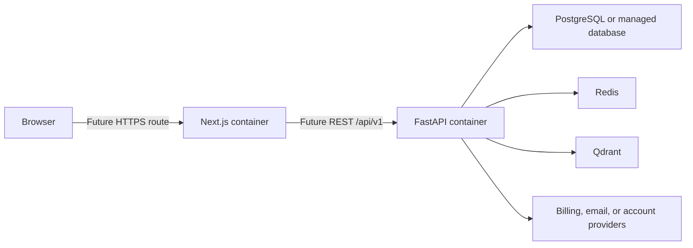

That topology is not a Phase 6 implementation. It should only be documented as
Docker architecture after Docker and Compose files are added in later phases.
Phase 6 should not imply that container services, live providers, or service DNS
already exist.

## Implementation references

| Responsibility | Source |
|---|---|
| Tool registry and async timeout | [registry.py](../../backend/app/tools/registry.py) |
| Approval policy | [policy.py](../../backend/app/tools/policy.py) |
| Success and error result objects | [result.py](../../backend/app/tools/result.py) |
| Read-only tool construction and registration | [read_only.py](../../backend/app/tools/read_only.py) |
| Write-tool construction and registration | [write_tools.py](../../backend/app/tools/write_tools.py) |
| Integration contracts | [protocols.py](../../integrations/protocols.py) |
| Integration factory | [factory.py](../../integrations/factory.py) |
| Mock adapter implementations | [mock/services.py](../../integrations/mock/services.py) |
| SQLAlchemy database session factory | [core/database.py](../../backend/app/core/database.py) |
| Application settings | [core/config.py](../../backend/app/core/config.py) |
| FastAPI startup and route assembly | [main.py](../../backend/app/main.py) |
| Local backend command | [Makefile](../../Makefile) |
| Registry and policy tests | [test_tool_registry.py](../../tests/unit/test_tool_registry.py), [test_tool_policy.py](../../tests/unit/test_tool_policy.py) |
| Read/write and mock tests | [test_read_only_tools.py](../../tests/unit/test_read_only_tools.py), [test_write_tools.py](../../tests/unit/test_write_tools.py), [test_mock_integrations.py](../../tests/unit/test_mock_integrations.py) |
| Phase 6 system design evolution | [Phase6_Project_System_Design_Evolution.md](../design_evolution/Phase6_Project_System_Design_Evolution.md) |
| Phase 6 simple explanation | [phase6_explained.md](../explain_codebase/phase6_explained.md) |
