# Phase 7 — Infrastructure, Component Wiring, and Routing Evolution

This document explains how the Phase 7 rules and guardrail components connect
to the CloudDesk application process. It covers module dependencies, prompt
assembly boundaries, customer-memory routing, and test wiring. It also clearly
separates implemented in-process behavior from Docker and container networking,
which are not configured in this repository.

## Infrastructure status at the end of Phase 7

Phase 7 adds Python modules and in-process function calls. It does not add a
new server, API route, network listener, database table, queue, or external
service.

The guardrails are loaded as ordinary Python code in the FastAPI process or in
unit-test processes. The rules module, prompt module, guardrail module, customer
service, and future agents are all connected through imports and function calls.

| Component | Implemented Phase 7 connection |
|---|---|
| Deterministic policy | In-process functions in `agents/rules.py` |
| Injection and text guardrails | In-process functions in `backend/app/core/guardrails.py` |
| Shared prompt preamble | In-process constant exported by `agents/prompts.py` |
| Customer-memory scrub | In-process `scrub()` call from `CustomerService` |
| Workflow integration | Not mounted yet; functions are reusable library components |
| HTTP routes | Existing routes remain unchanged; no Phase 7 route was added |
| Database | No Phase 7 table or migration was added |
| External services | No real model or external guardrail provider is called |
| Docker / Compose | No Dockerfile or Compose network is present |

The Phase 7 components share one Python process and do not need network routing
to communicate.

## Wiring progression

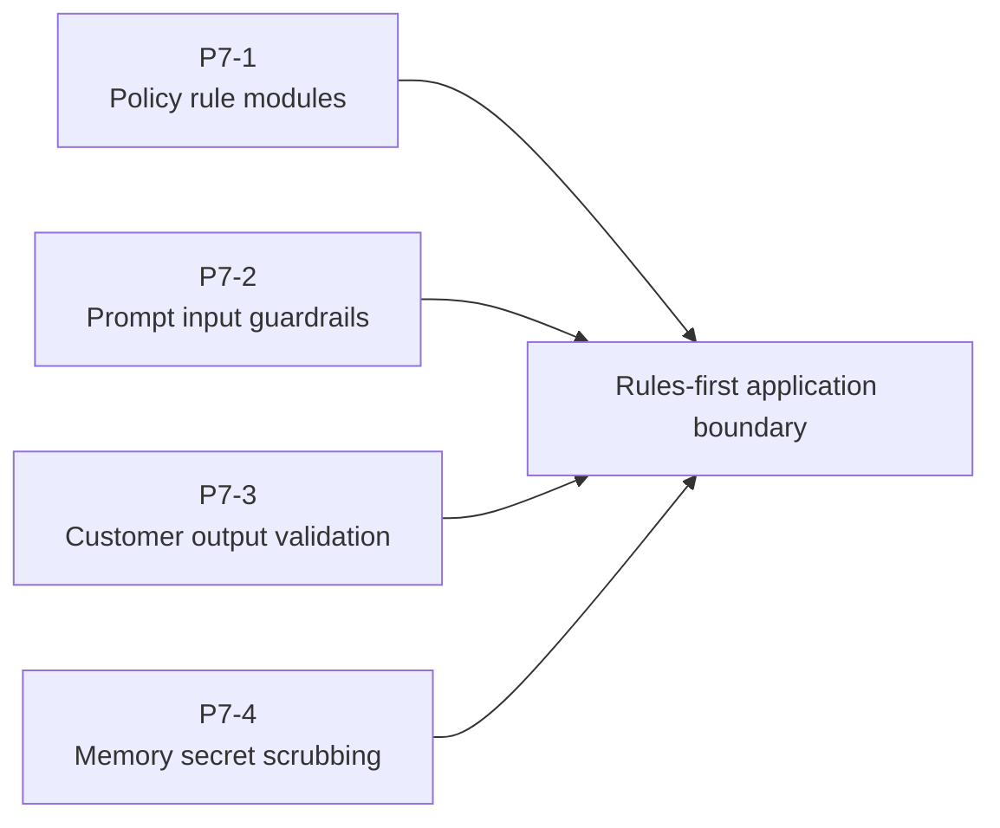

P7-1 supplies policy decisions. P7-2 protects prompt construction. P7-3 protects
generated output. P7-4 protects memory text before it is returned or reused.

## Starting point — Phase 6 application without the Phase 7 policy layer

Before Phase 7, the application process already contains middleware, API
routers, repositories, a knowledge service, a tool registry, and mock
integrations.

The future agent layer can call these components, but there is no shared policy
module or text-safety boundary among it.

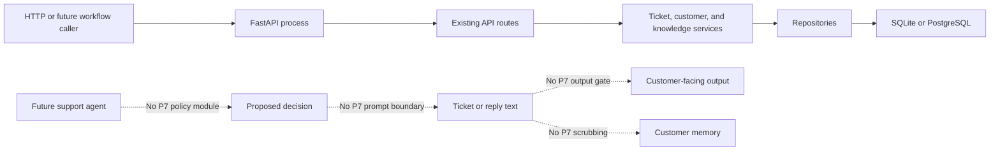

At this starting point, Phase 6 controls tool execution but does not provide
the complete rules and text-safety boundary needed by the future agent:

- escalation has no dedicated rule module;
- severity has no raise-only policy helper;
- ticket text has no shared wrapping helper;
- customer replies have no structured validation gate;
- memory display has no shared secret scrub API.

## P7-1 — Escalation and severity component wiring

P7-1 adds `agents/rules.py`. It is a library module, not a network service.
Future supervisor or escalation agents import its functions directly.

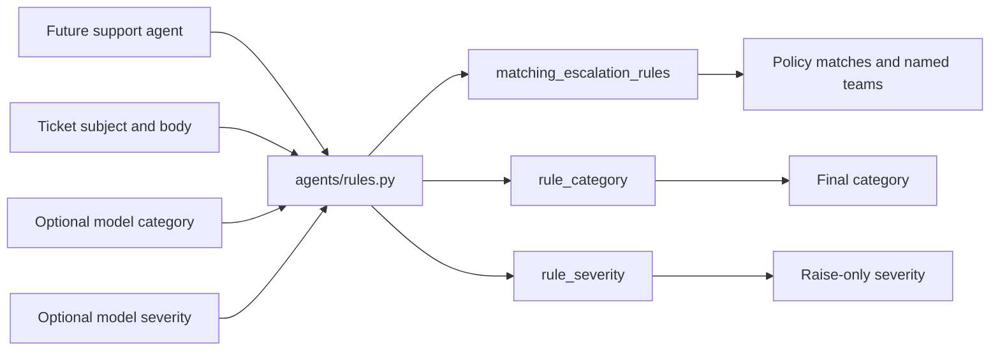

The functions share text-normalization and severity-ranking logic inside the
module. They do not open a database session, call an HTTP route, or depend on
FastAPI.

### P7-1 routing flow

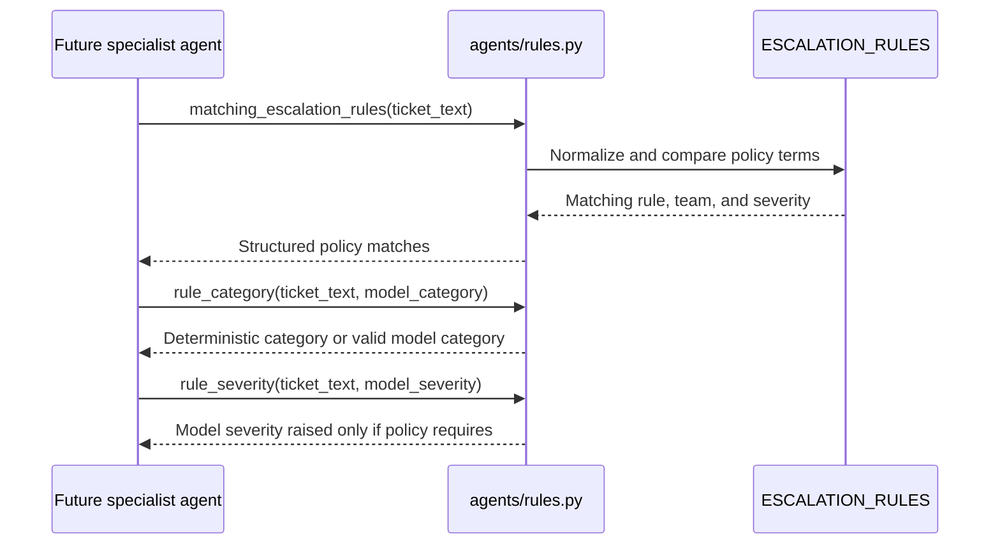

No service discovery or network address is involved. This module can be tested
with Python text fixtures and runs entirely inside the caller process.

## P7-2 — Injection wrapping and prompt routing

P7-2 adds `backend/app/core/guardrails.py` helpers and
`agents/prompts.py`.

The prompt input path is:

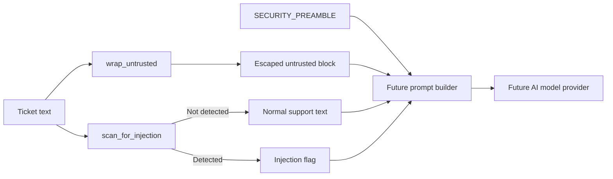

The preamble and wrapper do not configure or call a model themselves. They
produce text for a future prompt builder.

### P7-2 process boundary

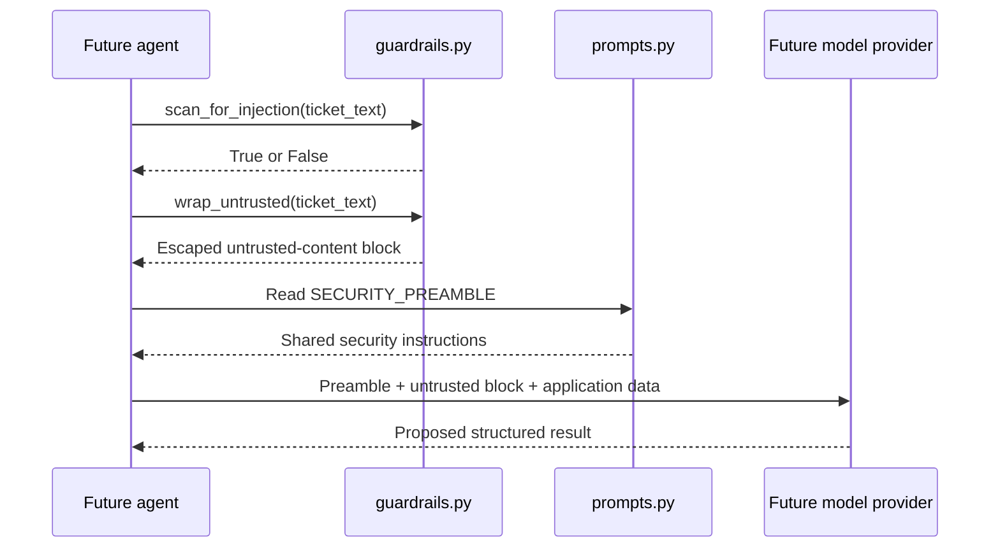

The delimiter escape happens inside `wrap_untrusted()` before text reaches the
prompt. A ticket attempt to close or open `<untrusted_content>` tags is escaped
to text rather than becoming part of the real prompt structure.

P7-2 is an in-process defense. It is not a network firewall or a hosted prompt
injection service.

## P7-3 — Customer output validation routing

P7-3 adds `validate_customer_output()` to the guardrails module.

The intended routing boundary is after a future resolution agent creates a reply
draft and before any HTTP reply or email action is allowed.

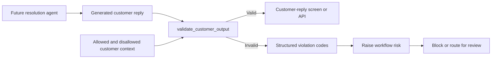

The validator returns reason codes rather than raising an HTTP exception.
This allows future graph nodes to make explicit routing decisions.

### P7-3 validation sequence

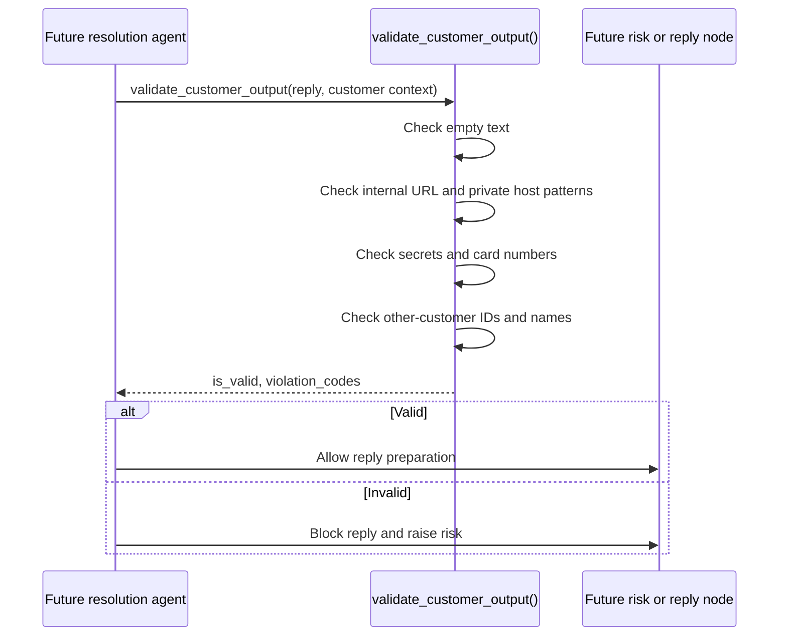

P7-3 does not currently connect to a route that sends replies. It provides the
library gate that later `POST /tickets/{id}/reply` and workflow code will use.

## P7-4 — Secret scrubbing and memory routing

P7-4 extends `backend/app/core/guardrails.py` with `scrub()` and
`SECRET_PATTERNS`. It also replaces local memory scrubbing in
`backend/app/services/customer_service.py`.

The current route-level integration is the customer detail API:

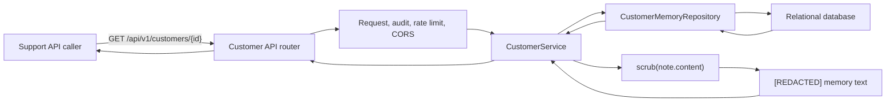

This means P7-4 scrubbing happens before memory text is placed in the customer
detail response. It is not a database migration or persistent update to stored
notes.

### P7-4 scrubbing sequence

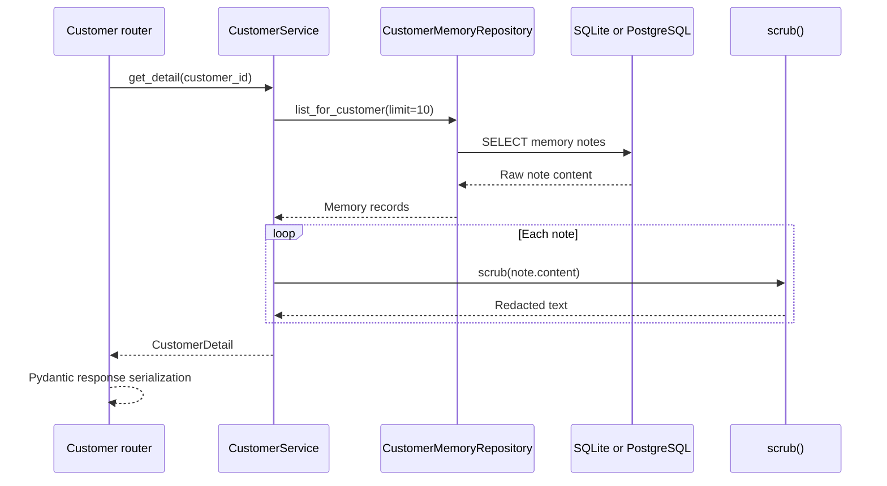

The persistent database still may contain the original memory note. P7-4
currently applies scrubbing at the read/display boundary. Later memory-write
code must also call `scrub()` before persistence.

The secret patterns handled in one shared module are:

- private-key blocks;
- password and credential assignments;
- bearer tokens and JWT values;
- URL credentials;
- sensitive query values;
- AWS-style access keys;
- card numbers.

## Test-time component wiring

Phase 7 tests run in isolated Python processes or pytest fixtures.

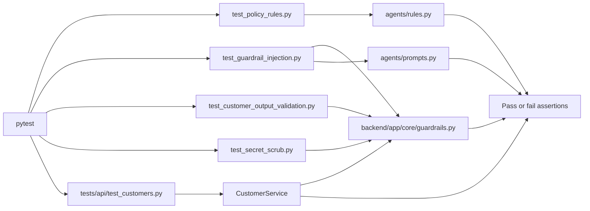

The tests use in-memory SQLite for API behavior where needed. They do not start
Docker containers, call a live model, or call a real integration.

## Existing HTTP routing

Phase 7 does not add a route. The existing application router order remains:

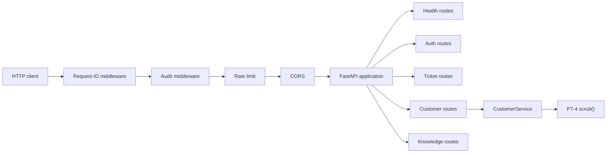

No Phase 7 route is mounted under `/api/v1/agents`, `/api/v1/rules`, or a
separate guardrail service. The code is available to future agent nodes and
existing services such as `CustomerService`.

## End-of-Phase 7 component and process view

The final Phase 7 design is a set of in-process policy and safety modules around
the future agent workflow.

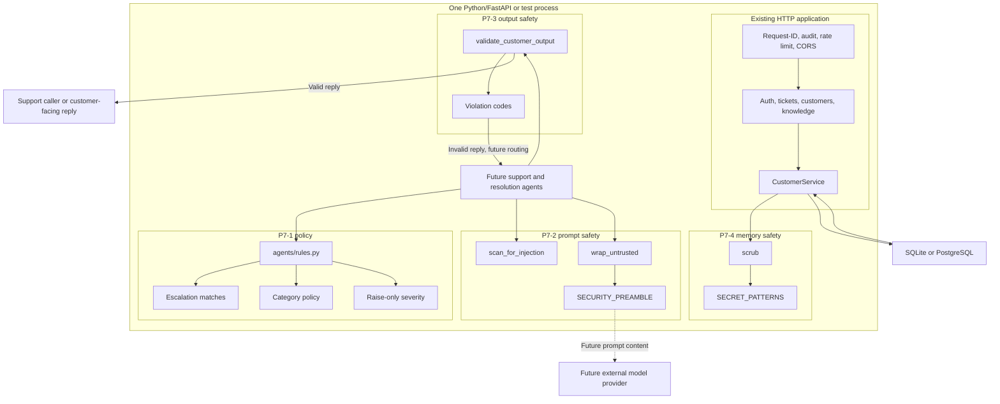

The solid connections represent implemented imports and function calls.
The model and reply connections are future workflow boundaries, not active
Phase 7 HTTP integrations.

## Component routing summary

| Routing path | Implemented Phase 7 path |
|---|---|
| Ticket policy | Future agent -> `agents/rules.py` -> team/category/severity result |
| Prompt safety | Future agent -> injection scan -> untrusted wrapper -> preamble |
| Reply safety | Future resolution agent -> output validator -> valid or violation result |
| Memory safety | CustomerService -> repository -> database -> `scrub()` -> API response |
| HTTP middleware | Existing Request-ID, audit, rate limit, CORS wrapper |

## Docker networking — not implemented at end of Phase 7

There is no Dockerfile or Compose file in the repository. Phase 7 therefore
does not create or route:

- container service names;
- backend or frontend container ports;
- a Docker or Compose network;
- a guardrail sidecar;
- a separate rules service;
- a prompt-safety microservice;
- a secret-scrubbing worker;
- container volumes or health dependencies.

All guardrails run inside the application or test Python process.

A future container deployment might appear like this:

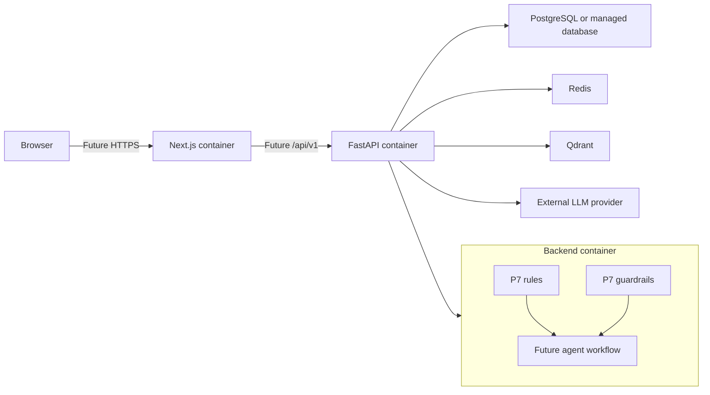

This is a planned topology only. It is not an implemented Docker network in
Phase 7. Container names, ports, health checks, volumes, secrets, and service
DNS should only be documented after Docker and Compose files exist.

## Infrastructure and honest status

Phase 7 is implemented as module-level Python behavior:

- rules and guardrails are importable library components;
- prompt preamble is a shared constant;
- customer memory content is scrubbed by `CustomerService`;
- no HTTP route exposes or bypasses the guardrails;
- no database or external service has been added.

The local offline suite passed 165 tests, and Ruff passed for the relevant
implementation and test files. No live model, live database, Docker container,
cloud service, or real customer data was used.

The future workflow will decide how to compose these modules during graph nodes.
Until that integration exists, there is no Phase 7 production request path
through a rules or guardrail route.

## Implementation references

| Responsibility | Source |
|---|---|
| Escalation, category, and severity rules | [rules.py](../../agents/rules.py) |
| Injection, output, and secret guardrails | [guardrails.py](../../backend/app/core/guardrails.py) |
| Shared prompt security preamble | [prompts.py](../../agents/prompts.py) |
| Memory API scrubbing | [customer_service.py](../../backend/app/services/customer_service.py) |
| FastAPI app and middleware routing | [main.py](../../backend/app/main.py) |
| Policy tests | [test_policy_rules.py](../../tests/unit/test_policy_rules.py) |
| Injection tests | [test_guardrail_injection.py](../../tests/unit/test_guardrail_injection.py) |
| Customer output tests | [test_customer_output_validation.py](../../tests/unit/test_customer_output_validation.py) |
| Secret scrub tests | [test_secret_scrub.py](../../tests/unit/test_secret_scrub.py) |
| Customer API tests | [tests/api/test_customers.py](../../tests/api/test_customers.py) |
| Phase task status | [TASK.md](../../TASK.md) |
| Phase exit criteria | [PLAN_PHASE.md](../../PLAN_PHASE.md) |
| Phase 7 system design evolution | [Phase7_Project_System_Design_Evolution.md](../design_evolution/Phase7_Project_System_Design_Evolution.md) |
| Plain-language Phase 7 explanation | [phase7_explained.md](../explain_codebase/phase7_explained.md) |
