# Phase 8 — Infrastructure, Component Wiring, and Routing Evolution

This document explains how the Phase 8 memory components connect to the
CloudDesk application process and data stores. It covers the Redis/Fakeredis
selection path, async SQLAlchemy routing, memory service composition, test
wiring, and HTTP boundaries. It also clearly distinguishes this implemented
Python-process architecture from Docker networking, which is not present in
the repository.

## Infrastructure status at the end of Phase 8

Phase 8 adds two memory facades and a composition service. It does not add a
new server, HTTP route, Redis queue, database migration, or container.

The short-term implementation uses Redis or Fakeredis. The long-term
implementation uses the existing SQLAlchemy session and `customer_memory`
table. The memory service receives both dependencies through Python composition.

| Component | Implemented Phase 8 connection |
|---|---|
| Short-term memory | In-process `ShortTermMemory` facade |
| Redis factory | Fakeredis when fake mode or no URL; real Redis when configured |
| Conversations | Redis key `conversation:{ticket_id}` |
| Workflow state | Redis key `workflow:{workflow_id}` |
| Retrieval cache | Redis key `rag:{mode}:{category}:{top_k}:{query}` |
| Long-term memory | In-process `LongTermMemory` facade |
| SQL memory | Existing async SQLAlchemy session and `customer_memory` table |
| Memory repositories | `CustomerMemoryRepository`, `CustomerRepository`, `TicketRepository` |
| Memory service | In-process composition of short-term and long-term facades |
| HTTP routes | Existing customer routes only; no dedicated memory route |
| Docker / Compose | No Dockerfile or Compose network is present |

## Wiring progression

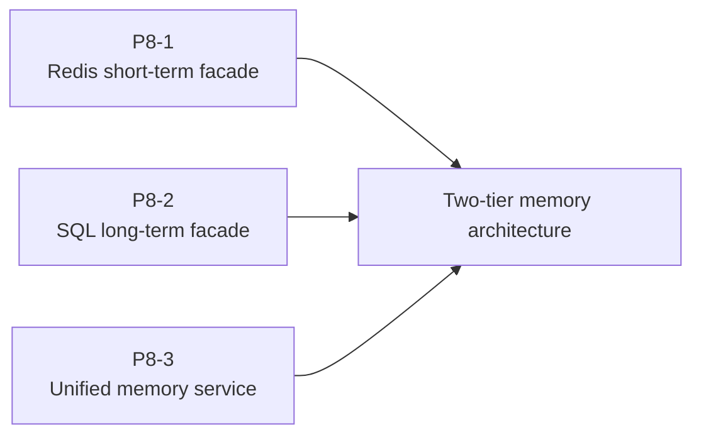

P8-1 establishes temporary key and TTL routing. P8-2 establishes SQL
customer-memory routing. P8-3 composes both and records resolution summaries.

## Starting point — Application with data stores but no memory service facade

Before P8-1, the application has a Redis client factory and SQLAlchemy session
factory. Redis is used by the rate limiter, and SQL stores tickets, customers,
and customer-memory records.

It does not yet have the dedicated memory modules that define conversation,
workflow, retrieval-cache, recall, or resolution-memory routing.

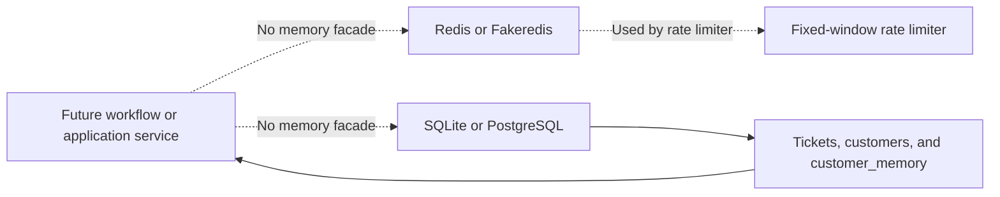

The existing Redis client is reused only through the core factory. The memory
phase adds a second usage shape on top of that factory.

## P8-1 — Redis short-term component wiring

P8-1 adds `memory/short_term.py` and uses `backend/app/core/redis.py`.

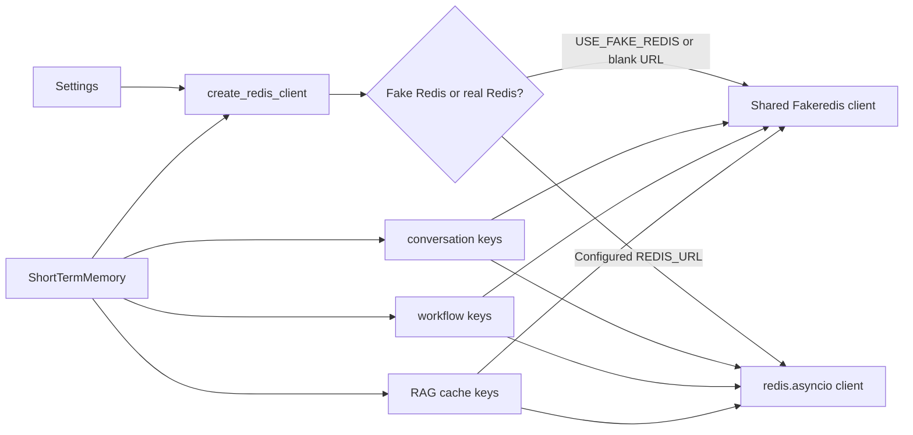

The client protocol now includes Redis operations used by memory:

- `get`;
- `set`;
- `delete`;
- `exists`;
- TTL and close operations.

The short-term facade selects the configured client only once and keeps it in
the facade object for subsequent calls.

### Conversation routing

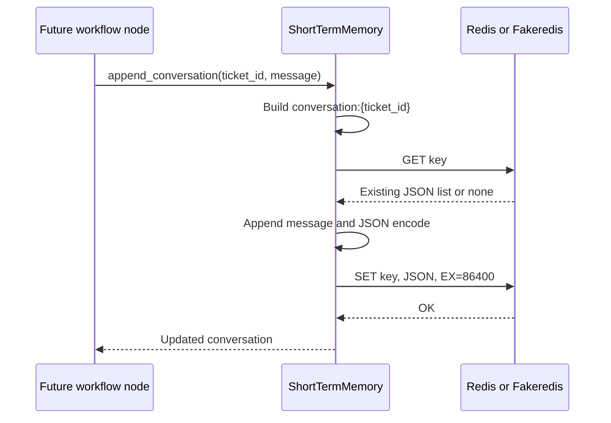

Conversation values expire after 24 hours. The value is not written to the
ticket database through this facade.

### Workflow-state routing

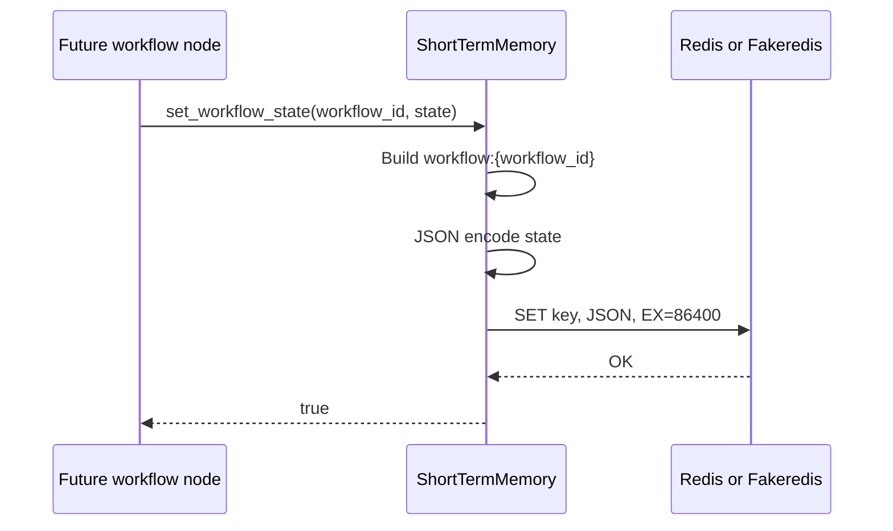

The workflow key is separate from the durable `workflow_runs` SQL table.
Redis is a temporary convenience store, not the system of record.

### Retrieval-cache routing

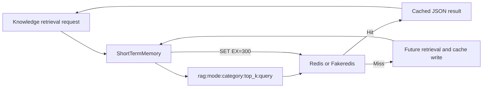

The cache TTL is 300 seconds. The key normalizes mode, category, result count,
and whitespace in the query.

P8-1 does not integrate cache reads into the knowledge retriever itself yet.
The facade provides cache operations for a later RAG-memory integration.

## P8-2 — SQL long-term component wiring

P8-2 adds `memory/long_term.py` and repository support for exact memory lookup.

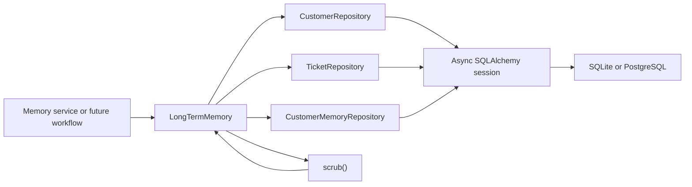

The long-term facade shares the same SQLAlchemy session rather than creating
an independent database connection per operation.

### Recall route

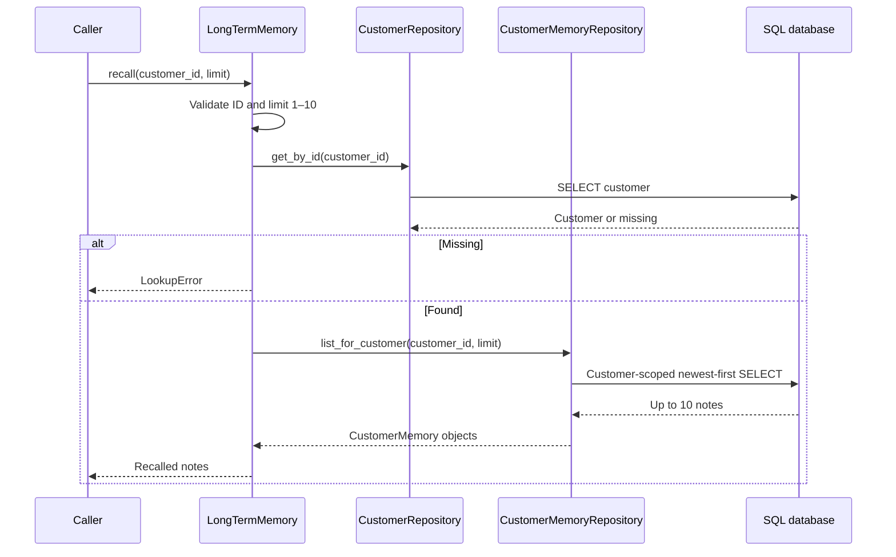

The query begins with `customer_id`. It does not load every customer and filter
afterward.

### Record route

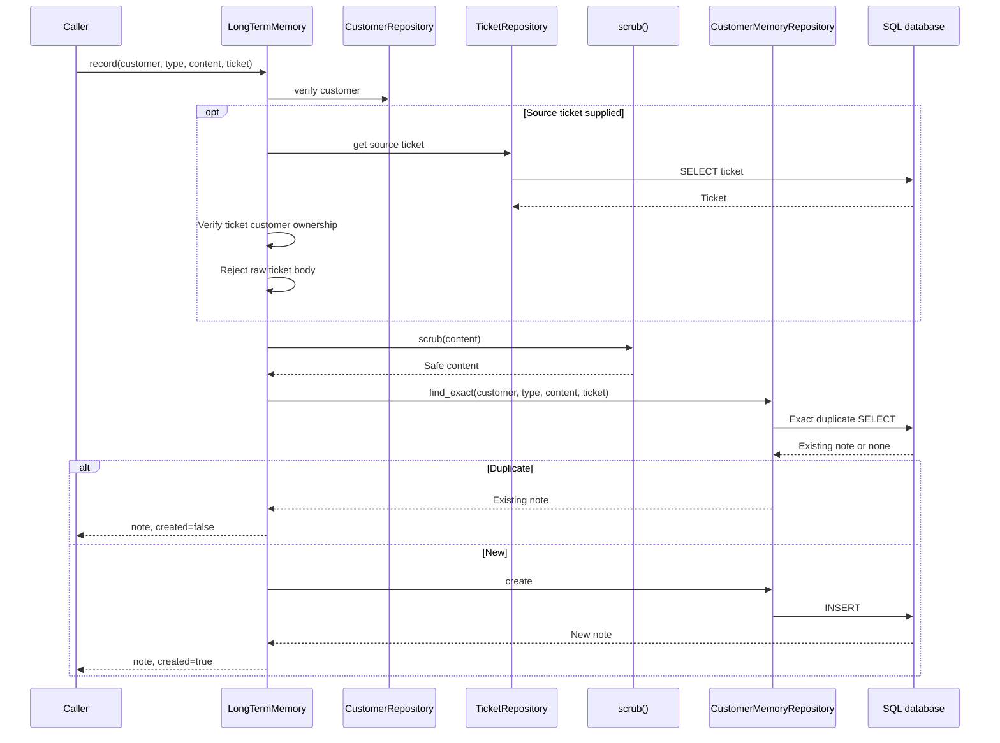

P8-2 does not commit automatically in every helper. `record()` flushes through
the repository. P8-3 owns the resolution transaction commit or rollback.

## P8-3 — Unified memory service wiring

P8-3 adds `memory/memory_service.py`.

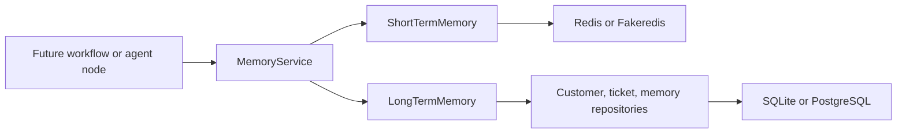

The service constructs:

- one short-term object;
- one long-term object;
- the long-term object with the caller's SQLAlchemy session.

The short-term object obtains Redis through the shared core factory.

### Recall route

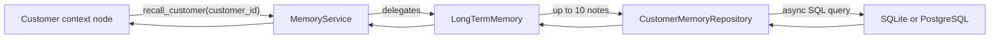

### Resolution-record route

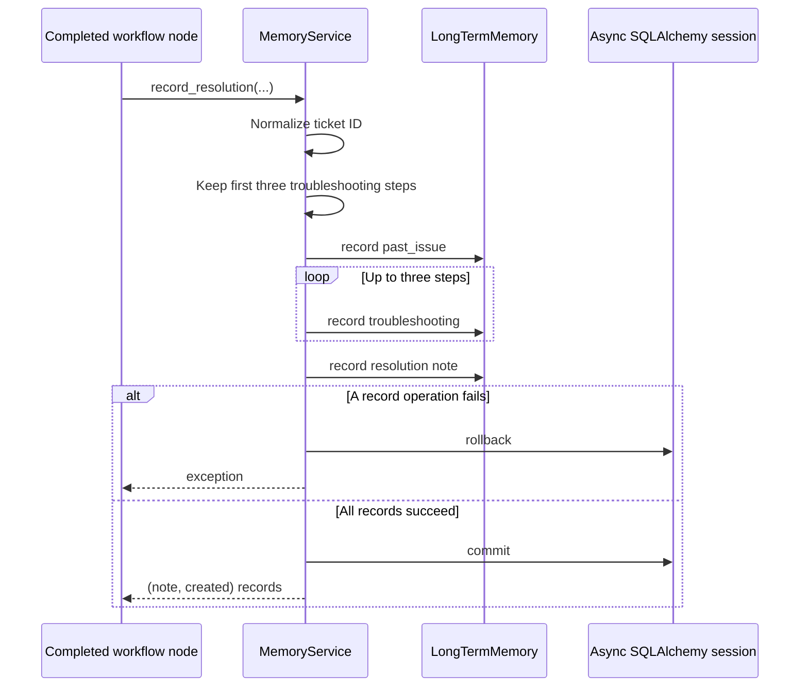

This transaction boundary is important: P8-3 records a resolution as one
logical SQL transaction. It does not leave a mixture of partial past-issue,
step, and resolution notes after an error.

### Short-term convenience routing

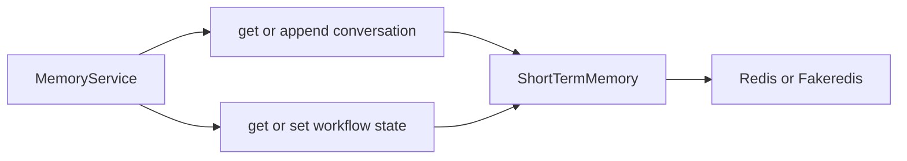

The future workflow node does not need to import Redis or build Redis key names
when using these convenience methods.

## Test-time wiring

Phase 8 tests construct isolated memory dependencies:

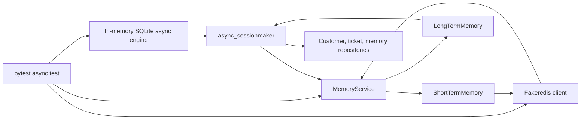

The tests verify:

- Redis TTL constants and key formats;
- JSON round trips;
- customer-scoped recall;
- exact duplicate prevention;
- ticket ownership;
- raw-ticket rejection;
- secret scrubbing;
- short-term/long-term separation;
- resolution transaction behavior.

No Docker container or live Redis server is required.

## HTTP and application routing

Phase 8 does not add a memory API route. The existing FastAPI application
continues to route customer detail through `CustomerService`.

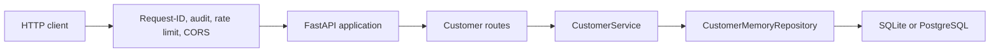

Customer detail currently returns memory through this repository path and
applies `scrub()` at the response boundary. It does not use the P8
`MemoryService` in an HTTP route yet.

A future workflow route or memory node can compose `MemoryService` with the
application's session factory and Redis client.

## End-of-Phase 8 component and network view

The complete implemented memory architecture is in-process Python composition
with two configured data backends.

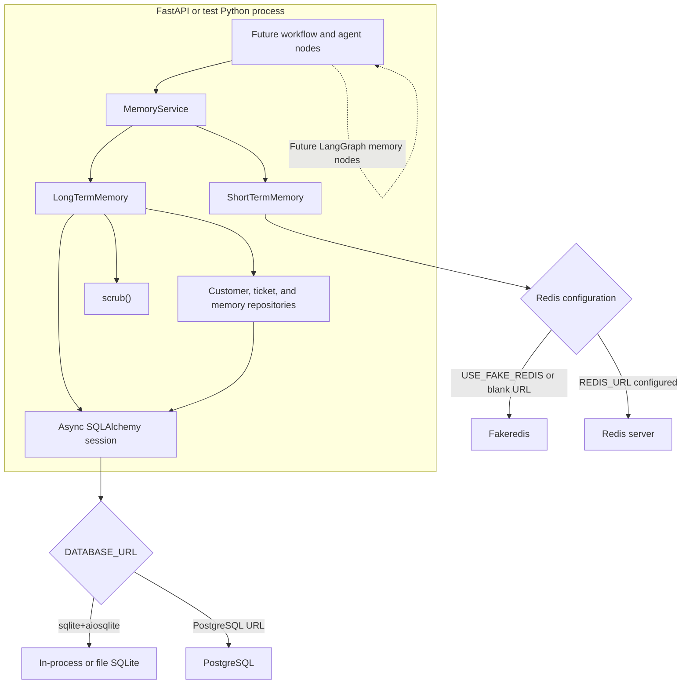

### Final routing summary

| Operation | Implemented route |
|---|---|
| Save or read conversation | Workflow node -> MemoryService -> ShortTermMemory -> Redis/fakeredis |
| Save or read workflow state | Workflow node -> MemoryService -> ShortTermMemory -> Redis/fakeredis |
| Cache retrieval result | RAG caller -> ShortTermMemory -> Redis/fakeredis |
| Recall customer memory | Workflow node -> MemoryService -> LongTermMemory -> SQL repository |
| Record resolution | Workflow node -> MemoryService -> LongTermMemory -> one SQL transaction |
| Display customer memory | Customer API -> CustomerRepository -> SQL -> scrubbed response |

## Docker networking — not implemented at end of Phase 8

There is no Dockerfile or Compose file in the repository. Phase 8 therefore
does not create or route:

- backend-to-Redis container DNS;
- backend-to-PostgreSQL container DNS;
- Redis ports or volumes;
- PostgreSQL volumes;
- memory worker containers;
- a dedicated memory microservice;
- Docker health checks for Redis or memory.

Redis and SQL are still configured by environment settings.

The real Redis and database locations are resolved by the Python libraries:

- Redis uses `REDIS_URL`;
- SQLAlchemy uses `DATABASE_URL`.

In the offline demo, the Redis network dependency is replaced by Fakeredis and
SQLite replaces PostgreSQL.

A future container deployment might appear as:

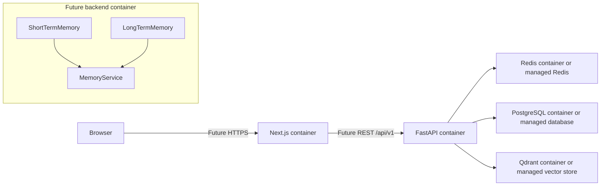

This is planned container topology, not an implemented Phase 8 Docker
configuration. Service names, ports, networks, volumes, and health checks should
only be written after Compose or deployment files exist.

## Infrastructure and honest status

Phase 8 implementation is verified as:

- an in-process memory service;
- a Redis/Fakeredis short-term backend;
- an async SQLAlchemy long-term backend;
- a customer and ticket repository boundary;
- transaction commit and rollback behavior;
- no dedicated HTTP memory route;
- no Docker or container network.

The local offline suite passed 182 tests, and Ruff passed for the memory
implementation and tests.

Validation used:

- Fakeredis;
- in-memory SQLite;
- async SQLAlchemy sessions.

No live Redis, PostgreSQL, Docker, cloud credential, or real customer data was
used.

The future LangGraph integration must compose `MemoryService` with the real
workflow session and decide when recall and resolution recording occur.

## Implementation references

| Responsibility | Source |
|---|---|
| Redis protocol and factory | [core/redis.py](../../backend/app/core/redis.py) |
| Redis short-term facade | [short_term.py](../../memory/short_term.py) |
| SQL long-term facade | [long_term.py](../../memory/long_term.py) |
| Unified memory service | [memory_service.py](../../memory/memory_service.py) |
| Customer memory repository | [customers.py](../../backend/app/repositories/customers.py) |
| Async SQLAlchemy session routing | [core/database.py](../../backend/app/core/database.py) |
| Secret scrubbing | [guardrails.py](../../backend/app/core/guardrails.py) |
| FastAPI startup and route assembly | [main.py](../../backend/app/main.py) |
| Short-term tests | [test_short_term_memory.py](../../tests/unit/test_short_term_memory.py) |
| Long-term tests | [test_long_term_memory.py](../../tests/unit/test_long_term_memory.py) |
| Memory service tests | [test_memory_service.py](../../tests/unit/test_memory_service.py) |
| Phase task status | [TASK.md](../../TASK.md) |
| Phase exit criteria | [PLAN_PHASE.md](../../PLAN_PHASE.md) |
| Phase 8 system design evolution | [Phase8_Project_System_Design_Evolution.md](../design_evolution/Phase8_Project_System_Design_Evolution.md) |
| Plain-language Phase 8 explanation | [phase8_explained.md](../explain_codebase/phase8_explained.md) |
