# Phase 9 — Infrastructure, Component Wiring, and Routing Evolution

This document explains how the Phase 9 specialist components are loaded, connected, and routed inside the CloudDesk application process. It starts with the Phase 8 baseline and follows P9-1 through P9-8. It also explains what is not yet implemented: the LangGraph workflow, container orchestration, public workflow routes, and Docker networking.

## Infrastructure status at the end of Phase 9

Phase 9 adds Python classes and test components. It does not start a new server, add a Docker container, or create a workflow process.

| Component                 | Phase 9 infrastructure role                                                  |
| ------------------------- | ---------------------------------------------------------------------------- |
| Pydantic workflow schemas | Define typed objects exchanged between specialist Python classes             |
| `call_structured()`       | Sends prompts to an AI provider and validates JSON output                    |
| `FakeLLM`                 | Provides a deterministic in-process offline AI implementation                |
| `SupervisorAgent`         | Runs inside the backend Python process                                       |
| `CustomerAgent`           | Calls the in-process `ToolRegistry` and memory service                       |
| `KnowledgeAgent`          | Calls the registered `search_docs` tool                                      |
| `TroubleshootingAgent`    | Calls the registered `check_service_status` tool                             |
| `ResolutionAgent`         | Combines diagnosis, evidence, guardrails, and deterministic action proposals |
| `EscalationAgent`         | Applies deterministic policy rules before bounded AI judgement               |
| Evaluation dataset        | Loads JSON from `datasets/eval_cases.json` during tests                      |
| Docker / Compose          | Not implemented at this phase                                                |
| LangGraph workflow        | Not implemented at this phase                                                |

## Wiring progression

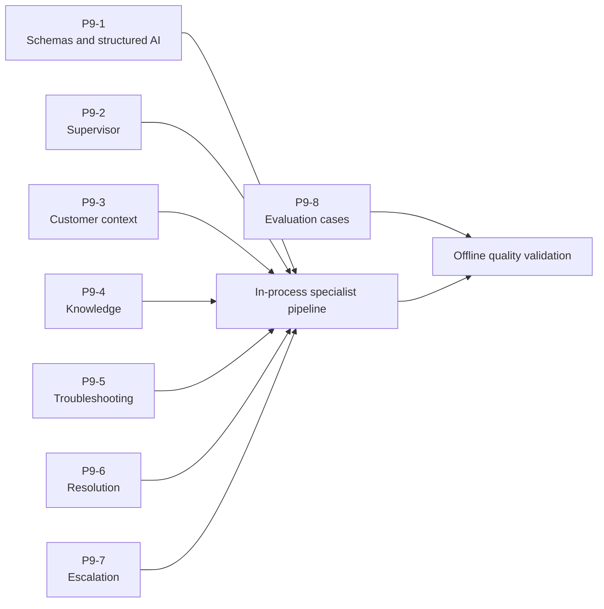

## Starting point — Phase 8 application process

Before Phase 9, the backend and test processes already contain:

- FastAPI and its middleware;
- SQLAlchemy repositories;
- Redis or Fakeredis memory;
- knowledge retrieval and vector services;
- registered tools and tool policy;
- guardrail functions;
- a single fake or real-provider LLM interface;
- deterministic escalation and severity rules.

However, no specialist package is responsible for coordinating these capabilities into a support decision.

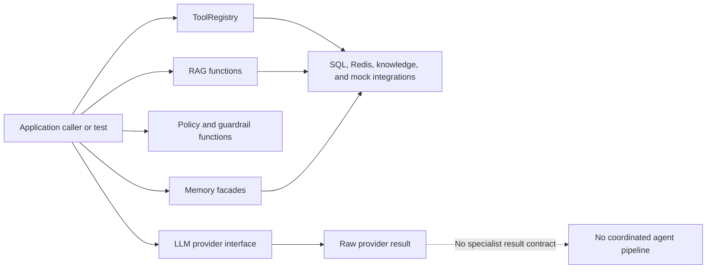

The starting limitations are:

- no common Pydantic result contract;
- no specialist classes for diagnosis or resolution;
- no deterministic assembly of customer, evidence, and policy context;
- no consistent routing through named specialist components;
- no golden evaluation dataset tied to specialist behavior.

Phase 9 solves these problems inside the existing Python process.

## P9-1 — Schema and structured-AI wiring

P9-1 adds `backend/app/schemas/workflow.py`, `call_structured()`, and the offline `FakeLLM` implementation.

### Component routing

```mermaid
flowchart TD
    Specialist["Specialist Python class"] --> Prompt["Prompt text"]
    Prompt --> Call["call_structured(response_model, prompt)"]

    Settings["LLM_PROVIDER setting"] --> Factory["get_llm()"]
    Factory --> Provider{ "Provider selection" }
    Provider -->|"fake"| Fake["FakeLLM"]
    Provider -->|"unsupported real provider"| Error["Not available before real-provider setup"]

    Call --> Fake
    Fake --> JSON["JSON string"]
    JSON --> Validate["Pydantic model_validate()"]
    Validate --> Result["Typed workflow object"]
    Result --> Specialist
```

The specialist never parses arbitrary provider text directly. `call_structured()` owns the retry, parsing, Pydantic validation, usage, and duration behavior.

### Output contracts

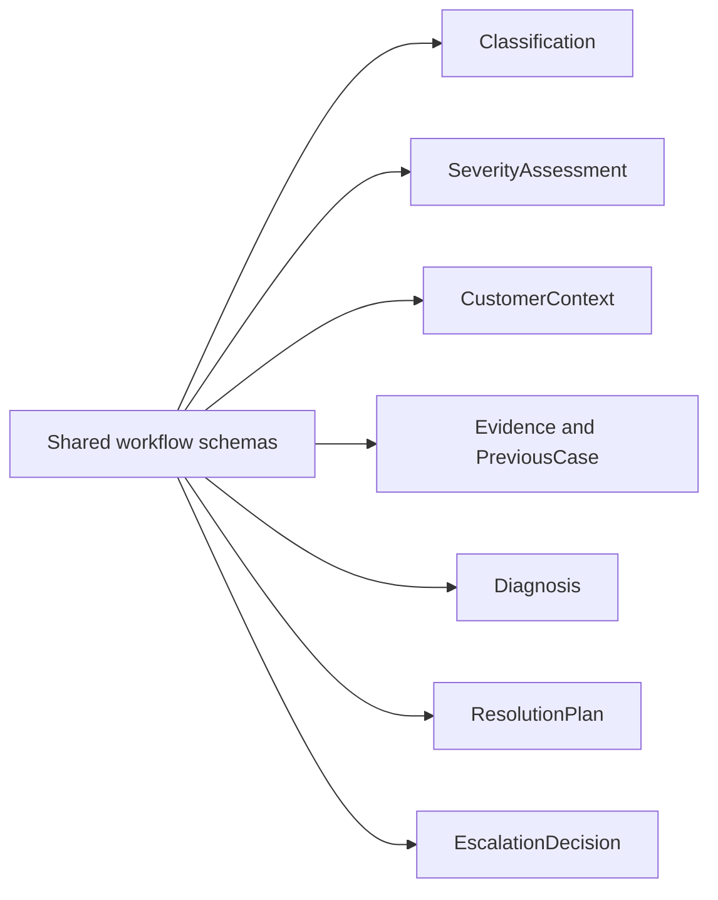

The result object is held in Python memory. It is not written to a database or sent through HTTP in Phase 9.

### Test wiring

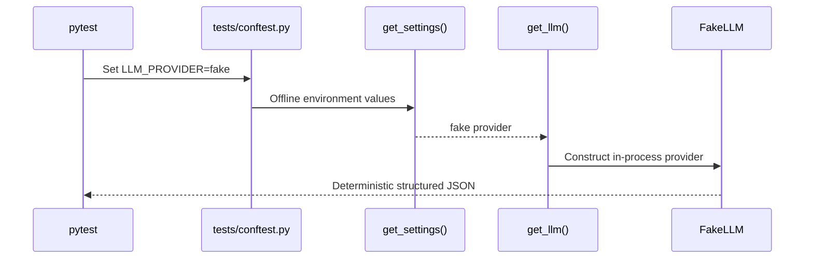

P9-1 therefore requires no external AI network connection.

## P9-2 — Supervisor component wiring

P9-2 adds `agents/specialists/supervisor.py` and prompt constants.

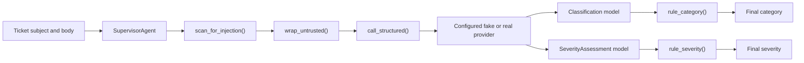

### Routing sequence

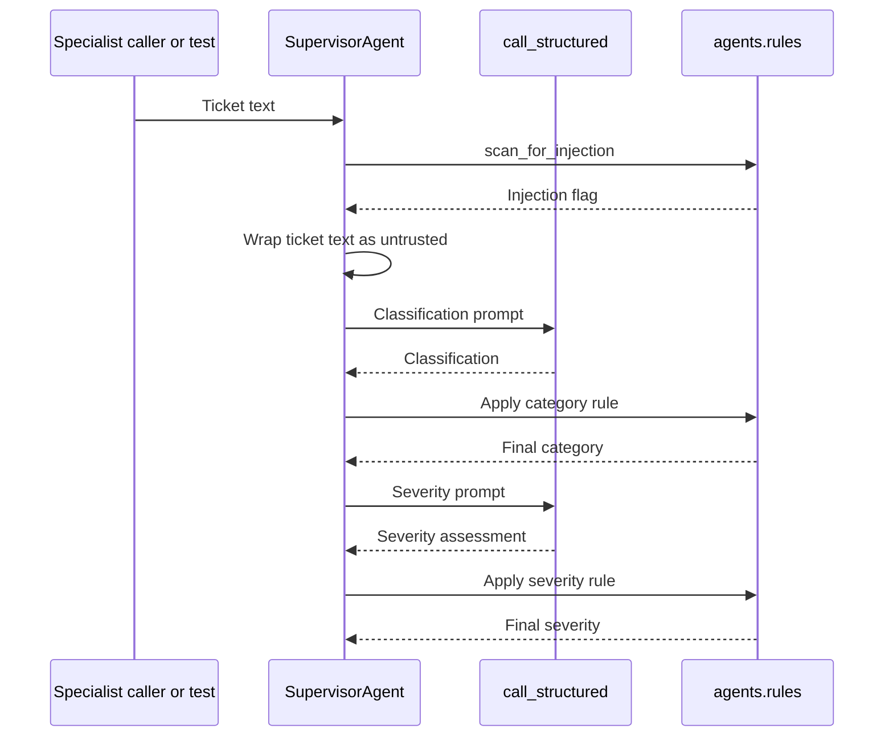

No network route is added. The method is called directly from Python tests or a future graph node.

## P9-3 — Customer component wiring

P9-3 adds `agents/specialists/customer.py`.

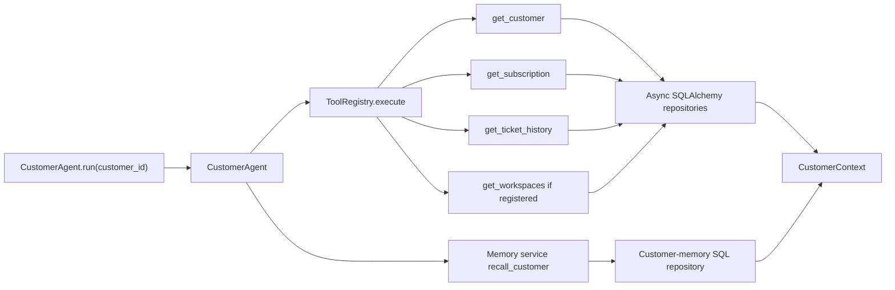

The tool boundary is important:

```mermaid
flowchart TD
    Agent["CustomerAgent"] --> Execute["ToolRegistry.execute"]
    Execute --> Known{ "Tool registered?" }
    Known -->|"Yes"| Result["ToolResult"]
    Known -->|"No"| Failure["Unknown-tool ToolResult"]
    Result --> Agent
    Failure --> Partial["Partial or empty context"]
```

Tool failures are converted into a partial context. The agent does not raise SQL or HTTP exceptions directly into the caller.

## P9-4 — Knowledge component wiring

P9-4 adds `agents/specialists/knowledge.py`.

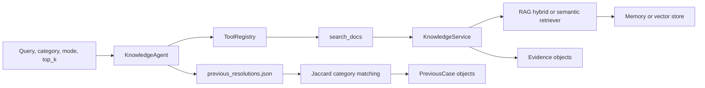

### Evidence and route sequence

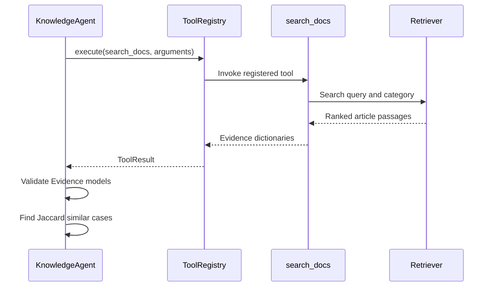

The evidence is passed in Python memory to Troubleshooting and Resolution agents. There is no separate HTTP knowledge agent service.

## P9-5 — Troubleshooting component wiring

P9-5 adds `agents/specialists/troubleshooting.py` and category playbooks.

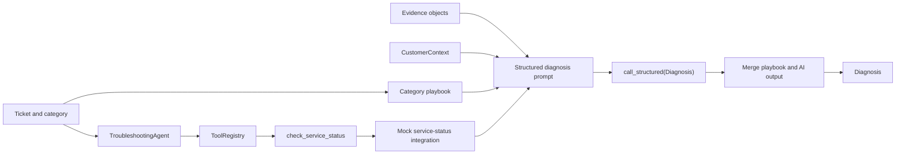

The status call follows the registered-tool path rather than calling a mock integration directly.

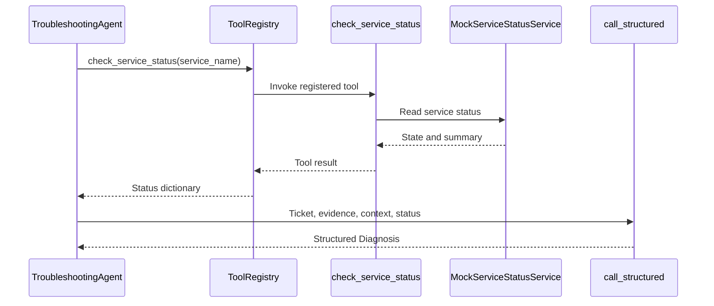

A service failure or missing tool produces no status check, but the specialist still returns a diagnosis using its category playbook and AI result.

## P9-6 — Resolution component wiring

P9-6 adds `agents/specialists/resolution.py`.

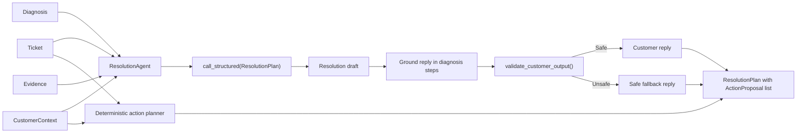

### Routing of proposed actions

```mermaid
flowchart TD
    Ticket["Ticket and category"] --> Update["Ticket update proposal"]
    Ticket --> Billing{ "Refund or dispute?" }
    Ticket --> Reset{ "Workspace reset requested?" }

    Update --> Plan["ActionProposal list"]
    Billing -->|"Yes"| Refund["create_refund_request<br/>approval_required=true"]
    Reset -->|"Yes"| Setting["reset_demo_setting<br/>approval_required=true"]

    Refund --> Plan
    Setting --> Plan
```

The resolution agent proposes actions but does not call `ToolRegistry.execute()`. This prevents a specialist from causing a refund or account change before approval infrastructure exists.

## P9-7 — Escalation component wiring

P9-7 adds `agents/specialists/escalation.py`.

```mermaid
flowchart TD
    Ticket["Ticket text"] --> Rules["matching_escalation_rules()"]
    Rules --> Match{ "Policy match?" }

    Match -->|"Yes"| Severity["severity_for_escalation_matches()"]
    Severity --> PolicyDecision["EscalationDecision<br/>confidence=1.0"]

    Match -->|"No"| AI["call_structured(EscalationDecision)"]
    AI --> Confidence{ "Confidence >= 0.60 and severity high or critical?" }
    Confidence -->|"Yes"| Judgement["EscalationDecision"]
    Confidence -->|"No"| Normal["No escalation"]
```

Policy routing does not pass through the LLM if a deterministic match exists.

```mermaid
sequenceDiagram
    participant Agent as EscalationAgent
    participant Rules as agents.rules
    participant AI as call_structured

    Agent->>Rules: Match ticket against policy terms
    alt Policy match found
        Rules-->>Agent: Team and severity matches
        Agent->>Agent: Highest policy severity wins
        Agent-->>Agent: Return deterministic escalation
    else No policy match
        Agent->>AI: Category, severity, evidence, ticket
        AI-->>Agent: Judgement and confidence
        Agent->>Agent: Accept only confident high/critical result
    end
```

This keeps important routing decisions separate from model probability.

## P9-8 — Evaluation component wiring

P9-8 adds `datasets/eval_cases.json` and tests under `tests/evaluation/`.

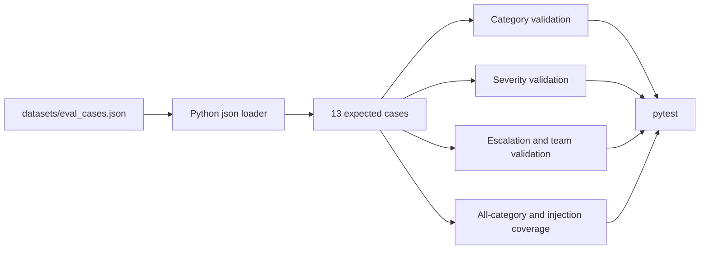

The evaluation dataset is currently a test fixture and contract. It is not part of runtime ticket routing in this phase.

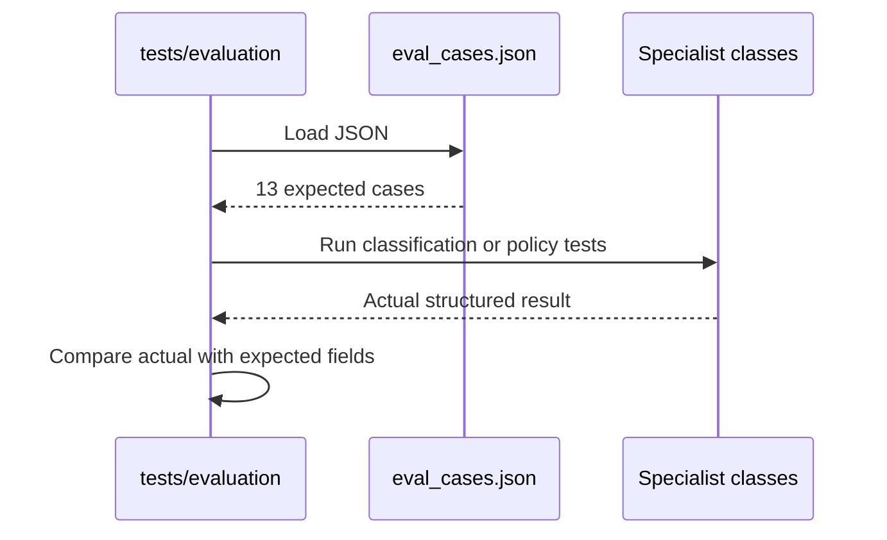

## End-of-Phase 9 component wiring

The complete specialist implementation is in-process and testable without external services:

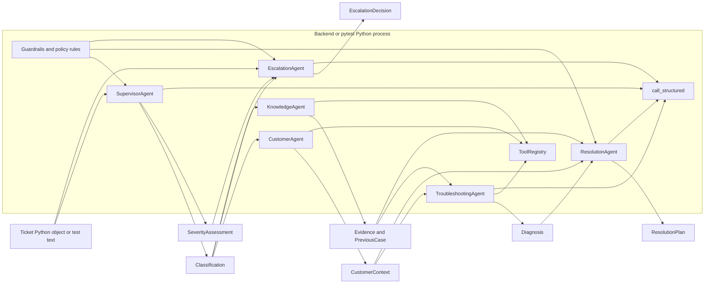

The output objects are held locally and passed between method calls. There is no browser call, message queue, graph runtime, or HTTP service route for these specialist components yet.

## Offline and test routing

```mermaid
flowchart LR
    Pytest["pytest"] --> Env["Offline test environment"]

    Env --> SQLite["Temporary SQLite database"]
    Env --> Fakeredis["In-process Fakeredis"]
    Env --> MemoryVector["In-memory vector store"]
    Env --> FakeLLM["FakeLLM"]
    Env --> MockTools["Mock integrations"]

    SQLite --> Agents["Specialist agent tests"]
    Fakeredis --> Agents
    MemoryVector --> Agents
    FakeLLM --> Agents
    MockTools --> Agents

    Dataset["eval_cases.json"] --> Agents
```

Tests set:

- `DEMO_MODE=true`;
- `LLM_PROVIDER=fake`;
- `VECTOR_STORE=memory`;
- `USE_FAKE_REDIS=true`;
- temporary SQLite storage;
- in-memory checkpoints for later graph tests.

## Docker and network status

At the end of Phase 9, no Docker topology is added.

```mermaid
flowchart LR
    Developer["Developer or pytest"] --> Process["Local Python process"]
    Process --> InMemory["FakeLMM, Fakeredis, memory vector store"]
    Process --> SQLite["Local temporary or support.db SQLite"]

    Process -. "No container routing" .-> Docker["Docker is not implemented"]
    Process -. "No workflow HTTP route" .-> HTTP["Specialists are not exposed as routes"]
```

The repository may later introduce:

- a backend container;
- a frontend container;
- Redis container networking;
- Qdrant container networking;
- health checks;
- Compose service DNS;
- cloud managed replacements.

Those items are deployment concerns for later phases and should not be described as already active in Phase 9.

## Route summary

| Function            | Current routing                                                                       |
| ------------------- | ------------------------------------------------------------------------------------- |
| Structured AI call  | Specialist -> `call_structured()` -> provider -> Pydantic model                       |
| Customer context    | Specialist -> `ToolRegistry` -> read-only SQL tools -> `CustomerContext`              |
| Knowledge retrieval | Specialist -> `ToolRegistry` -> `search_docs` -> RAG service -> evidence              |
| Similar cases       | Specialist -> JSON previous resolutions -> Jaccard matcher                            |
| Service diagnosis   | Specialist -> registered status tool -> mock integration -> merged diagnosis          |
| Resolution plan     | Specialist -> structured AI -> guardrail validation -> deterministic action proposals |
| Escalation          | Specialist -> deterministic rules, then bounded AI judgement                          |
| Evaluation          | pytest -> JSON dataset -> specialist tests                                            |
| HTTP route          | None added for specialist components                                                  |
| Docker network      | None added for specialist components                                                  |

## Honest Phase 9 infrastructure limitation

Phase 9 provides component wiring, but it is still a library-style implementation inside the existing application process.

It does not yet provide:

- the LangGraph runtime;
- graph-node routing;
- workflow state persistence;
- approval interrupt networking;
- workflow event endpoints;
- Docker service discovery;
- container-to-container communication;
- frontend-to-agent HTTP calls.

These capabilities begin in later graph, approval, console, and delivery phases.

## Final Phase 9 infrastructure summary

At the end of Phase 9, the infrastructure shape is:

```mermaid
flowchart LR
    Caller["Test or future workflow caller"] --> Specialists["Six specialist Python components"]

    Specialists --> Schemas["Pydantic structured results"]
    Specialists --> Tools["ToolRegistry"]
    Specialists --> LLM["call_structured and FakeLLM"]
    Specialists --> Rules["Deterministic policy and guardrails"]

    Tools --> SQL["SQLAlchemy and SQL database"]
    Tools --> Redis["Redis or Fakeredis"]
    Tools --> RAG["Knowledge and vector retrieval"]
    Tools --> Mock["Mock integrations"]

    Cases["Evaluation JSON"] --> Validation["pytest and quality checks"]
    Schemas --> Validation
```

The main architectural result is that each specialist is isolated behind a Python interface and shared infrastructure boundary. AI and tools are controlled, results are structured, policy rules remain outside the model, and testing is fully offline. The later graph phase will compose these components and route them through a resumable workflow.
