# Phase 10 — Project System Design Evolution

This document follows the CloudDesk support-workflow design from the isolated specialist components available at the start of Phase 10 through P10-1 to P10-6. It shows the simple starting shape, the design introduced by each subtask, and the complete Phase 10 architecture.

## Phase 10 goal

Before Phase 10, CloudDesk already had specialist agents that could understand tickets, gather customer context, retrieve knowledge, diagnose problems, propose resolutions, and evaluate escalation. Those specialists existed as individual components, but they were not yet arranged into one dependable workflow.

Phase 10 gives the application:

- one shared workflow state;
- a checkpointer for resumable progress;
- named graph nodes for each stage;
- deterministic routing for policy, approval, and low-risk cases;
- workflow run and status APIs;
- persisted node, tool, model, and completion events;
- an events API for support operators.

The subtask evolution is:

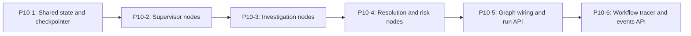

The result is not just a collection of AI components. It is a controlled support-workflow system with a visible route, persistent state, and an audit trail.

## Starting design — specialist components without one workflow

At the beginning of Phase 10, CloudDesk already has the specialist components from earlier phases:

- Supervisor logic for classification and severity;
- Customer context tools;
- Knowledge search and similar-case retrieval;
- Troubleshooting diagnosis;
- Resolution planning;
- Escalation policy logic;
- workflow state and checkpointer foundations;
- workflow database models and repositories.

The missing design element is coordination.

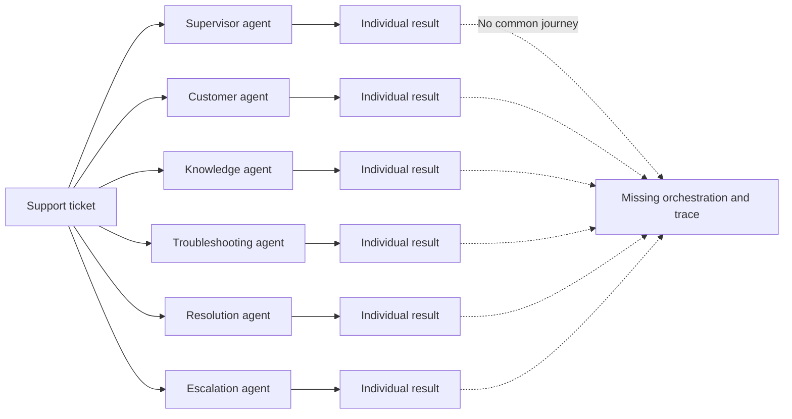

### Starting limitations

- The system knows the specialist operations but does not have one authoritative path between them.
- Completed stages are not guaranteed to be recorded together.
- A service needs a way to save progress after every node.
- There is no complete HTTP start/status lifecycle for a workflow.
- Operators cannot yet follow one chronological activity trail for a run.
- Approval and later execution behavior need a graph route that can pause and resume.

Phase 10 adds a coordinator around these specialists. LangGraph is that coordinator.

## Design principle — shared state and named stages

The workflow is designed as a sequence of named stages with a shared case file.

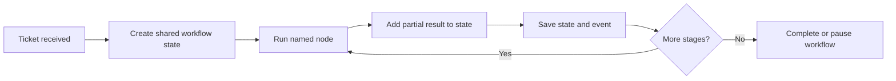

The shared state includes:

- ticket identifiers and ticket data;
- classification and severity;
- injection detection;
- customer context;
- knowledge evidence and previous cases;
- diagnosis;
- resolution plan;
- escalation decision;
- risk and approval fields;
- current node;
- completed nodes;
- errors;
- total token usage.

The graph uses partial updates rather than replacing the entire case. This allows completed nodes and errors to accumulate, and token usage to increase as each model call occurs.

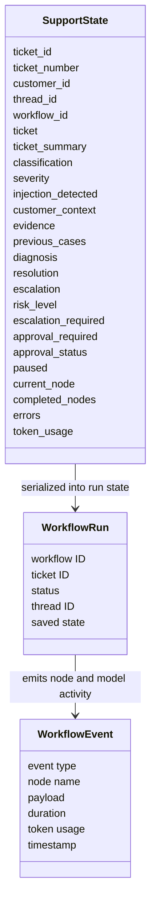

## P10-1 — Workflow state and checkpointer

P10-1 establishes persistence conventions before all nodes are connected.

### Design change

The workflow moves from a one-time Python function call to a stateful process with a resumable history.

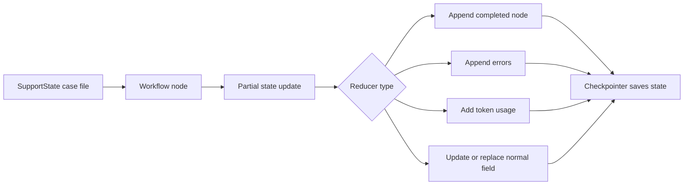

The checkpointer is not the database workflow record. It has a different job:

- the workflow database run records the application status;
- the checkpointer preserves LangGraph execution state and thread identity;
- the workflow service saves a JSON-safe snapshot in the run record.

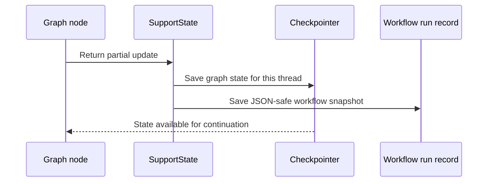

### P10-1 result

The system can remember state, append a complete activity history, add model usage across nodes, and resume a known workflow thread later.

## P10-2 — Supervisor graph nodes

P10-2 turns the supervisor into the beginning of the workflow graph.

### Design change

Ticket understanding becomes the first named stage, followed by severity classification and an internal summary.

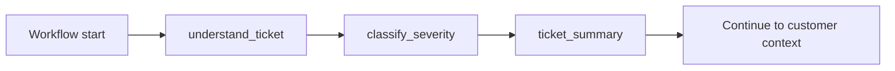

Each node returns a small partial update:

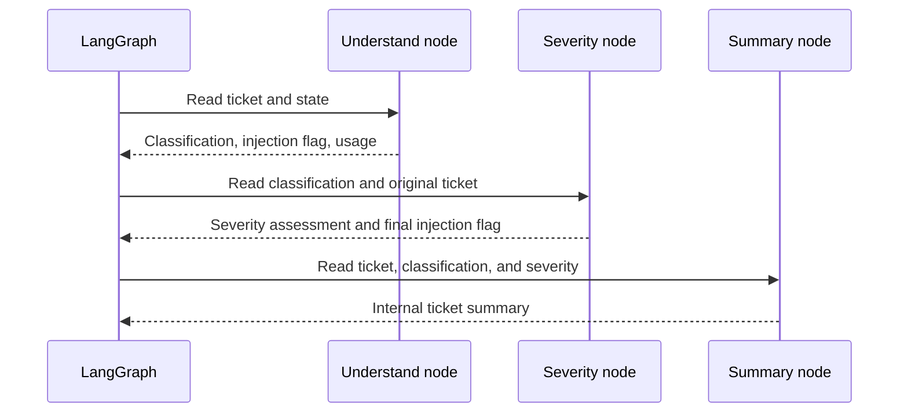

The same policy approach is preserved: clear rule conditions can raise severity or detect suspicious instructions, while AI judgement provides a result for less certain cases.

### P10-2 result

Every workflow now begins with a structured understanding stage and a known completed-node trail.

## P10-3 — Investigation graph nodes

P10-3 adds customer context, knowledge evidence, and diagnosis to the graph.

### Design change

The workflow becomes a research pipeline rather than a single prompt.

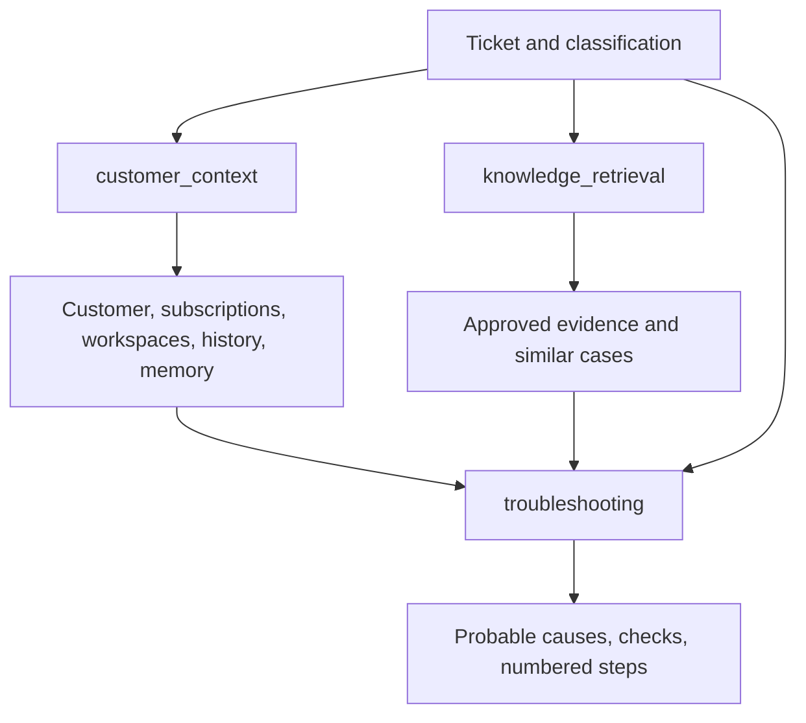

The node sequence is:

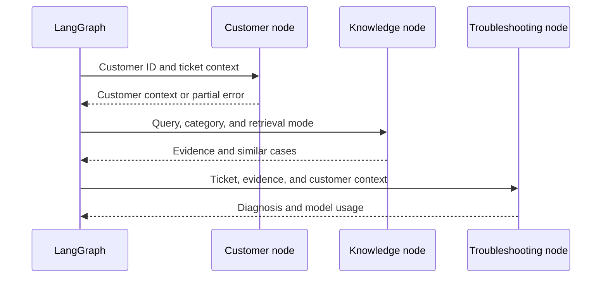

Tool failures do not stop this stage. A missing customer record or search result produces partial state and an error, allowing the graph to continue when possible.

### P10-3 result

Before a resolution is prepared, the graph can gather account context, approved knowledge, and likely causes through separate registered-tool paths.

## P10-4 — Resolution and risk nodes

P10-4 prepares a proposed answer and decides how safely the workflow should continue.

### Design change

Resolution planning is separated from risk routing.

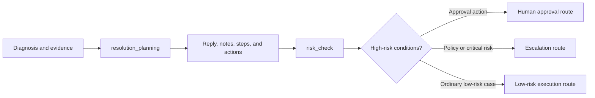

The risk node checks:

- consequential actions;
- policy-rule matches;
- critical severity;
- prompt-injection detection;
- invalid customer-facing output.

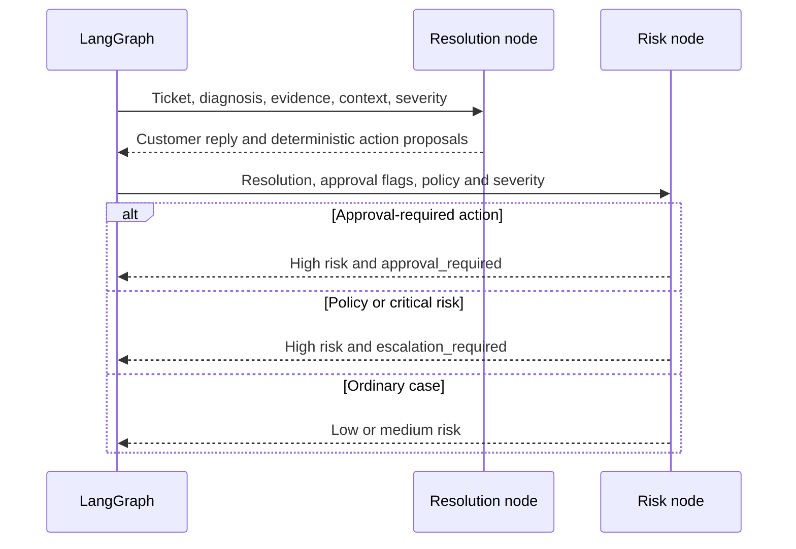

A billing refund or setting reset remains approval-gated. Policy decisions such as a security breach or data-loss situation take precedence over an ordinary model opinion.

### P10-4 result

The graph produces both a resolution plan and a risk decision. The next stage does not need to guess whether action is safe.

## P10-5 — Graph wiring and run API

P10-5 joins every node into a compiled LangGraph workflow and exposes HTTP start/status operations.

### Design change

The application moves from callable specialist nodes to a persistent workflow service with background execution.

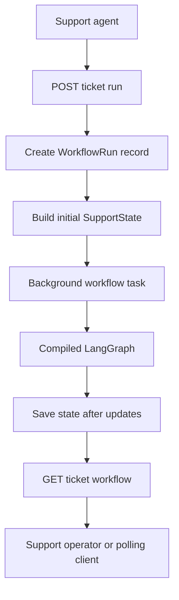

The complete graph shape is:

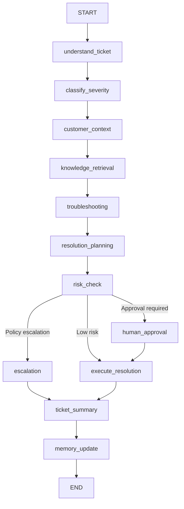

The run API request sequence is:

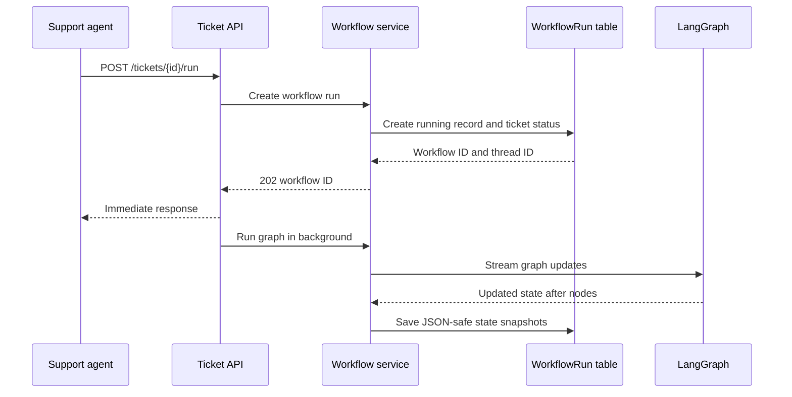

A second run is blocked when the latest workflow is already waiting or paused. This prevents duplicate executions while a case is unresolved.

Runtime objects such as a tool registry or AI provider are not stored in database state or LangGraph checkpoints. The checkpoint keeps workflow data, while the service recreates runtime dependencies at execution time.

### P10-5 result

An operator can start a workflow, receive a workflow ID immediately, poll status, and preserve a resumable workflow thread.

## P10-6 — Workflow tracer and events API

P10-6 makes the graph visible after and during execution.

### Design change

Workflow state answers “What is the current case situation?” Workflow events answer “What happened, in what order, and how long did it take?”

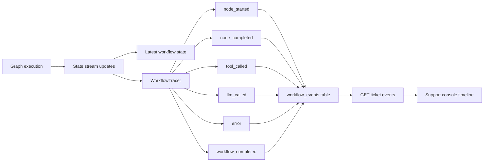

The event data is intentionally safe:

- no raw prompts;
- no hidden reasoning;
- no secrets;
- no runtime objects;
- no other-customer data;
- timing and token usage only where available.

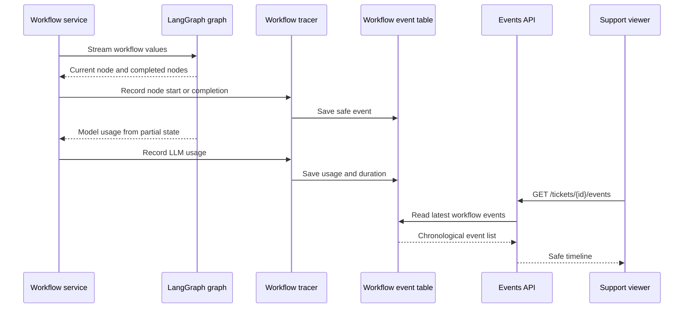

The events endpoint is viewer-readable, but workflow run remains agent-controlled.

### P10-6 result

Every run has an inspectable event history. A support team can see the node path and model cost information without receiving hidden prompts or other sensitive execution details.

## End-of-Phase 10 design

The final Phase 10 design connects all CloudDesk specialists in a persistent workflow and exposes the process through status and event APIs.

```mermaid
flowchart TB
    Agent[Support agent] --> RunAPI[POST /tickets/{id}/run]
    Viewer[Support viewer] --> WorkflowAPI[GET /tickets/{id}/workflow]
    Viewer --> EventsAPI[GET /tickets/{id}/events]

    RunAPI --> Service[WorkflowService]
    Service --> RunRecord[(workflow_runs)]

    Service --> State[Initial SupportState]
    State --> Graph[Compiled LangGraph]

    subgraph GraphStages[Phase 10 workflow stages]
        Understand[Understand and classify]
        Context[Customer context]
        Knowledge[Knowledge and cases]
        Diagnose[Troubleshooting]
        Plan[Resolution planning]
        Risk[Risk check]
        Escalation[Escalation]
        Approval[Approval placeholder]
        Execute[Execution placeholder]
        Summary[Ticket summary]
        Memory[Memory placeholder]

        Understand --> Context --> Knowledge --> Diagnose --> Plan --> Risk
        Risk --> Escalation
        Risk --> Approval
        Risk --> Execute
        Escalation --> Summary
        Approval --> Execute
        Execute --> Summary
        Summary --> Memory
    end

    Graph --> GraphStages

    GraphStages --> Checkpoint[(Checkpointer state)]
    GraphStages --> StateUpdate[Safe state snapshot]
    StateUpdate --> RunRecord

    GraphStages --> Tracer[WorkflowTracer]
    Tracer --> Events[(workflow_events)]

    WorkflowAPI --> RunRecord
    EventsAPI --> Events
```

The HTTP request and graph process have a clear division:

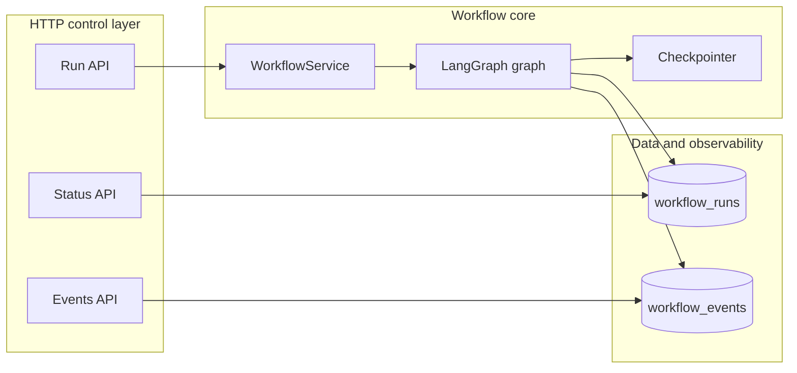

## Layer and responsibility boundaries

Phase 10 follows the project layering rules:

| Component         | Responsibility                                                     | Must not do                                      |
| ----------------- | ------------------------------------------------------------------ | ------------------------------------------------ |
| API ticket routes | HTTP validation, RBAC, 202 response, status and events lookup      | Contain specialist policy or graph routing rules |
| Workflow service  | Create runs, start graphs, persist safe snapshots, resume workflow | Talk to HTTP clients directly                    |
| LangGraph nodes   | Perform one stage and return partial state                         | Write SQL directly                               |
| Specialist agents | Use existing tools and structured outputs                          | Bypass guardrails or the tool registry           |
| Checkpointer      | Preserve resumable graph state                                     | Store runtime provider objects or secrets        |
| Workflow tracer   | Persist timing, usage, node, tool and error events                 | Store prompts or hidden reasoning                |
| Repositories      | Read and write workflow data through SQLAlchemy                    | Invoke AI models or execute tools                |

## Phase 10 design decisions

### 1. Rules and policies stay outside the model

Policy escalation, severity raising, approval-required actions, and output validation are deterministic application decisions. The AI supports judgement in grey areas but cannot replace those rules.

### 2. State is append-safe

Completed nodes and errors are not overwritten. Token usage is summed across node calls.

### 3. Runtime objects stay outside persistence

The model provider, tool registry, and memory service are execution dependencies. They are not serialized into workflow JSON or checkpoints.

### 4. The graph is inspectable

Every stage is named and completed-node state is preserved. The events API makes that activity visible to authorized operators.

### 5. Consequential work remains controlled

The Phase 10 graph adds approval and escalation routes, but the final human interrupt and shared action execution lifecycle are completed in Phase 11.

## Honest limitations after Phase 10

Phase 10 is complete in orchestration shape, but not complete in every later action behavior:

- `human_approval` is a graph placeholder until P11 adds the real interrupt and approval record;
- `execute_resolution` is a placeholder until P11 adds shared registry execution;
- `memory_update` is a placeholder until P11 adds final resolution-memory writing;
- P10-6 currently derives some tool observations from workflow node context in the stream. Full low-level tool arguments and results are the next layer to make consistently inspectable;
- offline fake LLM mode is supported; live providers require later environment and credential configuration;
- no real refund, real email, real deletion, or account action is executed in Phase 10.

These are intentional boundaries, not hidden failures. They prevent a workflow from being presented as production-complete before approval and action controls exist.

## Short questions and answers

**What is the main benefit of this design?**

It turns separate specialist functions into one controlled journey with saved state and visible progress.

**Where does the workflow state live?**

LangGraph checkpoints preserve resumable execution state. The workflow run record also stores a JSON-safe application snapshot.

**Why is there an events table as well as workflow state?**

State stores the current case information. Events preserve history: which stage happened, at what time, and which usage or error result occurred.

**Can a workflow pause for approval?**

The routing and checkpointer shape support a paused workflow. The final interrupt implementation and resume decisions are completed in Phase 11.

**Can operators see hidden AI prompts?**

No. The event API exposes safe activity and usage fields, not raw prompts or hidden reasoning.

**Can a consequential action happen automatically?**

No. Consequential actions are routed to approval. The final approval and execution controls are not completed until Phase 11.

**Is this Phase 10 design production-ready?**

It is production-shaped and fully inspectable in the offline environment. It is not yet the complete final product because human approval, shared resolution execution, and memory update behavior belong to the next phase.
