# Phase 11 — Project System Design Evolution

This document follows the CloudDesk memory design from the Phase 10 workflow baseline through the memory components implemented in Phase 11. It shows the simple starting shape, the design added for temporary and durable memory, how the components connect to the workflow, and the final architecture—including the remaining graph integration gap.

## Phase 11 goal

Before Phase 11, CloudDesk could execute a support workflow, but it did not yet have a complete memory architecture around that workflow.

Phase 11 adds:

- short-term memory for conversations;
- short-term workflow state storage;
- a five-minute knowledge-retrieval cache;
- durable customer memory records;
- recall of up to ten notes for a customer;
- secret scrubbing before storage or reuse;
- customer and source-ticket ownership checks;
- exact duplicate prevention;
- a coordinated `MemoryService` interface;
- a final `memory_update` position in the workflow graph.

The design evolution is:

```mermaid
flowchart LR
    P10["Phase 10: Stateful support workflow"]
    S1["1. Short-term memory"]
    S2["2. Durable memory model"]
    S3["3. Safe recall"]
    S4["4. Resolution recording"]
    S5["5. Privacy and duplicate rules"]
    S6["6. MemoryService coordinator"]
    S7["7. Workflow memory node"]
    Complete["Phase 11 memory architecture"]

    P10 --> S1
    S1 --> S2
    S2 --> S3
    S3 --> S4
    S4 --> S5
    S5 --> S6
    S6 --> S7
    S7 --> Complete
```

The central design rule is: **temporary context and durable customer knowledge must not become one undifferentiated data store**.

---

## Starting design — Phase 10 workflow without complete memory

At the end of Phase 10, the application already has:

- a LangGraph workflow for one ticket;
- a shared `SupportState` object;
- a checkpointer for resumable workflow state;
- workflow run and event records;
- a customer agent that loads basic customer context;
- a knowledge retriever and previous-case search;
- a resolution agent and approved execution path;
- the graph shape ending in `ticket_summary → memory_update → END`.

The missing design parts are:

- a practical short-term conversation store;
- a clean interface for workflow and retrieval cache state;
- durable, customer-scoped support history;
- safe recall of previous memory notes;
- a real write process for resolution summaries.

The beginning of Phase 11 therefore looks like this:

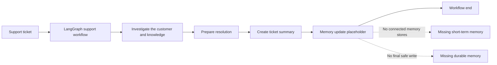

### Starting limitations

- Workflow state can be persisted by the workflow system, but it is not represented through a dedicated application memory interface.
- The customer agent may receive memory service state, but no complete implementation is guaranteed in every graph run.
- Recent conversations and retrieval results have no consistent application-level cache component.
- A useful resolution summary is not guaranteed to become a safe long-term customer note.
- Sensitive text could be stored unless an explicit scrubbing and validation design is added.

Phase 11 separates these concerns into a short-term layer, a durable layer, and a coordinator.

---

## Design principle — separate memory by lifetime and purpose

CloudDesk memory follows one of the simplest and safest design patterns: place information in the storage tier that matches its lifetime.

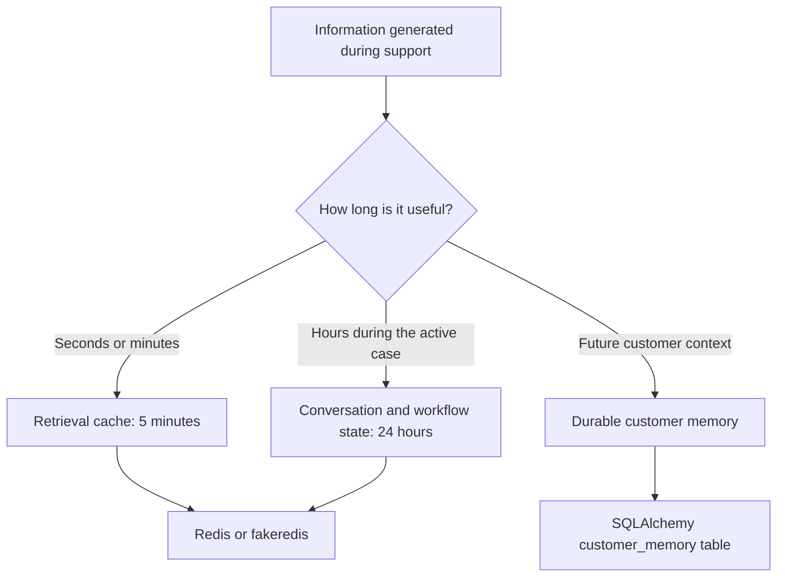

The lifetime rules are deliberate:

| Memory type     | Store           | Default lifetime | Purpose                                |
| --------------- | --------------- | ---------------- | -------------------------------------- |
| Conversation    | Redis/fakeredis | 24 hours         | Recent ticket messages                 |
| Workflow state  | Redis/fakeredis | 24 hours         | Temporary workflow values              |
| Retrieval cache | Redis/fakeredis | 5 minutes        | Repeated knowledge-search acceleration |
| Customer memory | SQL database    | Durable          | Safe support history                   |

The workflow checkpointer is a separate mechanism. It preserves LangGraph execution for pause and resume. It should not be replaced by Redis memory or used as the customer record.

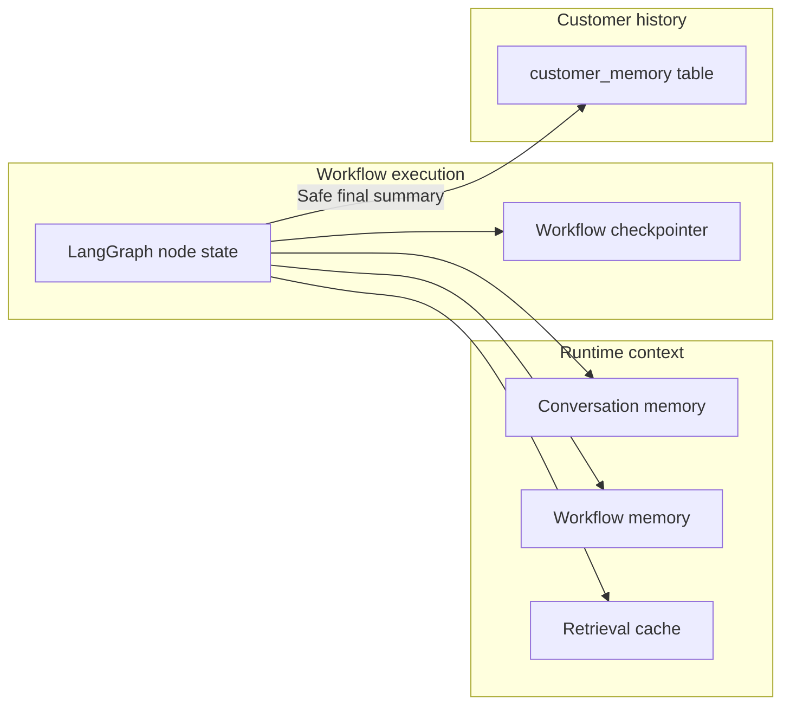

---

## Phase 11-1 — Short-term memory design

The first memory design introduces `ShortTermMemory` and Redis-compatible key formats.

### Design change

Temporary data moves behind a typed application class instead of being read directly from Redis by workflow components.

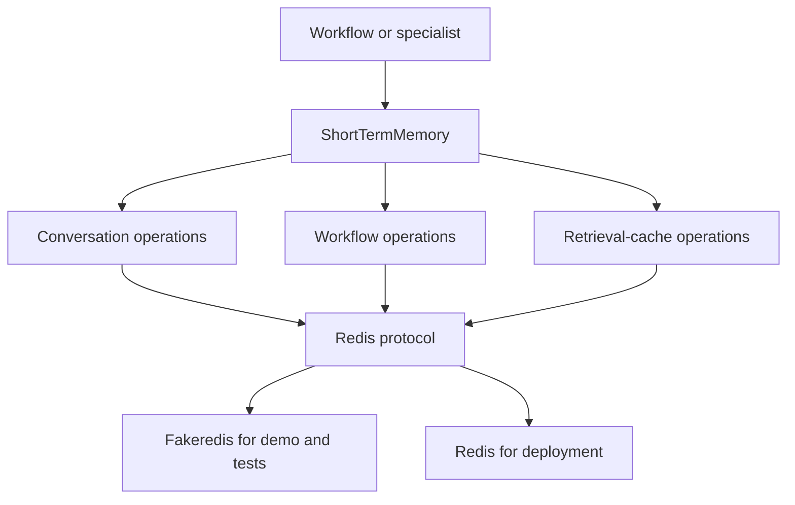

The key design is also simple and predictable:

```text
conversation:<ticket-id>
workflow:<workflow-id>
rag:<mode>:<category>:<top-k>:<normalized-query>
```

### Data flow

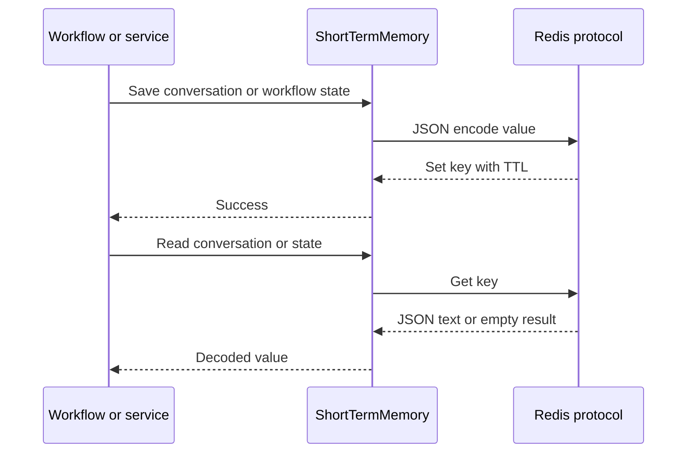

### Cache design

Retrieval cache keys include every meaningful search variation:

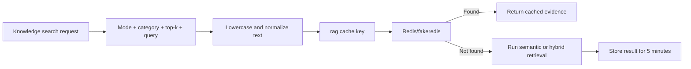

This cache is not a permanent source of evidence. It is only a temporary acceleration layer.

**P11-1 result:** temporary conversations, workflow values, and knowledge search results have bounded lifetimes and a Redis-compatible interface.

---

## Phase 11-2 — Durable customer-memory design

The second design introduces the `CustomerMemory` database entity and a repository for customer-scoped operations.

### Design change

Long-term memory is stored only in one dedicated table with a strict set of permitted types.

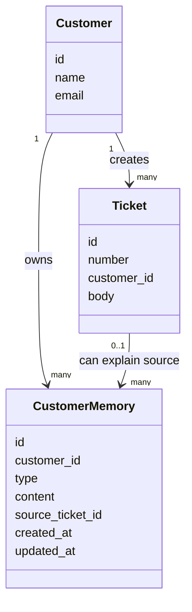

Allowed memory types are represented by an application allow-list and also constrained in PostgreSQL:

```text
preference
past_issue
troubleshooting
note
```

Unknown types must not pass the memory service.

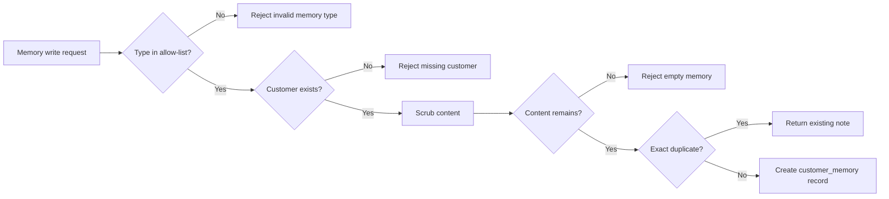

**P11-2 result:** durable memory has one customer owner, a controlled category, and a dedicated database record.

---

## Phase 11-3 — Safe recall design

The third design allows the customer agent to use previous memory without sending unbounded history or untrusted text into the workflow.

### Design change

Memory recall becomes a bounded read operation:

- only one customer is allowed;
- a limit of 1–10 notes is enforced;
- newest notes are returned first;
- recalled content is scrubbed again before use;
- recall failure does not stop the rest of customer-context work.

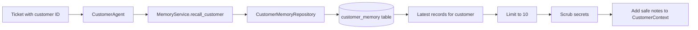

### Recall and workflow sequence

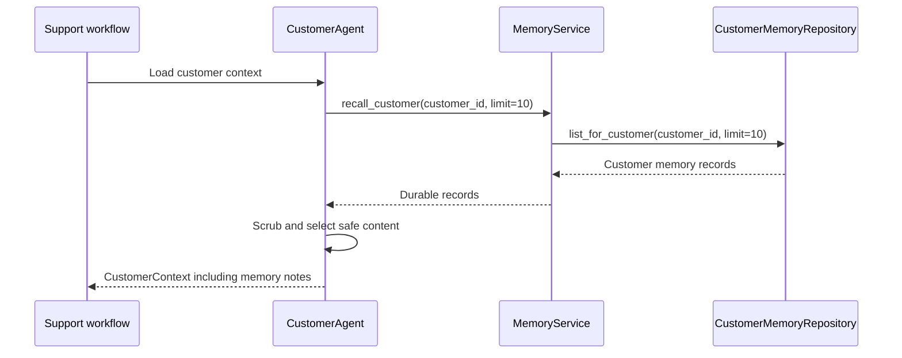

The customer context remains resilient:

- missing customer ID → context reports a partial error;
- memory service unavailable → other customer context still loads;
- memory recall fails → customer context continues without remembered notes.

**P11-3 result:** memory improves context, but it is optional and bounded rather than a workflow dependency.

---

## Phase 11-4 — Resolution recording design

The fourth design defines what may be saved after a workflow.

Instead of storing the full ticket, `MemoryService.record_resolution()` creates only:

1. one `past_issue` record;
2. up to three `troubleshooting` records;
3. one `note` record.

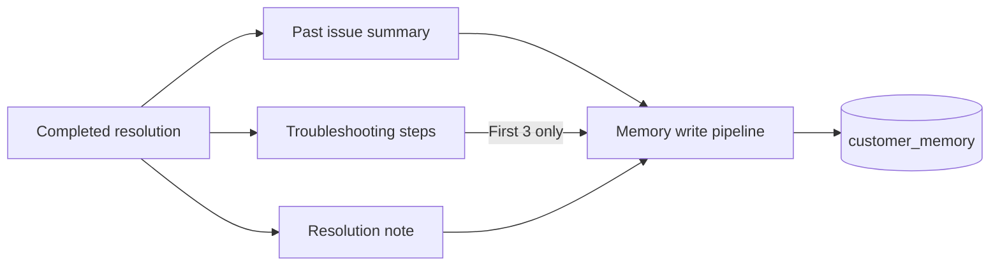

### Resolution write sequence

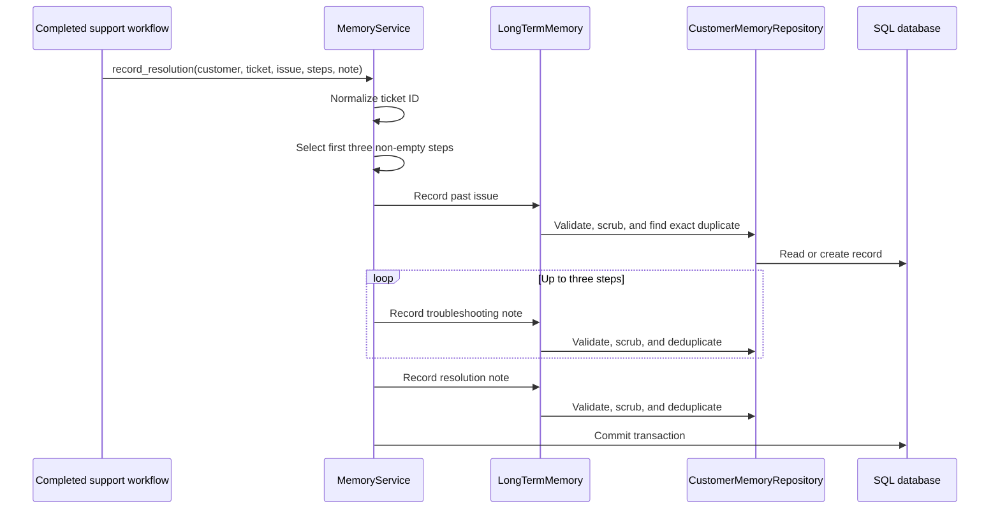

The record is intentionally small. It does not contain:

- the raw ticket body;
- the complete conversation;
- internal chain-of-thought;
- unrelated customer information;
- secrets or card identifiers.

**P11-4 result:** the durable record is a short support summary rather than a copy of the original case.

---

## Phase 11-5 — Privacy and ownership design

The fifth design adds validation to the memory write and read pipeline.

### Design change

Memory is treated as untrusted generated content until all of these checks pass:

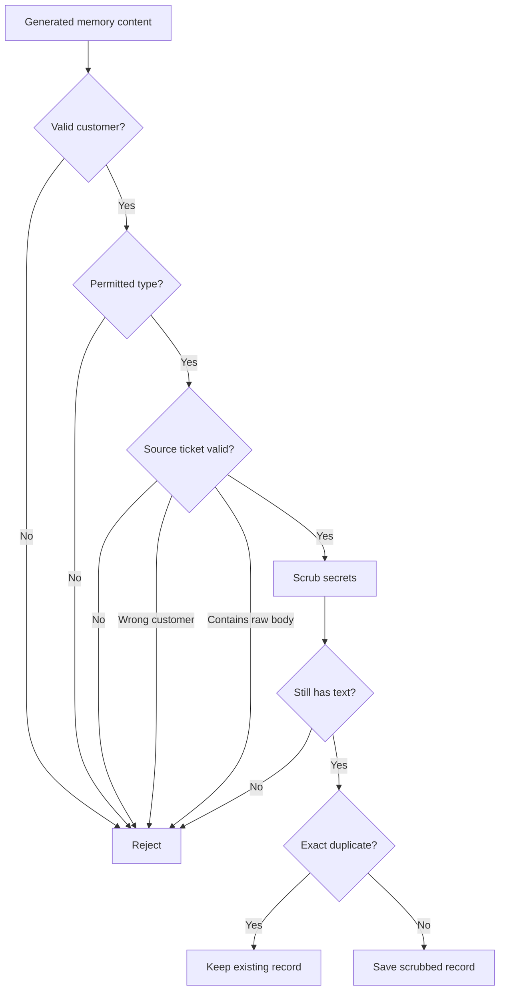

### Scrubbing design

The scrubber removes or masks:

- password assignments;
- API-key assignments;
- bearer and JWT tokens;
- AWS access keys;
- private-key blocks;
- credentials in URLs;
- sensitive query values;
- card-number sequences.

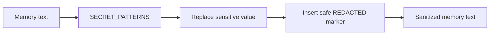

### Ownership design

A source ticket must pass all three checks:

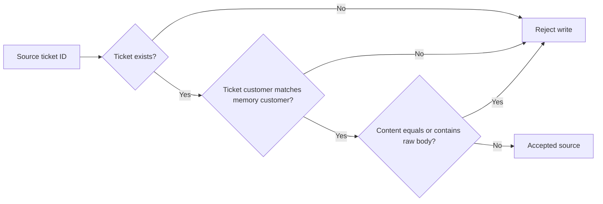

**P11-5 result:** memory cannot become a second, unsafe copy of the ticket or a cross-customer record.

---

## Phase 11-6 — Duplicate-prevention design

The sixth design prevents repeated workflow runs from creating identical records.

A duplicate is defined precisely. Two memory records are duplicates only when all relevant fields match:

- the same customer;
- the same memory type;
- the same scrubbed content;
- the same source ticket.

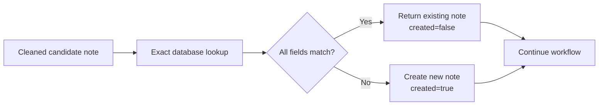

The system deliberately does not use AI similarity judgment for duplicate detection. “Exact duplicate” is a deterministic database check, making the behavior predictable and testable.

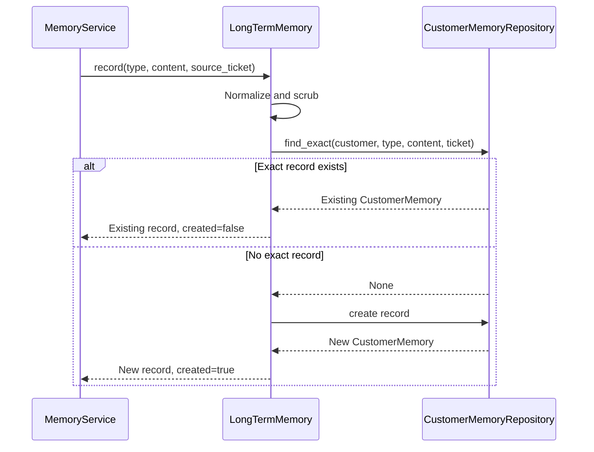

**P11-6 result:** repeated runs do not create a second copy of the exact same note.

---

## Phase 11-7 — Memory coordinator design

The seventh design introduces `MemoryService` as one public facade for the rest of the application.

Before this facade, a caller would need to know:

- Redis or fakeredis APIs;
- JSON encoding rules;
- SQLAlchemy session behavior;
- the long-term repository;
- scrubbing rules;
- duplicate behavior;
- TTL values.

`MemoryService` hides these details and exposes support-oriented operations.

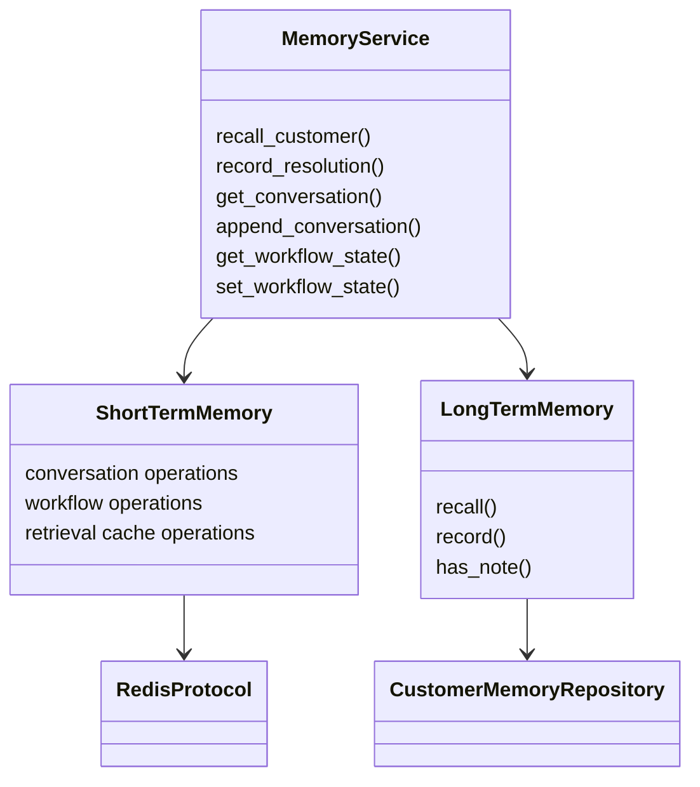

### Coordinator behavior

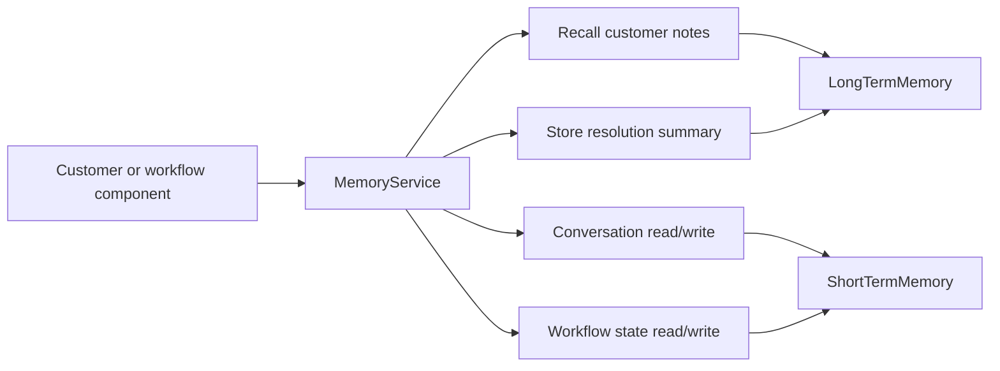

The service also keeps transaction behavior clear:

- long-term `record_resolution()` writes multiple records;
- successful writes commit together;
- an exception rolls the transaction back;
- short-term operations remain independent of the SQL transaction.

**P11-7 result:** application components call one coherent memory interface while storage details remain in separate implementations.

---

## Phase 11-8 — Customer-context integration design

The customer agent is the main read-time integration point for memory.

### Design change

Customer context is expanded from account, subscription, workspace, and ticket history to also include safe memory notes.

```mermaid
flowchart LR
    Ticket[Ticket] --> CustomerAgent[CustomerAgent]

    CustomerAgent --> Customer[Customer profile]
    CustomerAgent --> Subscription[Subscription]
    CustomerAgent --> Workspaces[Workspace list]
    CustomerAgent --> History[Previous tickets]
    CustomerAgent --> Memory[Recall memory]

    Memory --> Scrub[Scrub recalled text]
    Scrub --> Notes[Up to 10 notes]

    Customer --> Packet[CustomerContext packet]
    Subscription --> Packet
    Workspaces --> Packet
    History --> Packet
    Notes --> Packet

    Packet --> Investigation[Knowledge and troubleshooting stages]
```

The memory lookup is a separate, non-destructive read. If no memory service exists or recall raises an exception, the agent returns the rest of the context and does not crash the investigation node.

```mermaid
sequenceDiagram
    participant Graph as Investigation node
    participant Customer as CustomerAgent
    participant Tools as Registered read tools
    participant Memory as MemoryService

    Graph->>Customer: Run with customer_id
    Customer->>Tools: Read customer, plan, workspaces, tickets
    Customer->>Memory: Recall up to 10 notes
    alt Memory works
        Memory-->>Customer: Safe customer records
    else Memory unavailable
        Memory-->>Customer: Failure or no service
        Customer->>Customer: Continue without memory
    end
    Customer-->>Graph: Partial or complete CustomerContext
```

**P11-8 result:** previous safe context can inform diagnosis, while memory failure remains non-critical.

---

## Phase 11-9 — Graph integration design and remaining gap

The workflow graph reserves a final memory stage:

```text
execute_resolution or escalation
  → ticket_summary
  → memory_update
  → END
```

The intended design is:

```mermaid
flowchart LR
    Completed[Resolution or escalation completed] --> Summary[ticket_summary]
    Summary --> Update[memory_update]
    Update --> Safe[Safe resolution summary]
    Safe --> Record[MemoryService.record_resolution]
    Record --> Long[(customer_memory)]
    Update --> End[Workflow complete]
```

The intended `memory_update` responsibilities are:

- identify the customer and source ticket;
- read the past issue summary;
- pass the first three troubleshooting steps;
- pass the resolution note;
- call `MemoryService.record_resolution()`;
- mark the node complete;
- return errors without crashing the workflow if memory write fails.

However, the current graph implementation still contains a placeholder.

```mermaid
flowchart LR
    State[Final workflow state] --> Node[memory_update node]
    Node --> Mark[Add memory_update to completed_nodes]
    Mark --> End[END]

    Node -. "No real memory write call yet" .-> Gap[Remaining graph integration]
```

This means a precise status distinction is required:

| Design area                         | Current state                                  |
| ----------------------------------- | ---------------------------------------------- |
| Short-term memory implementation    | Implemented                                    |
| Durable memory model and repository | Implemented                                    |
| Safe recall                         | Implemented                                    |
| Resolution recording service        | Implemented                                    |
| Secret scrubbing                    | Implemented                                    |
| Customer/ticket ownership checks    | Implemented                                    |
| Exact duplicate prevention          | Implemented                                    |
| MemoryService coordinator           | Implemented                                    |
| Customer agent recall integration   | Implemented through an injected memory service |
| Automatic graph memory write        | Placeholder remains                            |
| Real production Redis               | Not required in demo/test mode                 |
| Real production database deployment | Not claimed in this phase                      |

**P11-9 result:** all memory building blocks exist, but the last graph invocation must receive and call a real `MemoryService` before Phase 11 can satisfy automatic “remember after every completed run” behavior.

---

## Final Phase 11 design

The final memory architecture is a four-layer design:

```mermaid
flowchart TD
    Browser[Support agent browser] --> API[FastAPI workflow API]
    API --> Workflow[LangGraph support workflow]

    Workflow --> Customer[CustomerAgent]
    Workflow --> Summary[ticket_summary]

    Customer --> MemoryFacade[MemoryService]
    Summary -. Intended final write .-> MemoryFacade

    MemoryFacade --> Short[ShortTermMemory]
    MemoryFacade --> Long[LongTermMemory]

    Short --> Redis[(Redis or fakeredis)]
    Long --> Guards[Type, ownership, scrubbing, duplicate guards]
    Guards --> Repo[CustomerMemoryRepository]
    Repo --> SQL[(SQLAlchemy database)]

    SQL --> Postgres[PostgreSQL in cloud mode]
    SQL --> SQLite[SQLite in demo and tests]

    Workflow --> Checkpoint[LangGraph checkpointer]
    Checkpoint --> CheckpointStore[(SQLite or in-memory checkpoint)]
```

The complete intended flow is:

```mermaid
sequenceDiagram
    participant Ticket as Ticket
    participant Graph as LangGraph workflow
    participant Customer as CustomerAgent
    participant Memory as MemoryService
    participant Short as Short-term memory
    participant Long as Long-term memory

    Ticket->>Graph: Start workflow
    Graph->>Short: Optional temporary state and cache access
    Graph->>Customer: Gather customer context
    Customer->>Memory: Recall up to 10 safe notes
    Memory->>Long: Read customer memory
    Long-->>Memory: Records
    Memory-->>Customer: Scrubbed notes
    Customer-->>Graph: CustomerContext

    Graph->>Graph: Investigate, diagnose, plan, and execute
    Graph->>Graph: Create ticket summary
    Graph->>Memory: record_resolution intended write
    Memory->>Long: Store past issue and first three steps
    Memory->>Long: Store resolution note
    Long-->>Memory: Created or duplicate result
    Memory-->>Graph: Completed memory update
    Graph-->>Ticket: Workflow complete
```

### End-of-phase system responsibilities

| Component                  | Responsibility                                 | Must not do                                         |
| -------------------------- | ---------------------------------------------- | --------------------------------------------------- |
| `ShortTermMemory`          | Conversations, workflow state, retrieval cache | Store permanent customer history                    |
| Redis/fakeredis            | Fast temporary key/value storage               | Become the only source of customer memory           |
| `LongTermMemory`           | Validated durable memory writes and recall     | Store raw ticket bodies or secrets                  |
| `CustomerMemoryRepository` | Customer-scoped database operations            | Decide policy or scrub content                      |
| `MemoryService`            | Coordinate both memory lifetimes               | Cross customer memory or bypass safety checks       |
| Customer agent             | Read memory into customer context              | Write unrestricted memory                           |
| `memory_update` node       | Save a small completed-run summary             | Execute while the graph write remains a placeholder |
| Workflow checkpointer      | Resume workflow execution                      | Be used as the long-term customer record            |

---

## Testing and validation design

The Phase 11 memory design is verified through offline unit tests using SQLite and fakeredis.

| Test area                | Design guarantee                                                     |
| ------------------------ | -------------------------------------------------------------------- |
| Short-term TTL constants | Conversation and workflow state last 24 hours; cache lasts 5 minutes |
| Key generation           | IDs and normalized queries create predictable keys                   |
| JSON round-trip          | Conversation and workflow values survive storage and retrieval       |
| Recall limit             | Customer memory can be recalled up to the 10-note limit              |
| Resolution write         | Past issue, first three steps, and resolution note are stored        |
| Secret scrub             | Password and API-key text does not remain in memory                  |
| Duplicate prevention     | Repeating the same resolution does not create duplicate records      |
| Short/long separation    | Temporary and durable memory operations remain independent           |
| Customer ownership       | Source ticket must belong to the same customer                       |

These tests allow memory behavior to be reviewed without a real Redis deployment or cloud database.

---

## Honest Phase 11 status

Phase 11 should be presented with the following status:

```text
Implemented:
- short-term memory
- long-term customer memory
- memory facade
- safe recall
- scrubbing
- ownership validation
- duplicate prevention
- offline tests

Remaining integration:
- the final graph memory_update node must call MemoryService after a completed workflow
- workflow-service dependency injection must consistently provide MemoryService
- an end-to-end demo run must verify recall on a subsequent run
```

Phase 11 therefore adds a real memory subsystem, but the automatic write at the end of the LangGraph workflow is the final connection to complete for strict F11/F4 behavior across every run.

---

## Interview-ready summary

### 30-second summary

> “Phase 11 separates temporary memory from durable customer memory. Redis or fakeredis holds conversations, workflow state, and retrieval cache values for a short time. SQLAlchemy stores only allowed customer notes, and every write is customer-scoped, secret-scrubbed, ownership-checked, and duplicate-safe. The memory subsystem is implemented and tested offline. The remaining work is connecting the final workflow node so every completed run automatically records a safe summary.”

### 60-second summary

> “Before Phase 11, CloudDesk had a workflow but did not have a complete memory architecture. We added `ShortTermMemory` for 24-hour conversation and workflow state plus a five-minute retrieval cache. We also added a durable `customer_memory` table with only preference, past-issue, troubleshooting, and resolution-note types. `MemoryService` coordinates short-term and long-term memory, and the customer agent recalls up to ten scrubbed notes. Resolution writes are limited to an issue summary, the first three useful steps, and one resolution note. Customer ownership, source-ticket ownership, secret scrubbing, and exact duplicate checks protect the write. SQLite and fakeredis tests validate the behavior locally. One integration gap remains: the graph's final `memory_update` node is still a placeholder rather than an active end-of-run database write.”
