# Phase 12 — Project System Design Evolution

This document follows the CloudDesk frontend design from the Phase 11 backend baseline through P12-1 to P12-4. It shows the simple starting shape, the design introduced by each subtask, and the complete Phase 12 browser-console architecture.

## Phase 12 goal

Before Phase 12, CloudDesk already had a protected FastAPI backend, typed domain records, workflow execution, approval and escalation services, customer memory, knowledge search, and specialist agents. It did not yet have a complete browser interface that support workers could use naturally.

Phase 12 gives the application:

- a Next.js 15 App Router shell;
- shared navigation declared once;
- a typed frontend API client;
- bearer-token demo authentication;
- session restoration and login routing;
- viewer, agent, and admin role-aware layout behavior;
- dashboard and read-only list pages;
- customer, ticket, and knowledge detail views;
- loading, empty, network-error, polling, status, and formatting behavior;
- frontend unit tests for API, navigation, authentication, and read components.

The subtask evolution is:

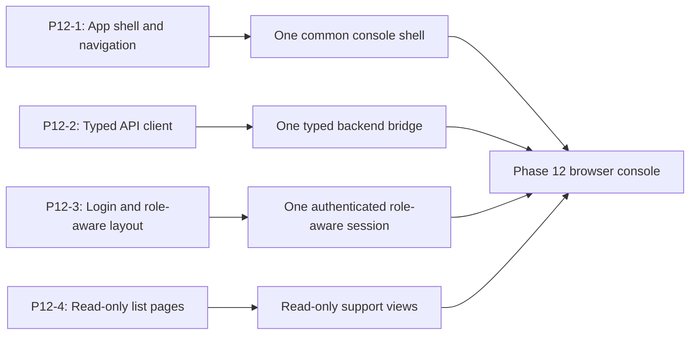

The main architectural change is that CloudDesk gains a presentation layer around its existing backend. The frontend becomes easier to navigate and inspect, while FastAPI remains the application and security authority.

---

## Starting design — backend capabilities without a complete console

At the end of earlier phases, CloudDesk already has:

- FastAPI routes and middleware;
- JWT authentication and role enforcement;
- ticket and customer repositories;
- knowledge retrieval and knowledge API routes;
- approval and escalation APIs;
- workflow run, status, event, and graph services;
- a Next.js project folder, but no complete application shell;
- a frontend types file, but no API client implementation;
- placeholder frontend pages.

The browser-facing architecture at the start of Phase 12 is incomplete:

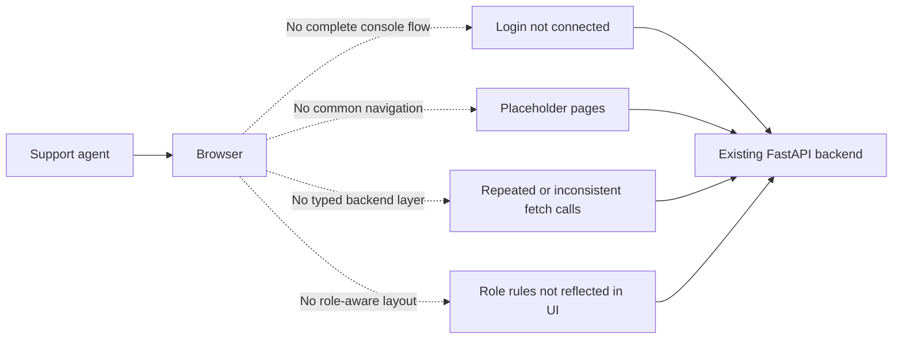

### Starting limitations

- The backend API exists, but the browser does not provide one consistent route structure.
- Authentication was available but not represented by a frontend session provider.
- Navigation is not declared through a central application configuration.
- API responses can be called differently from each page without a shared client.
- Pages do not yet display loading, empty, network-error, status, and polling behavior consistently.
- Read-only tickets, customers, knowledge, escalations, and workflow events are not presented as a complete console.

Phase 12 solves these problems by adding a browser presentation layer without moving business rules into the frontend.

---

## Design principle — frontend presentation around backend authority

The central Phase 12 principle is separation:

- Next.js presents screens and navigation;
- the typed API client communicates with FastAPI;
- FastAPI validates authentication and roles;
- services and repositories execute application behavior;
- SQL, Redis, knowledge stores, and the workflow graph hold application state.

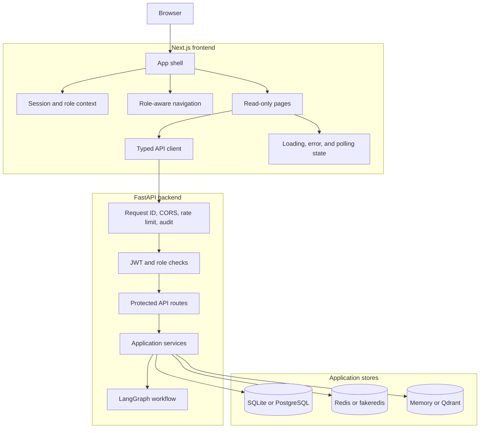

The frontend role rules improve navigation and hide restricted controls. They do not decide whether a direct backend request is authorized.

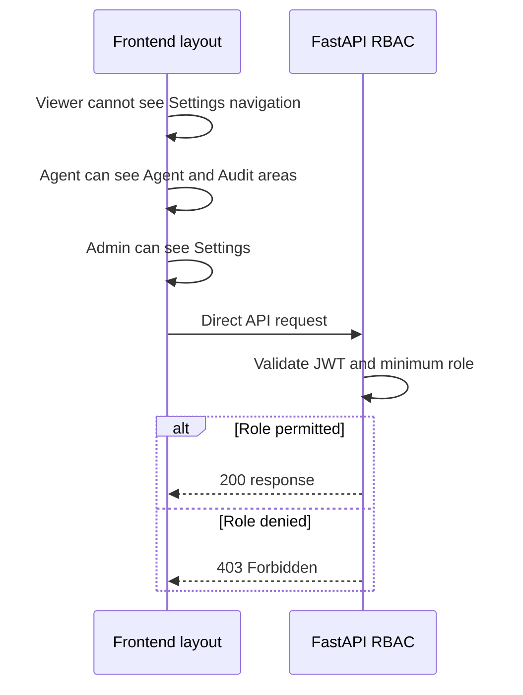

---

## P12-1 — App shell and shared navigation design

P12-1 adds the common visual and route structure.

### Design change

Before P12-1, pages are separate placeholders. After P12-1, every page is rendered inside a common application frame.

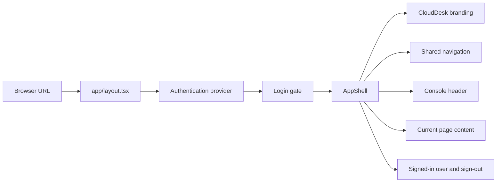

The App Router route structure is predictable:

```text
/login
/dashboard
/tickets
/tickets/[id]
/customers
/customers/[id]
/knowledge
/knowledge/[id]
/escalations
/agents
/audit
/settings
/api/health
```

A dynamic `[id]` route becomes the detail URL for one ticket, customer, or knowledge article.

### Navigation design

Navigation is declared once in `components/layout/nav.ts`.

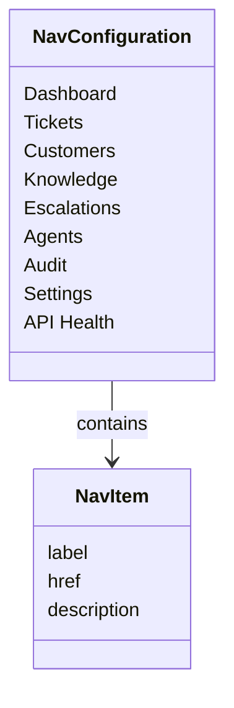

This prevents the menu from being copied into separate page components.

### App shell responsibilities

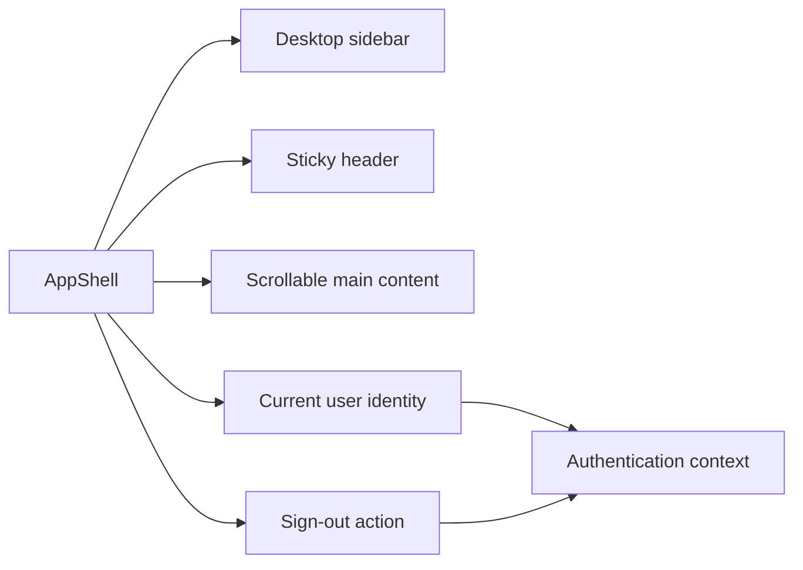

P12-1 also establishes a responsive layout:

- desktop screens show a fixed left sidebar;
- smaller screens remove the fixed desktop sidebar;
- the active page content remains inside a bounded content region;
- the CloudDesk brand remains accessible.

**P12-1 result:** the frontend is now an organized application shell instead of isolated placeholder pages.

---

## P12-2 — Typed API client design

P12-2 adds the communication boundary between Next.js and FastAPI.

### Design change

Every browser method that needs backend data is expected to pass through `ApiClient`.

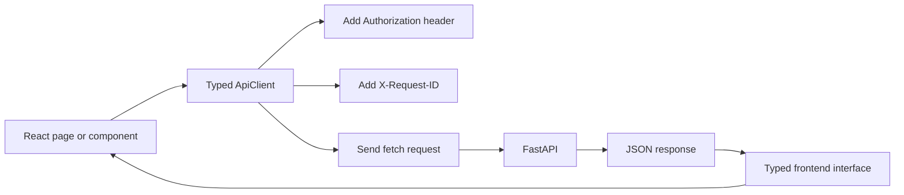

This removes page-specific URL and response conventions.

### Contract mirror design

The frontend uses interfaces in `frontend/lib/types.ts` that mirror API contract shapes.

Examples include:

- `TicketSummary` and `TicketDetail`;
- `CustomerSummary` and `CustomerDetail`;
- `KnowledgeArticle` and `KnowledgeEvidence`;
- `WorkflowStatusResponse` and `WorkflowEventsResponse`;
- `ApprovalResponse`;
- `EscalationResponse`;
- `DemoTokenResponse` and `MeResponse`.

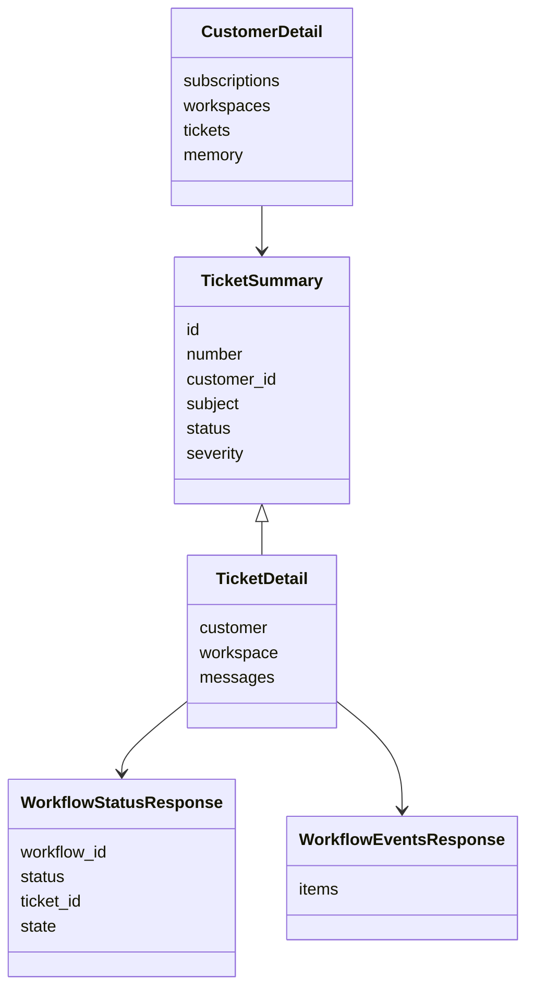

### Authentication request design

The API client has access to two browser operations:

- get token from local storage;
- set or remove token in local storage.

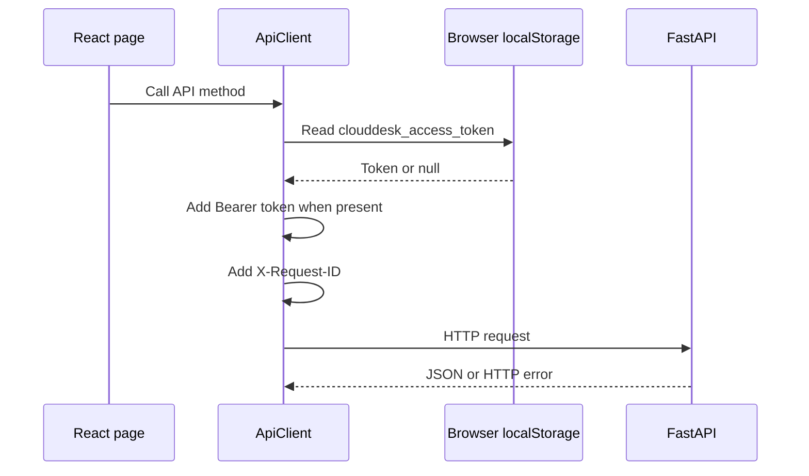

The public demo-token request has no existing bearer token. Later protected requests include the stored token.

### 401 session design

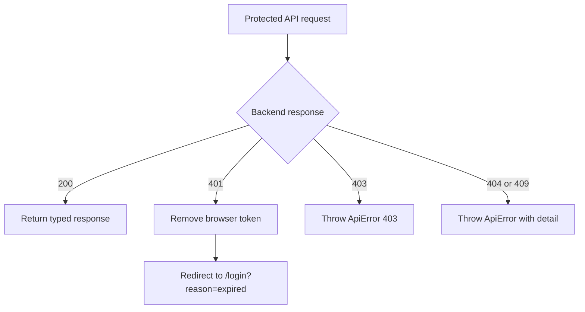

A 401 means the browser session is no longer valid. A 403 means the session is valid but the role is insufficient.

### Error design

The API client separates connection failures from HTTP application failures.

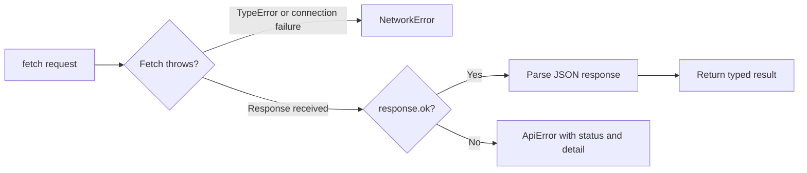

**P12-2 result:** API communication is centralized, observable, authenticated, and contract-aligned.

---

## P12-3 — Authentication and role-aware layout design

P12-3 adds a frontend identity and session system.

### Design change

The application moves from a shell with no user to a shell backed by a React authentication context.

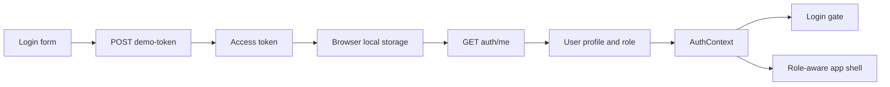

### Authentication state

`AuthProvider` holds:

- current user;
- loading state;
- sign-in method;
- sign-out method;
- `canAct`;
- `isAdmin`;
- `isViewer`.

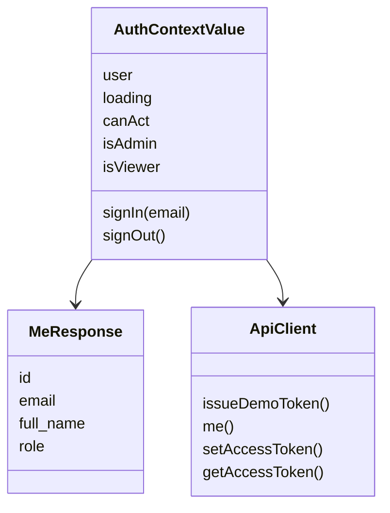

### Login flow

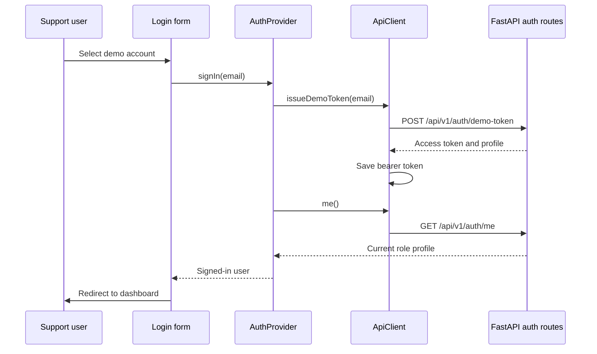

The login form is wrapped in a Next.js Suspense boundary because it reads URL search parameters for expired-session state.

### Session restoration

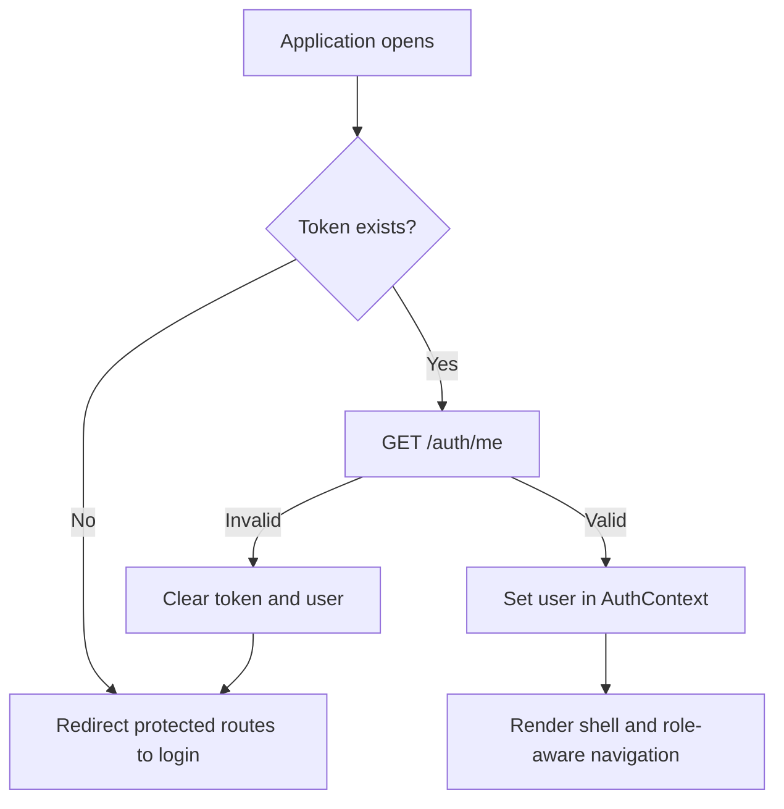

### Login gate design

The login gate separates public and protected rendering:

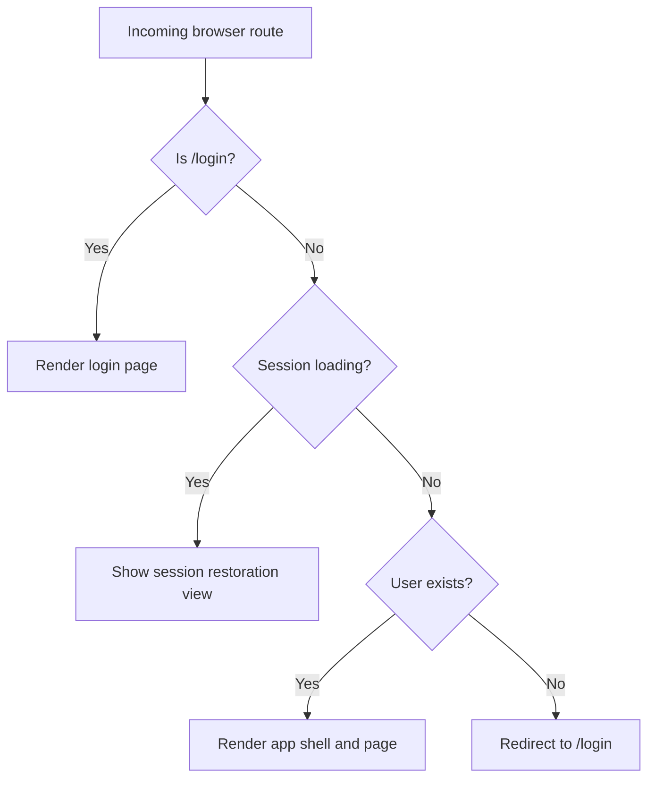

The login gate is a UX control and route guard. Backend route RBAC remains the security authority.

### Role hierarchy design

The frontend role hierarchy mirrors the backend:

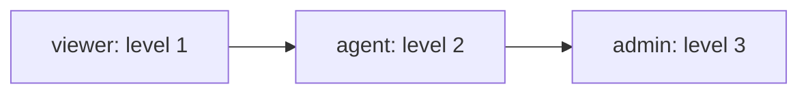

The role-aware presentation rules are:

| Route area              |                                   Viewer | Agent | Admin |
| ----------------------- | ---------------------------------------: | ----: | ----: |
| Dashboard               |                                      Yes |   Yes |   Yes |
| Tickets                 |                                      Yes |   Yes |   Yes |
| Customers               |                                      Yes |   Yes |   Yes |
| Knowledge               |                                      Yes |   Yes |   Yes |
| Escalations             | No navigation restriction in read layout |   Yes |   Yes |
| Audit                   |                                       No |   Yes |   Yes |
| Settings                |                                       No |    No |   Yes |
| Agent workflow metadata |                          Read visibility |   Yes |   Yes |

### Role-aware app shell design

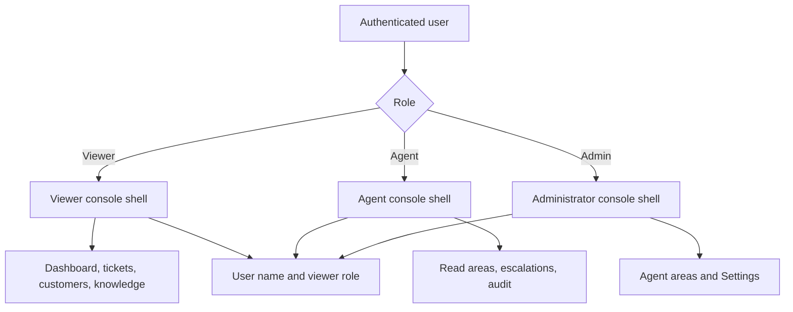

**P12-3 result:** the application has a real identity-aware shell and navigation, while direct authorization still occurs in FastAPI.

---

## P12-4 — Read-only support pages design

P12-4 converts the placeholder routes into API-backed pages.

### Design change

The frontend moves from static route names to data-driven support views.

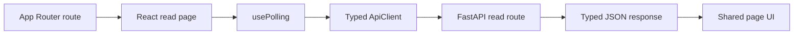

Every read page follows the same state pattern:

- loading;
- successful data;
- empty data;
- network or API error;
- optional retry;
- optional polling.

```mermaid
stateDiagram-v2
    [*] --> Loading
    Loading --> Data: records returned
    Loading --> Empty: no records returned
    Loading --> Error: API or network failure
    Error --> Loading: retry
    Data --> Loading: polling refresh
    Empty --> Loading: polling refresh
```

### Dashboard design

The dashboard is an aggregate browser view composed of existing read endpoints.

```mermaid
flowchart LR
    Dashboard[Dashboard page] --> Tickets[listTickets]
    Dashboard --> Customers[listCustomers]
    Dashboard --> Escalations[listEscalations]

    Tickets --> TicketCount[Ticket count card]
    Customers --> CustomerCount[Customer count card]
    Escalations --> EscalationCount[Open escalation count card]

    TicketCount --> TicketRoute[/tickets]
    CustomerCount --> CustomerRoute[/customers]
    EscalationCount --> EscalationRoute[/escalations]
```

This dashboard does not use a dedicated dashboard backend route. It aggregates currently implemented read methods in the frontend.

### Ticket list design

```mermaid
flowchart LR
    TicketList[Tickets page] --> Client[listTickets]
    Client --> Table[Responsive ticket table]

    Table --> Number[Ticket number]
    Table --> Subject[Subject]
    Table --> Category[Category]
    Table --> Severity[Severity pill]
    Table --> Status[Status pill]
    Table --> Updated[Updated date]

    Number --> Detail[/tickets/:id]
```

The page is intentionally read-only:

- no workflow run button;
- no reply composer;
- no approve or reject button;
- no escalate action.

Those controls belong to the ticket workflow screen in a later phase.

### Customer pages design

```mermaid
flowchart LR
    CustomerList[Customers page] --> List[get customers]
    List --> Cards[Customer cards]
    Cards --> Detail[/customers/:id]

    CustomerDetail[Customer detail page] --> Profile[getCustomer]
    CustomerDetail --> History[getCustomerTickets]

    Profile --> Subscriptions[Subscriptions]
    Profile --> Workspaces[Workspaces]
    Profile --> Memory[Safe memory]
    History --> TicketHistory[Previous tickets]

    TicketHistory --> TicketDetail[/tickets/:id]
```

The customer detail design combines account context and ticket history without changing account state.

### Knowledge pages design

```mermaid
flowchart LR
    KnowledgeList[Knowledge page] --> List[listKnowledge]
    List --> ArticleCards[Approved article cards]
    ArticleCards --> ArticleRoute[/knowledge/:id]

    ArticleDetail[Knowledge detail] --> Read[getKnowledgeArticle]
    Read --> Title[Title and category]
    Read --> Tags[Tags]
    Read --> Summary[Summary]
    Read --> Content[Article content]
```

Article content is a read-side support source. It does not grant write or reindex permissions.

### Escalation page design

```mermaid
flowchart LR
    Escalations[Escalations page] --> List[listEscalations]
    List --> Cards[Escalation cards]

    Cards --> Team[Named team]
    Cards --> Reason[Escalation reason]
    Cards --> Status[Escalation status]
    Cards --> Date[Created date]
    Cards --> TicketLink[Related ticket]
```

The page reflects named-team routing already determined by backend policy and escalation services.

### Ticket detail design

The P12-4 ticket detail route is a read-only summary rather than the final three-column action console.

```mermaid
flowchart TB
    TicketDetail[Ticket detail page]

    subgraph ReadData[Three API reads]
        Ticket[getTicket]
        Workflow[getWorkflow]
        Events[getWorkflowEvents]
    end

    TicketDetail --> Ticket
    TicketDetail --> Workflow
    TicketDetail --> Events

    Ticket --> Header[Number, subject, status, severity]
    Ticket --> Messages[Customer and support messages]
    Ticket --> Customer[Customer summary]
    Ticket --> Classification[Category, channel, workspace]

    Workflow --> State[Workflow status and ID]
    Events --> Timeline[Safe chronological event list]
```

The event list can show node and event names and timestamps, but does not display raw prompts or hidden reasoning.

**P12-4 result:** CloudDesk now has useful API-backed read pages instead of placeholder screens.

---

## Shared read-page component design

P12-4 is supported by reusable interface components.

```mermaid
classDiagram
    class PageHeader {
        eyebrow
        title
        description
    }

    class LoadingState {
        label
    }

    class EmptyState {
        title
        description
    }

    class NetworkErrorBanner {
        message
        onRetry
    }

    class StatusPill {
        value
        tone
    }

    class ReadPage {
        data
        loading
        error
        reload()
    }

    ReadPage --> PageHeader
    ReadPage --> LoadingState
    ReadPage --> EmptyState
    ReadPage --> NetworkErrorBanner
    ReadPage --> StatusPill
```

### Polling design

`usePolling()` centralizes automatic refresh behavior.

```mermaid
sequenceDiagram
    participant Page as Read-only page
    participant Hook as usePolling
    participant API as Typed API client

    Page->>Hook: Register loader and interval
    Hook->>API: Load data immediately
    API-->>Hook: Data or error
    Hook-->>Page: Set data, loading, or error

    loop Configured refresh interval
        Hook->>API: Reload data
        API-->>Hook: New data or error
        Hook-->>Page: Refresh visible page
    end

    Page->>Hook: Leave page
    Hook->>Hook: Clear interval
```

The current refresh intervals are:

- dashboard: 10 seconds;
- ticket list: 10 seconds;
- customer list: 10 seconds;
- escalation list: 10 seconds;
- customer detail: 10 seconds;
- ticket detail: 2 seconds;
- knowledge list and detail: 30 seconds.

### Formatting design

```mermaid
flowchart LR
    APIValue[Technical API value] --> Format[format.ts]

    Format --> Date[Readable date and time]
    Format --> Label[Readable underscore replacement]

    Date --> UI[Status, table, or detail card]
    Label --> UI

    Status[StatusPill] --> Color[Neutral, success, warning, or danger]
    Color --> UI
```

Technical values remain unchanged in API state. Formatting only changes their presentation.

---

## Complete Phase 12 component design

The final Phase 12 frontend is the following system:

```mermaid
flowchart TB
    Browser[Support-agent browser]

    subgraph Next[Next.js 15 frontend]
        Root[app/layout.tsx]
        AuthProvider[AuthProvider]
        LoginGate[LoginGate]
        AppShell[AppShell]
        RoleNav[RoleAwareNav]

        ApiClient[ApiClient]
        Types[Mirrored API types]
        Polling[usePolling]
        SharedUI[Status, loading, empty, and error UI]

        Login[Login page]
        Dashboard[Dashboard]
        Tickets[Ticket pages]
        Customers[Customer pages]
        Knowledge[Knowledge pages]
        Escalations[Escalations page]
    end

    subgraph FastAPI[FastAPI backend]
        AuthRoutes[Auth routes]
        TicketRoutes[Ticket routes]
        CustomerRoutes[Customer routes]
        KnowledgeRoutes[Knowledge routes]
        EscalationRoutes[Escalation routes]
        WorkflowRoutes[Workflow routes]
        RBAC[JWT and role checks]
    end

    Browser --> Root
    Root --> AuthProvider
    AuthProvider --> LoginGate
    LoginGate --> AppShell
    AppShell --> RoleNav
    AppShell --> Login
    AppShell --> Dashboard
    AppShell --> Tickets
    AppShell --> Customers
    AppShell --> Knowledge
    AppShell --> Escalations

    Dashboard --> ApiClient
    Tickets --> ApiClient
    Customers --> ApiClient
    Knowledge --> ApiClient
    Escalations --> ApiClient

    Polling --> ApiClient
    SharedUI --> Pages[All read pages]
    Types --> ApiClient

    ApiClient --> AuthRoutes
    ApiClient --> TicketRoutes
    ApiClient --> CustomerRoutes
    ApiClient --> KnowledgeRoutes
    ApiClient --> EscalationRoutes
    ApiClient --> WorkflowRoutes

    AuthRoutes --> RBAC
    TicketRoutes --> RBAC
    CustomerRoutes --> RBAC
    KnowledgeRoutes --> RBAC
    EscalationRoutes --> RBAC
    WorkflowRoutes --> RBAC
```

The complete request flow is:

```mermaid
sequenceDiagram
    participant User as Support user
    participant Browser as Next.js browser
    participant Auth as AuthProvider
    participant Client as Typed API client
    participant API as FastAPI
    participant Services as Backend services
    participant Stores as SQL and knowledge stores

    User->>Browser: Open CloudDesk
    Browser->>Auth: Restore token and profile
    Auth->>Client: GET /auth/me
    Client->>API: Authorization bearer token
    API->>Services: Validate role and load profile
    Services-->>Browser: User profile

    Browser->>Client: Open tickets or customer page
    Client->>API: GET protected read route
    API->>Services: Apply viewer or higher RBAC
    Services->>Stores: Read records
    Stores-->>Services: Ticket or customer data
    Services-->>Client: Typed JSON response
    Client-->>Browser: Data state

    loop Poll interval
        Browser->>Client: Reload current read page
        Client->>API: GET latest records
        API-->>Client: Updated response
        Client-->>Browser: Refresh visible state
    end
```

---

## Final Phase 12 responsibility boundaries

| Component    | Owns                                                    | Must not own                     |
| ------------ | ------------------------------------------------------- | -------------------------------- |
| App shell    | Layout and common page frame                            | API data and support policy      |
| Navigation   | Route names and role visibility                         | Backend authorization            |
| AuthProvider | Browser session and profile state                       | Server role enforcement          |
| LoginGate    | UX route guarding and expired-session handling          | Security decision                |
| ApiClient    | HTTP transport, auth, request IDs, and typed methods    | Ticket or account business rules |
| Read pages   | Rendering server-provided read data                     | Resolving workflow decisions     |
| usePolling   | Periodic page refresh                                   | Long-term workflow state         |
| StatusPill   | Readable status presentation                            | Status policy                    |
| FastAPI      | Authentication, RBAC, validation, and business services | Browser layout rules             |

---

## Testing design

P12 testing validates the presentation contract and role behavior.

| Test area                 | Design guarantee                                           |
| ------------------------- | ---------------------------------------------------------- |
| Navigation list           | Console routes are declared once                           |
| Role hierarchy            | Viewer < agent < admin                                     |
| Role-aware navigation     | Settings and audit visibility follow role                  |
| App shell                 | Brand, navigation, content, and identity render            |
| API client                | Bearer token, request IDs, filters, JSON, and methods work |
| 404 handling              | API detail errors become readable `ApiError` values        |
| Network handling          | Fetch failures become `NetworkError` values                |
| Approval action request   | JSON decision bodies are sent to the API                   |
| Status and format helpers | Technical values become readable UI text                   |
| Loading and empty states  | Pages do not remain blank in normal states                 |

The frontend test environment uses Vitest and jsdom. It runs locally without live cloud services.

**Important validation note:** the frontend build and unit tests pass, but a live browser session still requires the FastAPI server and demo users to be running.

---

## Honest Phase 12 status

| Area                             | State                                  |
| -------------------------------- | -------------------------------------- |
| Next.js app shell                | Implemented                            |
| Shared navigation                | Implemented                            |
| Typed API client                 | Implemented                            |
| Demo login                       | Implemented                            |
| Session restoration              | Implemented                            |
| Login gate                       | Implemented                            |
| Role-aware navigation            | Implemented                            |
| Dashboard read page              | Implemented                            |
| Ticket list and detail read view | Implemented                            |
| Customer list and detail         | Implemented                            |
| Knowledge list and detail        | Implemented                            |
| Escalation list                  | Implemented                            |
| Shared read-page states          | Implemented                            |
| Frontend tests                   | Implemented and passing locally        |
| Final workflow action screen     | Not part of P12-4; belongs to Phase 13 |
| Approve/reject/reply/escalate UI | Not implemented in Phase 12            |
| Cloud deployment                 | Not claimed                            |

Phase 12 is complete as the **browser shell and read-only console foundation**, not as the final ticket action experience.

---

## Interview-ready summary

### 30-second summary

> “Phase 12 builds the CloudDesk browser console around the existing backend. It adds a Next.js app shell, shared navigation, a typed API client, demo login and session restoration, role-aware layout rules, and read-only dashboard, ticket, customer, knowledge, escalation, and detail pages. Frontend role visibility improves the interface, but FastAPI remains the real authorization authority. Phase 12 is complete for the console shell and read pages; the final workflow action screen is Phase 13.”

### 60-second summary

> “At the start of Phase 12, CloudDesk had backend services but no complete browser interface. P12-1 created a Next.js shell and one shared navigation definition. P12-2 created a typed `ApiClient` that handles bearer authentication, request IDs, typed contract shapes, 401/403/session behavior, and network/API errors. P12-3 added a demo login flow, session restoration, login gating, and viewer/agent/admin role-aware navigation. P12-4 connected the dashboard and read-only ticket, customer, knowledge, escalation, and detail routes to FastAPI. Shared components provide loading, empty, error, retry, status, formatting, and polling behavior. The frontend never replaces backend authorization. Phase 12 is complete for the shell and read console, while running workflows and approving, rejecting, replying, or escalating from the ticket screen belong to Phase 13.”
