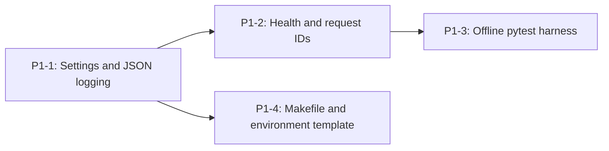
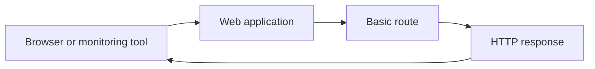
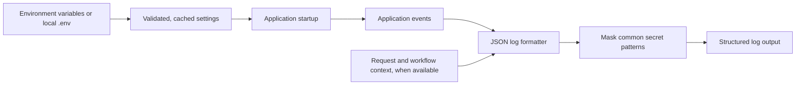
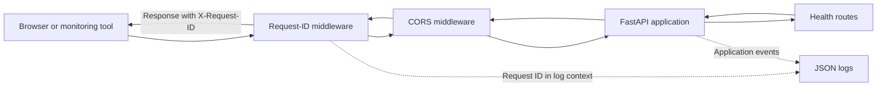
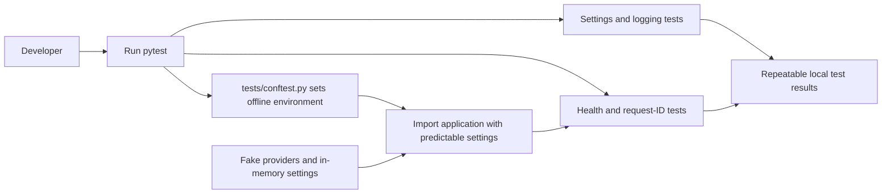
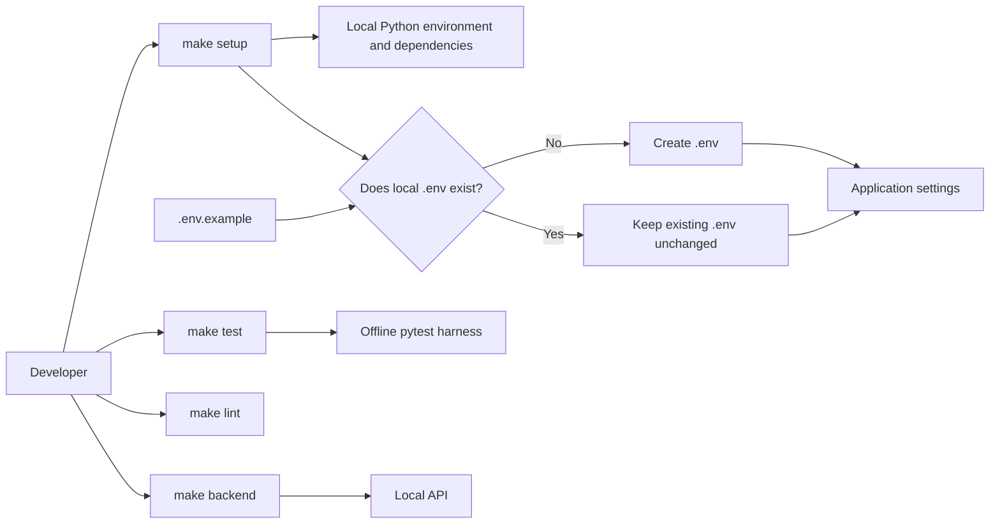
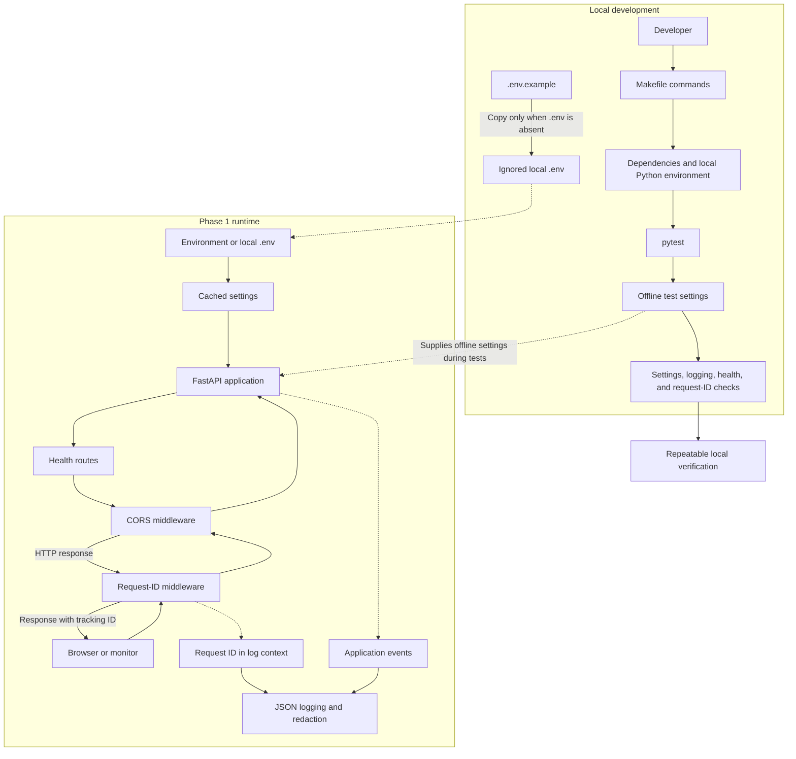

# Phase 1 — Project System Design Evolution

This document follows the Phase 1 runtime foundation from its simplest starting
shape to the design implemented by its subtasks. It is intentionally limited to
Phase 1; later product capabilities are shown only as future work.

## Phase 1 goal

Before CloudDesk can investigate support tickets, the application needs a reliable
way to start, read its settings, answer basic health checks, trace requests, protect
diagnostic logs, and run tests without external services.

The design evolves in four subtasks:

P1-2 and P1-4 can proceed in parallel after P1-1. P1-3 builds on the application
entry points established by P1-2.

## Starting design: a minimal web service

At the beginning of the phase, think of the service as a small web application:
someone sends a request, the application handles it, and a response comes back.
This is a conceptual starting point for the phase, not a claim that every detail
below was present in a particular earlier commit.

This shape is enough to describe a request, but it does not yet explain how the
application is configured, how operators trace a problem, how readiness is checked,
or how developers can test it consistently.

## Evolution by subtask

### P1-1 — Settings and JSON logging

**Design change:** configuration becomes a defined input to the application, and
diagnostic output becomes consistent and safer to inspect.

Settings are read from environment variables or a local `.env` file and reused by
the application. Sensitive settings are treated as secrets when displayed. Logs
are written as structured JSON, with common credential patterns masked. Logging
also has places for request and workflow IDs; P1-2 connects request IDs to that
context.

**Result:** settings can change between environments without changing application
code, and logs have predictable fields instead of relying only on free-form text.

### P1-2 — Health routes and request-ID middleware

**Design change:** a shared request boundary handles tracking and cross-origin
browser access before a request reaches the API routes.

The request-ID layer keeps a safe incoming ID or creates a new one, binds it to the
log context, and adds it to the response. CORS handles browser-origin rules inside
that boundary. Health routes provide simple liveness and configuration-readiness
responses.

The health routes have different jobs:

- `/health` and `/health/live` answer whether the web process is running. They do
  not check external dependencies.
- `/health/ready` checks whether required dependency settings look configured. It
  does **not** make live connections to the database, Redis, vector store, or model
  provider yet.

**Result:** responses, including errors and CORS preflights, can carry a consistent
tracking ID. Operators can use that ID to locate related logs.

### P1-3 — Offline pytest harness

**Design change:** tests receive their own predictable configuration before the
application is imported.

The test setup selects fake model and Redis modes, in-memory vector storage, and
in-memory SQLite/checkpoint settings. That makes the current tests independent of
cloud credentials, Docker, and paid model services. It does not mean that the future
database or workflow has already been implemented; the current tests focus on the
runtime foundation.

**Result:** tests can run without reaching out to real customer systems or model
providers.

### P1-4 — Makefile and environment template

**Design change:** local setup and routine development actions have named entry
points, and the settings expected by the application are documented in one safe
template.

The Makefile defines `setup`, `test`, `lint`, and `backend` targets. Setup installs
the project and development dependencies, then creates `.env` from `.env.example`
only if a local `.env` does not already exist. The example contains placeholders,
not real credentials.

**Result:** developers have a repeatable setup path and a clear, non-secret
reference for local configuration. The real `.env` file and generated tool caches
are excluded by `.gitignore`.

## End-of-Phase 1 design

The four subtasks combine into a small but observable and testable runtime. Local
configuration feeds application startup; requests pass through the tracking and
CORS layers; health routes return status; and request context connects responses to
structured logs. Tests use offline settings, while the Makefile provides local
commands for setup and routine checks.

## Boundaries: what this design does and does not promise

Phase 1 provides runtime foundations. It does not yet store tickets, authenticate
agents, run a support investigation, retrieve knowledge, send customer replies, or
process refunds. Those capabilities belong to later phases and will add new
components around this foundation.

The readiness route currently checks configuration rather than live connectivity.
The tests verify the components that exist now; they do not prove future workflow
features. The Phase 1 plan remains in progress until the Makefile targets can be
invoked directly in an environment with GNU Make installed.

## Component reference

| Design responsibility | Implementation |
|---|---|
| Application settings and secret masking | [config.py](../../backend/app/core/config.py) |
| JSON logs, redaction, and log context | [logging.py](../../backend/app/core/logging.py) |
| Request IDs on HTTP responses | [request_id.py](../../backend/app/middleware/request_id.py) |
| Liveness and readiness routes | [health.py](../../backend/app/api/health.py) |
| Application and middleware assembly | [main.py](../../backend/app/main.py) |
| Offline test environment | [conftest.py](../../tests/conftest.py) |
| Local development commands | [Makefile](../../Makefile) |
| Safe settings template | [.env.example](../../.env.example) |
