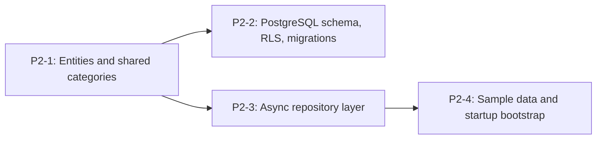
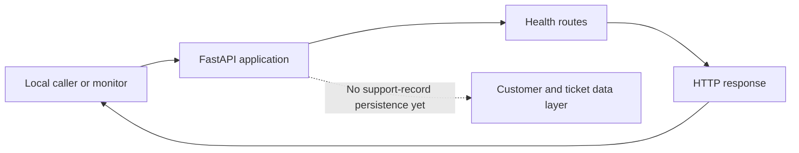
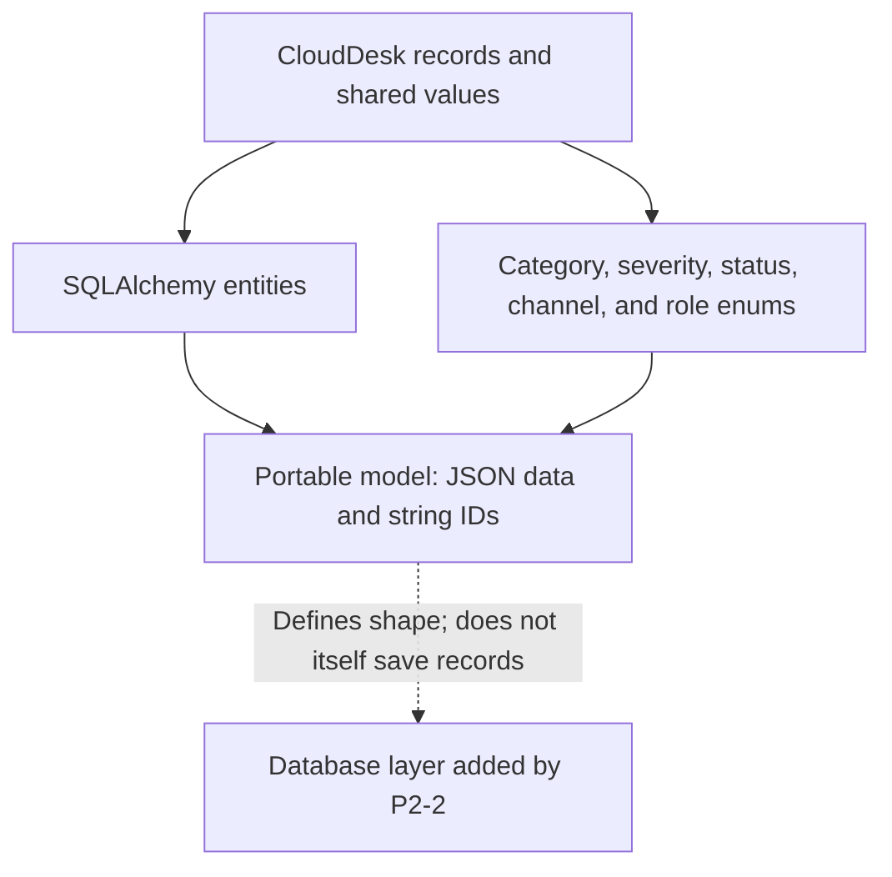
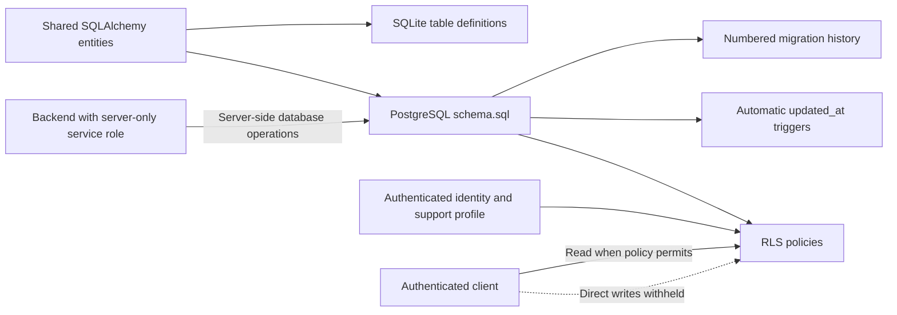
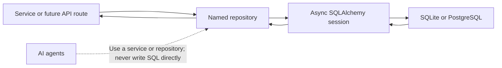
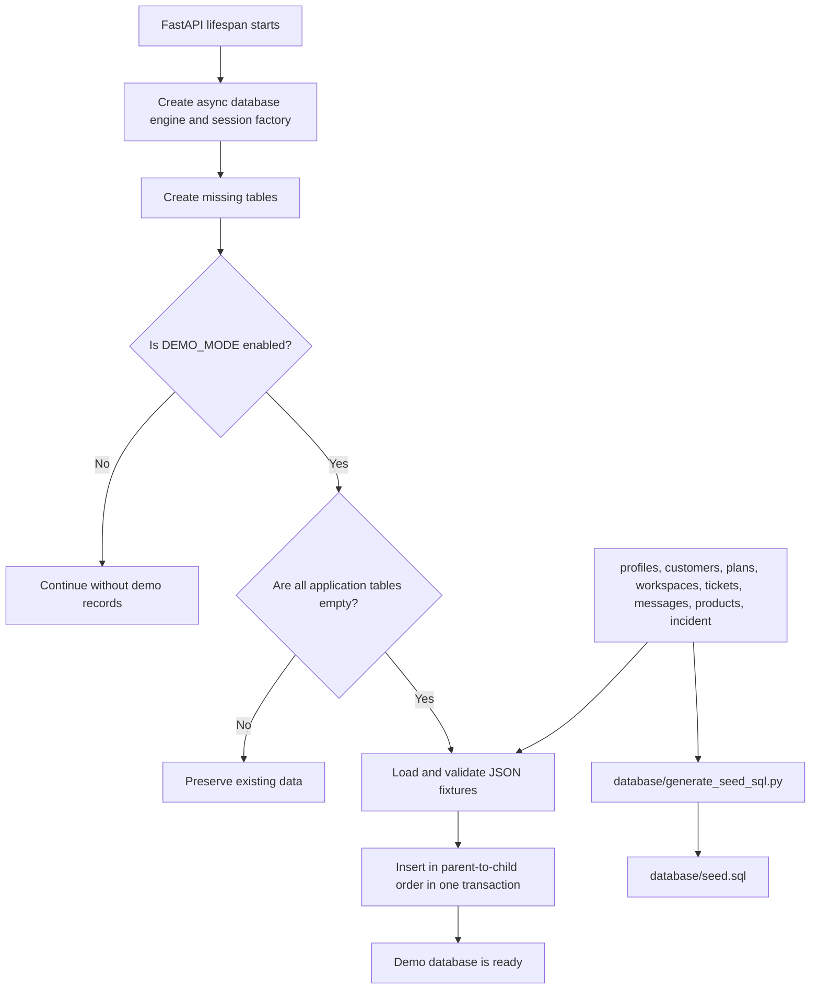
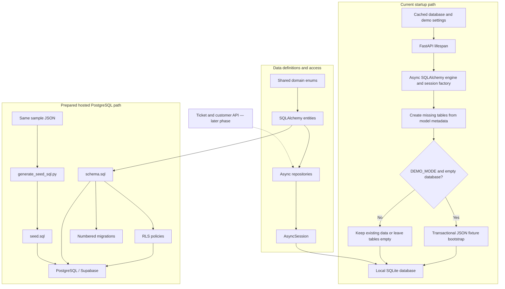

# Phase 2 — Project System Design Evolution

This document follows the data foundation from its simplest starting shape through
the four Phase 2 subtasks. It describes the implemented design and clearly marks
the pieces that are prepared for later use but are not yet connected to a ticket
API or a live hosted database.

## Phase 2 goal

Phase 1 gave CloudDesk a small application that can start and answer health checks.
Phase 2 adds the durable data design behind the future support workflow: standard
record definitions, database schemas, a repository access layer, and safe demo data.

The task order is:

P2-2 and P2-3 can be developed in parallel after P2-1. P2-4 follows the repository
work and adds database startup and sample loading using the shared entities.

## Starting design: an application with no persistent support records

At the start of Phase 2, the application had configuration, health routes, request
tracking, and offline tests. It did not yet have tables for customers and tickets or
a reliable way to save demo records. This is the conceptual starting point for the
phase, not a claim about a specific earlier commit.

The goal is to add the data path without putting database code directly inside
future HTTP routes or AI agents.

## Evolution by subtask

### P2-1 — SQLAlchemy entities and category enum

**Design change:** the information CloudDesk stores is described in one consistent
set of application models.

Entities define the shape of profiles, customers, subscriptions, workspaces,
products, tickets, messages, incidents, workflow records, approvals, escalations,
memory notes, and audit logs. Shared values such as category, severity, channel,
role, and ticket status are defined once so the rest of the application can reuse
them.

The models use portable SQL types and string IDs so the same application
definitions work with local SQLite and PostgreSQL.

**Result:** there is one application-level description of the records. The models
do not themselves create a running database connection or implement ticket
behavior.

### P2-2 — PostgreSQL schema, row-level security, and migrations

**Design change:** the application model is paired with SQL that describes the
hosted PostgreSQL database and its access rules.

`database/schema.sql` creates the PostgreSQL tables, their relationships, and
automatic update-time triggers. `database/rls_policies.sql` enables row-level
security. Its policies permit read access for users whose authenticated identity
has a recognized support profile, but do not grant direct writes to authenticated
clients. The backend is intended to perform writes with its server-only
`service_role` credential.

Numbered migrations record database changes in order. The initial schema and RLS
setup are in migrations `0001` and `0002`; changes after they have been applied
should be made in a new migration rather than by editing those files.

These PostgreSQL files are a prepared design, not proof of a live deployment. They
have not been applied to a real PostgreSQL account. The application still needs the
later identity phase to provide its complete API sign-in and role enforcement.

**Result:** local and hosted storage share the same record design, while the
PostgreSQL setup defines a controlled read boundary and a repeatable migration
history.

### P2-3 — Async repository layer

**Design change:** database queries are collected behind repository classes instead
of being scattered through routes, services, or agents.

A service or other caller can ask a repository to find a ticket, list a customer's
history, retrieve workflow events, or save an entity. The repository translates
that request into a SQLAlchemy query. It does not decide what answer to give a
customer, call an AI model, or own the larger transaction commit.

The repositories cover all mapped entities. They flush changes so identifiers and
database errors are available, while the caller remains responsible for committing
or rolling back the overall unit of work.

**Boundary:** this phase builds the data-access layer, but the ticket API and AI
agents that will use it belong to later phases. The repositories are therefore
available components, not yet a complete ticket-processing path.

**Result:** future application layers can use the same tested data-access methods
without duplicating SQL.

### P2-4 — Sample data and demo bootstrap

**Design change:** a new local database can be prepared automatically with
consistent fictional support records.

On application startup, the backend creates missing SQLite tables. If
`DEMO_MODE=true` and every application table is empty, the bootstrap reads the JSON
files in `sample_data/` and loads records in relationship order—for example,
customers before tickets and tickets before their messages. The complete load is
transactional, so a failed seed does not leave a partial demo database.

If any application table already contains records, the bootstrap leaves the
database unchanged. With demo mode off, the application creates tables but does
not insert demo records. A PostgreSQL seed script can also be generated from the
same JSON fixtures for a clean hosted database.

The demo set contains three support profiles, eight customers and related records,
and the thirteen ticket scenarios `CD-1001` through `CD-1013`. The prompt-injection
example is saved as ticket text; it is data to test against, not an instruction to
execute. Previous-resolution examples are kept as fixtures for a later similarity
search feature and are not inserted into a table in this phase.

**Result:** developers can start with predictable offline data, repeated startups
do not duplicate it, and an existing database is not overwritten by the demo
loader.

## End-of-Phase 2 design

The four subtasks combine into a persistence foundation around the existing
FastAPI runtime. During startup, the application creates an async database engine
and session factory, creates missing model tables, and conditionally seeds an
empty demo database. Repositories provide a consistent way for future services to
read and write those records.

The final diagram shows two different levels of readiness:

- **Implemented locally:** models, repositories, startup table creation, SQLite
  demo bootstrap, and repeatable tests.
- **Prepared but not live:** PostgreSQL schema, access policies, migrations, and
  seed script. No live PostgreSQL account was used in validation.
- **Still future work:** authenticated ticket routes and the AI support workflow.

## What Phase 2 does not do

Phase 2 does not yet authenticate users through the API, expose ticket or customer
routes, run the AI workflow, retrieve knowledge articles, send replies, or process
refunds. The demo profiles and database RLS policies are data and access
foundations; the complete identity and business approval paths are built in later
phases.

## Component reference

| Design responsibility | Implementation |
|---|---|
| Application record definitions | [entities.py](../../backend/app/models/entities.py) |
| Shared categories and other domain values | [common.py](../../backend/app/schemas/common.py) |
| PostgreSQL schema, RLS, and migration history | [database/](../../database/) |
| Async engine, session factory, and table creation | [database.py](../../backend/app/core/database.py) |
| Data-access repositories | [repositories/](../../backend/app/repositories/) |
| Startup and conditional demo loading | [main.py](../../backend/app/main.py), [seed_service.py](../../backend/app/services/seed_service.py) |
| Offline demo fixtures | [sample_data/](../../sample_data/) |
| PostgreSQL seed generation | [generate_seed_sql.py](../../database/generate_seed_sql.py) |
| Phase checklist and status | [TASK.md](../../TASK.md), [PLAN_PHASE.md](../../PLAN_PHASE.md) |
