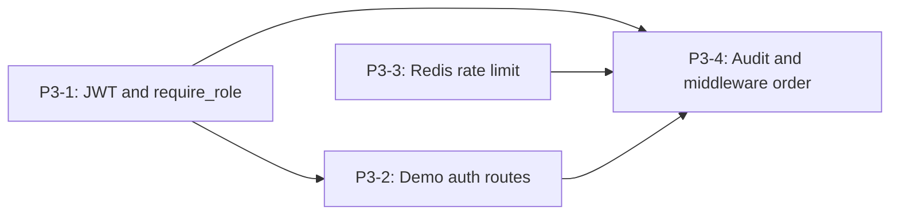
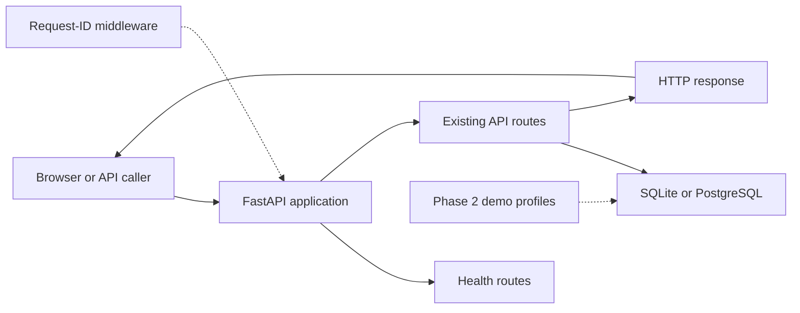
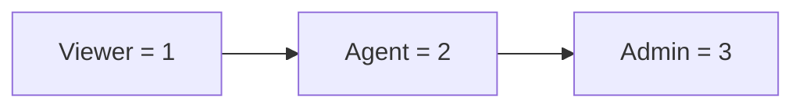
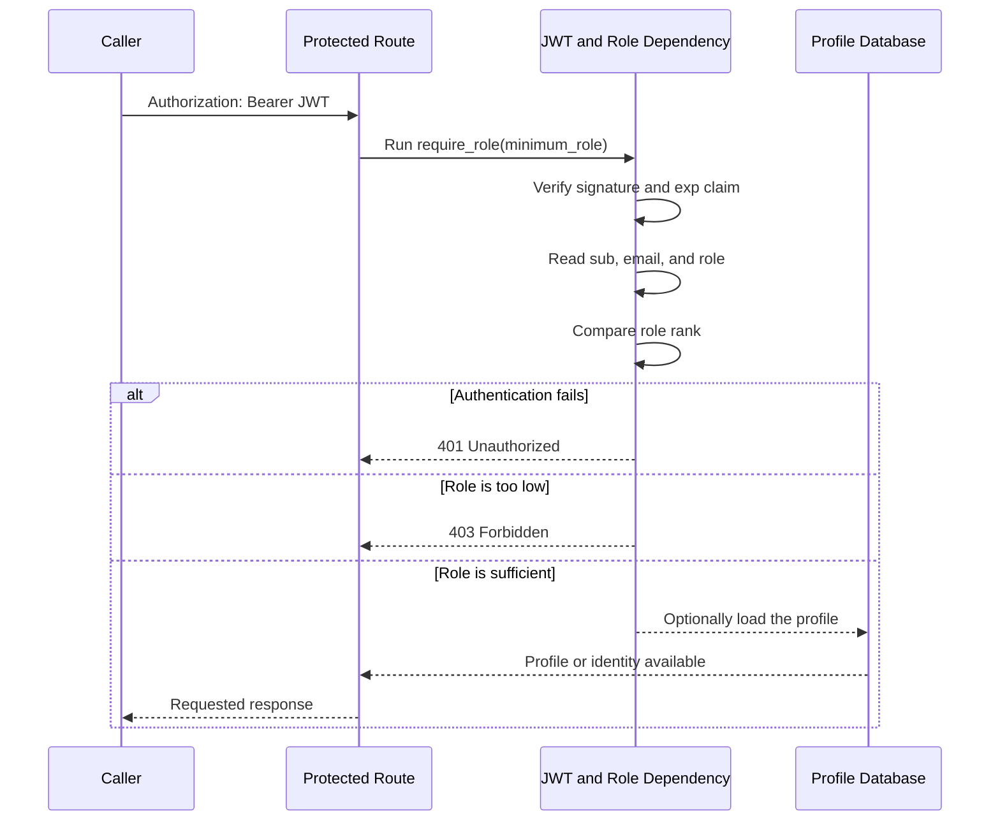
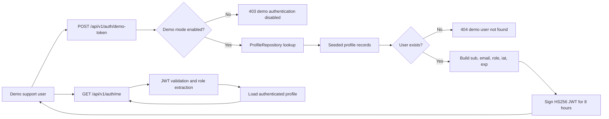
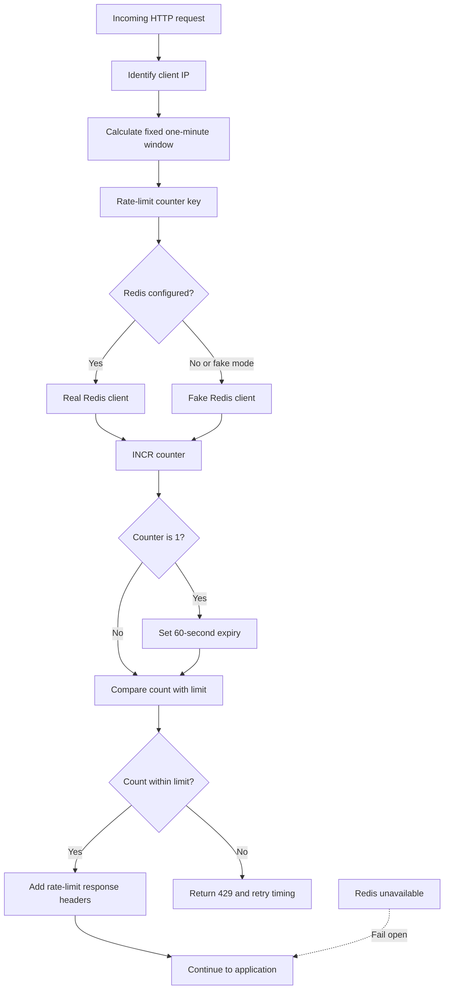
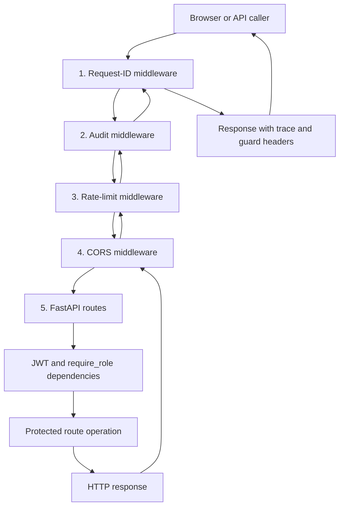
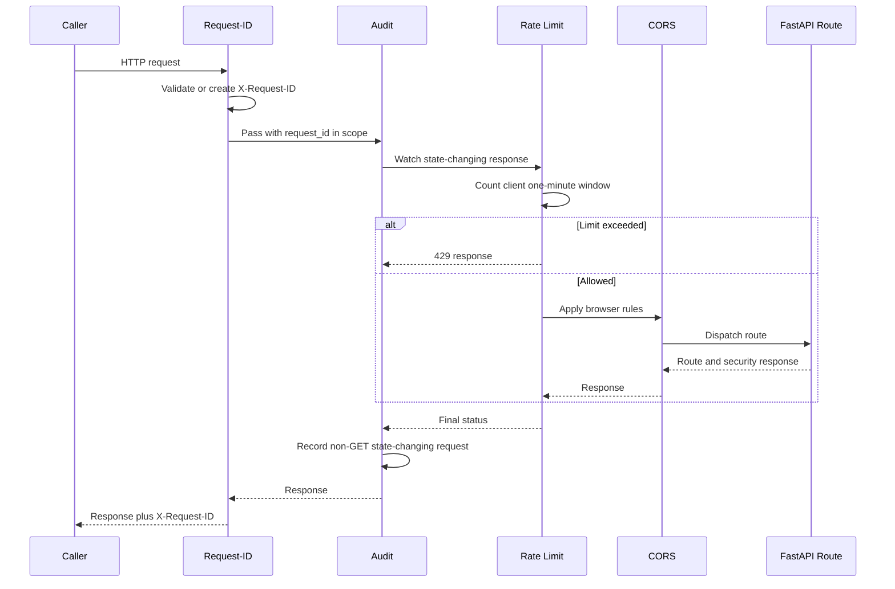
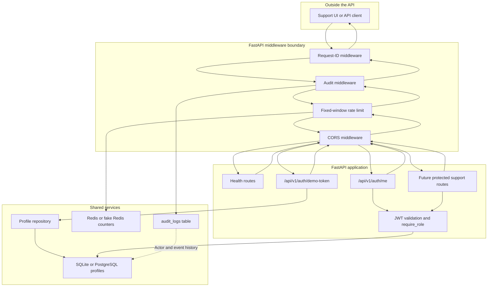
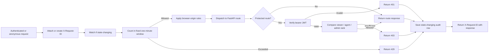

# Phase 3 — Project System Design Evolution

This document follows the identity and request-protection design from the
Phase 2 baseline through the four Phase 3 subtasks. Each subtask adds a focused
piece; the final design shows how those pieces wrap the application together.

## Phase 3 goal

Phase 1 established the runtime foundation, request tracking, and structured
logs. Phase 2 added persistent support data and demo records.

Phase 3 adds the control plane needed before protected support routes can be
built:

- authentication and signed JWTs;
- role-based authorization;
- demo login and the `/me` identity route;
- fixed-window request limiting;
- audit logging for state-changing HTTP requests;
- one consistent middleware order.

The subtask evolution is:

P3-1 and P3-3 start in parallel. P3-2 follows P3-1 because its demo tokens use
the JWT identity and role definitions. P3-4 is last because it owns the final
middleware arrangement.

## Starting design: a runnable API without route-level identity guards

At the beginning of Phase 3, CloudDesk already has a FastAPI application,
database models and repositories, health routes, request-ID middleware, and demo
startup data. Requests can reach the application, but protected operations do not
yet have a common JWT validation or role comparison.

This conceptual starting shape is based on the implemented Phase 1 and Phase 2
foundation; it is not a claim about a particular historical commit.

The missing capabilities are an authenticated identity, a route permission check,
and shared protection against abusive traffic or missing audit trails.

## Evolution by subtask

### P3-1 — JWT and `require_role`

**Design change:** a request gains a verified identity and role, and future routes
can declare a minimum role.

The authentication code reads a bearer token, verifies its HS256 signature and
expiry, and requires `sub` and `exp` claims. It extracts a role from the token
and turns the claims into an `AuthenticatedUser` with an ID, email, and role.

Roles form a numeric hierarchy:

`require_role` is a FastAPI dependency factory. A route declares the minimum role
it needs, then the dependency compares the current user's rank with that minimum.
Missing or invalid authentication produces 401. A valid user without enough rank
produces 403.

**Result:** identity and authorization become reusable backend dependencies
rather than route-specific checks.

### P3-2 — Demo authentication routes and tokens

**Design change:** demo users can exchange a known fictional email for an
eight-hour signed access pass.

The demo authentication router is available only in demo mode. It looks up a
profile through `ProfileRepository`, rejects unknown users, and creates a JWT
with `sub`, `email`, `role`, `iat`, and `exp`.

The same JWT structure is used for the later protected-route checks. The `/me`
route validates the pass, loads the matching profile, and returns that profile
through a typed Pydantic response.

The demo role set is:

| Demo user | Role |
|---|---|
| `admin@clouddesk.demo` | admin |
| `sam.agent@clouddesk.demo` | agent |
| `vic.viewer@clouddesk.demo` | viewer |

**Result:** the application has a real local sign-in path for testing, while
demo authentication remains unavailable outside demo mode.

### P3-3 — Redis fixed-window rate limiting

**Design change:** the API gains a per-client traffic guard that counts requests
in fixed one-minute windows.

`FixedWindowRateLimiter` creates a counter key from the client IP and the current
window. It increments the Redis counter and sets an expiry on the first request
in that window. The middleware adds limit, remaining, reset, and retry headers to
responses.

Redis is shared by real deployments and fake Redis is used for local tests or
when no Redis URL is configured. If Redis operations fail, the limiter fails open
and permits the request instead of making a cache outage stop the application.

**Result:** an individual client's request volume is constrained, while normal
application behavior remains available if the cache is unreachable.

### P3-4 — Audit middleware and middleware order

**Design change:** shared middleware gains the same trace ID, security,
rate-limit, CORS, and audit behavior for every route.

The audit middleware excludes read-only `GET` requests and watches the status
returned by state-changing requests. It records:

- actor ID, when a valid bearer JWT can identify it;
- HTTP method;
- request path;
- response status;
- request trace ID;
- an optional data field, currently null.

Audit writes use the application database session factory. They are separate from
the route transaction and are not allowed to turn a telemetry failure into a
failed application request.

The final middleware wrapping order is:

This order means request-ID processing surrounds the later guards and application
routes, so even rate-limited or preflight responses receive a trace ID.

**Result:** request context, traffic protection, browser policy, audit capture,
and route authorization are applied consistently rather than being implemented
again in every route.

## End-of-Phase 3 design

The complete Phase 3 design adds identity and common request guards around the
existing FastAPI and data services.

The request flow is now:

## Component responsibilities and boundaries

| Component | Responsibility | Does not do |
|---|---|---|
| `Role` enum | Defines `viewer`, `agent`, and `admin` | Does not decide route permissions |
| `decode_jwt` | Verifies JWT signature, expiry, subject, and claims | Does not create users or ticket actions |
| `get_current_user` | Turns bearer credentials into `AuthenticatedUser` | Does not grant a role above the token |
| `require_role` | Compares the user's rank with a route minimum | Does not hide business policy in the UI |
| Demo auth routes | Issue local demo tokens and return `/me` | Do not register real users or external identity providers |
| `FixedWindowRateLimiter` | Counts clients in fixed windows | Does not classify or block individual API paths |
| Redis factory | Chooses real or fake Redis | Does not store application records |
| `AuditMiddleware` | Records state-changing HTTP attempts and status | Does not define refund or ticket business rules |
| `RequestIdMiddleware` | Creates or validates trace IDs | Does not replace application or workflow IDs |
| `create_app` | Wraps CORS and middleware around FastAPI | Does not implement support routes or workflows |

## Design properties

The Phase 3 design improves several system qualities:

- **Identity:** a signed token carries the identity and role of the caller.
- **Authorization:** route dependencies enforce a role hierarchy server-side.
- **Availability:** Redis failure is isolated from normal application execution.
- **Traffic protection:** excessive clients receive a 429 with retry information.
- **Traceability:** every HTTP response has a request ID and state changes can
  contain that ID in audit records.
- **Auditability:** actor, method, path, status, and request ID are retained.
- **Offline operation:** fake Redis and demo profiles allow local testing without
  a real Redis account or paid external service.
- **Separation of concerns:** middleware handles shared HTTP concerns, while
  protected routes and future services keep their own business rules.

## What Phase 3 does not yet include

This phase secures access but is not the complete support-product workflow.

It does not yet:

- create or update tickets;
- list customers;
- run AI investigation or knowledge retrieval;
- make a refund or account-change approval;
- send customer replies;
- escalate tickets;
- build the support console;
- execute LangGraph workflows.

The phase supplies the request identity, role checks, rate guard, trace context,
and audit trail that those later components will use.

## Honest validation status

The current implementation was validated with 19 focused offline tests covering
the auth, rate-limit, request-ID, health, and audit components. It uses:

- in-memory SQLite for middleware tests;
- fake Redis for repeatable rate-limit tests;
- signed demo JWTs;
- no live Redis account;
- no live PostgreSQL account;
- no real customer or external identity provider.

The JWT and role code is implemented, demo login is implemented, rate limiting is
implemented, and the final request-ID, audit, rate-limit, CORS, and route wrapping
is present. Live infrastructure deployment is not claimed.
