# Phase 4 — Project System Design Evolution

This document follows the Support API design from the Phase 3 protected-API
baseline through the three Phase 4 subtasks. It shows the simplest starting shape,
how each subtask changes the design, and the complete Support API structure at the
end of Phase 4.

## Phase 4 goal

Phases 1–3 established configuration, persistence, authentication, role checks,
request guards, audit logging, and demo data. Phase 4 adds the application's first
support-facing API surface:

- a written ticket and customer contract;
- ticket list, detail, and creation routes;
- customer list, detail, and ticket-history routes;
- service and repository layers that keep HTTP code separate from database logic.

The subtask evolution is:

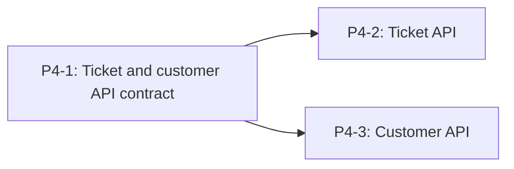

P4-1 comes first because ticket and customer work need one shared contract. P4-2
and P4-3 can then be developed independently against that contract.

## Starting design: a protected application with data but no support routes

At the beginning of Phase 4, CloudDesk has a FastAPI application, SQLite or
PostgreSQL storage, demo records, JWT authentication, role dependencies, request
tracking, rate limiting, and audit middleware. It does not yet expose the ticket
and customer API described in the Phase 4 contract.

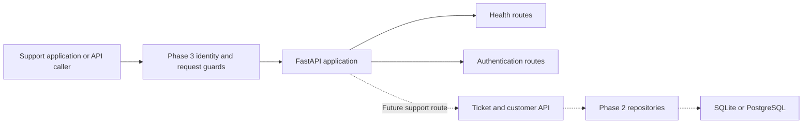

The missing design decisions are:

- the exact request and response fields;
- routes for listing and creating tickets;
- routes for listing and inspecting customers;
- a service layer for ticket and customer operations;
- safe response models that do not expose unnecessary database fields.

## Evolution by subtask

### P4-1 — Ticket and customer API contract

**Design change:** the backend, future frontend, and API documentation agree on
one set of route shapes before implementation work expands.

The contract lives in `docs/API_CONTRACT.md`. Pydantic models in
`backend/app/schemas/tickets.py` and `backend/app/schemas/customers.py` turn that
written contract into backend validation and response types. A planned frontend
contract in `frontend/lib/types.ts` mirrors those domain values.

The contract defines shared ticket values such as channels, categories, severity,
and status. It also defines the separation between:

- ticket summary information;
- detailed ticket information;
- customer summary information;
- detailed customer context;
- list wrappers containing an `items` collection.

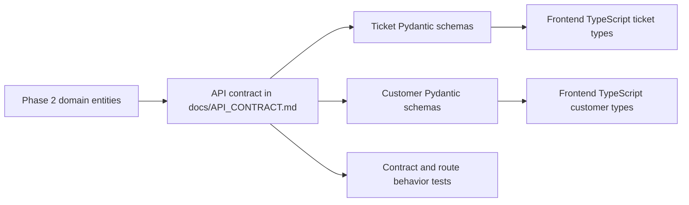

The ticket creation contract requires exactly one customer source:

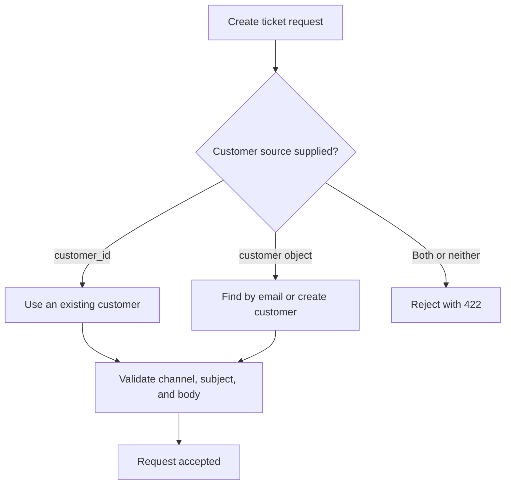

The Pydantic boundary protects the API from missing fields, invalid enum values,
and ambiguous customer selection.

**Result:** P4-2 and P4-3 use named request and response shapes instead of
inventing route-specific JSON structures independently.

### P4-2 — Ticket API

**Design change:** the application gains a role-aware ticket surface with separate
read and create operations.

The ticket router exposes:

- `GET /api/v1/tickets` for viewer-readable lists;
- `GET /api/v1/tickets/{ticket_id}` for viewer-readable detail;
- `POST /api/v1/tickets` for agent or admin ticket creation.

The route layer does not write SQL. It checks the role, calls `TicketService`, and
converts service failures into HTTP status responses.

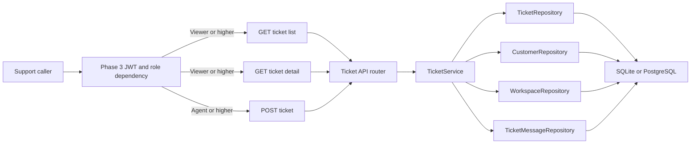

The list route supports status, category, severity, limit, and offset. The detail
route eagerly loads the customer, optional workspace, and messages. The service
converts each database record into a typed Pydantic response.

Ticket creation is a coordinated operation rather than one direct database insert:

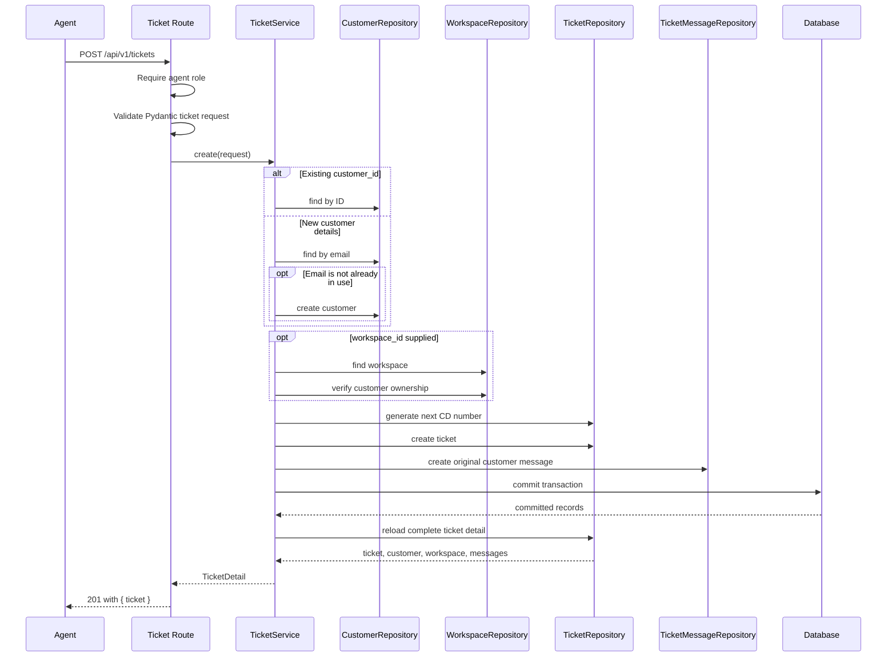

Ticket creation uses 404 for a missing customer or workspace and 422 for invalid
request values. If a workspace is supplied but belongs to another customer, the
service rejects it as a customer-workspace mismatch.

**Result:** ticket operations are role-aware, repository-backed, and separated
from raw SQL. One create request consistently creates or links a customer, creates
a ticket, stores the original message, and returns complete detail.

### P4-3 — Customer API

**Design change:** support staff gain a customer-context read surface that gathers
account and ticket information without exposing raw database records.

The customer router exposes:

- `GET /api/v1/customers` for viewer-readable customer lists;
- `GET /api/v1/customers/{customer_id}` for customer context detail;
- `GET /api/v1/customers/{customer_id}/tickets` for customer-only history.

Customer detail is assembled by `CustomerService`, which coordinates the customer,
subscription, workspace, ticket, and memory repositories.

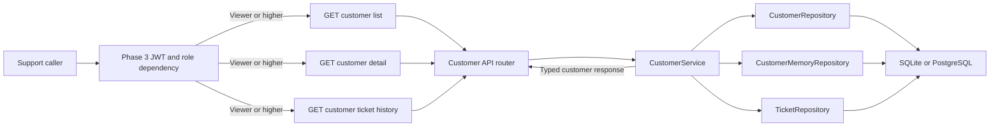

The detail operation has a privacy-conscious redaction step:

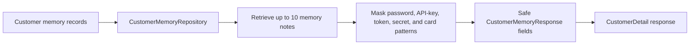

The customer-history route verifies the customer exists, uses a customer-specific
ticket repository query, and paginates the result. It cannot accidentally include
another customer's tickets.

**Result:** a viewer or stronger role can retrieve customer context and history
through typed routes, with a deliberate limit on memory context and a redaction
boundary for likely secrets.

## End-of-Phase 4 design

The complete Phase 4 design adds a support API between the protected FastAPI
runtime and the repository/data foundation. It is intentionally not an AI
workflow yet. It provides the routes and typed data a later console or agent
workflow will consume.

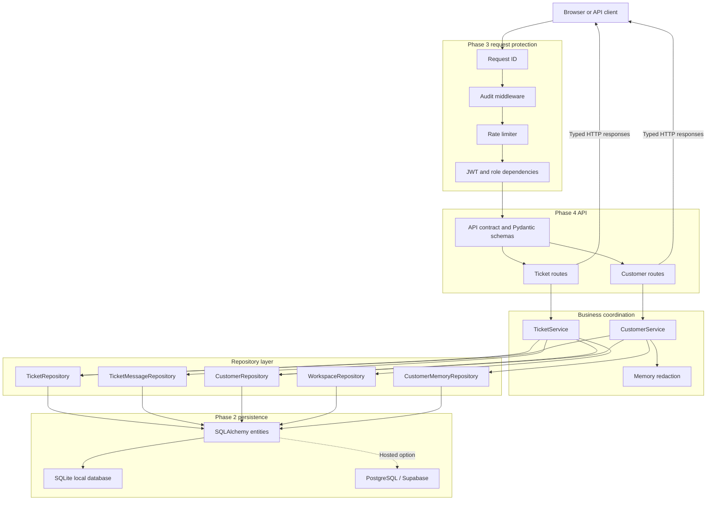

## Ticket and customer request flows

### Ticket list flow

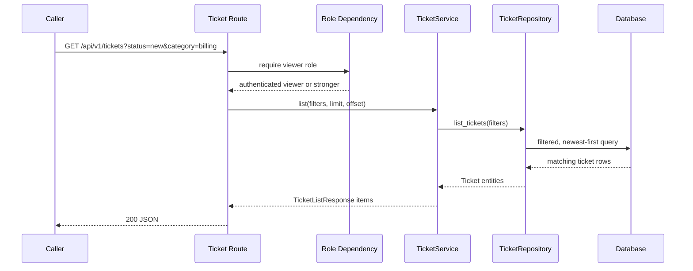

### Ticket detail flow

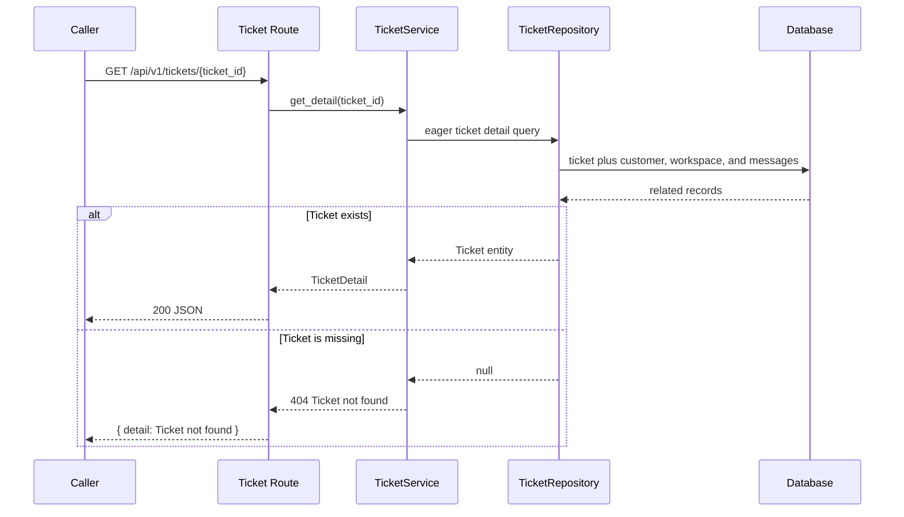

### Customer detail flow

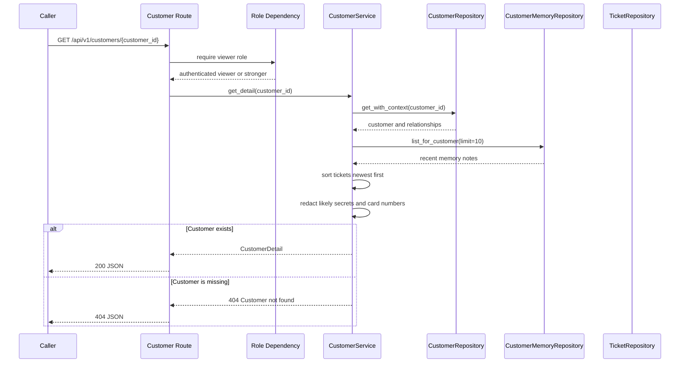

## Layer responsibilities

The final design keeps responsibilities separated:

| Layer | Responsibility | Does not do |
|---|---|---|
| API contract | Defines routes and JSON fields | Execute database or support operations |
| Pydantic schemas | Validate requests and shape responses | Run SQL or call external services |
| API routers | Handle HTTP, role checks, and status codes | Contain business coordination or SQL |
| Services | Coordinate repositories and apply response rules | Depend directly on HTTP request objects |
| Repositories | Read and write SQLAlchemy entities | Decide AI answers or send customer replies |
| Database | Persist customers, workspaces, subscriptions, and tickets | Define API authorization rules |

This separation is the main architectural result of Phase 4. The HTTP layer knows
how to accept a request and return a status. The service layer knows how ticket
and customer operations connect. The repository layer knows how to access stored
data.

## Data isolation and privacy

Phase 4 includes several design protections:

- read operations require at least the viewer role;
- ticket creation requires at least the agent role;
- customer history is filtered by the requested customer ID;
- workspace IDs must belong to the identified customer;
- invalid or missing resources return controlled 404 or 422 responses;
- customer memory responses contain at most ten notes;
- likely passwords, secrets, tokens, API keys, and card numbers are redacted;
- raw database objects are not returned directly to HTTP callers.

These protections establish the API boundary but do not yet implement every future
safety feature. Knowledge filtering, prompt-injection defenses, customer-output
validation, and approval gates belong to later phases.

## What Phase 4 does not add

At the end of Phase 4, CloudDesk does not yet:

- execute a LangGraph workflow;
- classify a ticket or assign severity;
- retrieve knowledge evidence;
- diagnose a support problem;
- plan a resolution;
- send a real email or refund;
- pause for human approval;
- escalate policy cases;
- maintain workflow events or run state.

Those features require later phases and later components. Phase 4 supplies the
ticket and customer APIs that a future workflow and agent console can use.

## Component reference

| Design responsibility | Implementation |
|---|---|
| Shared API contract | [API_CONTRACT.md](../../docs/API_CONTRACT.md) |
| Ticket request and response schemas | [tickets.py](../../backend/app/schemas/tickets.py) |
| Customer response schemas | [customers.py](../../backend/app/schemas/customers.py) |
| Ticket routes and role checks | [api/tickets.py](../../backend/app/api/tickets.py) |
| Customer routes and role checks | [api/customers.py](../../backend/app/api/customers.py) |
| Ticket coordination | [ticket_service.py](../../backend/app/services/ticket_service.py) |
| Customer coordination and memory redaction | [customer_service.py](../../backend/app/services/customer_service.py) |
| Ticket and message repositories | [tickets.py](../../backend/app/repositories/tickets.py) |
| Customer and memory repositories | [customers.py](../../backend/app/repositories/customers.py) |
| Application route assembly | [main.py](../../backend/app/main.py) |
| Frontend contract mirror | [frontend/lib/types.ts](../../frontend/lib/types.ts) |
| Ticket API tests | [test_tickets.py](../../tests/api/test_tickets.py) |
| Customer API tests | [test_customers.py](../../tests/api/test_customers.py) |
| Phase checklist | [TASK.md](../../TASK.md), [PLAN_PHASE.md](../../PLAN_PHASE.md) |

## Current validation state

P4-1, P4-2, and P4-3 are locally implemented and marked complete in the task
tracker. Focused customer and ticket API tests pass, including role behavior,
customer/workspace validation, missing-resource responses, list filters,
pagination, ticket creation, and memory redaction. Ruff checks pass.

No live PostgreSQL database or real cloud service was used. The workflow routes
and future agent console are intentionally outside this phase's validated
design.
