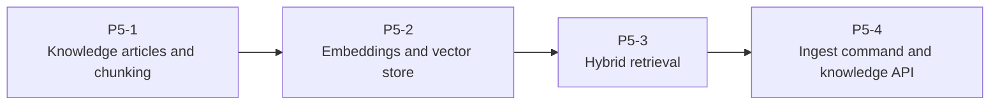
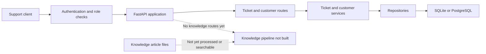
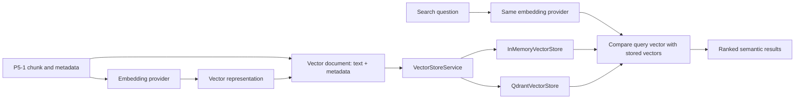
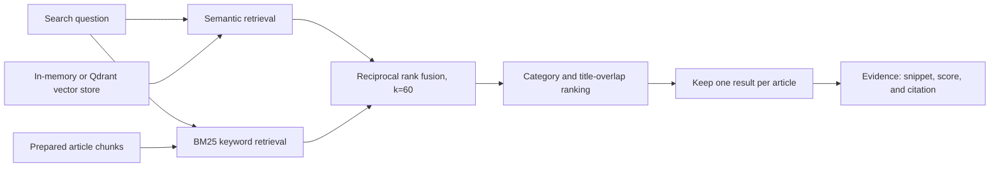
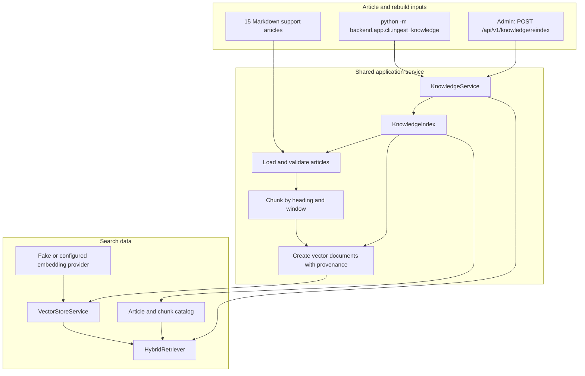
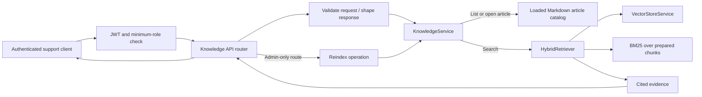
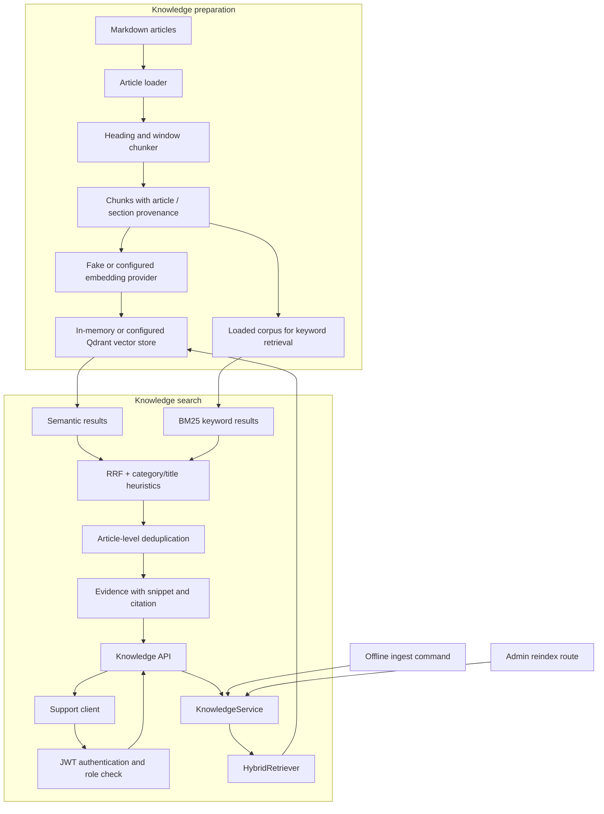

# Phase 5 — Project System Design Evolution

This document traces the CloudDesk knowledge pipeline from its starting point
after Phase 4 through P5-1 to P5-4. Each diagram shows the system design as it
evolved; it is not a deployment or Docker-networking diagram.

## Phase 5 goal

Phase 5 makes CloudDesk support articles searchable and exposes the results
through a protected API. Its main design progression is:

The order matters: the system first needs well-structured content, then a place
and format for finding it, then a retrieval strategy, and finally operational
and HTTP entry points.

## Starting design — Phase 4 support APIs, but no knowledge pipeline

At the start of Phase 5, CloudDesk already has protected ticket and customer
routes, database records, and the general FastAPI application. Markdown support
articles are intended as the source of guidance, but there is no article loader,
search index, retrieval path, or knowledge API yet.

### Starting limitations

- An agent cannot list or open support articles through the API.
- The application has no preparation step that makes article sections
  searchable.
- There is no way to search by meaning or by matching words.
- There is no evidence result with an article and section citation.

The first design task is therefore to establish the article format and preserve
the source location of every excerpt.

## P5-1 — Knowledge articles and chunking

### Design change

P5-1 establishes Markdown articles with a small metadata header and a
deterministic parser. It divides each article at headings and into bounded,
overlapping text windows where needed. Each resulting chunk keeps its title,
heading, category, tags, article ID, and a `kb://slug#section` source.

This stage prepares content, but it does not yet store embeddings or answer
search requests.

```mermaid
flowchart LR
    Files["Markdown support articles"]
    Files --> Parse["Read and validate front matter"]
    Parse --> Article["Article: title, category, tags, summary, content"]
    Article --> Sections["Split at Markdown headings"]
    Sections --> Windows["Create bounded overlapping text windows"]
    Windows --> Chunk["Chunk text with title and heading prefix"]
    Chunk --> Provenance["Keep article ID, category, slug, heading, and citation"]
```

### Why this step matters

The chunk is the search unit. If a full article were stored as one very large
item, a question about one section could return unrelated material from the
same page. Keeping the heading and article citation with each chunk lets later
stages rank a useful passage and still point back to its source.

At the end of P5-1, the system can load and prepare article content, but it
cannot yet search that content.

## P5-2 — Fake embeddings and vector storage

### Design change

P5-2 adds a common vector-store interface and an embedding provider. Each text
chunk can be represented as a vector, which is a list of numbers used for
similarity comparisons. The demo provider creates deterministic fake vectors so
local development does not need an external embedding service.

The same storage interface has two implementations:

- **In-memory store:** for offline demos and tests;
- **Qdrant adapter:** for a configured vector database.

### Design decision

The retriever depends on `VectorStoreService`, not on Qdrant-specific code.
That keeps the storage choice behind one boundary and allows the offline demo
to use memory while preserving a configured Qdrant option.

At the end of P5-2, the system has semantic vector search, but not yet the
combined keyword-and-meaning retrieval strategy or a knowledge API.

## P5-3 — Hybrid retrieval

### Design change

P5-3 adds a retriever that runs two searches over the same article chunks:

1. **Semantic search** compares question and chunk vectors.
2. **Keyword search** uses BM25 to find chunks containing relevant terms.

The retriever combines their ranked lists with reciprocal rank fusion using
`k=60`, applies category and title-overlap heuristics, and returns at most one
chunk per article. The result retains its source, snippet, article ID, and URL.

### Why combine rankings instead of scores?

Semantic similarity and BM25 keyword scores use different scales. Reciprocal
rank fusion combines each method's position in its list instead of comparing
their raw scores as if they were equivalent.

An optional reranker interface can reorder results, but the current knowledge
service does not configure a language-model reranker. The implemented path
therefore remains available offline.

At the end of P5-3, the retrieval engine can produce cited evidence when given
a query, an initialized vector store, and the article chunks. It is not yet
wired into the running application through knowledge routes.

## P5-4 — Ingest command and knowledge API

### Design change

P5-4 connects the content, storage, and retriever to the FastAPI application.
The `KnowledgeService` coordinates the `KnowledgeIndex`, vector store, and
retriever. The application creates the service during startup and initializes
an empty store from the article files. If a configured store already contains
vectors, startup keeps them and loads the current article catalog; operators
use an explicit reindex to rebuild the stored vectors from the current files.

The explicit ingest command and the admin-only API operation rebuild the index.
The rebuild clears the old configured index before adding the current chunks.
If a rebuild fails after clearing, the search path is marked unavailable instead
of returning an apparently successful empty search.

The command defaults to `SAMPLE_DATA_DIR/knowledge_base`. The local verification
run indexed 15 articles into 45 chunks. In the API, article list and detail
operations read from the loaded article catalog; search uses the retriever and
configured vector store.

### Knowledge API boundary

The API adds four operations:

| Route | Minimum role | Responsibility |
|---|---|---|
| `GET /api/v1/knowledge` | Viewer | List article summaries |
| `GET /api/v1/knowledge/{article_id}` | Viewer | Return one article |
| `POST /api/v1/knowledge/search` | Viewer | Return cited search evidence |
| `POST /api/v1/knowledge/reindex` | Admin | Rebuild the configured index |

Pydantic schemas validate search mode, category, query, and result count. The
route checks roles and shapes responses; `KnowledgeService` performs the
operation. The API contract and TypeScript types document the same article and
evidence fields.

The browser is represented as a client, but Phase 5 supplies the backend API
and frontend TypeScript contract; it does not add a finished knowledge-search
screen.

## End-of-Phase 5 design

The final Phase 5 design has two related flows: one prepares the knowledge base,
and the other answers an agent's search request.

### Final design boundaries

| Component | Owns | Does not own |
|---|---|---|
| Markdown articles | Support guidance and article metadata | Search ranking |
| Chunker | Section splitting and source provenance | Vector database calls |
| Embedding provider | Text-to-vector conversion | API authorization |
| Vector store | Storing and searching vectors | Article API response policy |
| Hybrid retriever | Combining semantic and keyword ranks | Ticket or customer database access |
| Knowledge service | Coordinating index, corpus, and retrieval | HTTP status codes |
| Knowledge API | Role checks, request validation, and response shapes | Direct SQL or embedding implementation |

This separation means the support API can return cited evidence without needing
to know how an article was split or how a vector was calculated. It also keeps
knowledge retrieval separate from ticket and customer persistence.

## What this design does not claim

- The default offline implementation uses fake embeddings and in-memory storage.
- The Qdrant adapter exists, but no live Qdrant service was used in local
  validation.
- The optional reranker hook exists, but no language-model reranker is wired
  into the current knowledge service.
- The offline test suite passed 87 tests, and the local ingest command indexed
  15 articles into 45 chunks.
- The retrieval hit-rate target has not been measured because no evaluation
  dataset and evaluation suite are present. Phase 5 therefore remains
  **in progress** in the phase-status table.

## Component reference

| Design responsibility | Implementation |
|---|---|
| Article parsing and chunking | [rag/chunking.py](../../rag/chunking.py) |
| Fake embeddings | [rag/embeddings.py](../../rag/embeddings.py) |
| Vector-store protocol and adapters | [rag/vector_store.py](../../rag/vector_store.py) |
| Hybrid retrieval and cited evidence | [rag/retriever.py](../../rag/retriever.py) |
| Ingestion and index lifecycle | [rag/ingest.py](../../rag/ingest.py) |
| Knowledge request and response schemas | [knowledge.py](../../backend/app/schemas/knowledge.py) |
| Knowledge API routes | [api/knowledge.py](../../backend/app/api/knowledge.py) |
| Settings and service composition | [knowledge_service.py](../../backend/app/services/knowledge_service.py) |
| Startup and route assembly | [main.py](../../backend/app/main.py) |
| Knowledge API contract | [API_CONTRACT.md](../../docs/API_CONTRACT.md) |
| Frontend contract types | [frontend/lib/types.ts](../../frontend/lib/types.ts) |
| Chunking, ingestion, and API tests | [tests/rag/](../../tests/rag/), [test_knowledge.py](../../tests/api/test_knowledge.py) |
| Phase checklist and exit criteria | [TASK.md](../../TASK.md), [PLAN_PHASE.md](../../PLAN_PHASE.md) |
