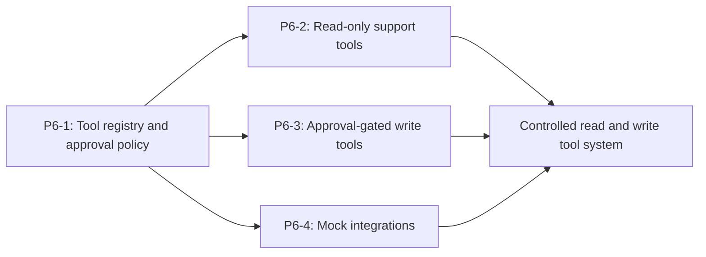
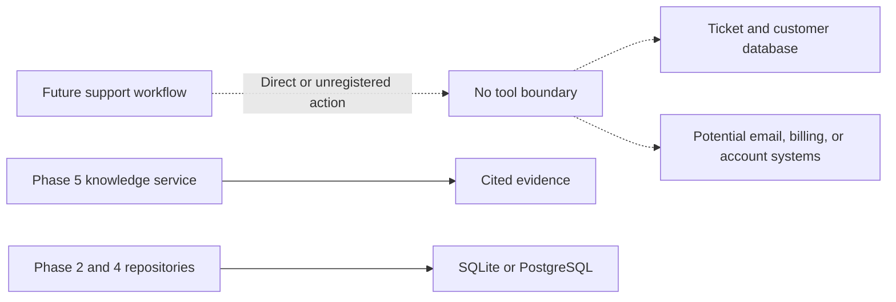
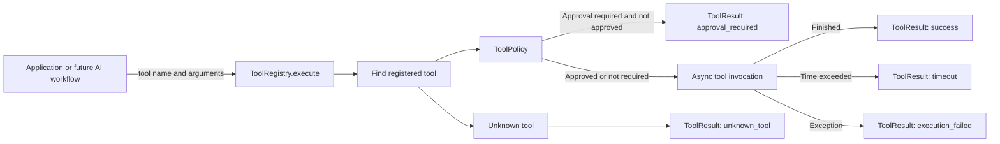
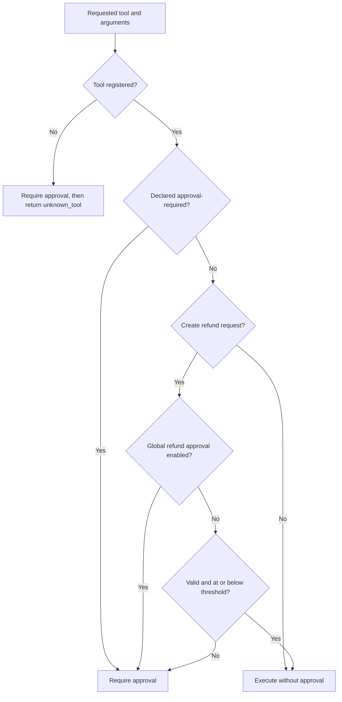
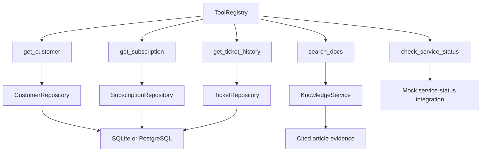
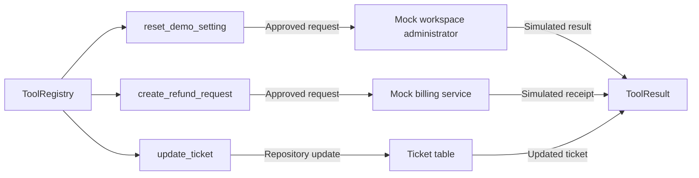
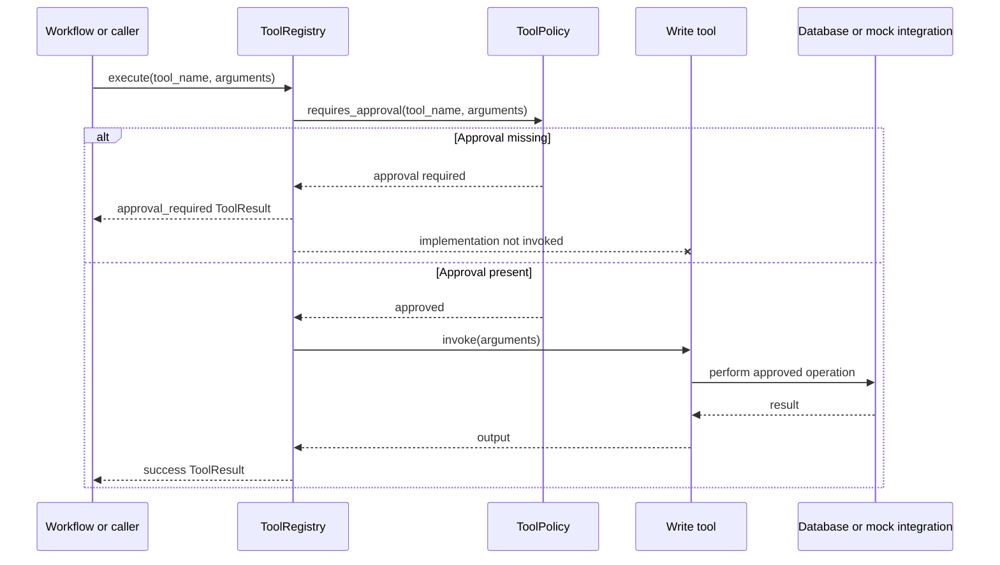
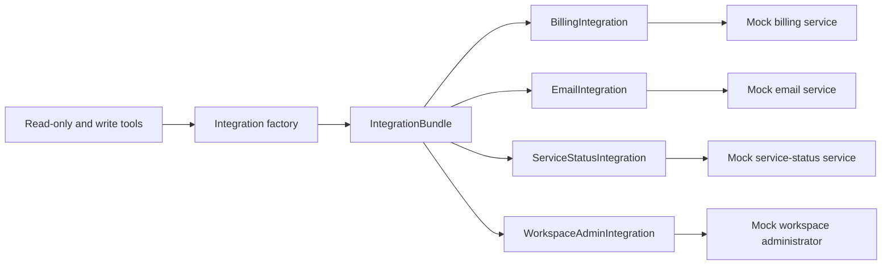
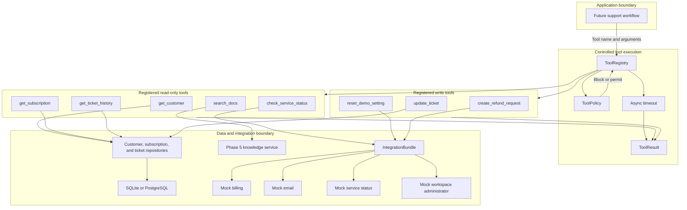
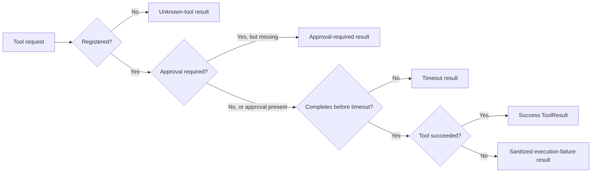

# Phase 6 — Project System Design Evolution

This document follows the CloudDesk tool and integration design from the
Phase 5 application baseline through P6-1 to P6-4. It shows the simplest
starting shape, how each subtask changes the design, and the complete
Phase 6 tool architecture at the end of the phase.

## Phase 6 goal

Phase 6 establishes a controlled way for the application and future AI workflow
to perform actions. It separates operations that only read information from
operations that may change a ticket, account setting, or billing request.

The subtask evolution is:

P6-1 creates the execution and approval foundation. P6-2 and P6-3 use that
foundation to define read and write actions. P6-4 provides safe implementations
behind integration interfaces.

## Starting design — Phase 5 application with knowledge search

At the beginning of Phase 6, CloudDesk already has a database, protected APIs,
repositories, and a knowledge-search pipeline. The application can read support
records and return cited knowledge evidence.

It does not yet have one common action boundary for support tools. In
particular, it has no central registry, approval policy, timeout handling,
or registered write tools.

### Starting limitations

- A write action could bypass a consistent approval check.
- The application would need separate timeout and error behavior for each
  operation.
- Unknown or misspelled actions would not share a predictable failure result.
- Read tools could be mixed with consequential operations.
- A demo could accidentally depend on real billing, email, or account systems.

Phase 6 therefore needs a central execution boundary and replaceable
integration implementations.

## Evolution by subtask

### P6-1 — Tool registry and approval policy

**Design change:** the application introduces one registry for registered tools,
one policy for approval decisions, and one consistent result shape.

Every tool request passes through `ToolRegistry.execute()`. The registry:

1. looks for the tool in its registration table;
2. asks `ToolPolicy` whether approval is required;
3. stops before invocation if approval is missing;
4. runs registered asynchronous tools within a timeout;
5. returns a success or explicit failure `ToolResult`.

The policy has separate approval decisions for unknown tools, declared write
tools, the workspace reset tool, and refund requests.

`ToolResult` makes success and failure predictable. It can carry an output or an
error code, and it can indicate that approval is required. Tool exceptions are
converted to a general failure type rather than exposing internal exception text.

**Result:** P6-1 becomes the mandatory execution path. Later tools should not
be called directly outside the registry if they need Phase 6 policy guarantees.

### P6-2 — Read-only support tools

**Design change:** common investigation operations become registered, named
tools that do not change support records.

The read-only tools use existing repositories, the knowledge service, and
mocked service-status integration:

The tools have separate responsibilities:

| Tool | Primary source | Behavior |
|---|---|---|
| `get_customer` | Customer repository | Returns a basic customer profile |
| `get_subscription` | Subscription repository | Returns customer subscriptions |
| `get_ticket_history` | Ticket repository | Returns summaries, excluding raw ticket bodies |
| `search_docs` | Knowledge service | Returns ranked evidence and citations |
| `check_service_status` | Integration adapter | Returns a mock service state |

The read-only registration function returns no approval requirement. These tools
remain data-gathering operations; they do not update the database or call a real
external system.

**Result:** a future workflow can investigate a ticket with named tools instead
of reaching directly into repositories or knowledge components.

### P6-3 — Approval-gated write tools

**Design change:** ticket changes and consequential operations are represented
as write tools, with approval enforced before their implementation is called.

P6-3 adds:

- `update_ticket`: writes supported ticket fields;
- `reset_demo_setting`: resets a workspace setting in the mock integration;
- `create_refund_request`: creates a simulated refund receipt.

Write-tool approval works differently from ordinary execution:

`reset_demo_setting` is always approval-gated. Refund approval follows the
configured refund policy, and the mock billing implementation does not charge
real money.

`update_ticket` currently does not require approval in the Phase 6 policy, but
its write boundary is still important: it validates fields and writes only
through the repository. The original ticket message body is not replaced.

**Result:** consequential operations have an explicit approval state, while
ordinary ticket metadata can be updated through the same common execution path.

### P6-4 — Mock integrations

**Design change:** tools interact with common integration interfaces while the
demo uses local implementations instead of real external systems.

P6-4 adds a bundle of integration contracts and a factory that currently creates
mock implementations:

The mock adapters isolate the rest of the application from vendor details:

| Integration | Mock behavior |
|---|---|
| Billing | Stores simulated refund receipts in memory |
| Email | Records a simulated message count without sending email |
| Service status | Returns configured local service states |
| Workspace administration | Records setting resets in mock state |

The integration protocols define expected methods and result types. A future
real adapter could implement the same protocols, which would allow tool code
to remain stable while the integration implementation changes.

**Result:** Phase 6 can be demonstrated and tested offline without credentials,
Docker, or live external systems.

## End-of-Phase 6 design

The final Phase 6 design combines a central execution registry, separate
approval policy, registered read and write tools, a common database boundary,
and replaceable mock integrations.

### Final execution boundary

This boundary has one important safety property: a consequential tool cannot
reach its implementation until the registry has passed its policy and approval
checks.

## Final design boundaries

| Component | Owns | Does not own |
|---|---|---|
| ToolRegistry | Registration, registry lookup, timeout, and execution routing | Approval policy values |
| ToolPolicy | Determining whether approval is required | Calling or changing external systems |
| ToolResult | Success, error, timeout, unknown-tool, and approval status | Database or integration implementation |
| Read-only tools | Investigation and context gathering | Tickets or account changes |
| Write tools | Supported ticket updates and consequential action requests | Approval UI or approval storage |
| Repositories | SQLAlchemy database operations | HTTP or LLM behavior |
| Integration protocols | The interface expected by tools | A concrete vendor implementation |
| Mock integrations | Offline, in-memory demonstration behavior | Real money, email, or account changes |

This separation keeps the following concerns independent:

- **what action exists**: tool implementation;
- **whether it may run**: policy and approval;
- **how it executes**: registry;
- **where data is stored**: repository;
- **which external provider is used**: integration adapter.

## Validation and honest status

The Phase 6 implementation and focused tests cover:

- registry-only execution;
- unknown-tool approval;
- declared approval requirements;
- refund threshold behavior;
- timeout and exception handling;
- mock integration behavior;
- write-tool approval before side effects;
- explicit write-tool success and failure results.

The focused local validation ran 24 tool-policy, tool-registry, and write-tool
tests successfully. Ruff also passed for the changed write-tool and test files.

Mock behavior is confirmed locally. This phase does not use real billing, email,
workspace administration, Docker services, or cloud credentials.

The human approval screen and persisted approval record are later Phase 11
responsibilities. Phase 6 supplies the registry and policy foundation they will
use.

## Component reference

| Design responsibility | Implementation |
|---|---|
| Tool policy | [policy.py](../../backend/app/tools/policy.py) |
| Central registry and timeout | [registry.py](../../backend/app/tools/registry.py) |
| Consistent tool results | [result.py](../../backend/app/tools/result.py) |
| Read-only support tools | [read_only.py](../../backend/app/tools/read_only.py) |
| Approval-gated write tools | [write_tools.py](../../backend/app/tools/write_tools.py) |
| Integration protocols | [protocols.py](../../integrations/protocols.py) |
| Integration composition | [factory.py](../../integrations/factory.py) |
| Mock billing, email, status, and workspace services | [mock/services.py](../../integrations/mock/services.py) |
| Policy tests | [test_tool_policy.py](../../tests/unit/test_tool_policy.py) |
| Registry tests | [test_tool_registry.py](../../tests/unit/test_tool_registry.py) |
| Read-only tool tests | [test_read_only_tools.py](../../tests/unit/test_read_only_tools.py) |
| Write-tool tests | [test_write_tools.py](../../tests/unit/test_write_tools.py) |
| Mock integration tests | [test_mock_integrations.py](../../tests/unit/test_mock_integrations.py) |
| Phase checklist | [TASK.md](../../TASK.md) |
| Phase exit criteria | [PLAN_PHASE.md](../../PLAN_PHASE.md) |
