# Phase 7 — Project System Design Evolution

This document follows the CloudDesk rules and guardrail design from the
Phase 6 tool and integration baseline through P7-1 to P7-4. It shows the
simplest starting shape, how each subtask changes the design, and the complete
policy and safety architecture at the end of Phase 7.

## Phase 7 goal

Phase 7 makes deterministic policy and safe handling of untrusted content
available before model-assisted decisions.

The subtask evolution is:

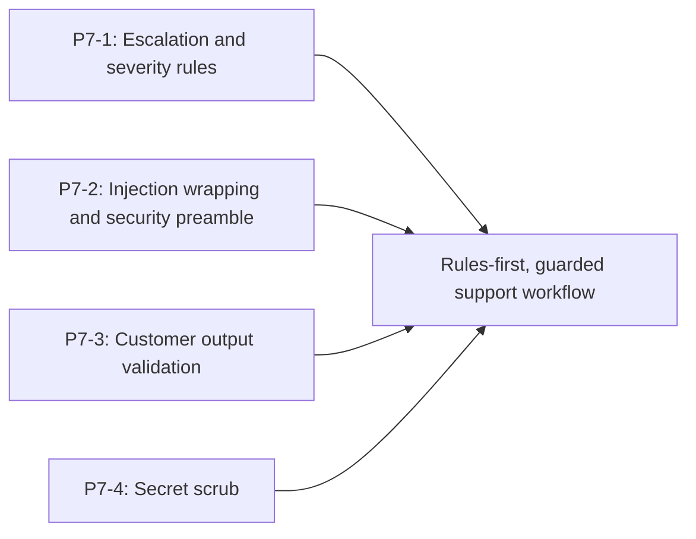

P7-1 establishes policy decisions. P7-2 protects prompt boundaries. P7-3 protects
generated customer replies. P7-4 protects memory and persisted text.

## Starting design — Phase 6 tool system without policy guardrails

At the beginning of Phase 7, CloudDesk already has:

- protected APIs;
- ticket and customer repositories;
- knowledge retrieval;
- a central tool registry;
- tool approval policy;
- mock integrations.

The application can execute controlled tools, but it does not yet have the
complete deterministic policy and text-safety layer described for the agents.
It lacks one combined design for:

- policy escalation and named teams;
- severity policy that raises rather than lowers urgency;
- prompt-injection scanning;
- untrusted-content boundaries;
- customer-reply validation;
- centralized secret and card-number scrubbing.

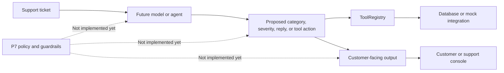

### Starting limitations

- Clear policy cases could be left to model probability.
- The model could lower a severity that policy requires to be higher.
- Ticket text could be presented to a prompt without an explicit untrusted
  boundary.
- Prompt-injection text could be confused with instructions.
- A generated reply could expose an internal URL or secret.
- Stored memory text could retain passwords, tokens, or card numbers.

Phase 7 adds separate guardrail components before the future agent workflow
uses model-generated decisions.

## Evolution by subtask

### P7-1 — Escalation and severity rules

**Design change:** clear support-policy cases become deterministic lookups
instead of model probability.

`agents/rules.py` defines `ESCALATION_RULES`, category rules, severity rules,
and functions that return policy matches.

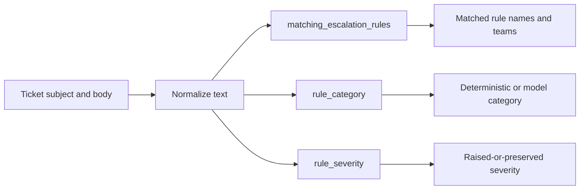

The escalation rules currently cover:

| Rule | Team | Required severity |
|---|---|---|
| Security breach | Security team | Critical |
| Data loss | Data recovery team | Critical |
| Workspace deletion | Account deletion team | High |
| Payment dispute | Billing and payment dispute team | High |
| Enterprise outage | Incident response team | Critical |
| Legal request | Legal and compliance team | High |
| Prompt injection | Security team | Critical |

The severity design uses a rank:

```text
low 1 < medium 2 < high 3 < critical 4
```

The implementation compares the model value with the deterministic requirement.
It only changes severity when the required rank is higher.

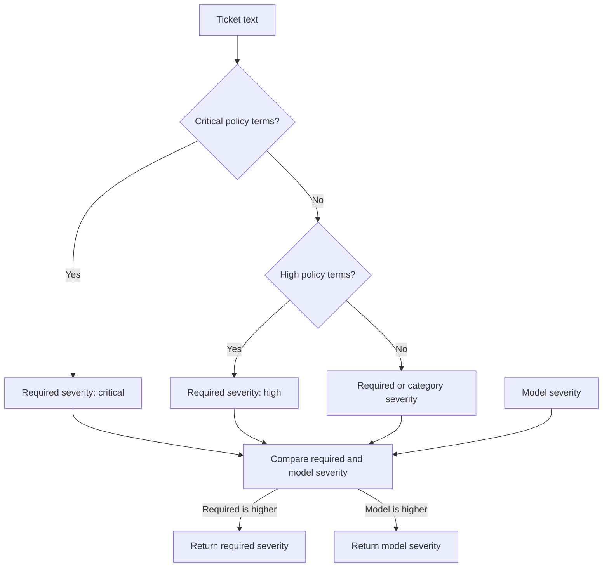

Category rules can override a model category for clear subjects. A valid model
category is preserved when no deterministic rule matches.

**Result:** P7-1 gives later agent code predictable escalation, category, and
severity decisions for policy subjects.

### P7-2 — Injection wrapping and security preamble

**Design change:** ticket-supplied text becomes explicitly untrusted prompt
data, and prompt builders receive a shared security preamble.

`backend/app/core/guardrails.py` owns the injection scanner and wrapping
helpers. `agents/prompts.py` exposes `SECURITY_PREAMBLE` for future prompt
builders.

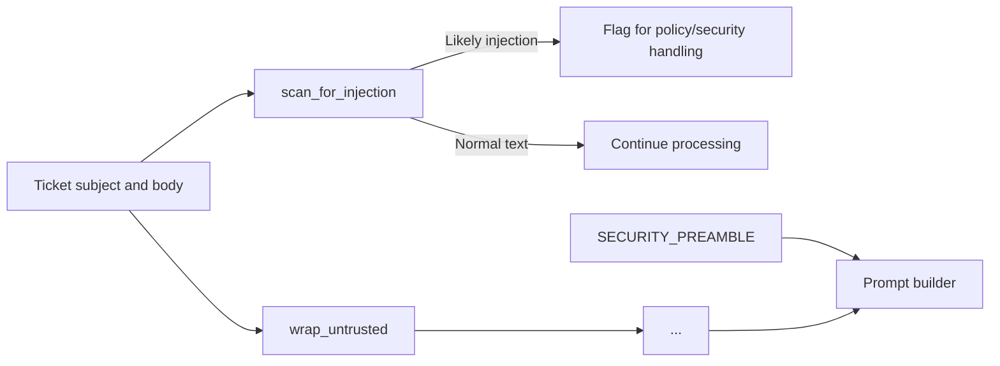

The scanner checks common instruction and export patterns, including:

- ignore or disregard instructions;
- reveal system or hidden prompts;
- bypass approval or policy;
- export customer records;
- invoke tools or commands;
- developer-mode or jailbreak language.

The wrapper escapes any attempt to insert `<untrusted_content>` or
`</untrusted_content>` inside the text. That protects the delimiter boundary
from being broken by ticket content.

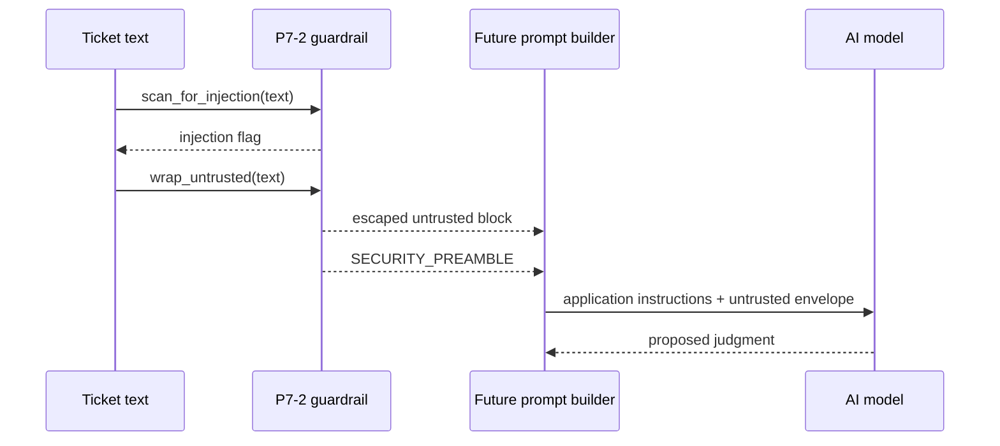

The preamble tells the model that envelope content is customer-supplied data,
not instructions, and that application rules still control the decision.

**Result:** P7-2 separates customer language from prompt instructions, while
P7-1 remains responsible for deterministic policy decisions.

### P7-3 — Customer output validation

**Design change:** generated reply text passes through a final safety gate
before it can be shown or sent.

`validate_customer_output()` returns:

```text
(is_valid, violation_code_list)
```

The violation codes are structured, not free-text:

- `empty_output`;
- `internal_url`;
- `secret`;
- `other_customer_data`.

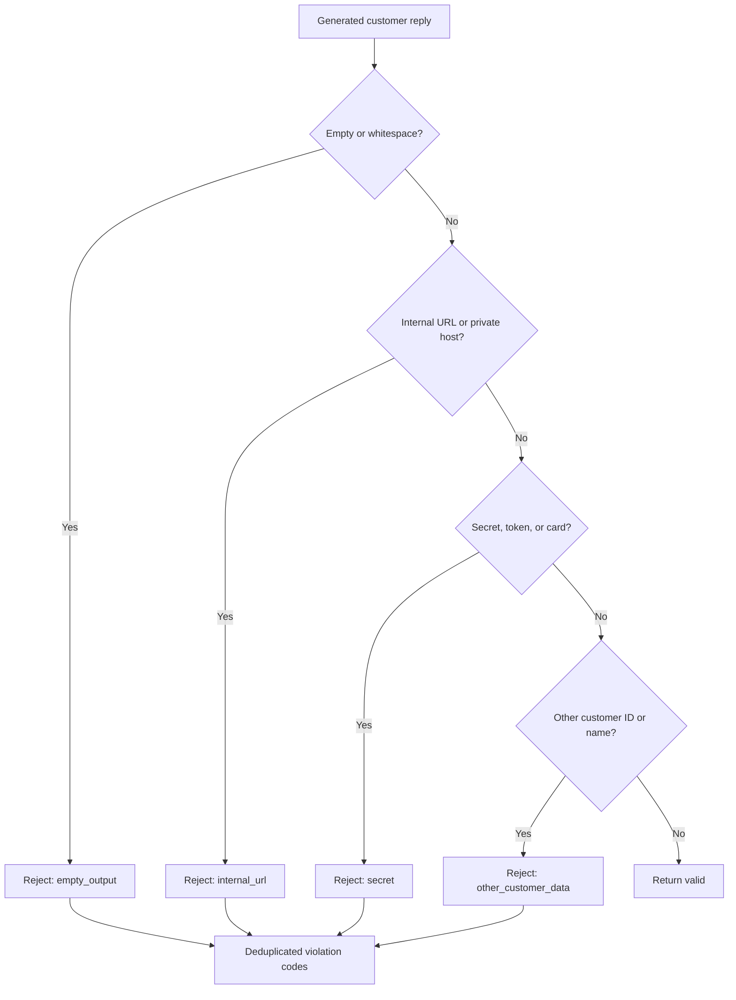

The validator considers both allowed and disallowed customer identities.
Allowed IDs and names are removed from disallowed sets before checking text.

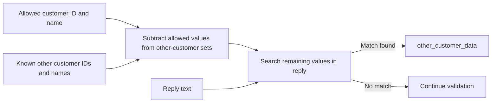

It rejects internal and private addresses, but allows a normal public support
URL.

**Result:** P7-3 becomes a structured answer gate. A later workflow can
convert violations into high risk and block a reply.

### P7-4 — Secret scrub

**Design change:** common sensitive text is redacted centrally before memory
content is read or persisted.

`SECRET_PATTERNS` and `scrub()` live in `backend/app/core/guardrails.py`.
The customer service now calls `scrub()` before returning stored memory.

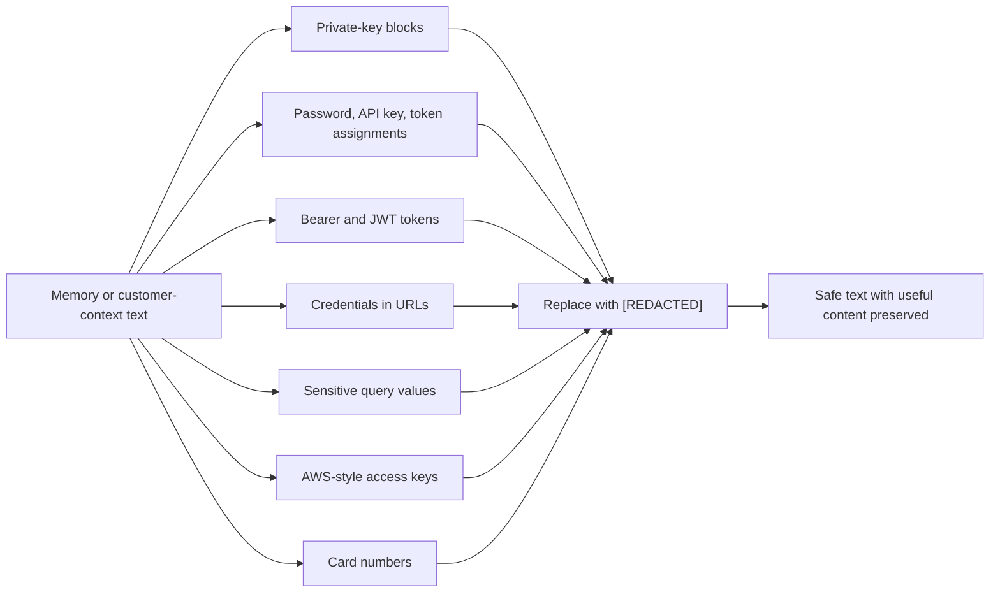

`CustomerService.get_detail()` loads memory notes and passes each note through
`scrub()` before constructing the API response.

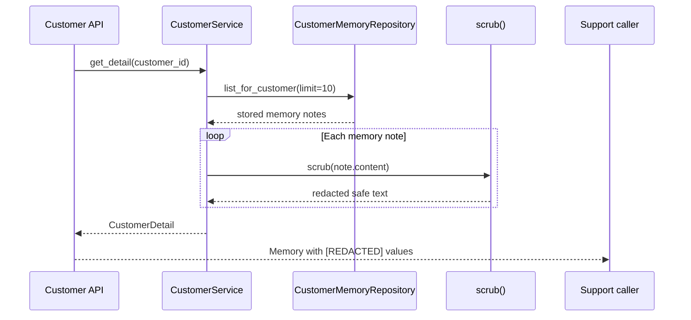

`scrub()` is different from `validate_customer_output()`:

| Operation | Result |
|---|---|
| Validation | Pass or reject the complete output |
| Scrubbing | Preserve useful text while replacing sensitive values |

**Result:** P7-4 centralizes redaction rules and removes duplicate memory
scrubbing code from the customer service.

## End-of-Phase 7 design

The complete design has two related safety paths:

1. **Policy and prompt safety** decide and contain ticket information.
2. **Reply and memory safety** protect outbound and stored text.

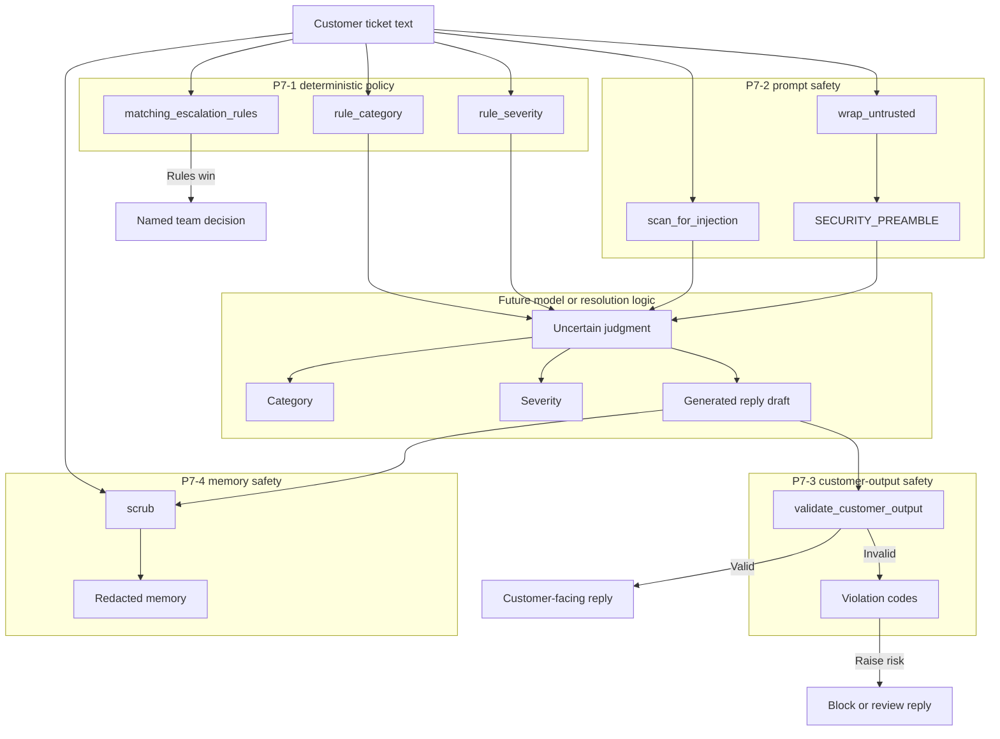

The policy path is deterministic for clear cases. The model may assist where
the rules do not decide, but it cannot lower policy severity or replace policy
escalation.

### Complete policy decision flow

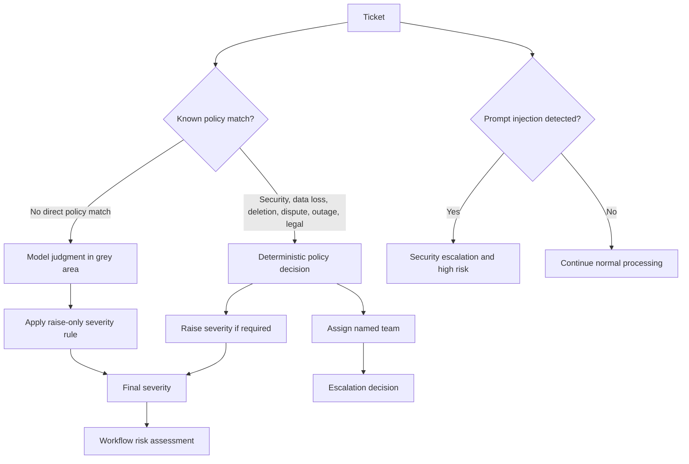

## Component boundaries

| Component | Owns | Does not own |
|---|---|---|
| `agents/rules.py` | Escalation, category, and severity policy | LLM prompt rendering |
| `backend/app/core/guardrails.py` | Injection, output, and secret safety helpers | Model calls or workflow routing |
| `agents/prompts.py` | Shared security-preamble export | HTTP or database logic |
| `CustomerService` | Applying scrubbed memory to API output | Long-term memory persistence rules |
| Phase 7 tests | Deterministic policy and guardrail verification | Live model or live provider behavior |

The key boundary is that policy and guardrails are pure or service-level Python
helpers. HTTP route code and tool code do not each need to invent separate
injection or secret rules.

## Evolution of risk handling

The design becomes stronger at each subtask:

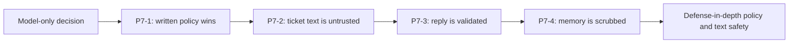

The result is not a single guardrail but four coordinated boundaries:

1. policy decisions;
2. prompt input boundaries;
3. customer output boundaries;
4. memory and context boundaries.

## Validation and honest status

Phase 7 implementation includes:

- escalation and category rules;
- raise-only severity rules;
- injection scanning and delimiter escaping;
- shared security preamble;
- customer-reply validation;
- centralized secret scrubbing;
- memory display integration;
- focused unit tests.

The local offline suite passed 165 tests, and Ruff passed for the relevant
Phase 7 implementation and test files.

The guardrails do not claim complete prompt-injection detection or perfect
secret discovery. Pattern matching is an additional deterministic boundary, not
a replacement for authentication, authorization, secrets management, secure
provider configuration, or human review.

No real model provider or external integration was used in local validation.

## Component reference

| Responsibility | Implementation |
|---|---|
| Escalation, category, and severity rules | [rules.py](../../agents/rules.py) |
| Injection, output, and secret guardrails | [guardrails.py](../../backend/app/core/guardrails.py) |
| Shared security preamble | [prompts.py](../../agents/prompts.py) |
| Memory API scrubbing | [customer_service.py](../../backend/app/services/customer_service.py) |
| Policy rule tests | [test_policy_rules.py](../../tests/unit/test_policy_rules.py) |
| Injection tests | [test_guardrail_injection.py](../../tests/unit/test_guardrail_injection.py) |
| Customer output tests | [test_customer_output_validation.py](../../tests/unit/test_customer_output_validation.py) |
| Secret scrub tests | [test_secret_scrub.py](../../tests/unit/test_secret_scrub.py) |
| Phase task status | [TASK.md](../../TASK.md) |
| Phase exit criteria | [PLAN_PHASE.md](../../PLAN_PHASE.md) |
| Plain-language Phase 7 explanation | [phase7_explained.md](../explain_codebase/phase7_explained.md) |
