# Phase 8 — Project System Design Evolution

This document follows the CloudDesk memory design from the Phase 7
rules-and-guardrails baseline through P8-1 to P8-3. It shows the simplest
starting shape, how each subtask changes the design, and the complete
two-tier memory architecture at the end of Phase 8.

## Phase 8 goal

Phase 8 provides short-term workflow storage and safe, de-duplicated customer
memory.

The subtask evolution is:

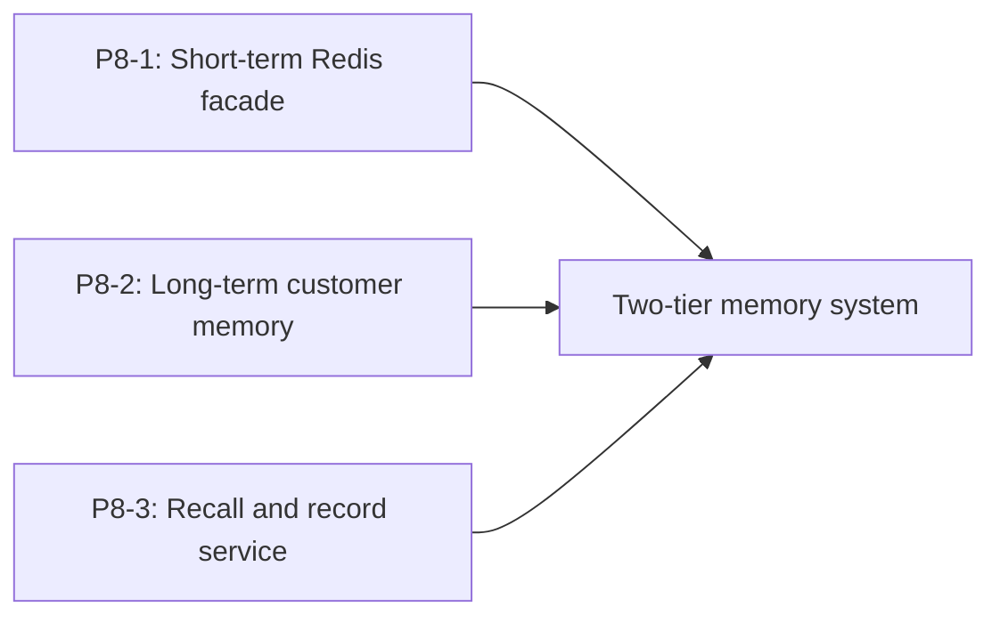

P8-1 establishes temporary Redis memory. P8-2 establishes durable,
customer-scoped SQL memory. P8-3 coordinates both tiers through one service
for future workflow nodes.

## Starting design — Phase 7 application without memory facades

At the beginning of Phase 8, CloudDesk has:

- persisted tickets and customers;
- policy and guardrail helpers;
- a tool registry;
- knowledge retrieval;
- a customer-memory database table;
- repository access to that table.

However, the application does not yet have one intentional memory abstraction
with two lifetimes.

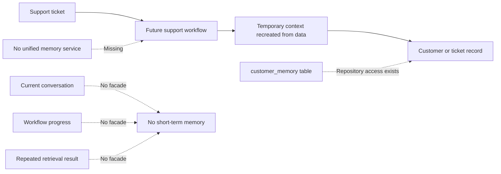

### Starting limitations

- Conversation context has no Redis facade.
- Workflow state has no defined short-term key pattern.
- Retrieval results have no 300-second cache boundary.
- Long-term memory has repository access but no dedicated safety facade.
- Memory recall and resolution recording are not coordinated.
- Raw ticket text or secrets could be copied if future code stores them
  directly.

The Phase 8 design therefore needs two tiers with one shared service boundary.

## Evolution by subtask

### P8-1 — Short-term Redis facade

**Design change:** temporary conversation, workflow, and cache values move
behind a Redis/fakeredis Python interface.

P8-1 introduces `ShortTermMemory` and Redis key builders.

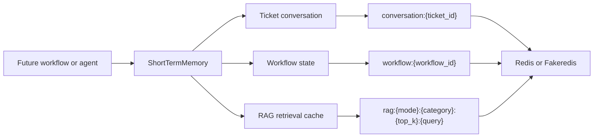

The Redis factory checks settings:

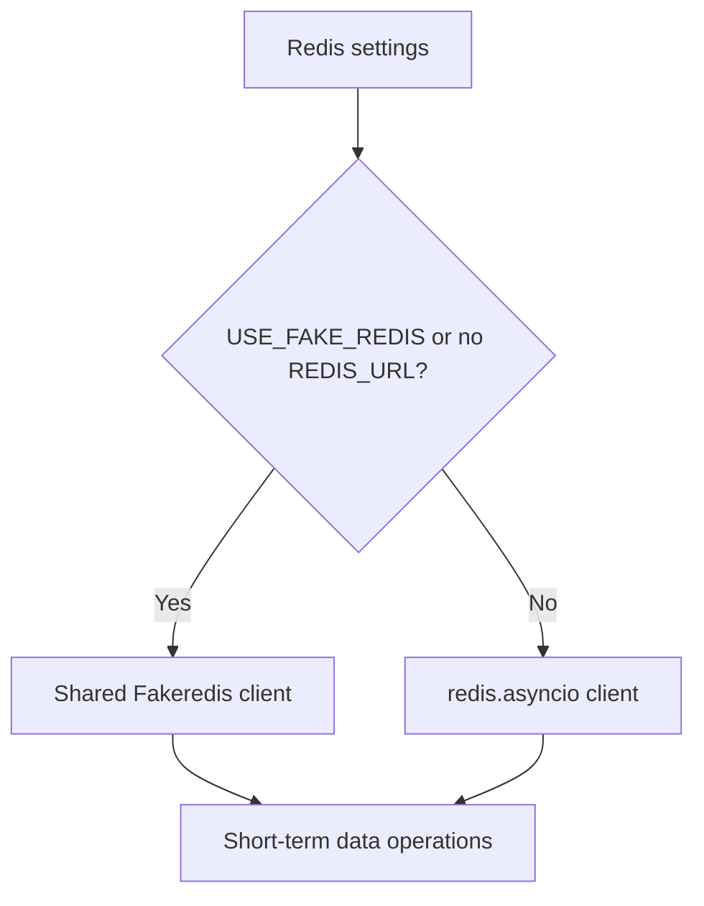

The TTL design is:

| Data | Key | TTL |
|---|---|---|
| Ticket conversation | `conversation:{ticket_id}` | 24 hours |
| Workflow state | `workflow:{workflow_id}` | 24 hours |
| Retrieval cache | `rag:{mode}:{category}:{top_k}:{query}` | 300 seconds |

Conversation values are JSON lists of messages. Workflow values are JSON
objects or values. Retrieval values are JSON-encoded evidence or search
results.

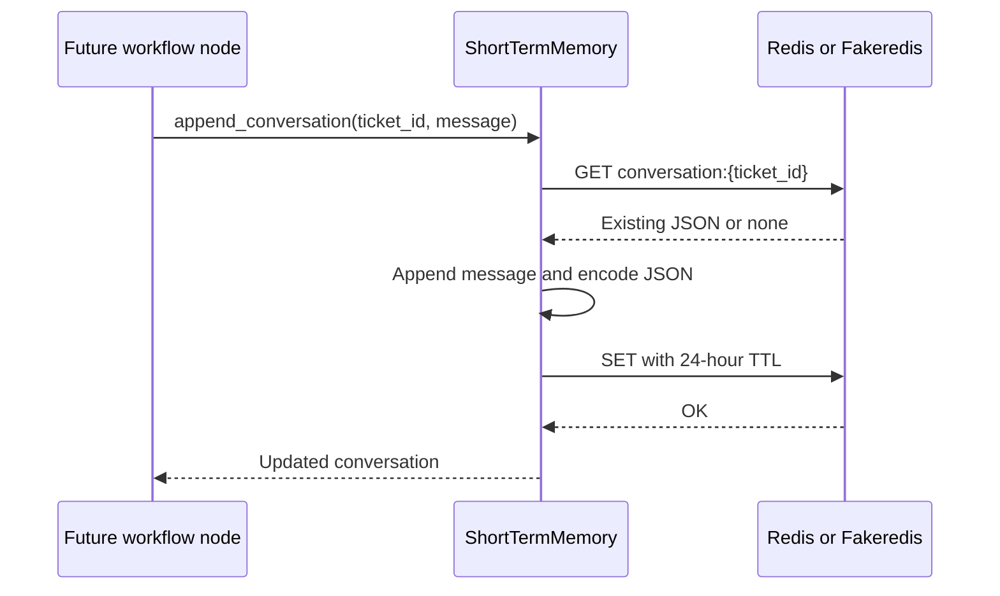

The retrieval cache key is normalized:

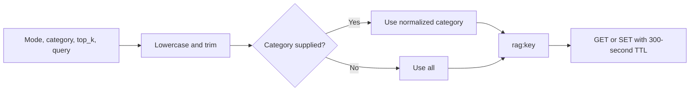

**Result:** P8-1 gives future nodes Redis-style temporary memory without
building Redis keys and JSON encoding themselves.

### P8-2 — Long-term customer memory

**Design change:** durable memory becomes a restricted, customer-scoped facade
instead of direct repository writes.

P8-2 introduces `LongTermMemory`, permitted memory types, exact duplicate
lookup, source-ticket validation, and secret scrubbing.

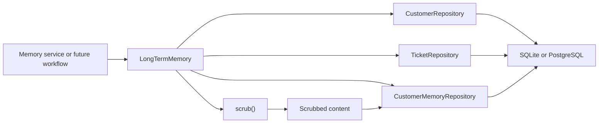

The permitted type boundary is:

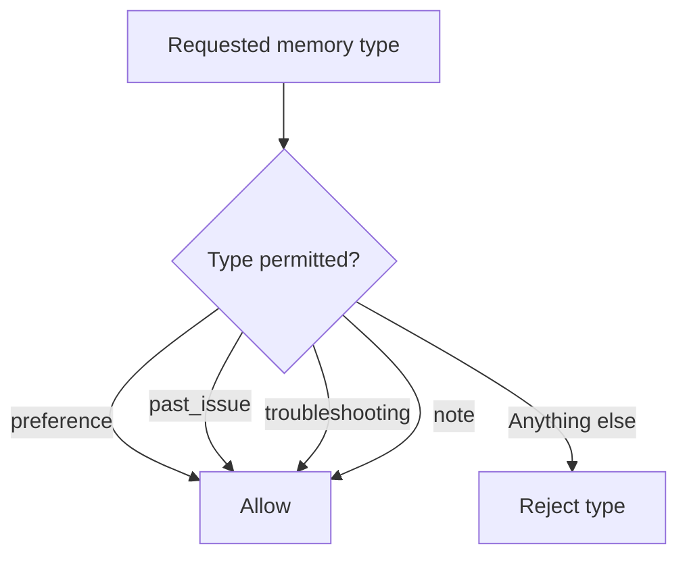

The safe record flow is:

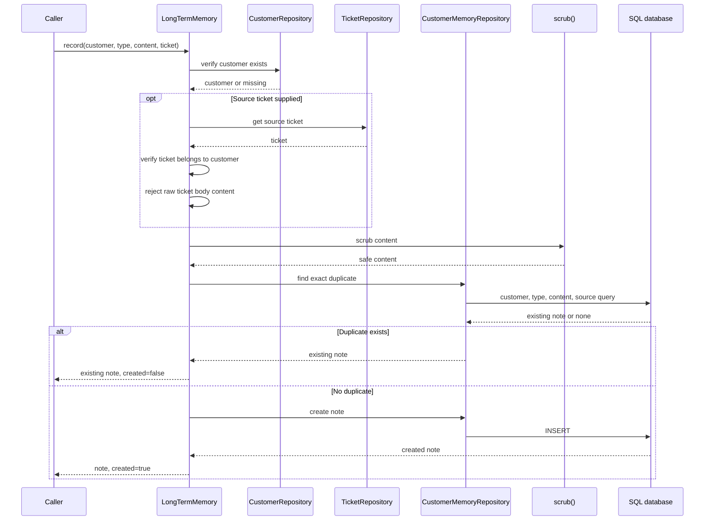

Recall is customer-scoped and bounded:

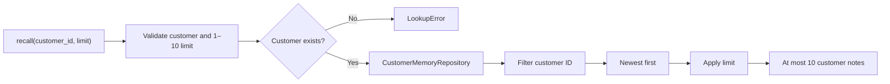

**Result:** P8-2 prevents arbitrary note types, cross-customer ticket sources,
raw ticket bodies, secrets, and exact duplicates.

### P8-3 — Recall and record service

**Design change:** short-term and long-term memory become one coordinated
service for future workflow nodes.

P8-3 introduces `MemoryService`.

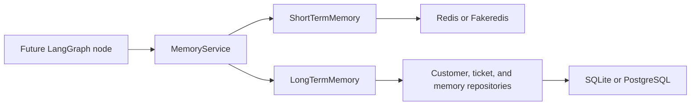

The service exposes two main long-term operations:

- `recall_customer`;
- `record_resolution`.

It also exposes short-term convenience operations for:

- ticket conversations;
- workflow state.

The resolution record flow is:

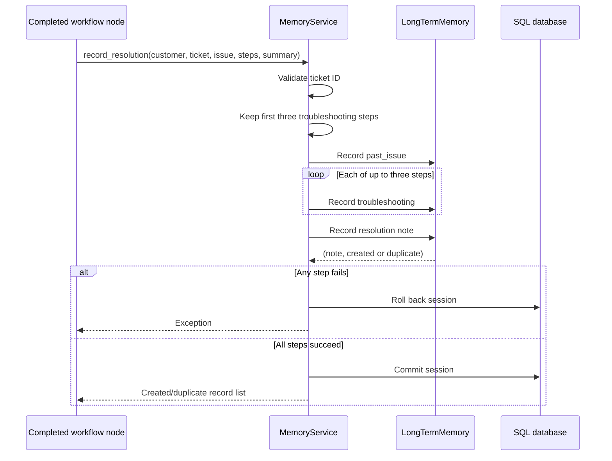

The resolution shape is consistent:

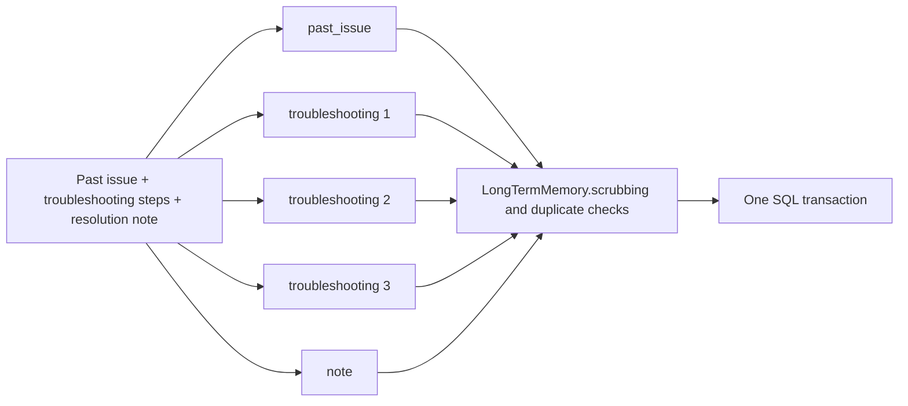

The short-term and long-term stores remain separate:

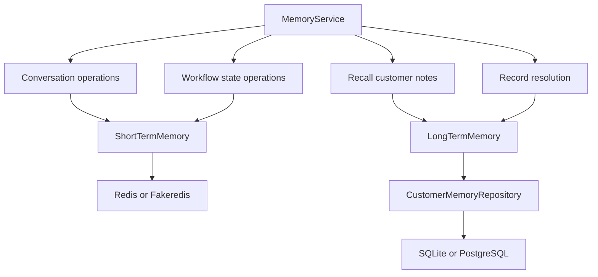

**Result:** P8-3 gives future graph code one composition service instead of
separate Redis, repository, and scrubbing calls.

## End-of-Phase 8 design

The final Phase 8 design has two memory lifetimes and one coordination
service.

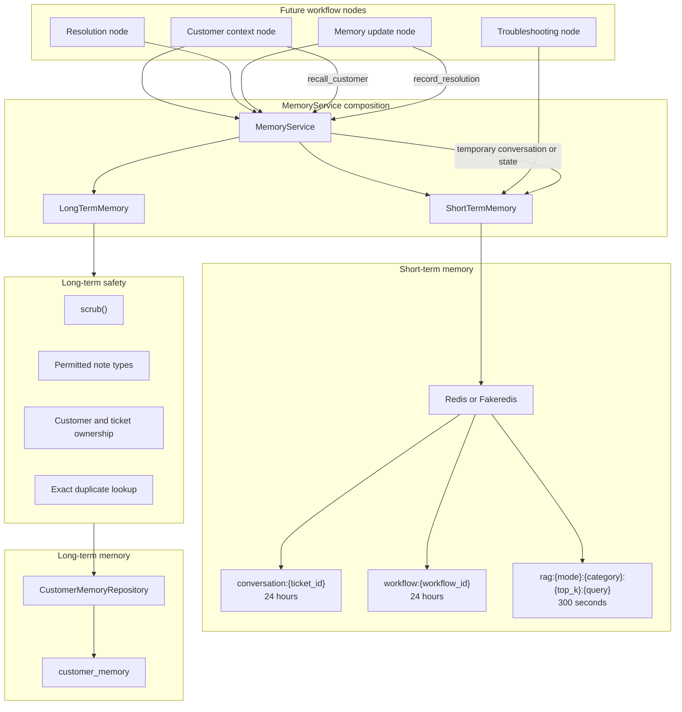

The final memory update flow is:

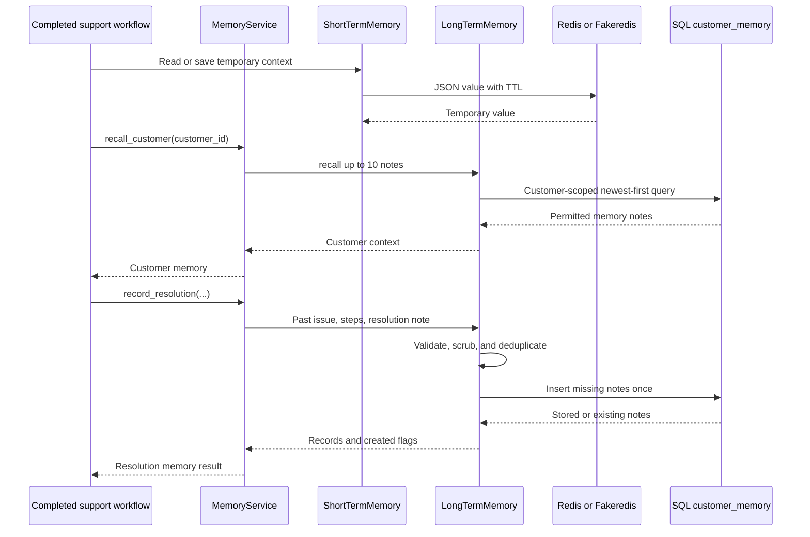

## Memory separation by purpose

| Design concern | Short-term component | Long-term component |
|---|---|---|
| Storage | Redis/fakeredis | SQLAlchemy/customer_memory |
| Lifetime | 24 hours or 300 seconds | Permanent until removed |
| Typical data | Active conversation, workflow state, cache | Past issue, preference, steps, resolution |
| Customer isolation | Keyed by ticket/workflow, not customer data | Customer ID and source ticket ownership |
| Secret safety | No dedicated scrub in P8-1 | P7 scrub reused before write |
| Duplication | Cache or message list behavior | Exact duplicate lookup |
| Recall size | Defined by temporary key contents | Maximum 10 |

The design does not store raw conversation content in the customer-memory
table. It stores only small resolution summaries and permitted facts.

## Data-safety boundaries

The long-term record path has several gates:

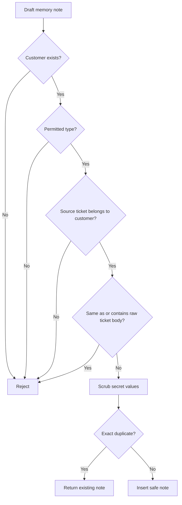

This boundary is important because P8 is not only a storage feature. It is a
privacy and data-quality feature.

## Component boundaries

| Component | Owns | Does not own |
|---|---|---|
| `ShortTermMemory` | Redis keys, JSON values, and TTLs | Long-term SQL memory |
| `LongTermMemory` | Permitted types, recall, scrubbing, ticket ownership, duplicates | Redis state |
| `CustomerMemoryRepository` | SQL customer-memory reads and exact lookup | Ticket-body or secret policy |
| `MemoryService` | Coordination and resolution recording | LangGraph node routing |
| `scrub()` | Secret redaction | Customer ownership or note types |
| Redis/fakeredis | Temporary value storage | Durable customer facts |

These boundaries keep temporary state separate from durable facts and keep
policy out of direct SQL repository calls.

## Evolution of the design

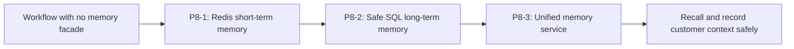

The design becomes safer and easier to use at every step:

1. P8-1 removes temporary Redis key duplication.
2. P8-2 restricts and de-duplicates durable records.
3. P8-3 gives future workflow nodes one recall/record interface.

## Validation and honest status

Phase 8 implementation includes:

- Redis/fakeredis short-term memory;
- conversation and workflow TTL keys;
- retrieval cache TTL and normalized key format;
- permitted long-term memory types;
- recall limit of 10;
- source-ticket ownership checks;
- secret scrubbing;
- exact duplicate prevention;
- unified recall and record service;
- resolution transaction rollback.

The local offline suite passed 182 tests, and Ruff passed for the memory
implementation and tests.

The implementation was validated with:

- Fakeredis;
- in-memory SQLite;
- in-memory async sessions.

No live Redis server, PostgreSQL database, Docker container, or cloud
credential was used.

P8-3 is complete, but future LangGraph memory nodes are not implemented yet.
The facades are ready for those nodes to call.

## Component reference

| Responsibility | Implementation |
|---|---|
| Redis protocol and factory | [core/redis.py](../../backend/app/core/redis.py) |
| Short-term memory facade | [short_term.py](../../memory/short_term.py) |
| Long-term memory facade | [long_term.py](../../memory/long_term.py) |
| Recall and record service | [memory_service.py](../../memory/memory_service.py) |
| Memory repository exact lookup | [customers.py](../../backend/app/repositories/customers.py) |
| Secret scrubbing | [guardrails.py](../../backend/app/core/guardrails.py) |
| Short-term tests | [test_short_term_memory.py](../../tests/unit/test_short_term_memory.py) |
| Long-term tests | [test_long_term_memory.py](../../tests/unit/test_long_term_memory.py) |
| Memory service tests | [test_memory_service.py](../../tests/unit/test_memory_service.py) |
| Phase task status | [TASK.md](../../TASK.md) |
| Phase exit criteria | [PLAN_PHASE.md](../../PLAN_PHASE.md) |
| Plain-language Phase 8 explanation | [phase8_explained.md](../explain_codebase/phase8_explained.md) |
