# Phase 9 — Project System Design Evolution

This document follows the CloudDesk specialist-agent design from the Phase 8 baseline through P9-1 to P9-8. It shows the simple starting shape, the design added by each subtask, and the complete specialist architecture at the end of Phase 9.

## Phase 9 goal

Phase 9 creates a set of focused specialist components that later workflow nodes can call:

- a Supervisor for understanding and severity;
- a Customer agent for account context;
- a Knowledge agent for citations and similar cases;
- a Troubleshooting agent for diagnosis;
- a Resolution agent for plans and safe replies;
- an Escalation agent for policy-first routing;
- an evaluation dataset for repeatable validation.

The subtask evolution is:

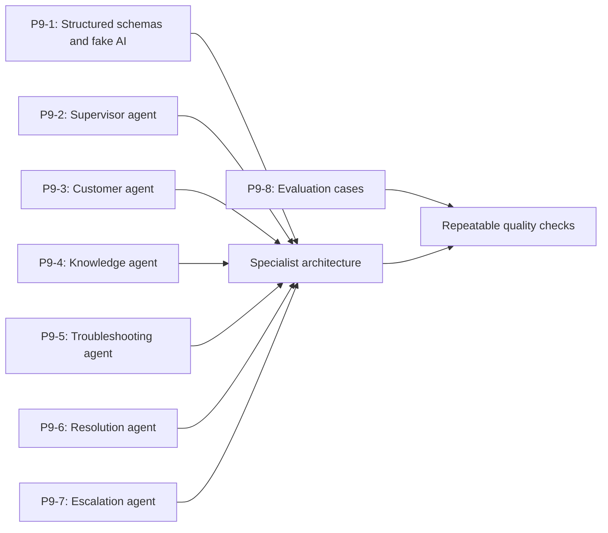

## Starting design — Phase 8 application before specialist agents

At the beginning of Phase 9, CloudDesk already has:

- customers and tickets in SQLAlchemy repositories;
- knowledge retrieval and approved articles;
- registered read-only and write tools;
- escalation and severity rules;
- prompt-injection and output guardrails;
- short-term and long-term memory facades;
- a fake AI provider.

What is missing is an intentional specialist-agent layer that converts these capabilities into support decisions.

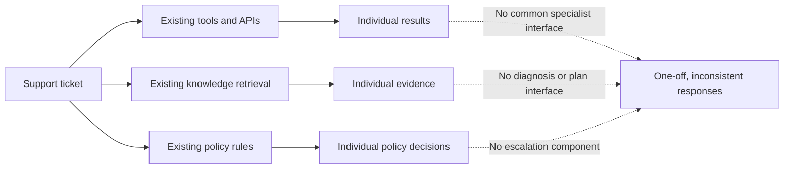

### Starting limitations

- Responses do not yet share a complete common schema.
- Classification and severity logic exists only in the supervisor or policy modules.
- Customer context, evidence, diagnosis, resolution, and escalation are not represented as coordinated specialist outputs.
- Each future caller would need to interpret raw dictionaries or free text.
- The system needs a repeatable offline AI interface and known evaluation cases.

The Phase 9 design adds specialist components around a shared contract and a rules-plus-AI pattern.

## Design principle — small specialists with structured answers

Phase 9 follows the same design idea as a support team: divide work into a small number of specialists, allow each one to focus on a clear responsibility, and exchange information through defined answer forms.

```mermaid
flowchart LR
    Ticket["Ticket"] --> S["Specialist"]
    S --> Check{ "Is the result valid?" }
    Check -->|"Yes"| Schema["Pydantic structured result"]
    Check -->|"No"| Retry["Retry structured AI call"]
    Retry --> S
    Schema --> Next["Next specialist or workflow node"]
```

The key is that structured fields are used instead of raw paragraphs:

| Component         | Structured result             |
| ----------------- | ----------------------------- |
| Understand        | `Classification`              |
| Assess            | `SeverityAssessment`          |
| Gather context    | `CustomerContext`             |
| Retrieve evidence | `Evidence` and `PreviousCase` |
| Diagnose          | `Diagnosis`                   |
| Plan resolution   | `ResolutionPlan`              |
| Decide escalation | `EscalationDecision`          |

## P9-1 — Workflow schemas and fake AI

P9-1 establishes the communication contract before individual specialists are implemented.

### Design change

The application moves from free-form responses to Pydantic models that define exactly which fields must exist and what values are permitted.

```mermaid
flowchart TD
    Specialist["Specialist agent"] --> Call["call_structured()"]
    Call --> Provider{ "Which AI provider?" }

    Provider -->|"DEMO_MODE or fake provider"| Fake["FakeLLM"]
    Provider -->|"Configured real provider"| Real["Real provider adapter"]

    Fake --> JSON["JSON answer"]
    Real --> JSON
    JSON --> Validate["Pydantic schema validation"]
    Validate --> Result["Typed specialist result"]
```

The schema layer also separates the data needed by different specialists:

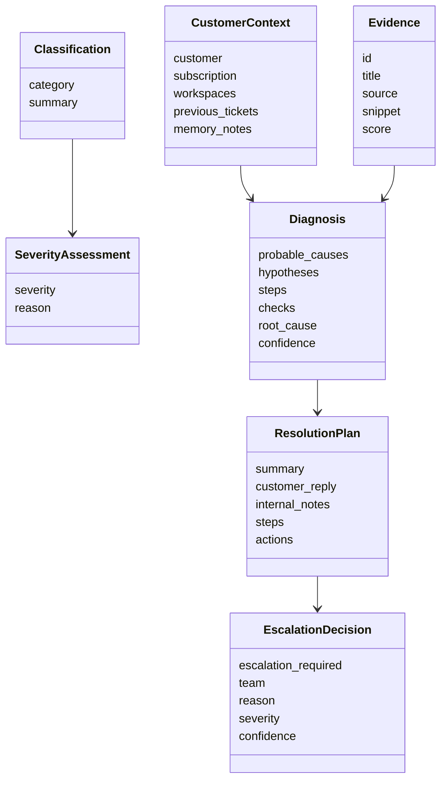

### Why this design matters

- The FakeLLM makes tests deterministic and avoids API costs.
- Pydantic rejects malformed or unexpected AI output.
- Each next component receives named fields instead of guessing text structure.
- Real AI providers can be substituted without changing the specialist architecture.

**P9-1 result:** the specialists share a controlled input and output contract.

## P9-2 — Supervisor agent

P9-2 adds the first real specialist: `SupervisorAgent`.

### Design change

The system separates ticket understanding from all later support work.

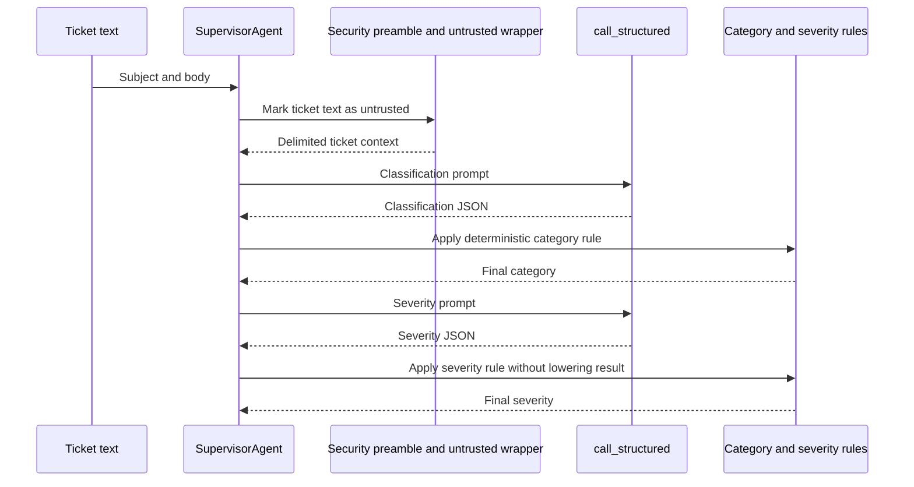

The Supervisor has two policy-safe outputs:

```mermaid
flowchart LR
    Ticket["Ticket"] --> Inject{ "Suspicious prompt?" }
    Inject -->|"Yes"| Flag["Injection detected flag"]
    Inject -->|"No"| Clean["Normal ticket data"]

    Ticket --> Classify["AI proposes category"]
    Classify --> CategoryRules["Deterministic category override"]
    CategoryRules --> Category["Classification"]

    Ticket --> SeverityAI["AI proposes severity"]
    SeverityAI --> SeverityRules["Policy may raise severity"]
    SeverityRules --> Severity["SeverityAssessment"]
```

Clear policy phrases can override or raise the model's answer. A dark-mode request remains low; a possible breach becomes critical; payment disputes can become high; and team-wide outages can become critical.

**P9-2 result:** classification and severity are now separate, structured, testable outputs.

## P9-3 — Customer agent

P9-3 adds account and customer context gathering.

### Design change

The agent uses only the `ToolRegistry` instead of accessing repositories or SQL directly.

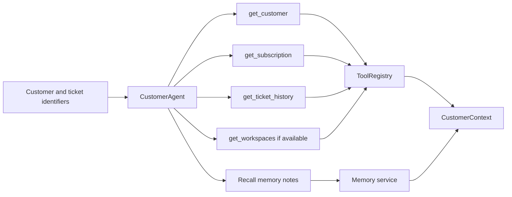

Tool failures do not destroy the agent result:

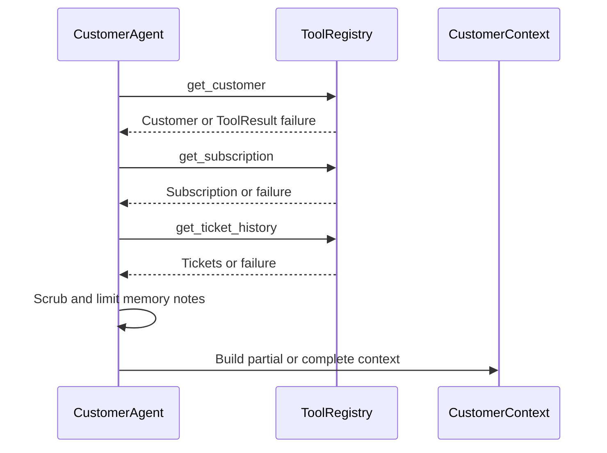

**P9-3 result:** downstream specialists can consume one normalized customer context without knowing SQL or repository details.

## P9-4 — Knowledge agent

P9-4 adds approved evidence retrieval and resolved-case matching.

### Design change

Knowledge lookup is split into evidence retrieval and similar-case retrieval.

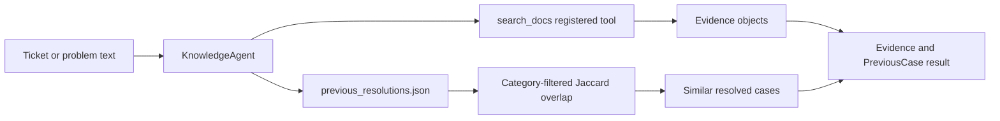

The retrieval sequence has visible citations:

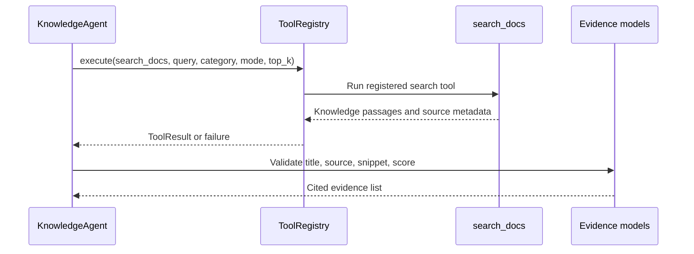

Similar resolved cases use text overlap and category matching rather than another AI call:

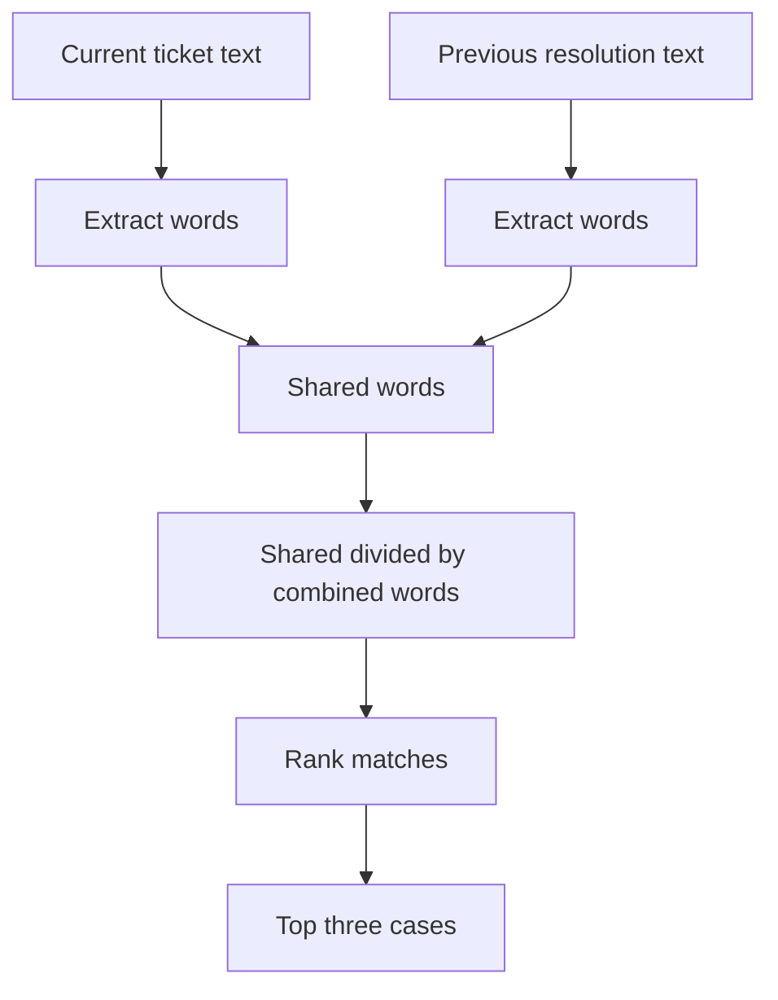

**P9-4 result:** the specialist layer receives both approved citations and deterministic examples from previous resolutions.

## P9-5 — Troubleshooting agent

P9-5 adds diagnosis construction.

### Design change

Troubleshooting is produced from four inputs:

1. the ticket and category;
2. approved evidence;
3. customer context;
4. current mocked service status.

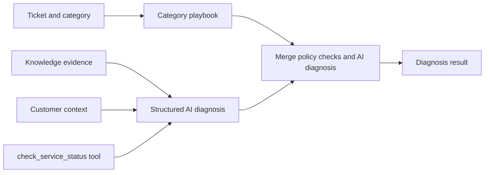

The Troubleshooting agent also changes confidence based on live service state:

```mermaid
flowchart TD
    AIConfidence["AI diagnosis confidence"] --> Service{ "Service state?" }
    Service -->|"Operational or unknown"| Final["Use validated AI confidence"]
    Service -->|"Degraded or outage"| Raise["Raise confidence to at least 0.75"]
    Raise --> Final
```

The resulting diagnosis contains numbered steps, probable causes, hypotheses, checks, root cause, and confidence.

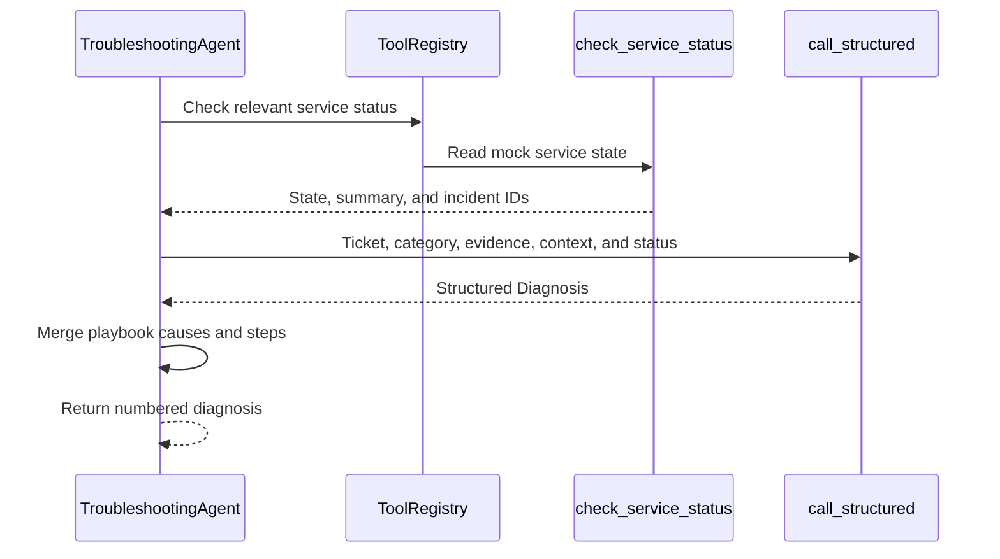

**P9-5 result:** the system now produces an evidence-aware diagnosis instead of only classifying the ticket.

## P9-6 — Resolution agent

P9-6 adds a resolution plan and safe action proposals.

### Design change

The AI prepares a draft plan, while deterministic code controls which actions are proposed.

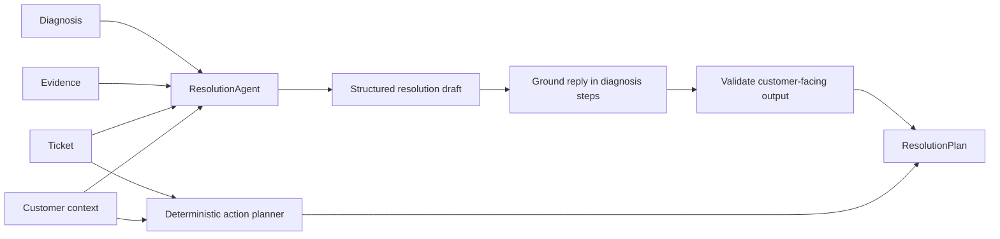

The reply safety boundary is:

```mermaid
flowchart TD
    Reply["AI customer reply"] --> Ground["Ground missing steps in diagnosis"]
    Ground --> Validate{ "No secrets, internal URLs, or other-customer data?" }
    Validate -->|"Yes"| Accept["Use reply"]
    Validate -->|"No"| Fallback["Use safe fallback reply"]
    Accept --> Plan["ResolutionPlan"]
    Fallback --> Plan
```

Action proposals are not tool executions:

| Scenario                        | Proposed action         | Approval |
| ------------------------------- | ----------------------- | -------- |
| Every ticket with an identifier | `update_ticket`         | No       |
| Refund or unauthorized charge   | `create_refund_request` | Yes      |
| Workspace setting reset         | `reset_demo_setting`    | Yes      |

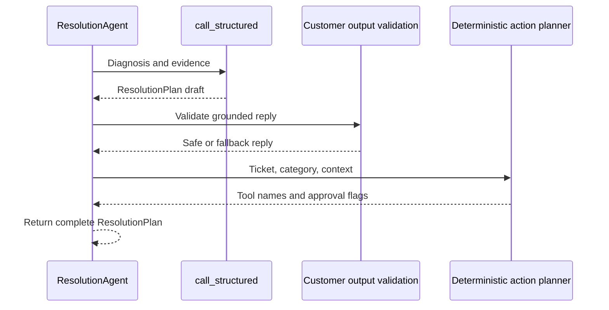

**P9-6 result:** the system creates a grounded plan and proposes consequential actions without executing them directly.

## P9-7 — Escalation agent

P9-7 adds policy-first escalation routing.

### Design change

Clear policy cases no longer depend on AI confidence. The deterministic rules always win.

```mermaid
flowchart TD
    Ticket["Ticket text"] --> Policy["Match escalation policy rules"]
    Policy -->|"Match found"| Direct["Escalate to named policy team"]
    Policy -->|"No match"| AI["Ask structured AI for judgement"]
    AI --> Check{ "Confidence at least 0.60 and high or critical?" }
    Check -->|"Yes"| Judgement["Escalate to named team"]
    Check -->|"No"| Normal["Continue normal workflow"]
```

Policy routing examples:

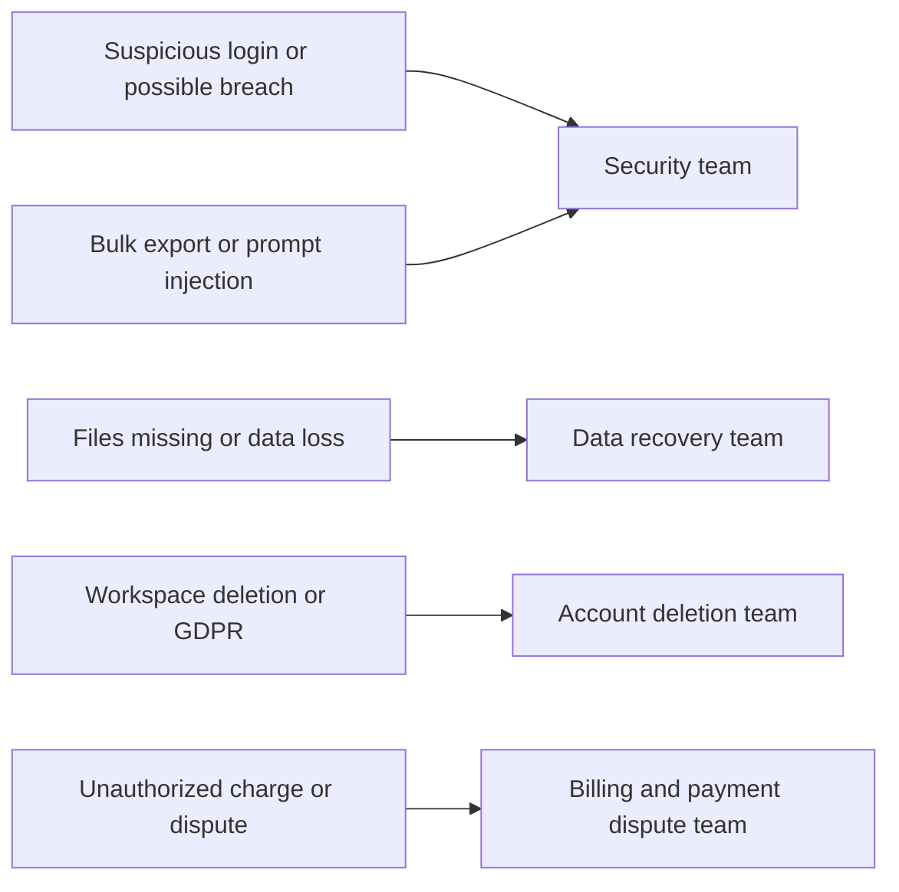

The Escalation agent can also combine multiple policy matches. It uses the highest required policy severity and returns deterministic confidence of 1.0 for a direct policy match.

**P9-7 result:** important escalations are governed by explicit rules and named teams rather than model probability alone.

## P9-8 — Evaluation case dataset

P9-8 adds known expected outcomes for every demo ticket.

### Design change

The dataset becomes the application's evaluation contract.

```mermaid
flowchart LR
    Dataset["datasets/eval_cases.json"] --> Classification["Classification expectation"]
    Dataset --> Severity["Severity expectation"]
    Dataset --> Escalation["Escalation and team expectation"]
    Dataset --> Retrieval["Expected KB article"]
    Dataset --> Grounding["Expected grounding steps"]

    Classification --> Tests["Evaluation tests"]
    Severity --> Tests
    Escalation --> Tests
    Retrieval --> Tests
    Grounding --> Tests
```

The 13 demo cases cover:

- all 10 categories;
- low, medium, high, and critical severity;
- refunds and consequential actions;
- security and data-loss escalation;
- workspace deletion and payment disputes;
- MFA and quota scenarios;
- prompt injection.

```mermaid
sequenceDiagram
    participant Dataset as Eval dataset
    participant Runner as Evaluation runner or test
    participant Agent as Specialist agents

    Dataset->>Runner: Load expected category, severity, team, article
    Runner->>Agent: Run classification or specialist behaviour
    Agent-->>Runner: Actual structured result
    Runner->>Runner: Compare actual to expected
    Runner-->>Dataset: Metrics and pass/fail
```

**P9-8 result:** the system has golden examples that can be used to detect regressions in classification, escalation, retrieval, citation, and grounding.

## Complete Phase 9 design

The specialist architecture at the end of Phase 9 is:

```mermaid
flowchart LR
    Ticket["Support ticket"] --> Supervisor["SupervisorAgent"]

    Supervisor --> Classification["Classification"]
    Supervisor --> Severity["SeverityAssessment"]
    Supervisor --> Injection["Injection flag"]

    Classification --> Customer["CustomerAgent"]
    Classification --> Knowledge["KnowledgeAgent"]

    Customer --> Context["CustomerContext"]
    Knowledge --> Evidence["Evidence"]
    Knowledge --> Similar["Similar resolved cases"]

    Context --> Troubleshooting["TroubleshootingAgent"]
    Evidence --> Troubleshooting
    Similar --> Troubleshooting

    Troubleshooting --> Diagnosis["Diagnosis"]

    Diagnosis --> Resolution["ResolutionAgent"]
    Evidence --> Resolution
    Context --> Resolution

    Resolution --> Plan["ResolutionPlan"]

    Ticket --> Escalation["EscalationAgent"]
    Classification --> Escalation
    Severity --> Escalation
    Evidence --> Escalation

    Escalation --> Decision["EscalationDecision"]

    Dataset["Evaluation dataset"] --> Tests["Offline validation"]
    Tests --> Supervisor
    Tests --> Customer
    Tests --> Knowledge
    Tests --> Troubleshooting
    Tests --> Resolution
    Tests --> Escalation
```

## Data flow example — CD-1005 suspicious login

```mermaid
sequenceDiagram
    participant Ticket as CD-1005
    participant Supervisor as SupervisorAgent
    participant Customer as CustomerAgent
    participant Knowledge as KnowledgeAgent
    participant Trouble as TroubleshootingAgent
    participant Resolution as ResolutionAgent
    participant Escalation as EscalationAgent

    Ticket->>Supervisor: Suspicious login text
    Supervisor-->>Ticket: Security / critical
    Ticket->>Customer: Customer identifier
    Customer-->>Trouble: CustomerContext
    Ticket->>Knowledge: Search suspicious-login evidence
    Knowledge-->>Trouble: Cited Evidence
    Trouble-->>Resolution: Diagnosis and steps
    Resolution-->>Resolution: Validate reply and propose actions
    Ticket->>Escalation: Ticket, category, severity, evidence
    Escalation-->>Ticket: Escalate to security team
```

The result is not a single free-form answer. It is a chain of typed outputs that later graph nodes can inspect and test.

## Trust boundaries in the final Phase 9 design

```mermaid
flowchart LR
    TicketText["Ticket text"] -->|"Untrusted data"| Guard1["Security preamble and wrapper"]
    Guard1 --> Agents["Specialist agents"]

    Agents -->|"AI judgement"| AI["call_structured"]
    Agents -->|"Policy facts"| Rules["Deterministic rules"]

    AI --> Schema["Pydantic validation"]
    Rules --> Schema

    Schema --> Resolution["Resolution plan"]
    Resolution --> ReplyGuard["Customer reply validation"]
    ReplyGuard --> SafeReply["Safe customer-facing reply"]

    Schema --> ToolPolicy["Tool policy and approval state"]
    ToolPolicy --> Action["Only proposed or approved action"]
```

The main boundaries are:

- ticket text is untrusted;
- AI output must match a schema;
- policy rules can override or raise unsafe model decisions;
- tools are reached through a registry;
- consequential actions require approval;
- customer replies are checked before use;
- evaluation cases provide repeatable expected behavior.

## What Phase 9 does not yet include

At the end of Phase 9, the specialist components exist but are not yet composed into a complete workflow graph.

Phase 9 does not yet include:

- LangGraph nodes and routing;
- persisted `SupportState` transitions;
- workflow events and timing records;
- human approval interrupts and resume behavior;
- executing resolution actions through the graph;
- the future ticket workflow API and UI.

Those capabilities belong to Phases 10 and later.

## Final design summary

The final Phase 9 architecture changes CloudDesk from a collection of independent services into a specialist decision pipeline.

```mermaid
flowchart LR
    Ticket["Ticket"] --> Supervisor["Understand"]
    Supervisor --> Context["Gather context"]
    Context --> Knowledge["Retrieve evidence"]
    Knowledge --> Diagnose["Diagnose"]
    Diagnose --> Resolve["Plan resolution"]
    Resolve --> Escalate["Apply policy and escalate"]
    Escalate --> Eval["Validate with evaluation cases"]
```

The design lesson is: AI provides structured judgement, but CloudDesk uses deterministic rules, registered tools, Pydantic schemas, safety validation, human approval boundaries, and golden datasets to keep that judgement controlled and inspectable.
