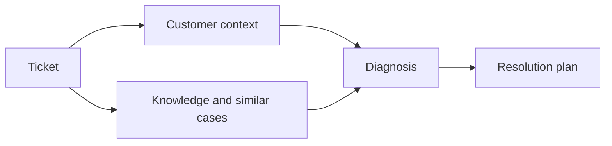
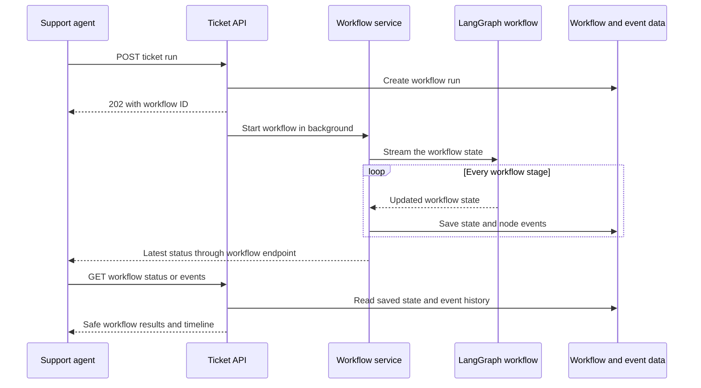

# Phase 10 — CloudDesk Workflow Graph and Trace

## A plain-language presentation

> **Use this as a speaking script.** It explains Phase 10 for an audience that may not have a software background.

Before Phase 10, CloudDesk had many useful specialist components. It had a supervisor, customer lookup, knowledge search, troubleshooting, resolution planning, and escalation workers. However, those components were not yet fully arranged into one repeatable customer-support journey.

Phase 10 joins those components together.

A useful comparison is a customer-support department operating a digital assembly line:

```text
A ticket enters
  → the supervisor reads it
  → the customer context is gathered
  → approved knowledge is searched
  → likely causes are prepared
  → a resolution is planned
  → the situation is checked for risk
  → the ticket is escalated, paused, or completed
  → a summary and trace are saved
```

The central idea is simple: one ticket follows a clearly defined route, and every stop can be seen by a support operator.

The short version is:

```text
Create workflow run
  → Run the graph in the background
  → Save progress after each step
  → Route low-risk, approval, or escalation cases differently
  → Record what happened
  → Let the console display workflow status and events
```

Phase 10 gives the platform its complete workflow shape and inspection system. It does not finish every later approval or account action. Those are completed in later phases.

---

## The problem Phase 10 solves

Without a workflow graph, the specialist components could be used only separately. Someone would have to decide the order in which to call them, whether a result was saved, what to do if the process stopped, and how to show progress to a support agent.

Phase 10 solves those questions with four building blocks:

1. **Shared state** — the ticket and every result travel together through the process.
2. **A graph** — the system follows a known path rather than choosing steps freely.
3. **A workflow run and API** — an agent can start a run and a console can read its progress.
4. **Tracing** — every completed stage and LLM usage record is saved for inspection.

This makes the workflow orderly, repeatable, and understandable.

---

## P10-1 — Shared workflow state and checkpointer

A support workflow needs to remember more than the original ticket. It gradually learns:

- the ticket classification;
- the severity;
- whether prompt-injection text was detected;
- customer information;
- knowledge evidence;
- previous similar cases;
- probable causes;
- the proposed resolution;
- the risk level;
- whether approval is required;
- completed node names;
- errors;
- AI token usage.

Phase 10 stores these values in `SupportState`.

Think of `SupportState` as a case file that travels with the ticket. Each specialist reads the information it needs and adds the next set of findings.

Two special rules keep this case file reliable:

- completed step names are appended rather than overwritten;
- workflow errors are appended rather than overwritten;
- token usage is added together rather than replaced.

This is important because it lets the system show an accurate activity history instead of losing earlier progress.

The checkpointer is the workflow's memory for a running process. It saves the state as the graph advances. It is especially useful for later pauses and approvals because the system can return to the exact stopped workflow.

The current demo mode uses in-memory checkpoints when no database checkpoint is needed. A file-backed SQLite checkpoint can preserve workflow state across a process restart.

---

## P10-2 — Supervisor graph nodes

The first graph stages come from the Supervisor:

```text
understand_ticket
  → classify_severity
  → ticket_summary
```

### Understand the ticket

The `understand_ticket` step:

- reads the ticket;
- identifies the category;
- creates a short classification summary;
- checks whether the ticket text appears to contain prompt-injection instructions.

### Assess severity

The `classify_severity` step:

- assesses low, medium, high, or critical severity;
- gives a reason;
- applies deterministic rules that may raise the severity;
- combines the injection result from earlier work.

The rules never lower severity. For example, a clear security or data-loss situation must stay serious even if the AI is uncertain.

### Prepare a ticket summary

Later in the pipeline, the `ticket_summary` step creates a concise internal summary from the classification and severity.

Each node returns only partial state. It does not replace the whole workflow case file. It adds its findings and marks its own step as complete.

---

## P10-3 — Investigation graph nodes

The investigation stages collect context and perform diagnosis:

```text
customer_context
  → knowledge_retrieval
  → troubleshooting
```

### Load customer context

`customer_context` gathers:

- the customer record;
- subscriptions;
- workspaces;
- previous tickets;
- safe memory notes.

If the customer ID is missing or a tool fails, this step returns a partial result and an error instead of crashing the entire graph.

### Retrieve knowledge and similar cases

`knowledge_retrieval` searches approved support articles and previously resolved tickets.

It produces:

- cited evidence;
- article source references;
- relevance scores;
- similar resolved cases.

### Troubleshoot

`troubleshooting` combines the ticket, category, customer context, evidence, and service status to prepare:

- probable causes;
- numbered support steps;
- service checks;
- a likely root cause;
- a confidence value.

These investigation steps help keep the later resolution grounded in evidence instead of making the AI guess without information.



---

## P10-4 — Resolution and risk nodes

The next stages are:

```text
resolution_planning
  → risk_check
```

### Create a resolution plan

`resolution_planning` uses the `ResolutionAgent` to prepare:

- a short resolution summary;
- a safe customer-facing reply;
- internal notes;
- recommended troubleshooting steps;
- proposed actions.

Some actions are ordinary and informational. Others are consequential.

For example:

| Proposed action           | Approval needed? |
| ------------------------- | ---------------- |
| Update ticket progress    | No               |
| Create a refund request   | Yes              |
| Reset a workspace setting | Yes              |

The resolution agent uses deterministic action planning. It does not ask the AI to invent a random tool or approval requirement.

### Check risk

`risk_check` applies the final workflow routing conditions.

The risk level becomes **high** when at least one of these is true:

- an action needs human approval;
- a deterministic policy rule matches;
- severity is critical;
- prompt-injection text was detected;
- customer-facing output validation failed.

High severity without approval is **medium** under the implemented routing rules, while ordinary tickets remain low risk.

Policy rules are always outside the model. This is the point where dangerous or regulated cases receive the strongest routing.

---

## P10-5 — Graph wiring and run API

P10-5 connects all stages into one LangGraph workflow.

The complete graph shape is:

```text
understand_ticket
  → classify_severity
  → customer_context
  → knowledge_retrieval
  → troubleshooting
  → resolution_planning
  → risk_check
      ├─ policy escalation
      ├─ approval required
      └─ low-risk execution
  → ticket_summary
  → memory_update
  → end
```

The routing decision is intentional:

- deterministic policy escalation goes to the escalation stage;
- a consequential action goes to the approval stage;
- an ordinary low-risk ticket goes directly to the execution stage.

The graph is then backed by workflow services and APIs.

### Start a workflow

An authenticated support agent can call:

```text
POST /api/v1/tickets/{ticket_id}/run
```

The service:

1. confirms the ticket exists;
2. rejects a second run while a workflow is paused for approval;
3. creates a workflow record;
4. sets the ticket to in progress;
5. returns a workflow ID with HTTP 202 Accepted;
6. starts the graph in a background task.

The API returns quickly. It does not make the support agent wait until every node finishes.

### Read workflow status

A viewer, agent, or administrator can call:

```text
GET /api/v1/tickets/{ticket_id}/workflow
```

The response includes:

- workflow ID;
- status;
- ticket ID;
- thread ID;
- safe workflow state;
- completed nodes;
- decisions;
- evidence;
- errors;
- usage data.

Runtime objects such as the AI provider, tool registry, and memory service are kept outside the saved workflow state. This keeps database and checkpointer records serializable and prevents sensitive runtime dependencies from leaking into JSON storage.

In Phase 10, the `human_approval`, `execute_resolution`, and `memory_update` graph nodes are placeholders or partial wiring. Full approval, shared action execution, and memory recording are completed in later phases.

---

## P10-6 — Workflow tracer and events API

Phase 10 also makes the workflow inspectable.

The `WorkflowTracer` writes records to the `workflow_events` table. It does not allow telemetry problems to stop the support workflow.

Supported event types include:

- `node_started` — a graph stage began;
- `node_completed` — a graph stage completed;
- `tool_called` — a workflow node indicates a support tool was involved;
- `llm_called` — an AI call was made and usage is available;
- `error` — a stage recorded an error;
- `workflow_completed` — the workflow finished;
- future approval events can be added for later phases.

The event records contain:

- ticket ID;
- workflow ID;
- event type;
- node name;
- safe payload;
- duration;
- token usage;
- timestamp.

### How it stays safe

The tracer excludes prompt, message, raw, and secret fields. It converts Pydantic models and enums into JSON-safe values and masks the structure from runtime objects.

Raw AI prompts and hidden reasoning are not stored or exposed by the events API.

In the current P10 implementation, tool events are represented from the workflow stream and node context. The full one-to-one registry call/result trace is part of the more complete tool observability that should be verified and extended during integration work.

### Read workflow events

A viewer or higher role can call:

```text
GET /api/v1/tickets/{ticket_id}/events
```

The API returns event items in chronological database order.

An event example in simple terms is:

```json
{
  "event_type": "node_completed",
  "node_name": "troubleshooting",
  "duration_ms": 0,
  "payload": {}
}
```

A real interface can turn this into a timeline:

```text
Understood ticket
  → Classified severity
  → Loaded customer context
  → Retrieved evidence
  → Prepared diagnosis
  → Planned resolution
  → Checked risk
```

This is the audit trail for the support workflow.

---

## How the Phase 10 pieces work together



The ticket may finish at once or it may stop for a future approval stage. In both cases, the workflow run and event history preserve the path taken.

---

## What Phase 10 does not yet do

Phase 10 establishes the graph and tracing, but it does not finish the full human-action lifecycle:

- there is no final P11 approval interrupt implementation yet;
- approval decisions do not yet resume the graph through the P11 routes;
- `execute_resolution` is not yet executing the shared tool path;
- `memory_update` is not yet writing the final customer-memory summary;
- the graph does not yet execute consequential actions without later approval controls;
- live LLM, live database, live Redis, and live Qdrant are not required for the offline demo.

Those requirements belong to later approval, escalation, memory, and delivery phases.

---

## Current validation

The Phase 10 implementation has offline tests covering:

- state reducers;
- graph shape and routing;
- investigation and resolution nodes;
- 202 workflow run behavior;
- workflow status retrieval;
- safe event persistence;
- events API ordering and viewer access;
- file-backed and in-memory checkpointer behavior.

No real cloud account, live AI provider, real refund, real email, or real customer action is required for these checks.

The Phase 10 checkpoint is considered complete when the graph shape, run API, state persistence, routing, and event timeline are available for the next approval and escalation stage.

---

## Short answers for likely questions

**What is LangGraph in this phase?**

It is the digital workflow coordinator. It stores the case state and decides which named stage should run next.

**What happens if a workflow has an error?**

The state records an error and completed steps. Telemetry must not stop the workflow; it is treated as a side record, not the main support decision.

**Can someone stop the ticket in the middle?**

The checkpointer is designed to preserve progress and support paused/resumed workflows. The final human-interrupt behavior is completed in Phase 11.

**Why save both workflow state and events?**

Workflow state answers “What is the current case situation?” Events answer “What happened, in what order, and how long did it take?”

**Can users see AI prompts or hidden reasoning?**

No. The API exposes decisions, safe evidence, node activity, usage, durations, and errors. It does not expose raw prompts or hidden chain-of-thought.

**Can an approval-required action run automatically?**

Not in the completed model. Approval-required routing is a safety boundary. The later P11 implementation records approval and only then resumes the execution path.

**Is this one complete support product yet?**

No. Phase 10 is the orchestration and observability layer. It makes the specialist parts work as a graph and prepares the platform for approval, memory, the agent console, and deployment phases.
