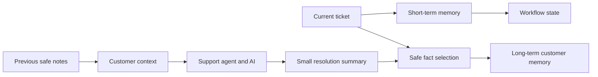
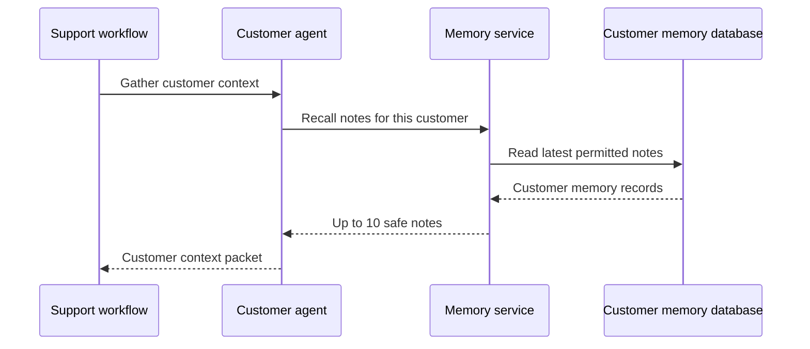
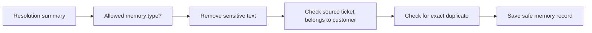

# Phase 11 — CloudDesk Memory

## A plain-language presentation

> **Use this as a speaking script.** It explains Phase 11 for an audience that may not have a software background.

Phases 1 through 10 gave CloudDesk an application foundation, stored customer records, safe access rules, a knowledge system, approved tools, and an automated support workflow.

Phase 11 gives the platform memory.

The important difference is:

- **Short-term memory** remembers what is happening now.
- **Long-term memory** remembers useful information for future support conversations.

A useful comparison is a support agent’s desk:

- the desk pad contains notes for the conversation happening today;
- the customer file contains useful history that can be used in later conversations.

The desk pad should eventually be cleared. The customer file should contain only safe and genuinely useful facts.

The short version is:

```text
Customer starts a conversation
  → CloudDesk recalls up to 10 safe notes about that customer
  → The support workflow uses those notes as context
  → Temporary conversation and workflow state are kept briefly
  → After completion, CloudDesk saves only a small permitted summary
  → Sensitive text is removed
  → Repeated notes are not saved again
```

Phase 11 makes the platform helpful over time without allowing it to keep everything forever or storing private data unnecessarily.

---

## The problem Phase 11 solves

Imagine that the same customer contacts support three times.

Without memory:

- the agent starts again from zero;
- previous troubleshooting steps may be repeated;
- the system cannot recognize an earlier issue;
- resolved information is easy to lose.

That wastes time and creates a poor customer experience.

Without strict rules, however, memory becomes dangerous.

A support system could accidentally store:

- a password;
- an API key;
- a card number;
- the full original ticket;
- information that belongs to another customer.

Phase 11 solves both problems:

1. it remembers useful, customer-related support information;
2. it protects that information through limits, permission checks, and secret removal.



---

## The main idea: two kinds of memory

CloudDesk has two clearly separate memory systems.

| Kind of memory    | Purpose                                               | How long it lasts                   | Example                                             |
| ----------------- | ----------------------------------------------------- | ----------------------------------- | --------------------------------------------------- |
| Short-term memory | Holds temporary conversation and workflow information | 24 hours                            | “The customer is waiting on MFA approval.”          |
| Retrieval cache   | Avoids repeating the same knowledge search            | 5 minutes                           | “This billing question was just searched.”          |
| Long-term memory  | Holds useful customer support history                 | Permanent, until removed or changed | “The customer previously needed MFA session reset.” |

This separation is important.

A temporary workflow should not become a permanent customer record. A permanent customer record should contain a useful summary, not a copy of the entire conversation.

---

## P11-1 — Short-term memory

Short-term memory is implemented using Redis in normal operation or an in-memory Redis replacement in demo and test mode.

It stores three kinds of temporary information:

1. **Conversation messages** for a ticket;
2. **Workflow state** for a workflow run;
3. **Recent knowledge-search results** for faster retrieval.

### Conversation memory

A ticket conversation can be stored temporarily under a key related to the ticket.

Example key:

```text
conversation:<ticket-id>
```

The information expires after 24 hours.

This means CloudDesk can retain the recent conversation context while the ticket is active without keeping every old conversation indefinitely.

### Workflow memory

A workflow run can store its latest state under a key related to the workflow ID.

Example key:

```text
workflow:<workflow-id>
```

This stores temporary information such as:

- the current workflow step;
- classification and severity;
- gathered evidence;
- diagnosis;
- resolution plan;
- approval status.

Workflow state also expires after 24 hours.

This is separate from the database checkpointer, which protects a paused workflow so it can be resumed. Short-term memory is a fast working layer, while the database workflow record remains the durable workflow history.

### Knowledge retrieval cache

Repeated knowledge searches should not perform unnecessary work.

CloudDesk can cache a search result for 5 minutes using a key that describes:

- retrieval mode;
- category;
- maximum number of results;
- normalized search question.

An example key structure is:

```text
rag:hybrid:billing:5:<search question>
```

If the same search is repeated quickly, CloudDesk can return the recent result instead of repeating the whole retrieval process.

---

## P11-2 — Long-term customer memory

Long-term memory is stored in the `customer_memory` database table.

Every memory record belongs to one customer. It can also point to the ticket that created it.

A long-term record has:

- a customer ID;
- a memory type;
- summary text;
- an optional source ticket ID;
- created and updated dates.

The system allows only four memory types:

| Type              | Meaning                                         | Example                                             |
| ----------------- | ----------------------------------------------- | --------------------------------------------------- |
| `preference`      | A customer preference or communication choice   | “Prefers concise troubleshooting steps.”            |
| `past_issue`      | A useful previous problem summary               | “The customer previously had MFA login failure.”    |
| `troubleshooting` | A specific troubleshooting step that was useful | “Verify MFA enrollment.”                            |
| `note`            | A short resolution note                         | “Customer access was restored after session reset.” |

Only these types are accepted. Unknown or unrestricted memory categories are rejected.

This is an allow-list, similar to saying: “These are the only filing cabinet labels we permit.”

---

## P11-3 — Reading memory before support work

Before the customer context is considered complete, CloudDesk can recall up to 10 notes for the customer.

The process is:

```text
Find the customer
  → Check for permission to remember information
  → Read the latest allowed memory notes
  → Scrub any content that could contain secrets
  → Add safe notes to the customer context
  → Continue troubleshooting
```

The newest notes are retrieved first.

If no memory service is available or the recall operation fails, the workflow does not stop. It continues with the other available customer information.

That resilience is important: memory is helpful context, but it should not be allowed to break the support workflow.

For example, customer context can contain:

- basic customer details;
- subscription plan;
- workspaces;
- previous tickets;
- up to 10 safe memory notes.



---

## P11-4 — Writing memory after a completed workflow

After a workflow completes, CloudDesk should save only a small, useful resolution record.

It can store:

1. one **past issue** note;
2. up to the **first three troubleshooting steps**;
3. one **resolution** note.

It does not store the entire customer ticket.

For example:

```text
Past issue:
MFA login failure

Troubleshooting:
Verify MFA enrollment
Reset MFA session
Check identity provider status

Resolution:
Customer access was restored
```

The system can store all of these, but the final record is controlled:

- no more than three troubleshooting steps;
- only permitted memory types;
- no raw ticket body;
- no secrets or card numbers;
- no exact duplicate record.

The process follows three layers of protection:



---

## P11-5 — Safe scrubbing and privacy controls

Before memory text is saved or recalled, it passes through a scrubbing rule.

The scrubber removes or replaces common sensitive values such as:

- passwords;
- API keys;
- bearer tokens;
- JWT tokens;
- AWS access keys;
- private-key blocks;
- card numbers;
- credentials in URLs or query strings.

Sensitive values are replaced with a safe marker such as `[REDACTED]`.

The system also prevents an incorrect source-ticket relationship:

- the ticket must exist;
- the ticket must belong to the same customer;
- the text must not match or contain the raw ticket body.

These rules prevent two serious mistakes:

1. saving a secret as memory;
2. attaching one customer's ticket to another customer's memory.

This is an important interview point:

> CloudDesk does not assume that generated text is safe. It validates memory before writing and scrubs memory before recall.

---

## P11-6 — Removing duplicate memory

The system performs an exact duplicate check.

A duplicate means that the same customer has already received:

- the same memory type;
- the same cleaned content;
- the same source ticket.

If the record already exists, CloudDesk does not create a second copy. It returns the existing record and indicates that nothing new was created.

This keeps the customer memory file organized and prevents repeated workflow runs from filling the database with the same note.

Example:

```text
First completed MFA ticket:
  Save “Verify MFA enrollment.”

Second completed MFA ticket with the same note:
  Recognize that the same note already exists
  Do not create a duplicate
```

It is possible for two similar—but not exactly identical—notes to exist. That is acceptable because the current rule is deliberately exact matching rather than an uncertain AI-based “similar enough” decision.

---

## P11-7 — Coordinator service

`MemoryService` joins the short-term and long-term components behind one straightforward interface.

It exposes operations such as:

- recall customer memory;
- record a resolution;
- get or append a conversation;
- get or set workflow state;
- cache or retrieve knowledge search results.

This gives the rest of the application a simple memory interface instead of forcing each specialist to understand Redis, database repositories, and secret scrubbing separately.

```text
Customer agent or workflow
  → MemoryService
      → ShortTermMemory for temporary Redis data
      → LongTermMemory for safe database notes
      → Customer memory repository for database queries
```

The service also makes short-term and long-term memory independent. Temporary workflow data may disappear after 24 hours while useful customer notes remain.

---

## P11-8 — Graph memory status

The workflow graph has a final `memory_update` step in its visible path:

```text
ticket_summary
  → memory_update
  → workflow end
```

The graph shape is prepared so that memory can run after ticket summary and other completed work.

However, the repository currently still marks `memory_update` in `agents/graph.py` as a placeholder. The `MemoryService` and durable memory components exist and are tested, but a full database-backed graph write has not yet been fully connected in every workflow path.

This distinction matters:

- **Implemented:** short-term memory, long-term memory, memory coordination, recall, scrubbing, source-ticket validation, and duplicate prevention;
- **Not yet complete:** the end-to-end graph call that automatically records every finished run through `memory_update`.

A future Phase 12 or follow-on implementation should connect the graph node, pass a real `MemoryService` into the workflow, and verify that the last completed workflow creates the safe customer summary.

---

## P11-9 — Tests and behavior verification

The memory behavior is tested with the following offline scenarios:

| Behavior              | What the test proves                                              |
| --------------------- | ----------------------------------------------------------------- |
| Recall                | A customer's latest notes can be read with a limit of up to 10    |
| Resolution record     | Past issue, up to three steps, and one resolution note are stored |
| Secret scrubbing      | Passwords and API keys are removed from memory text               |
| Duplicate prevention  | Repeating the same resolution does not create duplicate records   |
| Raw ticket protection | The original ticket body cannot become a memory record            |
| Customer ownership    | A source ticket must belong to the same customer                  |
| Short-term storage    | Conversation and workflow state remain separate                   |
| Memory type limits    | Unsupported memory types are rejected                             |

These tests use SQLite and fakeredis, so they run fully offline without a real Redis server or cloud database.

The implementation should be described as **locally implemented and validated**, not as cloud-deployed memory.

---

## A simple end-to-end example

Imagine that Avery Morgan has an MFA login problem.

### 1. Temporary context begins

CloudDesk creates a workflow and may temporarily store:

- recent conversation messages;
- the workflow state;
- retrieval results;
- the current ticket step.

### 2. Customer context is recalled

CloudDesk reads Avery's previous safe notes. The system finds:

```text
“A previous MFA session reset restored access.”
```

### 3. Troubleshooting is completed

The support workflow identifies the likely cause and proposes:

```text
Verify MFA enrollment
Reset MFA session
Check identity-provider status
```

### 4. Resolution summary is selected

A safe summary is prepared:

```text
Past issue: MFA login failure
Resolution: Customer access restored
```

### 5. Memory protections run

CloudDesk:

- rejects unsupported memory types;
- scrubs passwords or API keys;
- confirms Avery owns the source ticket;
- rejects an exact duplicate;
- saves only the permitted summary.

### 6. Future context improves

On Avery's next support conversation, CloudDesk can recall the safe summary and avoid asking or repeating the same basic troubleshooting in an unnecessary way.

---

## What this phase added to the system

| Added component                      | Business value                                              |
| ------------------------------------ | ----------------------------------------------------------- |
| Short-term conversation memory       | Keeps recent chat context available                         |
| Short-term workflow memory           | Keeps temporary workflow information available              |
| Retrieval cache                      | Makes repeated searches faster                              |
| Long-term customer memory            | Keeps useful support history across tickets                 |
| Memory type allow-list               | Restricts what can be remembered                            |
| Secret scrubbing                     | Prevents sensitive values from becoming stored memory       |
| Customer and ticket ownership checks | Prevents cross-customer memory mistakes                     |
| Recall limit of 10 notes             | Keeps context bounded and manageable                        |
| Exact duplicate prevention           | Prevents repeated notes from cluttering the record          |
| Offline test coverage                | Allows development and demonstration without cloud services |

---

## Honest current status

Phase 11 creates the memory foundation, but not every integration is complete.

| Area                                        | Status                                        |
| ------------------------------------------- | --------------------------------------------- |
| Short-term Redis/fakeredis memory           | Implemented and tested                        |
| Durable customer memory database model      | Implemented                                   |
| Customer memory repository operations       | Implemented                                   |
| Safe memory recall and storage              | Implemented and tested                        |
| Secret scrubbing and duplicate prevention   | Implemented and tested                        |
| Memory coordinator service                  | Implemented                                   |
| Graph-to-database memory write on every run | Still a placeholder in the current graph node |
| Real Redis deployment                       | Not used for this local implementation        |
| Cloud database deployment                   | Not used for this local implementation        |

This is the right level of honesty for an interview: the memory components are real and tested, while the complete graph write integration is still the remaining final connection.

---

## Interview summary

A strong 30-second explanation is:

> “Phase 11 gives CloudDesk safe short-term and long-term memory. Short-term memory keeps conversations, workflow state, and recent searches for a limited time using Redis or fakeredis. Long-term memory stores only four permitted types of customer support information. Before anything is recalled or saved, CloudDesk scrubs secrets, verifies customer and ticket ownership, limits recall to ten notes, and prevents exact duplicates. The memory components are implemented and tested offline. The final workflow node that automatically writes a completed resolution is still a placeholder, so the graph-wide memory write is the remaining integration work.”

A strong 60-second explanation is:

> “The platform needs memory to avoid repeating work, but it cannot simply store every conversation. Phase 11 separates temporary context from durable customer history. Temporary conversations and workflow values expire after 24 hours, while knowledge-search results expire after five minutes. Long-term memory stores only preferences, past issues, troubleshooting steps, and resolution notes. It retrieves up to ten notes for the correct customer and cleans secret values before use. When a resolution summary is stored, it also checks that the source ticket belongs to that customer and that the note is not the same as an existing record. The implementation uses Redis or fakeredis for short-term memory and SQLAlchemy for long-term memory, with SQLite and fakeredis used for offline tests. The memory system is implemented, while its automatic graph write node still needs the final production connection.”
