# Phase 12 — CloudDesk Agent Console

## A plain-language presentation

> **Use this as a speaking script.** It explains Phase 12 for an audience that may not have a software background.

Before Phase 12, CloudDesk had a working backend: it could store tickets, recognize users, search knowledge, run AI workflows, pause for approval, and escalate difficult cases.

What it did not yet have was a complete screen for support agents to use.

Phase 12 gives CloudDesk its console.

The simplest comparison is a new office environment:

- the backend is the support department's systems and records;
- the frontend is the desk, monitor, and navigation used by the agent;
- the API client is the telephone line from the desk to the systems;
- authentication decides who is allowed inside;
- role-aware navigation decides which areas a person can see;
- read-only pages display information without making changes.

The short version is:

```text
User opens CloudDesk
  → The application asks the user to sign in
  → The backend confirms the person's role
  → The console displays the areas that role can use
  → The frontend sends typed API requests
  → The backend returns ticket, customer, and knowledge information
  → Loading, error, and empty states keep the console understandable
  → Read-only pages refresh periodically when needed
```

Phase 12 creates the front door and the main information screens. The detailed ticket action screen comes in Phase 13.

---

## The problem Phase 12 solves

A support system is not useful if agents can run the backend but cannot comfortably see and navigate its work.

Before Phase 12, a user would need to know API routes or database records directly.

That creates problems:

- the wrong user might see a screen they are not allowed to use;
- a viewer might accidentally reach an agent or administrator action;
- the frontend might interpret backend results differently in every page;
- network and authentication failures might appear as blank screens;
- operators would need separate tools for tickets, customers, knowledge, escalations, and dashboard information.

Phase 12 creates one consistent support console for those needs.

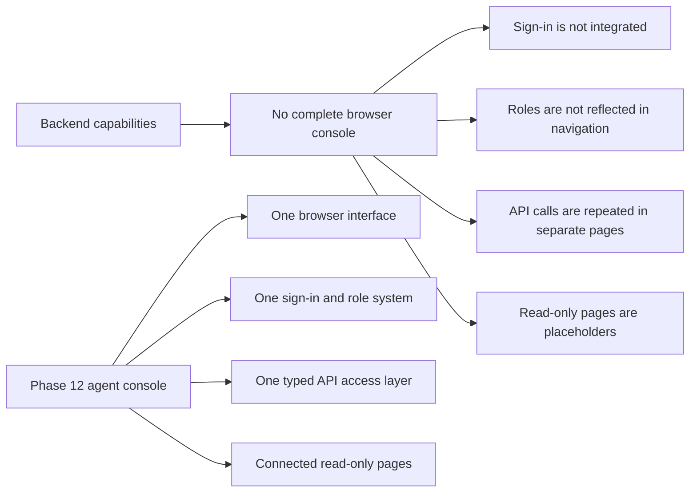

---

## The main idea: one consistent console

Phase 12 is built as a Next.js browser application using the App Router.

The frontend follows a simple separation:

| Component               | Responsibility                              | Does not do                               |
| ----------------------- | ------------------------------------------- | ----------------------------------------- |
| App shell               | Overall layout and navigation               | Decide support policy                     |
| Authentication provider | Restore and manage the signed-in user       | Perform backend authorization alone       |
| Typed API client        | Send structured requests to FastAPI         | Become a source of truth for security     |
| Read-only pages         | Display server information                  | Approve, reject, reply, or change records |
| Shared UI components    | Loading, errors, labels, status, formatting | Implement business rules                  |

The backend still makes the final authorization decision. Frontend role rules improve the user experience but do not replace backend protection.

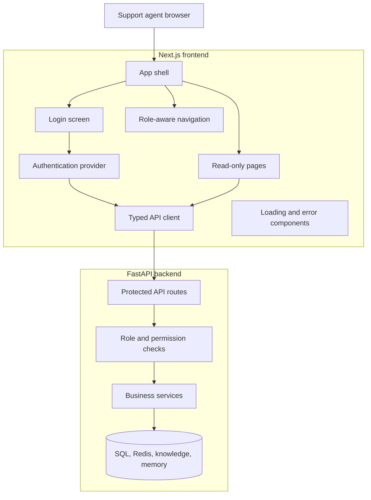

The frontend is not the security boundary. It is a clear, role-aware presentation of actions and information the backend permits.

---

## P12-1 — Next.js app shell and navigation

P12-1 creates the physical structure of the console.

The application uses Next.js 15 App Router and TypeScript. Tailwind CSS provides the visual layout, and the interface uses hand-written components rather than a third-party UI library.

The app shell is the common frame around every page:

- left-side desktop navigation;
- CloudDesk branding;
- top header;
- signed-in user area;
- sign-out control;
- main content region.

On a small screen, the desktop sidebar disappears and the main page remains usable.

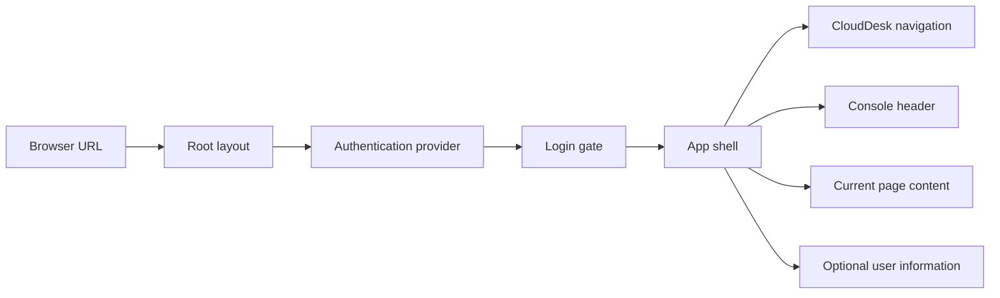

### One navigation definition

The navigation is declared once in `components/layout/nav.ts`.

The main navigation destinations are:

- Dashboard;
- Tickets;
- Customers;
- Knowledge;
- Escalations;
- Agents;
- Audit;
- Settings;
- API Health.

A future page should add its route to this one location instead of creating a separate menu in every component.

```mermaid
flowchart TD
    NavFile[components/layout/nav.ts] --> Dashboard[/dashboard]
    NavFile --> Tickets[/tickets]
    NavFile --> Customers[/customers]
    NavFile --> Knowledge[/knowledge]
    NavFile --> Escalations[/escalations]
    NavFile --> Agents[/agents]
    NavFile --> Audit[/audit]
    NavFile --> Settings[/settings]
    NavFile --> Health[/api/health]
```

P12-1 also creates placeholder routes for the planned console pages. These placeholders give the application a complete visual route structure without pretending that full feature work is already complete.

**P12-1 result:** CloudDesk now has a reusable Next.js shell and a common navigation structure.

---

## P12-2 — Typed API client

P12-2 creates the communication bridge from the browser to FastAPI.

Before this step, pages could individually call `fetch()`, define data shapes differently, and handle errors inconsistently. Phase 12 introduces one typed client in `frontend/lib/api.ts`.

The typed client means the frontend says:

- this response is a ticket;
- this response is a customer;
- this response is a knowledge article;
- this response is a workflow event;
- this response is an approval or escalation.

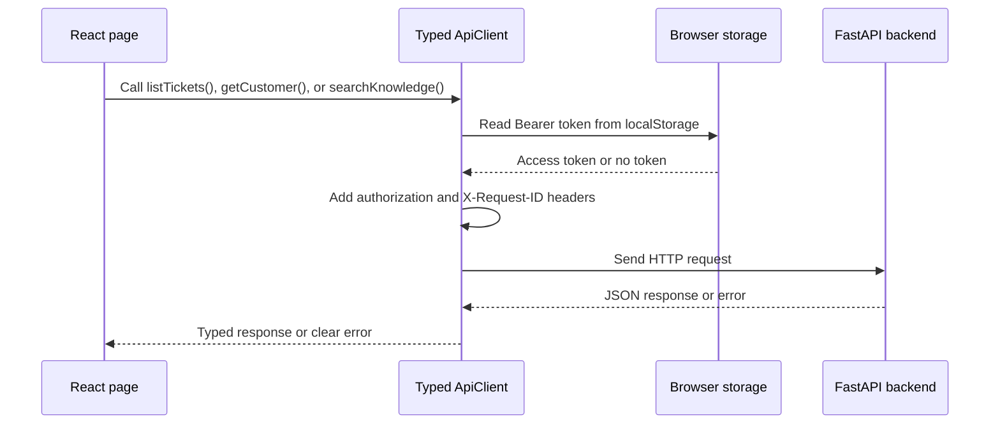

### What the API client manages

The client currently provides methods for:

- authentication and current-profile lookup;
- health checks;
- tickets;
- workflow status and events;
- customer profiles and histories;
- knowledge articles and search;
- approvals;
- escalations.

It is important that every backend call goes through this client instead of bypassing it with page-specific `fetch()` calls.

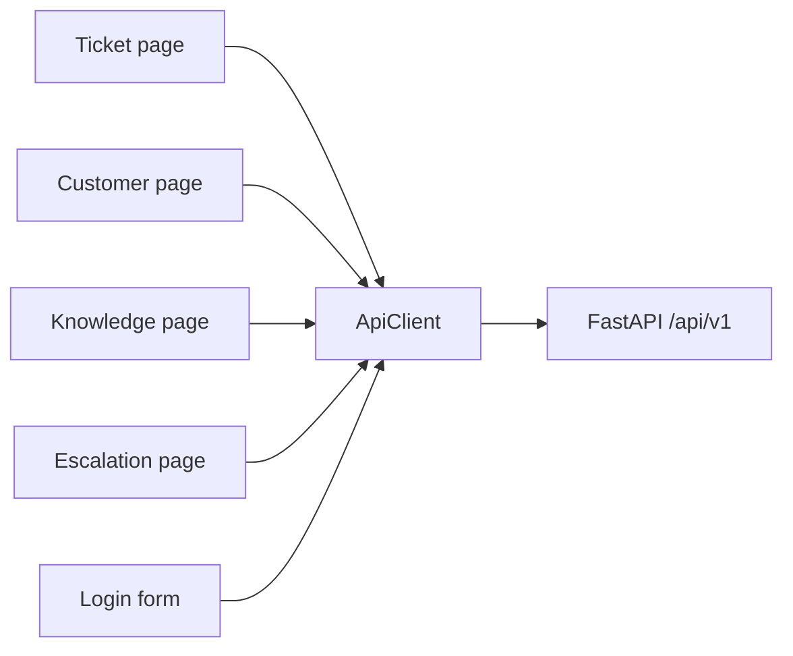

### Request IDs

Every request receives an `X-Request-ID`.

This identifier helps connect:

- a browser request;
- backend logs;
- audit activity;
- support troubleshooting;
- request failures.

If the browser supports UUID generation, the client creates a UUID. Otherwise it creates a fallback request identifier.

### Bearer authentication

After demo sign-in, the access token is stored in browser local storage.

The API client reads the token and adds:

```text
Authorization: Bearer <token>
```

to protected requests.

The browser does not receive or store a backend service-role key. It receives only the normal user access token.

### 401 handling

When the backend responds with HTTP 401:

1. the frontend removes the stored token;
2. the user is redirected to `/login?reason=expired`;
3. an expired-session message can explain what happened.

This prevents the console from continuing to look authenticated after a session is no longer valid.

### Error handling

The API client distinguishes between two broad problems:

| Error          | Meaning                                                                   |
| -------------- | ------------------------------------------------------------------------- |
| `NetworkError` | The backend cannot be reached                                             |
| `ApiError`     | The backend received the request but returned an HTTP or validation error |

`ApiError` includes:

- an HTTP status;
- a readable detail message;
- the original response detail.

This makes later pages able to show meaningful messages instead of raw technical responses.

**P12-2 result:** frontend-backend communication now follows one typed, observable, authenticated pattern.

---

## P12-3 — Login and role-aware layout

P12-3 adds session behavior and role awareness.

The login page offers the three demo accounts:

- administrator;
- support agent;
- read-only viewer.

A demo user chooses an account, the frontend calls `/api/v1/auth/demo-token`, and the backend creates a short-lived user token.

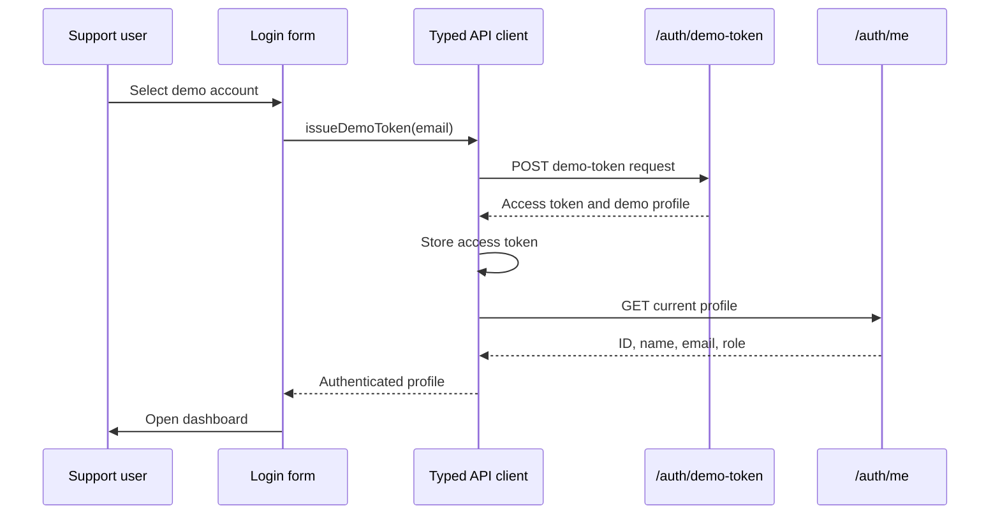

### Session restoration

The authentication provider checks browser storage when the application opens.

If a token exists:

1. it calls `/api/v1/auth/me`;
2. it obtains the user profile;
3. it marks the user authenticated;
4. it enables the role-aware console.

If no token exists or the profile cannot be read:

1. the token is removed if necessary;
2. the user is sent to `/login`;
3. protected pages do not remain visible.

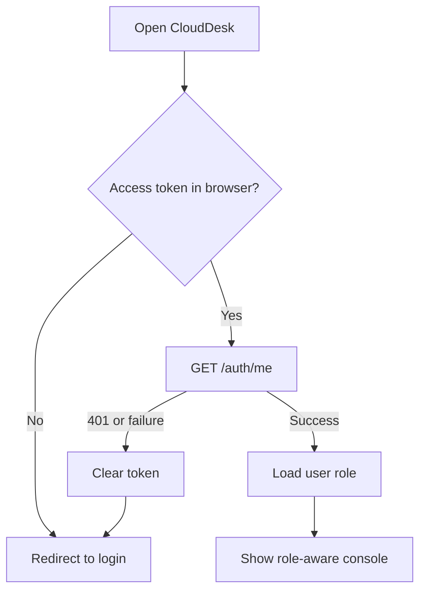

### Login gate

The `LoginGate` component decides whether the page should be shown.

It is a screen-level route guard:

- login page: can be shown when signed out;
- protected pages: only after the profile loads;
- loading state: shown while restoring a session;
- expired session: redirected to login.

The login gate is not the final security check. The backend still protects every API route with role requirements.

### Role hierarchy

CloudDesk defines three roles:

| Role   | Level | Intended console access                                             |
| ------ | ----: | ------------------------------------------------------------------- |
| Viewer |     1 | Read tickets, customers, knowledge, and permitted audit information |
| Agent  |     2 | Viewer access plus workflow and customer-support actions            |
| Admin  |     3 | Agent access plus settings and administrator operations             |

The frontend implements:

```text
viewer < agent < admin
```

This means:

- an agent is allowed to act;
- a viewer is not allowed to act;
- an admin is allowed to act and configure admin features.

### Role-aware navigation

The navigation does not show every item to every person.

Current layout rules are:

- viewer: receives read-oriented navigation;
- agent: receives viewer navigation plus agent/audit areas;
- admin: receives agent areas plus Settings;
- settings: visible only to admins;
- audit: visible to agents and admins, not viewers.

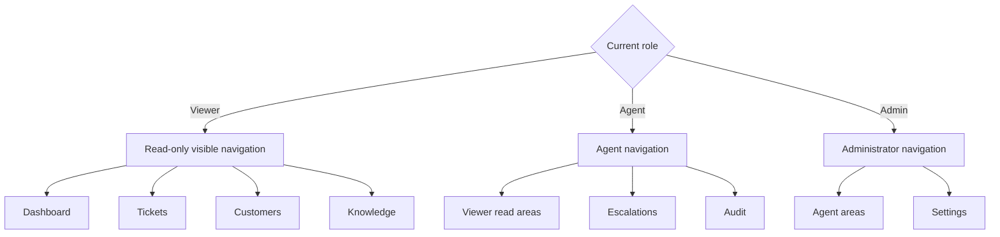

The app shell displays the current user name and role. It also provides sign-out.

**P12-3 result:** the console knows who is signed in and hides navigation the current role should not receive.

---

## P12-4 — Read-only list pages

P12-4 replaces the placeholder pages with real read-side views.

It does not yet implement the detailed ticket action screen. It provides the information pages needed before that screen is added.

### Dashboard

The dashboard loads:

- tickets;
- customers;
- open escalations.

It summarizes their counts and gives links to the relevant sections.

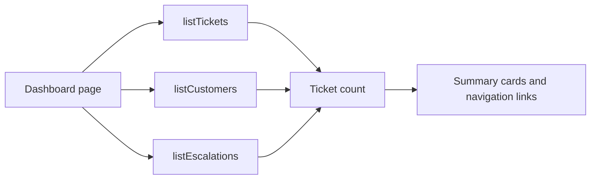

The dashboard refreshes periodically, so its values are refreshed instead of remaining permanently fixed after one load.

### Ticket list

The ticket list displays:

- ticket number;
- subject;
- category;
- severity;
- status;
- latest update time;
- link to ticket detail.

```mermaid
flowchart LR
    TicketPage[Tickets page] --> API[listTickets]
    API --> Table[Ticket table]
    Table --> Number[Ticket number and subject]
    Table --> Category[Category]
    Table --> Severity[Severity pill]
    Table --> Status[Status pill]
    Table --> Updated[Update time]
    Number --> Detail[/tickets/:id]
```

The ticket list is read-only. It does not offer run, reply, approve, or escalation buttons in this phase.

### Customer list

The customer list displays:

- customer name;
- email;
- company;
- plan;
- link to customer detail.

```mermaid
flowchart LR
    CustomerPage[Customers page] --> API[listCustomers]
    API --> Cards[Customer cards]
    Cards --> Profile[Name and email]
    Cards --> Company[Company]
    Cards --> Plan[Plan]
    Cards --> Detail[/customers/:id]
```

### Customer detail

The customer detail page combines safe customer context:

- subscriptions;
- workspaces;
- customer memory notes;
- ticket history.

```mermaid
flowchart LR
    Detail[Customer detail page] --> Profile[getCustomer]
    Detail --> History[getCustomerTickets]

    Profile --> Subscriptions[Subscriptions]
    Profile --> Workspaces[Workspaces]
    Profile --> Memory[Safe memory notes]
    History --> Tickets[Ticket history]

    Tickets --> TicketScreen[/tickets/:id]
```

Memory shown on this page is treated as safe customer context. It is read-side information, not a free-form secret store.

### Knowledge list and detail

The knowledge list displays approved articles with:

- category;
- title;
- slug;
- summary;
- detail link.

The article detail page displays the article title, category, tags, summary, and content.

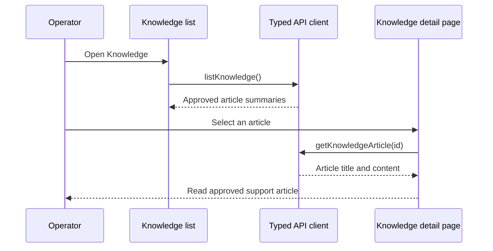

### Escalation list

The escalation page displays named specialist teams and open policy-routed cases.

For each escalation, the page shows:

- team;
- reason;
- status;
- created date;
- link to the related ticket.

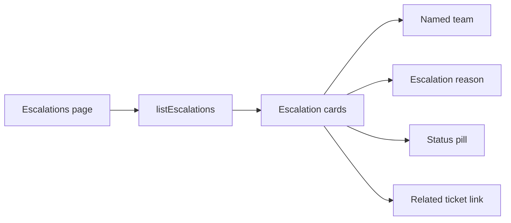

### Ticket detail read-side view

P12-4 also adds a read-only ticket detail page.

It currently combines:

- ticket number and subject;
- status and severity;
- customer summary;
- classification;
- channel and workspace;
- messages;
- workflow status;
- workflow events.

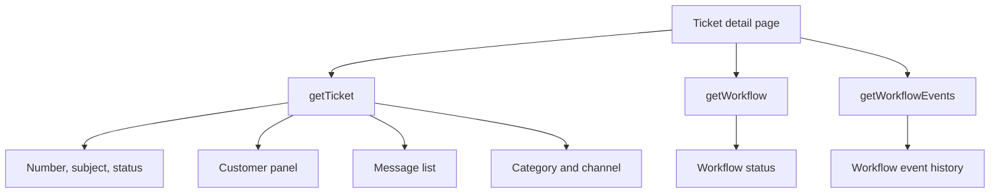

The workflow event view shows operational events but not hidden prompts or chain-of-thought.

This page is not yet the final three-column ticket console planned in Phase 13. It does not expose approve, reject, reply, or escalate controls.

**P12-4 result:** the console has useful read-only views for the main support objects.

---

## Shared read-page behavior

All read-only pages share one style of behavior.

### Loading state

While an API request is running, the page displays a clear loading message instead of a blank screen.

### Empty state

If the request succeeds but there are no records, the page explains that no records are available.

### Network error state

If the API cannot be reached, the page displays a retry banner.

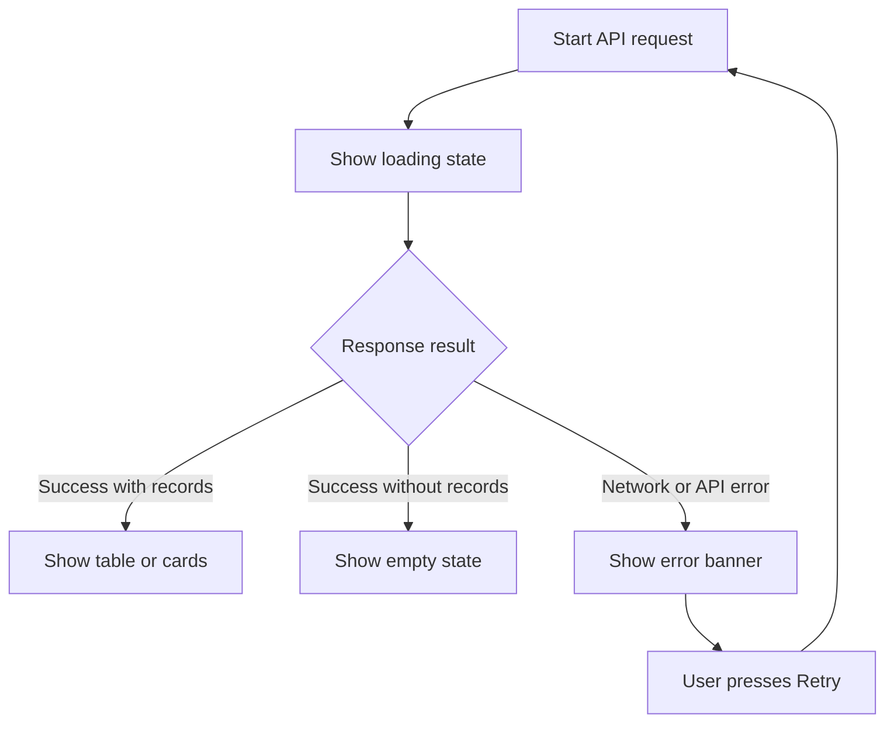

### Status pills

Status values are shown consistently:

- resolved or completed: green;
- waiting or pending: amber;
- escalated or rejected: red;
- ordinary status: neutral.

### Date formatting

Dates are converted into a readable browser format.

If a date is missing or invalid, the interface displays `—` rather than an unclear internal timestamp.

### Labels

Technical values such as `waiting_on_approval` or `login_issue` are converted into more readable text such as:

```text
Waiting On Approval
Login Issue
```

This is presentation formatting only. The backend value remains unchanged.

### Polling

Some pages refresh automatically:

- dashboard every 10 seconds;
- ticket/customer/escalation lists every 10 seconds;
- ticket detail every 2 seconds;
- knowledge every 30 seconds.

Polling keeps the console more current without requiring the user to reload the browser.

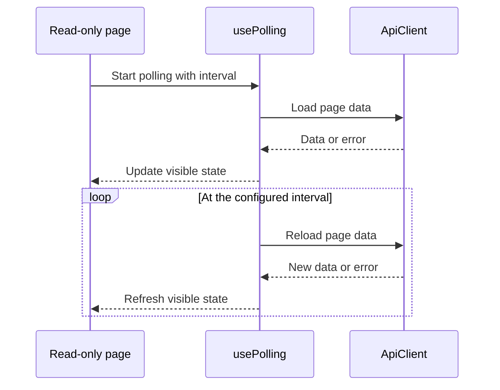

The polling mechanism can stop when the page is removed from view, preventing unnecessary requests.

---

## Role restrictions in read-only pages

Phase 12 also introduces role awareness at the layout level.

The frontend prevents a viewer from seeing navigation areas such as Settings or restricted audit information. It also prevents agent-style controls from being presented in the read-only pages.

However, the final security decision remains in FastAPI.

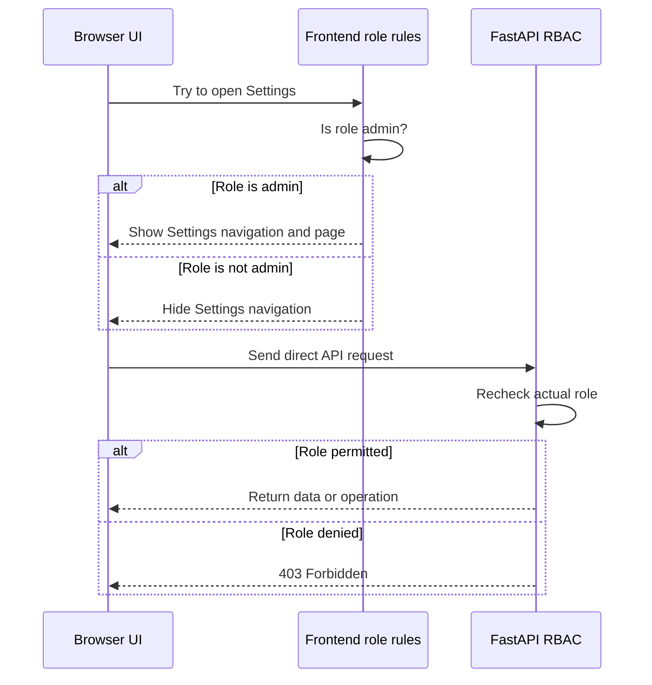

This is a defense-in-depth design:

- frontend hides screens for a better experience;
- backend rejects unauthorized requests;
- neither role display nor hidden navigation is treated as a security boundary by itself.

---

## What Phase 12 does not include

Phase 12 is complete as a console shell and read-side interface. It does not yet include every final support action.

It does not include:

- the final three-column ticket workflow screen;
- running an AI workflow from the UI;
- approving or rejecting a consequential action;
- sending a customer reply;
- requesting more information;
- escalating a ticket from the ticket screen;
- the complete workflow step panel;
- a complete ticket action composer.

Those capabilities are part of Phase 13.

This distinction is important in an interview:

> Phase 12 provides the application shell, login, role-aware navigation, typed API access, and read-only operational pages. Phase 13 will join those read pages to the workflow action controls.

---

## Testing and validation

The frontend is validated with three types of checks:

| Check                    | What it proves                                                                            |
| ------------------------ | ----------------------------------------------------------------------------------------- |
| Vitest unit tests        | App shell, navigation, auth hierarchy, API client behavior, and read-page components work |
| ESLint                   | Frontend code follows configured quality rules                                            |
| Next.js production build | Pages compile and can be generated or rendered successfully                               |

The tests also cover:

- role hierarchy;
- role visibility rules;
- navigation route definitions;
- bearer-token storage;
- request IDs;
- filter query strings;
- API errors;
- network errors;
- approval request bodies;
- status-pill and formatting behavior;
- loading and empty states.

The current frontend is locally implemented and can be built successfully. Real backend and browser sign-in sessions still depend on the FastAPI service running.

---

## End-to-end example

Imagine a support agent signs in to CloudDesk.

### 1. The login page opens

The agent chooses `sam.agent@clouddesk.demo`.

### 2. The frontend requests a token

The typed API client sends the selected account to the backend demo authentication route.

### 3. The backend confirms the role

The profile says the user is an agent.

### 4. The console opens

The app shell shows navigation and the agent's name.

The agent can see:

- Dashboard;
- Tickets;
- Customers;
- Knowledge;
- Escalations;
- Agents;
- Audit.

The agent may not see administrator-only Settings navigation.

### 5. The agent opens Tickets

The tickets page requests the ticket list through the typed API client.

The table shows the ticket number, subject, category, severity, status, and update time.

### 6. The agent opens a ticket

The ticket detail page loads:

- ticket messages;
- customer summary;
- classification;
- workflow status;
- workflow events.

### 7. The page refreshes

The workflow status and event area refresh every two seconds.

### 8. The agent can only read in this phase

No consequential action button is shown until the final ticket workflow screen is implemented.

This is the complete current Phase 12 journey: sign in, receive role-aware navigation, call typed backend methods, and inspect read-only support information.

---

## Honest Phase 12 status

| Area                                        | Status                            |
| ------------------------------------------- | --------------------------------- |
| Next.js app shell                           | Implemented                       |
| Navigation declared once                    | Implemented                       |
| Typed API client                            | Implemented                       |
| Authentication session provider             | Implemented                       |
| Demo login                                  | Implemented                       |
| Login gate                                  | Implemented                       |
| Role-aware navigation                       | Implemented                       |
| Dashboard read page                         | Implemented                       |
| Ticket list                                 | Implemented                       |
| Customer list                               | Implemented                       |
| Customer detail                             | Implemented                       |
| Knowledge list and detail                   | Implemented                       |
| Escalation list                             | Implemented                       |
| Ticket detail read view                     | Implemented                       |
| Shared loading/error/empty/polling behavior | Implemented                       |
| Frontend unit tests                         | Implemented                       |
| Final ticket action screen                  | Not complete; belongs to Phase 13 |
| Real cloud deployment                       | Not claimed in this phase         |

Phase 12 should therefore be described as **complete for the console shell and read-only pages**, not as complete for every workflow action.

---

## Interview summary

### 30-second summary

> “Phase 12 turns the CloudDesk backend into a browser console. It adds a Next.js app shell, one typed API client, demo login and session restoration, a role-aware layout, and read-only dashboard, ticket, customer, knowledge, escalation, and ticket-detail pages. It also provides consistent loading, empty, network-error, formatting, and polling behavior. The frontend role rules are only a user-experience layer; FastAPI still performs the real authorization. Phase 12 is complete for the shell and read pages, while the final workflow action screen belongs to Phase 13.”

### 60-second summary

> “Before Phase 12, CloudDesk had backend services but no complete support-agent console. We created a Next.js 15 App Router frontend with a common layout and one navigation definition. A typed `ApiClient` is the only frontend access layer to FastAPI. It stores the bearer token, sends a request ID, handles 401 sessions, and separates network errors from API errors. The authentication provider restores demo sessions and exposes whether the user is a viewer, agent, or admin. The login gate and app shell use that role to show the correct navigation. P12-4 adds read-only dashboard, ticket, customer, knowledge, escalation, and detail pages. These pages share polling, status formatting, loading, empty, and retry behavior. The backend remains the security authority, and read-only frontend pages do not execute agent actions. Phase 12 is complete for the console shell and read-only information; the approve, reject, reply, escalation, and workflow-action interface is the next phase.”
